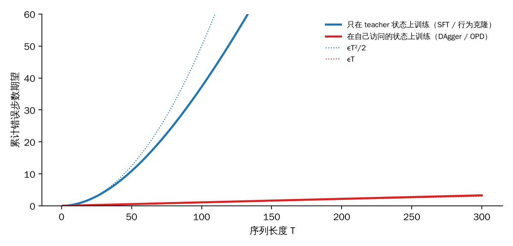
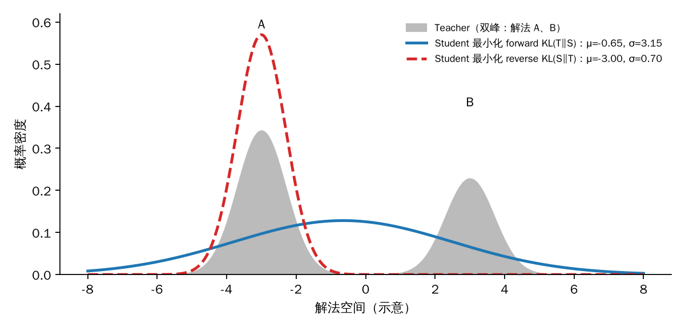

## 0. 这一篇讲什么

On-Policy Distillation（OPD，在线策略蒸馏）是 2025 到 2026 年后训练里最热的话题之一。Qwen3 用它训练全部小模型，Thinking Machines 写了一篇专门的技术博客，之后又出现了大量改进工作。但"OPD"这个名字下面混着几种不同的东西：有的工作说的是"让学生自己采样"，有的说的是"用 reverse KL"，有的说的是"把 teacher 的 log-prob 当奖励跑 RL"。这三件事相关，但不是同一件事。

这个系列按问题来组织：

| 篇目 | 内容 |
|---|---|
| 第 1 篇（本篇） | 定位与理论起源：OPD 和 SFT、RL 的关系；exposure bias 与 DAgger；forward / reverse KL；RL 与蒸馏的统一 |
| 第 2 篇 | 奠基方法：ImitKD、GKD、MiniLLM、DistiLLM 等，散度方向和梯度估计上的分歧 |
| 第 3 篇 | 工业配方：Gemma 2、Qwen3 的两段式蒸馏、Thinking Machines 的做法、多教师 OPD |
| 第 4 篇起 | 2026 年的工作，按它们共同解决的问题分组：为什么有效与何时失效、超越 teacher、长序列与 teacher 选择、黑盒 teacher、降本、OPSD 自蒸馏分支 |

本篇只讲基础，目标是把后面所有论文都要用到的概念一次讲清楚：

1. OPD 的精确定义，以及它在"轨迹由谁产生 × 监督有多稠密"这张表里的位置。
2. 为什么"在自己的轨迹上学"重要：exposure bias、复合误差，以及 DAgger 给出的理论界。
3. forward KL 和 reverse KL 在 token 级和序列级分别是什么，"mode-seeking"这个常见说法在什么条件下成立。
4. 带 KL 正则的 RL 本身就是一种 reverse KL 蒸馏，这是后面"OPD = 稠密奖励 RL"一类工作的出发点。

## 1. OPD 是什么

### 1.1 一个最小定义

设 student 是 $\pi_\theta$，teacher 是 $\pi_T$，提示词 $x$ 来自某个分布。最简单的 OPD 一步训练是：

1. **student 自己采样**：$y = (y_1, \dots, y_L) \sim \pi_\theta(\cdot \mid x)$。
2. **teacher 在 student 走过的每个位置打分**：把 $(x, y_{<t})$ 喂给 teacher 做一次前向，得到它在这个前缀下对下一个 token 的分布 $\pi_T(\cdot \mid x, y_{<t})$。注意 teacher 不生成，只做前向。
3. **逐 token 拉近两个分布**：最小化

$$
\mathcal{L}(\theta) = \mathbb{E}_{x}\,\mathbb{E}_{y \sim \pi_\theta(\cdot\mid x)} \left[ \sum_{t=1}^{L} D\big(\pi_\theta(\cdot \mid x, y_{<t}) ,\ \pi_T(\cdot \mid x, y_{<t})\big) \right]
$$

其中 $D$ 是某种逐 token 的分布距离，最常用的是 reverse KL $D_{\mathrm{KL}}(\pi_\theta \,\|\, \pi_T)$。

Joanna 笔记里的例子很直观：算 $12 \times 13$ 时 teacher 的解法是 $12\times10+12\times3$，student 自己写出了 $12\times12+12$。传统蒸馏只教 teacher 那条路；OPD 把 student 写出的 "$12\times12+12$" 当作前缀交给 teacher，问它"走到这里之后下一个 token 应该是什么"，再用 teacher 的回答监督 student。**学生决定去哪里，老师决定在那里该怎么做。**

### 1.2 两个轴：轨迹由谁产生，监督有多稠密

把后训练里几种常见方法放到同一张表里：

| 方法 | 训练用的轨迹（前缀）来自 | 监督信号 | 每条轨迹的信息量 |
|---|---|---|---|
| SFT / 序列级蒸馏（SeqKD） | 人工标注或 teacher 采样 | 目标 token（one-hot） | 每个 token 一个目标 |
| 词级蒸馏（word-level KD） | 人工标注或 teacher 采样 | teacher 的完整分布（soft label） | 每个 token 一个分布 |
| RL（RLHF / RLVR） | student 自己采样 | 整条回答一个标量奖励 | 每条回答一个数 |
| **OPD** | **student 自己采样** | **teacher 在每个位置的分布或 log-prob** | **每个 token 一个分布或一个数** |

这张表说明了 OPD 的两个来源：

- 它和 **RL 一样是 on-policy 的**：训练发生在 student 真正会访问的状态上，所以没有训练和推理之间的分布错位。
- 它和 **SFT / 蒸馏一样是稠密监督的**：不需要从一个最终奖励反推哪一步做对了，teacher 直接告诉每一步该怎么改。

Thinking Machines 的博客（Lu et al., 2025）用信息量来概括这个差别：RL 每个 episode 只教 $O(1)$ 比特，蒸馏每个 episode 教 $O(N)$ 比特，$N$ 是 token 数。

### 1.3 各自擅长什么

这个两轴视角直接说明了三种方法各管哪一段：

**SFT 负责冷启动和知识注入。** student 一开始可能连格式、领域知识、任务流程都不会。这时让它自己采样，大部分轨迹质量很差，teacher 的监督会花在非常初级的错误上。SFT 的数据分布也更容易控制：可以主动覆盖长尾、边界和安全样本，而 OPD 只能覆盖 student 自己会走到的状态。这也是 Qwen3 先做 off-policy 蒸馏、再做 on-policy 蒸馏的原因（第 3 篇详细讲）。

**OPD 负责把一个已有的强策略高效地迁移过来。** 前提是已经有一个 teacher，并且 student 已经"基本会做"。它修复的是分布错位和误差累积，而不是知识缺失：teacher 不能通过 logits 教会 student 一个它在预训练里完全没见过的事实。

**RL 负责发现。** 当没有比当前模型更好的 teacher、只能判断结果好坏时，只有 RL 能通过探索找到新的行为。代价是信号稀疏、需要大量采样。Joanna 的笔记把它概括为"RL 是搜索，OPD 是教学"，这个说法是准确的。

在实践里三者通常串联使用：先 SFT 到一个合理的起点，再用 OPD 从强 teacher 迁移能力，前沿模型自己则用 RL 去拓展能力边界（之后再作为别人的 teacher）。

## 2. 为什么要在自己的轨迹上学：exposure bias 与 DAgger

### 2.1 exposure bias

自回归模型在训练时使用 teacher forcing：每一步的输入前缀都来自标准答案。但推理时前缀来自模型自己。一旦某一步走偏，模型就进入了训练时从未见过的前缀，后面的预测没有被训练过，错误可能继续扩大。Bengio et al.（2015, Scheduled Sampling）系统讨论了这个训练–推理不一致，Ranzato et al.（2016, MIXER）在论文第 1 节给它起了后来通用的名字 **exposure bias**：模型训练时只暴露在训练数据的分布下，而推理时要面对自己的预测。

Scheduled Sampling 的做法是训练时以一定概率用模型自己的预测替换标准答案中的前缀。但它的监督目标仍然是原数据里的下一个 token：前缀已经偏离了，原来的"正确下一个 token"未必还是这个新前缀下的正确答案。这正是 DAgger 要解决的问题。

### 2.2 行为克隆的 $O(T^2)$ 与 DAgger 的 $O(T)$

模仿学习里有一个经典结果（Ross & Bagnell, 2010；Ross, Gordon & Bagnell, 2011）。设专家策略为 $\pi^*$，任务长度为 $T$，学到的策略在**专家访问的状态分布**上每步出错的概率是 $\epsilon$。

- **行为克隆**（Behavior Cloning，只在专家轨迹上做监督学习，对应 LLM 里的 SFT）：最坏情况下总代价比专家多 $O(T^2 \epsilon)$。原因是一旦第一次出错，学生进入了专家从未访问的状态，在那里的行为没有保证，后面每一步都可能继续出错；第一次出错的时间期望在 $1/\epsilon$ 量级，于是总错误是二次的。
- **DAgger**（Dataset Aggregation）：让学生按自己的策略执行，记录它实际访问的状态，请专家在这些状态上重新标注动作，把新数据并入训练集，反复迭代。作者证明（Ross et al. 2011, Thm 3.2）迭代 $\tilde O(uT)$ 轮后，序列中存在一个策略满足 $J(\hat\pi) \le J(\pi^*) + uT\epsilon_N + O(1)$，其中 $\epsilon_N$ 是学生在**自己的**状态分布上的模仿误差，$u$ 是"偏离专家一步"对后续代价的最大增量。对 0-1 模仿损失 $u \le 1$，这时误差从二次降到线性；但最坏情况下 $u$ 可以是 $O(T)$，此时界退化回二次。所以准确说法是：**当任务允许从错误中恢复（$u = O(1)$）时**，DAgger 把复合误差从 $O(T^2\epsilon)$ 降到 $O(T\epsilon)$。

DAgger 的关键是两件事同时成立：**状态来自学生自己**，**监督在这些新状态上重新向专家查询**。OPD 正是 DAgger 在 LLM 上的实现：student 产生前缀，teacher 在前缀上给出新的下一 token 分布。

下面用一个最小的数值例子看这两条曲线。任务是长度为 $T$ 的序列，每一步要么"在轨道上"要么"已偏离"。teacher 永远在轨道上，所以只在 teacher 数据上训练的学生从没见过偏离后的状态，偏离后就无法恢复；在自己的状态上训练的学生见过偏离状态，并从 teacher 那里学到了怎么回来。

```python
import numpy as np
# Toy "chain" task of length T. State = on-track / off-track.
# Teacher is always on track, so teacher-only data never contains an off-track state.
# Student trained on teacher data (BC / SFT) errs with prob eps on on-track states,
#   and on off-track states (never seen) it fails to recover: recover prob r_bc.
# Student trained on its own states (DAgger / OPD) also gets teacher labels on off-track
#   states, so it learns to recover: recover prob r_dag.
def expected_errors(T, eps, r):
    on, total = 1.0, 0.0                      # prob of being on-track at step t
    for _ in range(T):
        err = on*eps + (1-on)*(1-r)           # prob of a wrong action at this step
        total += err
        on = on*(1-eps) + (1-on)*r            # transition
    return total
eps = 0.01
print(" T    SFT/BC errors   DAgger/OPD errors   eps*T   eps*T^2")
for T in [10, 50, 100, 500, 1000]:
    bc  = expected_errors(T, eps, r=0.0)      # never recovers once off track
    dag = expected_errors(T, eps, r=0.9)      # learned recovery
    print(f"{T:4d}   {bc:10.2f}       {dag:10.2f}       {eps*T:6.1f}   {eps*T*T:7.0f}")
```

输出：

```
 T    SFT/BC errors   DAgger/OPD errors   eps*T   eps*T^2
  10         0.53             0.11          0.1         1
  50        10.90             0.55          0.5        25
 100        37.24             1.10          1.0       100
 500       401.65             5.49          5.0      2500
1000       901.00            10.99         10.0     10000
```

当 $\epsilon T$ 较小时，行为克隆的错误数接近 $\epsilon T^2/2$（$T=10$ 时 0.53 对 0.5，$T=50$ 时 10.9 对 12.5），之后被总步数 $T$ 封顶；学了恢复的策略始终约为 $\epsilon T$。



*图 1：只在 teacher 状态上训练（蓝）与在自己访问的状态上训练（红）时，累计错误步数随序列长度的变化，参数 $\epsilon = 0.01$。虚线是 $\epsilon T^2/2$ 与 $\epsilon T$。图为本文作者根据上面的代码绘制。*

这个例子也说明了 OPD 的收益在什么时候最大：**序列越长，收益越大**。这和工业界的经验一致，OPD 在长思维链推理上的收益最明显（第 3 篇）。但第 6 篇会讲到，序列很长时 teacher 自己在 student 前缀上的判断也会变差，这是 DAgger 理论没有考虑的地方：DAgger 假设专家在任何状态上都是可靠的，而 LLM teacher 在一个离自己分布很远的前缀上未必可靠。

## 3. 知识蒸馏的两种经典形式

### 3.1 词级蒸馏

Hinton, Vinyals & Dean（2015）提出用 teacher 的软分布（soft label）代替 one-hot 标签训练 student。放到自回归模型上，词级蒸馏（word-level KD）在每个位置最小化

$$
\mathcal{L}_{\text{word-KD}} = \mathbb{E}_{y \sim \mathcal{D}} \sum_t D_{\mathrm{KL}}\big(\pi_T(\cdot \mid y_{<t}) \,\|\, \pi_\theta(\cdot \mid y_{<t})\big)
$$

前缀 $y_{<t}$ 来自固定数据集。软标签比 one-hot 信息多：它告诉 student 哪些错误答案"比较接近"，哪些完全不可能。

### 3.2 序列级蒸馏

Kim & Rush（2016）指出，词级蒸馏只在每一步匹配分布，没有让 student 学到 teacher 在整条序列上的分布。他们提出序列级蒸馏（Sequence-Level KD, SeqKD）：用 teacher 的束搜索结果 $\hat y$ 代替原始标签，再在 $\hat y$ 上做普通的 SFT。这等价于用 teacher 分布的众数近似

$$
\min_\theta D_{\mathrm{KL}}\big(\pi_T(\cdot\mid x) \,\|\, \pi_\theta(\cdot \mid x)\big) \quad \text{（序列级 forward KL）}
$$

今天最常见的"用强模型生成数据再 SFT"（包括 DeepSeek-R1 把推理能力蒸馏到小模型的做法）都属于这一类：**前缀来自 teacher，监督是 teacher 的样本**。它是 off-policy 的，所以带着 2.2 节说的分布错位。

## 4. forward KL 与 reverse KL

### 4.1 定义

KL 散度不对称：

$$
D_{\mathrm{KL}}(P \,\|\, Q) = \mathbb{E}_{z \sim P}\left[\log \frac{P(z)}{Q(z)}\right] \neq D_{\mathrm{KL}}(Q \,\|\, P)
$$

在蒸馏里，

- **forward KL** 是 $D_{\mathrm{KL}}(\pi_T \,\|\, \pi_\theta)$，期望在 teacher 分布下计算。它问的是"teacher 会去的地方，student 有没有覆盖到"。student 在 teacher 高概率的地方给低概率，会被重罚。
- **reverse KL** 是 $D_{\mathrm{KL}}(\pi_\theta \,\|\, \pi_T)$，期望在 student 分布下计算。它问的是"student 想去的地方，teacher 认不认可"。student 在 teacher 几乎不给概率的地方放了概率，会被重罚；student 不去的地方则不贡献损失。

### 4.2 mode-covering 与 mode-seeking

当 student 的表达能力不够、无法完全复刻 teacher 时，两个方向的最优解不同。下面让一个单峰高斯 student 去拟合双峰 teacher（两个峰对应两种都正确的解法 A、B），用网格搜索分别最小化两种 KL：

```python
import numpy as np
x = np.linspace(-8, 8, 1601); dx = x[1]-x[0]
def gauss(mu, s): 
    p = np.exp(-0.5*((x-mu)/s)**2); return p/(p.sum()*dx)
# teacher: two modes (two good solutions A, B)
pT = 0.6*gauss(-3, 0.7) + 0.4*gauss(3, 0.7)
eps = 1e-300
def fkl(pS): return np.sum(pT*np.log((pT+eps)/(pS+eps)))*dx   # KL(T||S)
def rkl(pS): return np.sum(pS*np.log((pS+eps)/(pT+eps)))*dx   # KL(S||T)
best = {}
for name, f in [("forward KL(T||S)", fkl), ("reverse KL(S||T)", rkl)]:
    cands = [(f(gauss(m, s)), m, s) for m in np.arange(-5, 5.01, 0.05) for s in np.arange(0.3, 5.01, 0.05)]
    v, m, s = min(cands)
    pS = gauss(m, s)
    mid = pS[np.abs(x) < 1].sum()*dx          # mass the student puts between the modes
    print(f"{name:18s} -> mu={m:+.2f}, sigma={s:.2f}, loss={v:.3f}, mass in |x|<1: {mid:.3f}")
print("teacher mass in |x|<1:", round(pT[np.abs(x) < 1].sum()*dx, 4))
```

输出：

```
forward KL(T||S)   -> mu=-0.65, sigma=3.15, loss=0.778, mass in |x|<1: 0.246
reverse KL(S||T)   -> mu=-3.00, sigma=0.70, loss=0.511, mass in |x|<1: 0.002
teacher mass in |x|<1: 0.0021
```



*图 2：单峰 student 拟合双峰 teacher。forward KL（蓝实线）把两个峰都罩住，结果在两峰之间放了 24.6% 的概率，而 teacher 在那里只有 0.2%；reverse KL（红虚线）只锁定较大的峰 A，几乎完美地复刻了它，但完全放弃了 B。图为本文作者根据上面的代码绘制。*

这就是常说的 **forward KL 是 mode-covering（mass-covering），reverse KL 是 mode-seeking**。对生成任务来说，forward KL 的问题是会在"两种正确解法之间"生成 teacher 认为不合理的内容；reverse KL 的问题是会丢掉 teacher 的一部分多样性。MiniLLM（Gu et al., 2024）选择 reverse KL 的理由就是前者：小模型容量不足时，宁可只学好一种解法，也不要在 teacher 的低概率区域胡乱生成。

### 4.3 这个直觉的适用范围

"reverse KL = mode-seeking"是一个**容量受限**时的结论，在 LLM 蒸馏里要谨慎使用，有三个理由：

1. **容量充足时两者最优解相同。** 只要 student 能表示 teacher，两个方向的最小值都在 $\pi_\theta = \pi_T$ 处取到。
2. **token 级的词表分布不是双峰高斯。** Wu et al.（2025, *Rethinking Kullback-Leibler Divergence in Knowledge Distillation for Large Language Models*, COLING 2025）专门研究了 LLM 蒸馏里的这个问题。他们认为在 LLM 蒸馏中两者都没有表现出明显的 mode-seeking 或 mean-seeking，两者优化目标一致、训练足够久都会收敛；真正的差别在训练早期，reverse KL 先拟合分布的尾部，forward KL 先拟合头部。由于 LLM 很少训练到收敛，他们提出按头尾差距自适应组合两者（AKL）。
3. **序列级与 token 级不是一回事。** 一个 student 即使在每个 token 上都能精确匹配 teacher，序列级的多样性仍可能因为采样路径的差异而不同。真正的 mode collapse 更多出现在序列级（比如总是选同一种解题思路），这和 token 级散度的选择只是间接相关。

所以更准确的说法是：reverse KL **允许** student 忽略 teacher 的某些模式，forward KL **惩罚** student 忽略任何模式；在容量和训练步数有限时，这会表现为 mode-seeking 与 mode-covering 的倾向。

### 4.4 序列级 KL 的链式分解

自回归模型的序列概率是逐 token 条件概率的乘积，因此序列级 KL 可以精确分解成逐 token 的 KL。以 reverse KL 为例：

$$
D_{\mathrm{KL}}\big(\pi_\theta(\cdot\mid x) \,\|\, \pi_T(\cdot\mid x)\big)
= \mathbb{E}_{y \sim \pi_\theta}\left[\sum_t \log \frac{\pi_\theta(y_t \mid x, y_{<t})}{\pi_T(y_t \mid x, y_{<t})}\right]
= \sum_t \mathbb{E}_{y_{<t} \sim \pi_\theta}\Big[ D_{\mathrm{KL}}\big(\pi_\theta(\cdot\mid x, y_{<t}) \,\|\, \pi_T(\cdot \mid x, y_{<t})\big) \Big]
$$

forward KL 同理，只是前缀改为从 teacher 采样：

$$
D_{\mathrm{KL}}\big(\pi_T(\cdot\mid x) \,\|\, \pi_\theta(\cdot\mid x)\big)
= \sum_t \mathbb{E}_{y_{<t} \sim \pi_T}\Big[ D_{\mathrm{KL}}\big(\pi_T(\cdot\mid x, y_{<t}) \,\|\, \pi_\theta(\cdot \mid x, y_{<t})\big) \Big]
$$

这两个式子说明了一件容易被混淆的事：

- **序列级 reverse KL 天然要求前缀来自 student**，所以它天然是 on-policy 的。
- **序列级 forward KL 天然要求前缀来自 teacher**，在 teacher 样本上做 SFT（或词级蒸馏）就是它的估计。

### 4.5 "on-policy"和"reverse KL"是两个独立的选择

Joanna 的笔记里写道："OPD 必须用 reverse KL 的硬原因是采样约束"。这句话在一个条件下成立，在另一个条件下不成立，需要拆开说。

一个 OPD 方法其实要做两个选择：

- **前缀从哪里来**：teacher（off-policy）、student（on-policy），或者两者混合。
- **每个前缀上用什么散度**：forward KL、reverse KL、JSD 或者别的。

如果 teacher 是白盒（能拿到完整的词表分布），那么在 student 前缀上计算**任何方向**的逐 token 散度都没有困难，因为每个位置的散度可以在整个词表上精确求和，不需要从哪个分布采样。GKD（Agarwal et al., 2024）正是这么做的：前缀来自 student，逐 token 的散度可以是 forward KL、reverse KL 或广义 JSD，并通过实验比较了不同组合。这时"前缀是 on-policy 的"和"散度用 reverse KL"完全独立。

采样约束只在另一种实现下才变成硬约束：**只用 student 采到的那一个 token 来估计散度**，不对整个词表求和。比如 Thinking Machines 的实现把每个位置的

$$
\hat{k}_t = \log \pi_\theta(y_t \mid x, y_{<t}) - \log \pi_T(y_t \mid x, y_{<t}), \qquad y_t \sim \pi_\theta
$$

当作单样本估计，它是 reverse KL 的无偏估计（就是 RL 系列第 1 篇里讲的 $k_1$ 估计量），但不可能用它估计 forward KL，因为 forward KL 的期望是在 teacher 分布下取的。这种实现的好处是 teacher 只需要返回采样 token 的 log-prob，不需要传整个词表的分布，通信和显存开销小得多。

所以更准确的说法是：**序列级 reverse KL 与 on-policy 采样天然配对；而在白盒 teacher 的逐 token 实现里，散度方向是一个可以独立选择的超参数。** 第 4 篇会讲到，2026 年有工作专门把这两个因素拆开做消融。

## 5. 梯度：要不要考虑"现在的选择会影响未来的前缀"

在 student 前缀上做逐 token 蒸馏时，还有一个更隐蔽的问题。损失的期望是在 $\pi_\theta$ 生成的前缀上取的，而前缀分布本身依赖 $\theta$。对序列级 reverse KL 求精确梯度，会得到两部分：

$$
\nabla_\theta D_{\mathrm{KL}}(\pi_\theta \,\|\, \pi_T)
= \mathbb{E}_{y\sim\pi_\theta} \left[ \sum_t \nabla_\theta \log \pi_\theta(y_t\mid y_{<t}) \cdot \sum_{t' \ge t} \log\frac{\pi_\theta(y_{t'}\mid y_{<t'})}{\pi_T(y_{t'}\mid y_{<t'})} \right]
$$

（这里用了 $\mathbb{E}[\nabla \log \pi_\theta] = 0$ 去掉常数项，并按因果性把过去的项去掉。）括号里第二个求和是"从 $t$ 开始到结尾的累计 KL"，形式上就是策略梯度里的 reward-to-go，奖励是 $-\log(\pi_\theta/\pi_T)$。它包含两种贡献：

- $t'=t$ 那一项：**当前这一步**的分布离 teacher 有多远。
- $t' > t$ 的项：**当前这一步的选择会把 student 带到什么样的后续前缀**，那里离 teacher 有多远。

很多实现只保留第一部分，相当于把前缀分布当作常数、不对采样过程求导，或者说 RL 里的折扣因子 $\gamma = 0$。GKD 明确采用了这种做法，原文写的是"we do not backpropagate through the student's sampling distribution"，并说明这样做训练更稳定、计算更省；MiniLLM 则保留了未来项，用策略梯度加若干降方差技巧去估计它；Thinking Machines 的博客使用折扣因子为 0 的版本，并在脚注里说他们没有发现折扣因子大于 0 在实践中有提升。

下面的数值实验检查两件事。第一，单步时，"把 $-\hat k_1$ 当优势、跑策略梯度"在期望上就是 reverse KL 的精确梯度。第二，两步序列上，$\gamma=0$ 的梯度和序列级 reverse KL 的精确梯度在第一步的 logits 上不同，在最后一步上相同。

```python
import numpy as np, itertools
rng = np.random.default_rng(0)
V = 3
def softmax(z): e = np.exp(z - z.max()); return e/e.sum()
# ---------- (1) one step: per-token reverse KL as an advantage ----------
z = rng.normal(size=V); pS = softmax(z); pT = softmax(rng.normal(size=V)*2)
kl = np.sum(pS*np.log(pS/pT))
J = np.diag(pS) - np.outer(pS, pS)                 # d softmax / dz
grad_exact = J @ (np.log(pS/pT) + 1)               # d KL(S||T) / dz
N = 200000
a = rng.choice(V, size=N, p=pS)
adv = np.log(pT[a]) - np.log(pS[a])                # reward = -(log pS - log pT), no grad
score = np.eye(V)[a] - pS                          # d log pS(a) / dz
grad_pg = -(adv[:, None]*score).mean(0)            # descent direction on KL
print("KL(S||T) =", round(kl, 4))
print("exact grad      :", np.round(grad_exact, 4))
print("PG w/ adv=-k1   :", np.round(grad_pg, 4))
print("single-sample k1 mean / std :", round(-adv.mean(), 4), "/", round(adv.std(), 4))
# ---------- (2) two steps: per-token (gamma=0) vs full sequence-level reverse KL ----------
z1 = rng.normal(size=V); Z2 = rng.normal(size=(V, V))       # student logits: step1, step2|y1
t1 = softmax(rng.normal(size=V)*2); T2 = np.array([softmax(rng.normal(size=V)*2) for _ in range(V)])
def seq_kl(z1, Z2):
    p1 = softmax(z1); tot = 0.0
    for y1, y2 in itertools.product(range(V), range(V)):
        p2 = softmax(Z2[y1]); ps = p1[y1]*p2[y2]; pt = t1[y1]*T2[y1, y2]
        tot += ps*np.log(ps/pt)
    return tot
def per_token_surrogate(z1, Z2, p1_fixed):
    # sum_t E_{prefix ~ S (held fixed)} KL(S(.|prefix) || T(.|prefix)) -- gamma = 0
    p1 = softmax(z1); s = np.sum(p1*np.log(p1/t1))
    for y1 in range(V):
        p2 = softmax(Z2[y1]); s += p1_fixed[y1]*np.sum(p2*np.log(p2/T2[y1]))
    return s
def num_grad(f, z, h=1e-6):
    g = np.zeros_like(z)
    for i in range(z.size):
        e = np.zeros_like(z); e.flat[i] = h; g.flat[i] = (f(z+e) - f(z-e))/(2*h)
    return g
p1 = softmax(z1)
g_full = num_grad(lambda u: seq_kl(u, Z2), z1)
g_tok  = num_grad(lambda u: per_token_surrogate(u, Z2, p1), z1)
print("\nstep-1 logits gradient")
print("full sequence KL   :", np.round(g_full, 4))
print("per-token, gamma=0 :", np.round(g_tok, 4))
g2f = num_grad(lambda u: seq_kl(z1, u), Z2); g2t = num_grad(lambda u: per_token_surrogate(z1, u, p1), Z2)
print("step-2 logits gradients identical:", np.allclose(g2f, g2t, atol=1e-6))
```

输出：

```
KL(S||T) = 0.0743
exact grad      : [-0.0668  0.1779 -0.1111]
PG w/ adv=-k1   : [-0.0673  0.1791 -0.1117]
single-sample k1 mean / std : 0.0762 / 0.4277

step-1 logits gradient
full sequence KL   : [ 0.7001  0.0045 -0.7046]
per-token, gamma=0 : [ 0.7524 -0.2697 -0.4827]
step-2 logits gradients identical: True
```

几点解读：

1. **单样本估计在期望上是对的，但方差很大。** 精确梯度和策略梯度估计吻合，但单个 token 的 $k_1$ 估计标准差（0.43）是它均值（0.076）的 5 倍以上。这就是为什么白盒实现通常在整个词表（或 top-k）上精确计算每个位置的散度，而只用采样 token 的实现需要更大的 batch。第 4 篇会讲 2026 年专门分析这个偏差–方差权衡的工作。
2. **$\gamma = 0$ 是有偏的，但偏在"未来"那一项。** 最后一步没有未来，两个梯度完全一致；第一步的梯度不同，因为 $\gamma = 0$ 忽略了"第一步选什么会影响第二步的前缀落在 teacher 认可还是不认可的地方"。
3. **两者的不动点相同。** 当 $\pi_\theta = \pi_T$ 时，每个位置的 KL 都是 0，两种梯度都为 0。所以 $\gamma=0$ 不会把 student 推向错误的目标，只是在远离最优点时走的方向不同。它的好处是方差小、实现简单，工业实现大多选它。

## 6. RL 与蒸馏的统一视角

### 6.1 KL 正则的 RL 就是 reverse KL 蒸馏

RL 系列第 1 篇推导过带 KL 正则的 RL 目标和它的闭式最优解：

$$
J(\pi) = \mathbb{E}_{y\sim\pi}[r(x,y)] - \beta\, D_{\mathrm{KL}}(\pi \,\|\, \pi_{\text{ref}}), \qquad
\pi^*(y\mid x) = \frac{1}{Z(x)}\, \pi_{\text{ref}}(y\mid x) \exp\!\left(\frac{r(x,y)}{\beta}\right)
$$

把 $\pi^*$ 代回去可以得到

$$
J(\pi) = -\beta\, D_{\mathrm{KL}}(\pi \,\|\, \pi^*) + \beta \log Z(x)
$$

$\log Z(x)$ 与 $\pi$ 无关。所以**最大化 KL 正则的 RL 目标，等价于用 reverse KL 把策略蒸馏到一个隐式的 teacher $\pi^*$**。这个 teacher 无法采样也无法直接计算（$Z$ 不可求），RL 只能通过采样和奖励间接地靠近它。

反过来，OPD 是把这个隐式 teacher 换成了一个显式的、可以逐 token 查询的 $\pi_T$。如果取

$$
r(x,y) = \log \pi_T(y\mid x) - \log \pi_{\text{ref}}(y\mid x), \qquad \beta = 1
$$

那么 $\pi^* \propto \pi_{\text{ref}} \cdot \pi_T/\pi_{\text{ref}} = \pi_T$，KL 正则的 RL 就**恰好**变成了以 $\pi_T$ 为 teacher 的序列级 reverse KL 蒸馏，而且这对任意的 $\pi_{\text{ref}}$ 都成立。并且这个奖励可以按 token 分解，是一个稠密奖励。

这个视角有两个直接推论，后面会分别展开：

- **OPD 可以直接复用 RL 的基础设施。** 采样、优势、裁剪、异步训练都可以照搬，只是把奖励换成 teacher 的 log-prob。Thinking Machines 的实现就是这么做的（第 3 篇）。
- **可以改变 $\beta$ 或者奖励的权重。** 取 $\beta < 1$（等价于把奖励乘以一个大于 1 的系数），目标分布变成 $\pi_{\text{ref}}^{1-\lambda}\pi_T^{\lambda}$，$\lambda > 1$ 时是在 $\pi_{\text{ref}}$ 指向 $\pi_T$ 的方向上外推，student 有可能超过 teacher。这就是第 5 篇要讲的 G-OPD / ExOPD 的出发点。

### 6.2 RLHF 与模仿学习的联系

另一条理论线是把 RLHF 本身看成模仿学习。Xiao et al.（*On a Connection Between Imitation Learning and RLHF*, ICLR 2025，方法名 DIL）论证：在偏好数据上训练 Bradley–Terry 奖励模型，相当于对 chosen 回答做 forward KL 意义下的模仿学习；随后用 KL 正则的 RL 优化这个奖励模型，相当于把这个模仿结果用 reverse KL 蒸馏进策略。DIL 直接最小化策略到 chosen 分布的 reverse KL，用密度比估计（Bregman 散度族，如 LSIF、UKL、BCE）实现，DPO 是它的一个特例。对理解 OPD 有用的是它的整体图景：**forward KL 负责从数据里学到"好"的分布，reverse KL 负责把它压进一个会自己采样的策略**，和"先 SFT、再 OPD"的工程流程恰好同构。

### 6.3 RL 为什么遗忘更少，OPD 呢

还有一个相关的经验事实。Shenfeld, Pari & Agrawal（2025, *RL's Razor*）比较了 SFT 和 RL 在学新任务时对旧能力的遗忘，发现遗忘程度可以用"新策略与原策略在新任务分布上的 KL"来预测，而 on-policy 的 RL 天然倾向于找到 KL 最小的解，所以遗忘更少。OPD 也是 on-policy 的，训练只在 student 自己会生成的分布上改动模型，因此有理由预期它比 SFT 更不容易破坏原有能力。Thinking Machines 的博客用 OPD 恢复个性化微调后丢失的指令跟随能力（第 3 篇），就是这个性质的一个应用。这一点目前主要是经验观察，还缺少直接针对 OPD 的系统研究。

## 7. 小结

| 概念 | 一句话 |
|---|---|
| OPD 的定义 | student 采样前缀，teacher 在每个前缀上给下一 token 的监督，逐 token 拉近 |
| 和 SFT 的区别 | 前缀来自 student 而不是 teacher，消除 exposure bias |
| 和 RL 的区别 | 监督是每个 token 的稠密信号，而不是一条回答一个标量 |
| 理论根 | DAgger：在学生自己的状态上重新向专家查询，复合误差从 $O(T^2\epsilon)$ 降到 $O(uT\epsilon)$，可恢复任务（$u=O(1)$）上是线性 |
| forward / reverse KL | 容量受限时分别倾向 mode-covering / mode-seeking；容量充足时最优解相同 |
| 采样与散度方向 | 序列级 reverse KL 天然 on-policy；白盒逐 token 实现里散度方向可以独立选 |
| 梯度 | 精确梯度含"未来前缀"项；工业实现多用 $\gamma=0$，方差小，不动点相同 |
| 与 RL 的统一 | KL 正则 RL = 向隐式 teacher $\pi^*$ 的 reverse KL 蒸馏；奖励取 $\log\pi_T - \log\pi_{\text{ref}}$、$\beta=1$ 时恰好是 OPD |

下一篇讲把这些想法变成具体算法的几篇奠基论文：ImitKD 第一次把 DAgger 用到自回归蒸馏上，GKD 把"on-policy"和"散度选择"拆成两个超参数系统比较，MiniLLM 坚持序列级 reverse KL 并处理了它的高方差，DistiLLM 则在效率和稳定性上做了改进。

## 参考文献

- Ross & Bagnell. *Efficient Reductions for Imitation Learning.* AISTATS 2010.
- Ross, Gordon & Bagnell. *A Reduction of Imitation Learning and Structured Prediction to No-Regret Online Learning.* AISTATS 2011. arXiv:1011.0686.（DAgger）
- Bengio et al. *Scheduled Sampling for Sequence Prediction with Recurrent Neural Networks.* NeurIPS 2015. arXiv:1506.03099.
- Ranzato et al. *Sequence Level Training with Recurrent Neural Networks.* ICLR 2016. arXiv:1511.06732.
- Hinton, Vinyals & Dean. *Distilling the Knowledge in a Neural Network.* 2015. arXiv:1503.02531.
- Kim & Rush. *Sequence-Level Knowledge Distillation.* EMNLP 2016. arXiv:1606.07947.
- Lin et al. *Autoregressive Knowledge Distillation through Imitation Learning.* EMNLP 2020. arXiv:2009.07253.
- Agarwal et al. *On-Policy Distillation of Language Models: Learning from Self-Generated Mistakes.* ICLR 2024. arXiv:2306.13649.（GKD）
- Gu et al. *MiniLLM: Knowledge Distillation of Large Language Models.* ICLR 2024. arXiv:2306.08543.
- Wen et al. *f-Divergence Minimization for Sequence-Level Knowledge Distillation.* ACL 2023. arXiv:2307.15190.
- Wu et al. *Rethinking Kullback-Leibler Divergence in Knowledge Distillation for Large Language Models.* COLING 2025. arXiv:2404.02657.
- Xiao et al. *On a Connection Between Imitation Learning and RLHF.* ICLR 2025. arXiv:2503.05079.（DIL）
- Shenfeld, Pari & Agrawal. *RL's Razor: Why Online Reinforcement Learning Forgets Less.* 2025.
- Lu et al. *On-Policy Distillation.* Thinking Machines Lab: Connectionism, Oct 2025.
- Qwen Team. *Qwen3 Technical Report.* 2025. arXiv:2505.09388.
