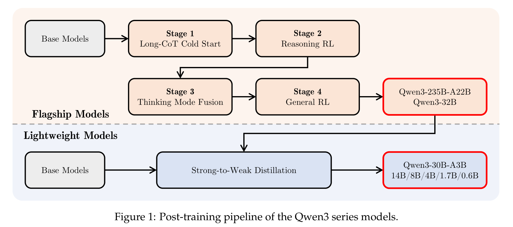
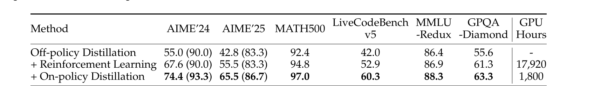
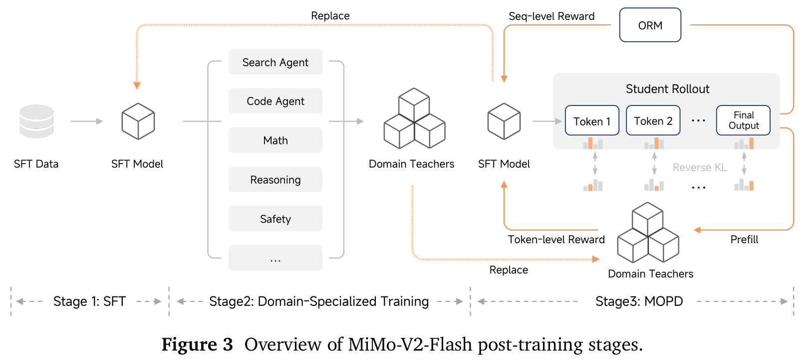
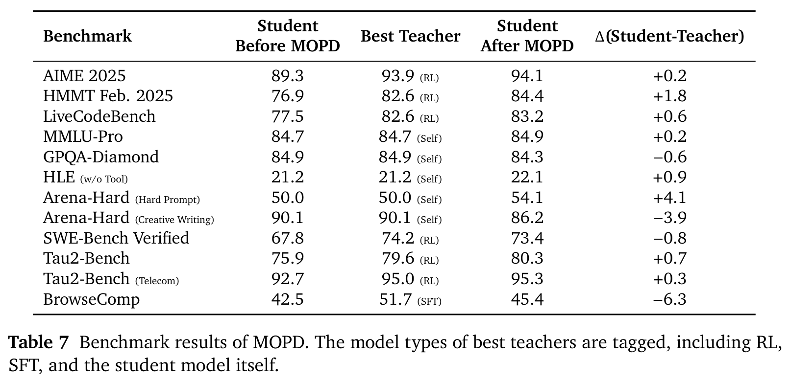

## 0. 这一篇讲什么

前两篇讲的方法都是在 T5、GPT-2、OPT 这一规模上验证的。2024 年起，OPD 进入了大模型的正式后训练流程。这一篇按时间讲几个有公开技术报告的例子，只写报告里明确说了的内容：

| 时间 | 来源 | OPD 在流程中的角色 |
|---|---|---|
| 2024.07 | Gemma 2 | 后训练中"在 student 的分布上做蒸馏" |
| 2025.05 | Qwen3 | 所有小模型的主要训练方式：先 off-policy、后 on-policy 蒸馏，和 RL 做了直接对比 |
| 2025.10 | Thinking Machines 博客 | 把 OPD 写成"奖励是逐 token reverse KL 的 RL"，系统讨论成本、LoRA、持续学习 |
| 2026.01 起 | MiMo-V2-Flash、GLM-5、DeepSeek-V4、Nemotron 3 Ultra | 多教师 OPD 成为把多个领域专家合并成一个模型的"整合层" |

最后一节讨论一个实际问题：什么时候 OPD 比 RL 划算，什么时候不划算。

## 1. Gemma 2：在 student 的分布上蒸馏

Gemma 2（Gemma Team, 2024）是最早在技术报告里明确使用这一做法的开源模型之一。它在两个阶段用了蒸馏：

- **预训练**：2B 和 9B 模型不用下一 token 预测，而是用一个更大的语言模型做知识蒸馏（逐 token 匹配 teacher 的分布），分别训练了 2T 和 8T token，报告称这是计算最优数量的 50 倍以上。27B 模型没有用蒸馏，从头训练了 13T token。
- **后训练**：报告第 4 节写道 "We also run distillation from the teacher on the student's distribution"，引用的正是 GKD（Agarwal et al.）和 MiniLLM（Gu et al.）。

报告没有给出后训练 on-policy 蒸馏的单独消融，也没有用"on-policy distillation"这个词（这个词只出现在被引用的 GKD 标题里）。它的意义主要在于：一个主流模型家族把"在学生分布上蒸馏"放进了正式流程。

## 2. Qwen3：OPD 与 RL 的直接对比

### 2.1 Strong-to-Weak Distillation

Qwen3（Qwen Team, 2025）的后训练分成两条路线。旗舰模型（Qwen3-235B-A22B、Qwen3-32B）走完整的四阶段流程：长思维链冷启动、推理 RL、思考模式融合、通用 RL。所有小模型（0.6B、1.7B、4B、8B、14B 和 30B-A3B）不走这个流程，而是从旗舰模型蒸馏。



*图 1：Qwen3 的后训练流程。上半部分是旗舰模型的四阶段训练，下半部分是轻量模型直接从旗舰模型做 Strong-to-Weak Distillation。图片来源：Qwen Team, "Qwen3 Technical Report", 2025, Figure 1。*

蒸馏分两段（报告 4.5 节）：

1. **Off-policy 蒸馏**：把 teacher 在 `/think` 和 `/no_think` 两种模式下生成的回答合在一起做回答蒸馏，让 student 学会基本的推理能力和两种模式的切换，"为下一阶段的 on-policy 训练打下基础"。
2. **On-policy 蒸馏**：student 自己在 `/think` 或 `/no_think` 模式下生成回答，然后"aligning its logits with those of a teacher model (Qwen3-32B or Qwen3-235B-A22B) to minimize the KL divergence"。

报告没有说明 KL 的方向。"对齐 logits"说明 teacher 提供的是完整的词表分布，而不是只有采样 token 的 log-prob。

这正是第 1 篇说的"SFT 负责把模型带到正确的区域，OPD 负责让模型在自己的分布上走稳"，以及第 2 篇 DistiLLM-2 讨论的"teacher 样本与 student 样本携带不同信息"在工业流程里的体现。

### 2.2 和 RL 的对比

报告最常被引用的是表 21。两个实验都从**同一个** off-policy 蒸馏后的 Qwen3-8B 检查点出发，只用数学和代码类问题，一个继续做 RL，一个做 on-policy 蒸馏：



*图 2：Qwen3-8B 上 RL 与 on-policy 蒸馏的对比，括号内是 pass@64。图片来源：Qwen Team, "Qwen3 Technical Report", 2025, Table 21。*

| | AIME'24 | AIME'25 | MATH500 | LiveCodeBench v5 | GPU 小时 |
|---|---|---|---|---|---|
| Off-policy 蒸馏（起点） | 55.0 (90.0) | 42.8 (83.3) | 92.4 | 42.0 | – |
| + RL | 67.6 (90.0) | 55.5 (83.3) | 94.8 | 52.9 | 17,920 |
| + On-policy 蒸馏 | **74.4 (93.3)** | **65.5 (86.7)** | **97.0** | **60.3** | **1,800** |

几点值得注意：

1. **效果和成本同时占优。** OPD 在所有指标上都超过 RL，GPU 小时约为 RL 的 1/10。
2. **pass@64 的差别。** RL 后 AIME 的 pass@64 和起点完全相同（90.0 和 83.3），OPD 则分别升到 93.3 和 86.7。报告的解释是"distillation from teacher logits enables the student model to expand its exploration space"，而 RL "does not lead to any improvement in pass@64 scores"。这和 RL 系列第 4 篇讨论的"RLVR 主要提高 pass@1、不扩大 pass@k 的上限"（Yue et al., 2025）一致：RL 只能在 student 已经会采到的解里重新分配概率，而 teacher 的分布可以把 student 原来几乎采不到的解法的概率抬上来。
3. **对比的前提。** 这个结论成立需要一个比 student 强得多的 teacher（这里是 32B 或 235B，而且 teacher 本身是用 RL 训练出来的）。它比较的是"有一个已经训好的强 teacher 时，怎么最快地把小模型训上去"，没有计算训练 teacher 的成本。如果没有这样的 teacher，这个对比就不存在。

报告在第 4 节开头还提到，相比让每个小模型都走一遍四阶段流程，蒸馏的 GPU 小时也只需要 1/10，并且 pass@1 和 pass@64 都更高。

## 3. Thinking Machines：把 OPD 写成 RL

### 3.1 实现方式

2025 年 10 月，Thinking Machines Lab 发表技术博客 *On-Policy Distillation*（Kevin Lu 等）。它没有提出新的目标函数，但把 OPD 的工程实现简化到了极致，并做了一系列很有参考价值的实验。这篇博客是 2026 年 OPD 研究热潮的主要起点之一。

实现方式就是第 1 篇第 6 节的统一视角：**把 OPD 当成一个 RL 问题，直接复用 RL 训练框架**。

- student 在提示词上采样完整回答。
- teacher 对 student 的每个 token 计算 log-prob（只需要采样 token 的 log-prob，不需要整个词表的分布）。
- 每个 token 的优势设为负的 reverse KL：$A_t = \log \pi_T(y_t \mid y_{<t}) - \log \pi_\theta(y_t \mid y_{<t})$。
- 折扣因子取 0："For simplicity, we use a discount factor of zero"，脚注说他们没有发现折扣因子大于 0 在实践中有提升。
- 然后用普通的策略梯度（重要性采样损失）更新。

用 RL 系列的语言说，这是一个**稠密奖励、没有 Critic、没有组内比较**的 RL。所有 RL 的基础设施（推理引擎采样、异步训练、重要性采样修正）都可以照搬，唯一的新组件是 teacher 的前向计算。博客也把 reverse KL 称为"unhackable"：reverse KL 低总是对应 teacher 认为高概率的行为，不像学习出来的奖励模型那样可以被钻空子。

开源实现在 tinker-cookbook 仓库的 `tinker_cookbook/recipes/distillation/` 下，包括单教师和多教师两个版本。

### 3.2 主要实验

博客的实验都基于 Qwen3 系列，以下数字取自博客原文。

**推理能力的蒸馏。** student 是 Qwen3-8B-Base，teacher 是 Qwen3-32B。先在 OpenThoughts3 的 40 万个提示上做 SFT，AIME'24 到约 60%。然后用 OPD 训练约 150 步（约 7.7 万个提示，每个采样 4 次），AIME'24 到约 70%。作为对比，他们把 SFT 的曲线外推到 200 万个提示才能达到相近水平；按这个外推计算，OPD 的成本低 9 到 30 倍（如果 SFT 数据已经现成，是 9 倍；把 teacher 采样 SFT 数据的成本算进来，约 30 倍）。注意这个 9 到 30 倍是**相对 SFT** 的，相对 RL 的约 10 倍数字是博客引用的 Qwen3 表 21。

**信息量的解释。** 博客对这个效率差距给出的解释是第 1 篇提到的比特论证："reinforcement learning only teaches O(1) bits per episode"，而"distillation teaches O(N) bits per episode, where N is the number of tokens"。

**持续学习与行为恢复。** 这是博客里最有新意的实验。他们想让 Qwen3-8B 学会一批内部文档的知识，做法是在文档上继续训练（mid-training），结果知识上去了，指令跟随能力（IF-eval）大幅下降。之后用**原来的 Qwen3-8B 作为 teacher**，在通用对话提示上做 OPD，把指令跟随能力找回来：

| 模型 | 内部知识问答 | IF-eval |
|---|---|---|
| Qwen3-8B | 18% | 85% |
| + mid-train（100% 文档） | 43% | 45% |
| + mid-train（70% 文档 / 30% 对话） | 36% | 79% |
| + mid-train（70/30）后再做 OPD | 41% | 83% |

OPD 几乎完全恢复了 IF-eval（83% 对原来的 85%），知识问答只从 36% 小幅变到 41%（没有被冲掉，反而略升）。这里的 teacher 比 student 在新知识上更弱，但在指令跟随上更强；OPD 只在 student 自己的分布上纠正"teacher 认为不对"的行为，所以能有选择地恢复能力。博客还报告了一个对照：在模型**自己**的样本上做 SFT 也会让 IF-eval 下降，而 OPD 不会。这和第 1 篇 6.3 节讲的 RL's Razor 一致：on-policy 的更新天然靠近原分布，遗忘更少。

**其他发现**（据博客的图注，均未给出精确数值，这里只做定性转述）：用 LoRA 做 OPD 时，LoRA 和全参数训练之间的差距比 SFT 时小；在一个用 RL 训出来的 teacher 上做自蒸馏，OPD 用大约 7 到 10 倍更少的梯度步数追上 teacher；甚至只用单个提示多轮训练也能蒸馏出 teacher 在 AIME'24 上的表现。最后一点说明 teacher 的稠密监督里携带的信息远多于"这道题的答案"。

## 4. 多教师 OPD：后训练的整合层

2026 年起，几份旗舰模型的技术报告不约而同地用 OPD 解决同一个问题：**分别训练出多个领域专家之后，怎么把它们合并成一个模型。** 以前的做法是参数合并、按顺序训练或者把专家的输出收集成 SFT 数据，各有能力互相干扰或遗忘的问题。多教师 OPD 的做法是：student 在每个领域的提示上自己采样，由该领域的专家当 teacher 打分。

### 4.1 MiMo-V2-Flash 的 MOPD

小米的 MiMo-V2-Flash（309B 总参数、15B 激活）是第一个详细公开这一做法的报告。



*图 3：MiMo-V2-Flash 的后训练三阶段。第 1 阶段 SFT；第 2 阶段从 SFT 模型出发，用独立的 RL 分别训练搜索、代码、数学、推理、安全等领域的 teacher；第 3 阶段 MOPD，student 自己采样，各领域 teacher 给出 token 级的 reverse KL 奖励，ORM 给出序列级奖励。图片来源：LLM-Core Xiaomi, "MiMo-V2-Flash Technical Report", 2026, Figure 3。*

报告 4.4 节给出了精确的形式。设 $\pi_\theta$ 是训练引擎里的 student，$\mu_\theta$ 是推理引擎里实际采样用的 student（两者因为数值精度不同会有差异），$\pi_{\text{domain}_x}$ 是提示 $x$ 所属领域的 teacher。代理损失是

$$
\mathcal{L}_{\text{MOPD}}(\theta) = -\mathbb{E}_{x\sim\mathcal{D},\, y\sim\mu_\theta(\cdot\mid x)}\left[\frac{1}{|y|}\sum_{t=1}^{|y|} w_t\, \hat A_{\text{MOPD},t}\, \log \pi_\theta(y_t\mid x, y_{<t})\right]
$$

其中 $w_t = \mathrm{sg}\big[\pi_\theta(y_t\mid\cdot)/\mu_\theta(y_t\mid\cdot)\big]$ 是训练–推理不一致的重要性权重，比值落在 $[\epsilon_{\text{low}}, \epsilon_{\text{high}}]$ 之外的 token 直接丢弃（RL 系列第 4 篇讲过这个问题）。默认的优势是 teacher 的 token 级信号加上 outcome reward 的优势：

$$
\hat A_{\text{MOPD},t} = \mathrm{sg}\left[\log\frac{\pi_{\text{domain}_x}(y_t\mid x,y_{<t})}{\pi_\theta(y_t\mid x,y_{<t})}\right] + \alpha\, \hat A_{\text{ORM}}
$$

$\hat A_{\text{ORM}}$ 可以是 GRPO 等方法算出的优势。这正是第 2 篇 GKD+RL 目标的工业版本。

teacher 可以是 RL 训出来的专家，也可以是 SFT 模型，甚至是 student 自己（对已经够好的领域，相当于用 OPD 防止它在训练其他领域时退化）。报告的表 7 列出了 MOPD 前后的对比：



*图 4：MOPD 前的 student、各领域最好的 teacher、MOPD 后的 student，以及 student 与 teacher 的差值。teacher 类型标注为 RL、SFT 或 Self（student 自己）。图片来源：LLM-Core Xiaomi, "MiMo-V2-Flash Technical Report", 2026, Table 7。*

读这张表要两面看：

- **多数领域达到或略超最好的 teacher**，如 AIME 2025（94.1 对 93.9）、HMMT（84.4 对 82.6）、LiveCodeBench（83.2 对 82.6）。超过的部分有可能来自 ORM 奖励项，也有可能来自多领域之间的正迁移，报告没有拆开分析。
- **也有明显没追上的**：BrowseComp 低于 teacher 6.3 分，创意写作低 3.9 分，SWE-Bench Verified 低 0.8 分。所以"student 超过所有 teacher"不是一个普遍结论，Joanna 笔记里只引用了 AIME 一行，需要补上这一点。

### 4.2 GLM-5：跨阶段蒸馏防遗忘

GLM-5（GLM-5 Team, 2026）把 OPD 用在另一个位置：后训练的**最后一个阶段**。报告 3.5 节称，在多个 SFT 和 RL 阶段之后，"we perform on-policy cross-stage distillation as the final stage"，目的是"swiftly recover the skills acquired in earlier SFT and RL stages"。teacher 是之前各阶段的最终检查点，提示来自这些阶段各自的 RL 数据；GRPO 损失里的优势被替换成 $\mathrm{sg}[\log(\pi_T/\pi_\theta)]$，组大小为 1，batch 大小 1024。

组大小为 1 这个细节说明：OPD 不需要 GRPO 那样同一提示采多个回答来做组内比较，因为每个 token 已经有了自己的信号。这对长序列任务能省下大量采样。

### 4.3 DeepSeek-V4：专家培养 + 统一整合

DeepSeek-V4 的技术报告把后训练描述为"a two-stage paradigm: the independent cultivation of domain-specific experts, followed by unified model consolidation via on-policy distillation"。数学、代码、Agent、指令跟随等领域的专家各自经过 SFT 和 GRPO 训练；之后"a single unified model is trained through on-policy distillation, wherein the unified model acts as the student learning to optimize the reverse KL loss with teacher models"。

报告目录里还有一节专门讲全词表 OPD 的 teacher 调度（"Efficient Teacher Scheduling for Full-Vocabulary OPD"）。我没能读到这一节的正文，teacher 的数量和具体调度方式这里不作陈述，等核实后在第 8 篇（降本）里补充。

这和 Joanna 笔记里的描述一致：OPD 在这里是整合层，各领域专家仍然由 SFT 和 GRPO 训练。

### 4.4 Nemotron 3 Ultra

NVIDIA 的 Nemotron 3 Ultra 报告同样使用多教师 OPD（MOPD），使用了"more than ten specialized teacher models"，目标是按领域加权的负 reverse KL，迭代两轮，每批 1024 个提示、每个提示采样一次，生成长度上限 192K token。报告给出的例子包括 Terminal Bench 2.0 从 RLVR 后的 44.5 提升到 54.0（对应 teacher 为 50.0），SWE-Bench Verified 从 65.8 到 71.7（teacher 为 72.5）。这里同样是有的指标超过 teacher、有的接近但没超过。

### 4.5 为什么多教师 OPD 适合做整合

把这几份报告放在一起，可以看出多教师 OPD 被选作整合层的几个原因：

1. **on-policy，所以遗忘少。** 每个领域的训练只在 student 自己会生成的分布上改动它，不像顺序 SFT 那样把模型拉向某个领域的数据分布（第 1 篇 6.3 节）。
2. **稠密信号，所以快。** 不需要为每个领域重新搭奖励和环境，teacher 的 log-prob 就是奖励；对 Agent 这种环境搭建很重的领域尤其省事，MiMo 报告也专门强调了这一点。
3. **模块化。** 某个领域的专家变强了，只需替换这个 teacher；MiMo 报告还提出 student 可以再进入专家 RL 阶段，训出更强的 teacher，形成迭代。
4. **和 RL 基础设施兼容。** 从 GLM-5、MiMo 的公式都可以看到，OPD 只是把 GRPO 的优势换掉或加一项。

## 5. 什么时候 OPD 比 RL 划算

下面的玩具实验把"OPD 更快，但以 teacher 为上限"放在一张表里。一条长度为 12 的"推理链"，每一步有 4 个选项，只有一个是对的；student 已经做过 SFT，每步有 0.55 的概率选对，所以整条链全对的概率只有 $0.55^{12} \approx 0.0008$。teacher 每一步给对的选项 0.97 的概率。RL 只在整条链全对时得到奖励 1；OPD 每一步的优势是 $\log\pi_T - \log\pi_\theta$。

```python
import numpy as np
# A toy "reasoning chain": L positions, V choices each; exactly one choice per position is correct.
# Student: independent softmax logits per position. Teacher: puts 0.97 on the correct choice.
L, V, B, lr = 12, 4, 16, 0.5
target = np.arange(L) % V
def softmax(z): e = np.exp(z - z.max(-1, keepdims=True)); return e/e.sum(-1, keepdims=True)
pT = np.full((L, V), 0.01); pT[np.arange(L), target] = 0.97
def init():                                   # an "SFT'd" student: 0.55 on the right choice
    p = np.full((L, V), 0.15); p[np.arange(L), target] = 0.55; return np.log(p)
def run(mode, steps=3000, seed=0, stop=0.5):
    rng = np.random.default_rng(seed); z = init()
    for step in range(steps):
        p = softmax(z)
        if np.prod(p[np.arange(L), target]) > stop: return step   # prob. that a sampled chain is fully correct
        ys = np.array([[rng.choice(V, p=p[t]) for t in range(L)] for _ in range(B)])
        g = np.zeros_like(z)
        if mode == "RL":                      # outcome reward: 1 if the whole chain is right
            r = (ys == target).all(1).astype(float); adv = r - r.mean()
            for b in range(B):
                for t in range(L): g[t] += adv[b]*(np.eye(V)[ys[b, t]] - p[t])
        else:                                 # OPD: per-token advantage = log pT - log pS (gamma = 0)
            for b in range(B):
                for t in range(L):
                    a = ys[b, t]; adv = np.log(pT[t, a]) - np.log(p[t, a])
                    g[t] += adv*(np.eye(V)[a] - p[t])
        z += lr*g/B
    return round(float(np.prod(softmax(z)[np.arange(L), target])), 3)
for mode in ["RL", "OPD"]:
    res = [run(mode, seed=s) for s in range(5)]
    print(f"{mode:3s}: steps to P(whole chain correct) > 0.5 over 5 seeds:", res)
print("initial P(whole chain correct) = %.4f, teacher = %.3f" % (0.55**L, 0.97**L))
for mode in ["RL", "OPD"]:
    print(f"{mode:3s}: P(whole chain correct) after 3000 steps:", run(mode, stop=2.0))
```

输出：

```
RL : steps to P(whole chain correct) > 0.5 over 5 seeds: [993, 1481, 927, 1193, 1354]
OPD: steps to P(whole chain correct) > 0.5 over 5 seeds: [23, 22, 24, 22, 22]
initial P(whole chain correct) = 0.0008, teacher = 0.694
RL : P(whole chain correct) after 3000 steps: 0.991
OPD: P(whole chain correct) after 3000 steps: 0.694
```

两个结论：

- **达到同一水平，OPD 快了约 50 倍。** RL 在前期几乎采不到全对的链，梯度信号极其稀疏；OPD 每一步都知道该往哪个选项移动。
- **OPD 停在 teacher 的水平。** 训练足够久后，OPD 收敛到 teacher 自己的全对概率 $0.97^{12} \approx 0.694$，而 RL 能继续提高到 0.991。reverse KL 的最优解就是 $\pi_\theta = \pi_T$，teacher 的错误也会被一起学走。

把这个玩具结果和上面的报告放在一起，可以得到一个判断框架：

| 情况 | 更合适的方法 | 理由 |
|---|---|---|
| 有明显更强的 teacher，student 已经过 SFT | OPD | 信号稠密，成本约为 RL 的 1/10（Qwen3），且可能提高 pass@k |
| 没有更强的 teacher，或者想超过 teacher | RL，或 OPD 之后接 RL | OPD 以 teacher 为上限 |
| 多个领域专家需要合并 | 多教师 OPD（可加 ORM 项） | 遗忘少、模块化、和 RL 框架兼容 |
| 后续训练冲掉了某些能力 | 以旧检查点为 teacher 做 OPD | 选择性恢复（Thinking Machines、GLM-5） |
| student 还不会基本格式和流程 | 先 SFT | 学生样本太差时 OPD 信号浪费在初级错误上（Qwen3 先 off-policy 的原因） |
| teacher 只有 API、拿不到 log-prob | 黑盒方法 | 见第 7 篇 |

最后一个值得强调的细节：这些工业流程里 **teacher 几乎都是 RL 训出来的**。OPD 并没有取代 RL，而是改变了 RL 的位置：RL 负责在前沿模型或领域专家上"发现"能力，OPD 负责把这些能力高效地复制和整合到其他模型上。如何让 OPD 本身也能超过 teacher，是第 5 篇的主题。

## 参考文献

- Gemma Team. *Gemma 2: Improving Open Language Models at a Practical Size.* 2024. arXiv:2408.00118.
- Qwen Team. *Qwen3 Technical Report.* 2025. arXiv:2505.09388.
- Lu et al. *On-Policy Distillation.* Thinking Machines Lab: Connectionism, Oct 2025.（技术博客）
- LLM-Core Xiaomi. *MiMo-V2-Flash Technical Report.* 2026. arXiv:2601.02780.
- GLM-5 Team. *GLM-5: from Vibe Coding to Agentic Engineering.* 2026. arXiv:2602.15763.
- DeepSeek-AI. *DeepSeek-V4: Towards Highly Efficient Million-Token Context Intelligence.* 2026. arXiv:2606.19348.
- NVIDIA. *Nemotron 3 Ultra* technical report. 2026. arXiv:2606.15007.
- Agarwal et al. *On-Policy Distillation of Language Models: Learning from Self-Generated Mistakes.* ICLR 2024.
- Gu et al. *MiniLLM: Knowledge Distillation of Large Language Models.* ICLR 2024.
- Yue et al. *Does Reinforcement Learning Really Incentivize Reasoning Capacity in LLMs Beyond the Base Model?* 2025.
- Shenfeld, Pari & Agrawal. *RL's Razor: Why Online Reinforcement Learning Forgets Less.* 2025. arXiv:2509.04259.
