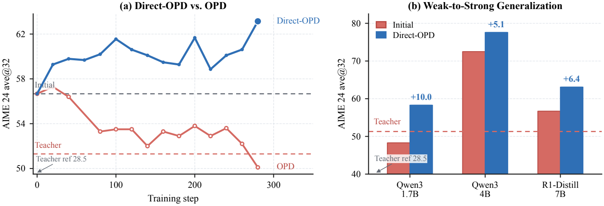

## 0. 这一篇讲什么

第 3 篇的玩具实验和第 1 篇的推导都说明：reverse KL 的最优解是 $\pi_\theta = \pi_T$，所以普通 OPD 的上限就是 teacher。第 4 篇又说明 teacher 必须带来"新东西"。这两点合起来引出了本篇的问题：

- 如果 teacher 已经比 student 强，能不能让 student 超过 teacher？
- 如果 teacher 比 student 弱，但它经过 RL 学到了 student 没有的东西，能不能只学这部分？

2026 年的回答有两条路线：

| 路线 | 代表工作 | 思路 |
|---|---|---|
| 改造 OPD 的隐式奖励 | G-OPD / ExOPD、Direct-OPD；Extrapolation Cliff、REOPD 作为边界 | 把 OPD 写成 RL，放大或提纯 teacher 提供的奖励 |
| 在 OPD 之外加信号 | KDRL、MiMo-V2-Flash 的 MOPD + ORM、MAD-OPD | 加 outcome reward，或者让 teacher 更强 |

## 1. G-OPD：OPD 是带隐式奖励的 KL 约束 RL

### 1.1 推导

G-OPD（Yang et al., *Learning beyond Teacher: Generalized On-Policy Distillation with Reward Extrapolation*, 2026）从第 1 篇第 6 节那个等式出发。对任意参考模型 $\pi_{\text{ref}}$，

$$
-D_{\mathrm{KL}}(\pi_\theta \,\|\, \pi^*) = \mathbb{E}_{y\sim\pi_\theta}\left[\log\frac{\pi^*(y\mid x)}{\pi_{\text{ref}}(y\mid x)}\right] - D_{\mathrm{KL}}(\pi_\theta \,\|\, \pi_{\text{ref}})
$$

其中 $\pi^*$ 是 teacher。所以标准 OPD 等价于 $\beta = 1$ 的 KL 约束 RL，奖励是逐 token 的隐式稠密奖励

$$
r_t^{\text{OPD}} = \log\frac{\pi^*(y_t\mid x, y_{<t})}{\pi_{\text{ref}}(y_t\mid x, y_{<t})}
$$

这个写法暴露出两个在普通 OPD 里被固定死的选择，G-OPD 把它们变成可调的旋钮：

$$
\max_\theta\ \mathbb{E}_{y\sim\pi_\theta}\left[\lambda \log\frac{\pi^*(y\mid x)}{\pi_{\text{ref}}(y\mid x)} - D_{\mathrm{KL}}(\pi_\theta \,\|\, \pi_{\text{ref}})\right]
$$

**旋钮一：奖励系数 $\lambda$（相当于 $1/\beta$）。** 它的闭式最优解是

$$
\log\pi_\theta = \lambda\log\pi^* + (1-\lambda)\log\pi_{\text{ref}} + \text{const}
$$

$\lambda < 1$ 是在参考模型和 teacher 之间插值；$\lambda = 1$ 是普通 OPD；**$\lambda > 1$ 是沿着"从 $\pi_{\text{ref}}$ 到 $\pi^*$"的方向越过 teacher 继续外推**，论文称之为 ExOPD。直观上，如果 teacher 相对参考模型把某个正确答案的概率提高了，外推会把它提得更高。

**旋钮二：参考模型 $\pi_{\text{ref}}$。** 默认是 student 的初始模型。论文提出"奖励修正"（reward correction）：在 teacher 是 RL 训出来的情况下，把 $\pi_{\text{ref}}$ 换成 **teacher 在 RL 之前的模型**。这样奖励 $\log(\pi^*/\pi_{\text{teacher base}})$ 只包含 RL 给 teacher 带来的变化，不包含 teacher 和 student 基座本身的差异。代价是需要拿到 teacher 的 RL 前检查点。

下面用一个只有 4 个候选答案的例子验证闭式解，并看 $\lambda$ 的作用。参考模型是 RL 前的模型，teacher 是 RL 后的模型，RL 把正确答案（第 0 个）的概率从 0.30 提到了 0.60：

```python
import numpy as np
def norm(p): return p/p.sum()
# 4 candidate solutions to one problem; index 0 is correct.
ref     = norm(np.array([0.30, 0.30, 0.25, 0.15]))   # teacher BEFORE RL (= student init in same-size setting)
teacher = norm(np.array([0.60, 0.20, 0.12, 0.08]))   # teacher AFTER RL: moved mass toward the correct answer
# (1) G-OPD: closed-form optimum log pi = lam*log teacher + (1-lam)*log ref
print("lambda   P(correct)  entropy")
for lam in [0.0, 0.5, 1.0, 1.25, 1.5, 2.0, 3.0]:
    pi = norm(np.exp(lam*np.log(teacher) + (1-lam)*np.log(ref)))
    print(f"{lam:5.2f}    {pi[0]:.3f}      {-(pi*np.log(pi)).sum():.3f}")
# check the closed form by gradient ascent on  E_pi[lam*log(teacher/ref)] - KL(pi||ref)
lam, z = 1.25, np.log(ref).copy()
for _ in range(5000):
    pi = norm(np.exp(z)); r = lam*np.log(teacher/ref) - np.log(pi/ref)
    z += 0.5*pi*(r - (pi*r).sum())
print("gradient ascent at lambda=1.25:", np.round(norm(np.exp(z)), 3),
      " closed form:", np.round(norm(np.exp(1.25*np.log(teacher) - 0.25*np.log(ref))), 3))
# (2) Direct-OPD: a STRONGER student that is already better than the teacher
student = norm(np.array([0.75, 0.10, 0.10, 0.05]))
opd    = teacher                                          # optimum of plain OPD: copy the teacher
direct = norm(student*teacher/ref)                        # student tilted by the teacher's RL shift (alpha=1)
print(f"\nstronger student P(correct): before {student[0]:.3f} | plain OPD -> {opd[0]:.3f} | Direct-OPD -> {direct[0]:.3f}")
```

输出：

```
lambda   P(correct)  entropy
 0.00    0.300      1.354
 0.50    0.446      1.268
 1.00    0.600      1.085
 1.25    0.672      0.967
 1.50    0.736      0.843
 2.00    0.837      0.604
 3.00    0.945      0.262
gradient ascent at lambda=1.25: [0.672 0.17  0.094 0.064]  closed form: [0.672 0.17  0.094 0.064]

stronger student P(correct): before 0.750 | plain OPD -> 0.600 | Direct-OPD -> 0.914
```

前半部分：梯度上升的结果和闭式解完全一致；$\lambda$ 从 1 增加到 1.25，正确答案的概率从 0.600（teacher 的水平）升到 0.672，同时熵下降。$\lambda$ 越大，外推越激进，分布也越尖。外推的方向完全由 $\pi^*/\pi_{\text{ref}}$ 决定：**如果 teacher 在某个地方的变化是错的，外推会把错误一起放大。** 后半部分留到第 2 节。

### 1.2 实验结果

G-OPD 的实验分两种设定，数字取自论文表格：

**同尺寸设定。** student 是 Qwen3-4B（非思考模式），teacher 是从它出发分别用 GRPO 在数学和代码上训出的两个 4B 模型。数学取 AIME24/25 和 HMMT25 二月、十一月四个评测的平均，代码取 HumanEval+、MBPP+、LiveCodeBench v6 的平均。

| | 数学平均 | 代码平均 |
|---|---|---|
| 领域 teacher | 46.0 | 61.2 |
| 单教师 OPD | 46.5 | 60.8 |
| 单教师 ExOPD | 48.0 | 62.1 |
| 多教师 SFT | 44.3 | – |
| 多教师 OPD | 46.4 | – |
| **多教师 ExOPD（$\lambda=1.25$）** | **47.7** | **62.0** |

Joanna 笔记里的"Math 47.7 vs 46.0"就是这里的多教师 ExOPD 对数学 teacher，数字核实无误。多教师 ExOPD 同时合并了数学和代码两个 teacher，并在两个领域都超过了对应的 teacher。

一个自然的质疑是：teacher 只做了不多的 RL，ExOPD 超过 teacher 会不会只是"等效于再多做一些 RL"？论文的表 1 对此做了对照：让 teacher 再继续 RL 100 步，数学平均是 46.9，仍低于 ExOPD 训练 50 步的 48.0。表 8 用 RL 训练了 1200 步的充分训练 teacher，ExOPD 依然有提升（数学 51.9 到 52.5，代码 63.1 到 64.4），但幅度变小了。

**强到弱设定。** teacher 是 Qwen3-30B-A3B-Instruct-2507（数学平均 59.7），student 是 Qwen3-1.7B 和 4B：

| student | SFT | OPD | ExOPD |
|---|---|---|---|
| 1.7B | 13.5 | 23.1 | 25.4 |
| 4B | 35.1 | 42.6 | 45.3 |

这里 student 没有超过 teacher，ExOPD 只是追回了更多差距。这是合理的：外推只能放大 teacher 相对参考模型的**方向**，当 student 的容量远小于 teacher 时，瓶颈是容量而不是方向。

**$\lambda$ 不能太大。** 论文测试了 $\lambda \in \{0, 0.25, 0.5, 0.75, 1.0, 1.25, 1.5\}$，所有多教师实验都用 1.25；到 1.5 时训练不稳定，作者归因于对数比值中一些很大的、有偏的峰值被钻了空子，同时回答长度持续增长（隐式奖励的长度偏差，和第 4 篇的长度问题同源）。

**证据强度。** 提升幅度是 1 到 2 个点，评测集都很小（AIME 每年 30 题），论文没有报告随机种子；只用了 Qwen3 的 1.7B 和 4B。推导是干净的，"超过 teacher"的现象在同尺寸设定下是真实的，但幅度应当如实看待。

### 1.3 外推的边界

两篇后续工作从不同角度检验了 $\lambda > 1$。

**Extrapolation Cliff**（Li et al., 2026）研究近乎确定性的结构化输出（JSON 格式的列表排序）。这类任务中，格式位置上的 teacher 分布几乎是 one-hot，外推会把这些位置的对数比值放大到超出重要性采样裁剪的安全范围。论文推导出一个"安全阈值" $\lambda^*$，它取决于 teacher 在结构位置上的众数概率、student 的初始概率和裁剪上限。在他们的任务上预测 $\lambda^* = 1.22$，实际观察到的崩溃起点在 1.15 到 1.25 之间（5 个种子的 95% 置信区间是 [1.204, 1.228]）。输出能被正确解析的比例在 $\lambda$ = 1.15、1.20、1.25、1.40 时分别是 0.948、0.868、0.651、0.160。也就是说，**G-OPD 默认的 1.25 恰好落在这类任务的悬崖上**。这个结论只针对结构化输出，在 GSM8K 等任务上论文的预测条件并不适用，但它说明 $\lambda$ 的合理范围依赖任务。

**REOPD**（Sun et al., 2026）把全局的 $\lambda$ 换成逐 token 的系数 $\lambda_t = 1 + \gamma_b q_t$：$q_t$ 衡量 teacher 和 student 在这个 token 上的一致程度，只在两者相容的位置外推。复现 G-OPD 的同尺寸设定，单教师数学上 REOPD 47.66、ExOPD 47.47、OPD 46.28。和 ExOPD 的差距在 0.2 分以内，没有报告方差，不能算有效的提升证据。它的价值在于思路：外推应当只用在 teacher 可靠的位置，这和第 4 篇"teacher 在 student 前缀上不可靠"的结论一致。

## 2. Direct-OPD：只蒸馏 RL 带来的变化

### 2.1 思路

G-OPD 的奖励修正给了一个启发：$\log(\pi_T/\pi_{T_{\text{ref}}})$，即同一个模型 RL 后和 RL 前的对数比值，单独刻画了"RL 教会了这个模型什么"。第 4 篇的 THUNLP 实验也说明，OPD 真正能传递的正是这种 RL 带来的变化。Direct-OPD（Feng et al., *Weak-to-Strong Generalization via Direct On-Policy Distillation*, 2026）把这两点结合起来，问：**能不能把一个小模型做 RL 学到的变化，直接迁移到一个更大、更强的 student 上？**

普通 OPD 做不到这一点。如果 student 已经比 teacher 强，OPD 会把 student 拉到 teacher 的水平。Direct-OPD 的奖励只用 teacher 的 RL 前后差：

$$
r_t(v) = \log\pi_T(v\mid s_t) - \log\pi_{T_{\text{ref}}}(v\mid s_t)
$$

其中 $T_{\text{ref}}$ 是 RL 前的弱模型，$T$ 是 RL 后的同一个模型，$s_t$ 是**强 student 自己的前缀**。论文指出，在 KL 正则的 RL 下，这个差值就是 RL 奖励除以 $\beta$ 再减去一个归一化常数，所以它是 teacher RL 奖励的一个稠密代理。目标函数是

$$
J = \mathbb{E}_{y\sim\pi_\theta}\big[\Delta_T(y\mid x) - \alpha\, D_{\mathrm{KL}}(\pi_\theta \,\|\, \pi_S)\big]
$$

$\pi_S$ 是 student 的初始模型，$\alpha$ 自适应地在 [0.5, 2.5] 内调整。它的最优解是 $\pi_\theta \propto \pi_S \cdot (\pi_T/\pi_{T_{\text{ref}}})^{1/\alpha}$：**保留 student 自己的分布，只按 teacher 的 RL 变化方向倾斜它。**

这和 G-OPD 的奖励修正是同一个量，区别在于 Direct-OPD 显式地把 KL 约束放在 student 的初始模型上，并且用在从弱到强的方向。这个联系是我的推断，Direct-OPD 论文只在"OPD 是稠密的 KL 约束 RL"这一点上引用了 G-OPD。两篇论文有共同作者，与第 4 篇的 THUNLP 工作也属于同一研究群体。

回到上面代码的后半部分：student 正确率已经是 0.750，高于 teacher 的 0.600。普通 OPD 的最优解是复制 teacher，正确率**降**到 0.600；Direct-OPD 用 teacher 的 RL 变化倾斜 student，正确率升到 0.914。

### 2.2 结果



*图 1：(a) 以 JustRL-1.5B（R1-Distill-1.5B 经 RL 后的模型）为 teacher，对 R1-Distill-7B 做普通 OPD（红）会把它从初始的 56.7 拉低到 teacher 的水平以下，Direct-OPD（蓝）则把它提高到约 63。(b) 三个比 teacher 更强或规模更大的 student 在 Direct-OPD 后的 AIME24 提升。红色虚线是 teacher 的水平。图片来源：Feng et al., "Weak-to-Strong Generalization via Direct On-Policy Distillation", 2026, Figure 1；取自官方仓库 BytedTsinghua-SIA/Direct-OPD。*

用 R1-Distill-1.5B → JustRL-1.5B 的 RL 变化作为信号，AIME24（ave@32）上：

| student | 之前 | Direct-OPD 之后 | 提升 |
|---|---|---|---|
| Qwen3-1.7B | 48.3 | 58.3 | +10.0 |
| Qwen3-4B | 72.5 | 77.6 | +5.1 |
| R1-Distill-7B | 56.7 | 63.1 | +6.4 |

teacher（JustRL-1.5B）在图上约为 51，所以 Qwen3-4B 和 R1-Distill-7B 一开始就比 teacher 强，仍然得到了提升。换成另一对信号（Nemotron-1.5B 的 RL 前后），结论相同；把两对信号依次应用到 Qwen3-1.7B 上，AIME24 达到 63.8。

成本上，论文报告 1.5B 模型做 1500 步 RL 约需 32 张 A100 上 160 小时，直接在 R1-Distill-7B 上做 RL 约需 320 小时；迁移本身只需 8 张 A100 上约 4 小时。在墙钟时间对齐的 AIME25 对比中，迁移优于直接 RL。

**局限。** 如果 teacher 的 RL 变化在 student 访问的状态上不成立（比如两者的思维模式差太远），信号就没有意义。最佳的回答长度和 KL 强度依赖 teacher–student 组合，6K 的回答长度反而比 2K 差（45.6 对 48.8）。评测仍然只有 AIME，没有报告随机种子。

### 2.3 这条线的意义

G-OPD 和 Direct-OPD 合起来改变了对 OPD 上限的理解。普通 OPD 学的是"teacher 是什么样"，上限是 teacher；**它们学的是"teacher 被 RL 改变了什么"，上限不再由 teacher 的绝对水平决定**。这也让 RL 和蒸馏的分工变得更清楚：在小模型上做 RL 便宜，把 RL 发现的"方向"用稠密信号迁移到大模型上更便宜。

需要警惕的是，这个方向完全由一对模型的对数比值定义，它同时包含 RL 学到的真实改进和 RL 的副作用（例如长度偏好、格式偏好）。外推和迁移都会把副作用一起放大，Extrapolation Cliff 就是一个例子。

## 3. 在 OPD 之外加 outcome reward

另一条路线更直接：既然 OPD 的上限是 teacher，就在 OPD 之外加一个能超过 teacher 的信号。这正是第 2 篇 GKD+RL 目标的思路。

**KDRL**（Xu et al., 2025）是最早系统研究这一组合的工作之一。它把 GRPO 的目标和 reverse KL 蒸馏写在一个损失里（而不是把蒸馏项塞进奖励，后者"在早期就崩溃"）：

$$
\mathcal{J}_{\text{KDRL}} = \mathcal{J}_{\text{GRPO}} - \beta\, D_{\mathrm{KL}}^{k_2}(\pi_\theta \,\|\, \pi_T), \qquad D^{k_2}_{\mathrm{KL}} \approx \mathbb{E}\left[\tfrac{1}{2}R_{i,t}^2\right],\ R_{i,t} = \log\frac{\pi_T(o_{i,t}\mid\cdot)}{\pi_\theta(o_{i,t}\mid\cdot)}
$$

这里用了 RL 系列第 1 篇讲的 $k_2$ 估计量（作为损失时给出 reverse KL 的正确梯度），论文报告它比 $k_3$ 在 AIME24 上高 1.4 分。两个关键设计：

- **蒸馏系数退火**：$\beta$ 从初始值线性降到下限。早期依赖 teacher，后期更多依赖奖励。
- **奖励引导的屏蔽**：只在**答错**的回答上加蒸馏项，答对的回答只由 RL 奖励决定。这样 teacher 不会把 student 已经做对的解法拉回 teacher 的风格，也减轻了长度膨胀（屏蔽让 AIME24 上的回答短了 1.4K 多 token）。

在 DeepScaleR-1.5B 学生、Skywork-OR1-Math-7B 老师、7 个数学评测上，平均分为 KDRL（退火）57.2、纯 OPD 56.1、GRPO 54.6、SFT 51.5。论文还报告纯 reverse KL OPD 在 AIME24 上回答长了 6K 多 token、截断率接近 15%（第 4 篇的长度问题）。提升幅度不大，且是单次运行。

**MiMo-V2-Flash 的 MOPD**（第 3 篇）默认把 teacher 的 token 级优势和 ORM 的优势相加。它在 AIME 2025、HMMT、LiveCodeBench 等领域略超最好的 teacher，可能部分来自 ORM 项，但报告没有做拆分消融。

**MAD-OPD**（Wang et al., 2026）走的是"让 teacher 更强"的路：多个 teacher 先就 student 的问题进行多轮辩论，辩论记录作为只有 teacher 能看到的特权上下文，再按各 teacher 自报的置信度加权蒸馏。在 14B + 8B teacher → 4B student 的设置下，代码平均 48.12 对普通 OPD 的 44.41；4B student 在 LiveCodeBench v6 上 pass@1 29.83，超过了 14B teacher 的 25.57（16 个种子平均）。不过它超过的是两个 teacher 中较弱的那个在单一评测上的分数，代价是 teacher 推理成本乘以 teacher 数和辩论轮数。它也可以看作第 9 篇"带特权上下文的 teacher"的一个变体。

## 4. 小结

| 方法 | 改了什么 | 能否超过 teacher | 证据强度 |
|---|---|---|---|
| ExOPD（G-OPD） | 奖励乘以 $\lambda > 1$，沿 teacher 相对参考模型的方向外推 | 同尺寸下能，幅度 1 到 2 分；强到弱时不能 | 推导干净，实验无种子 |
| 奖励修正（G-OPD） | 参考模型换成 teacher 的 RL 前版本 | 提纯信号 | 只在图中报告 |
| Direct-OPD | 只蒸馏 teacher 的 RL 前后差，约束在 student 初始模型附近 | 能，且适用于弱 teacher → 强 student | 结果显著，仅 AIME，无种子 |
| Extrapolation Cliff | 推导外推的安全上限 | – | 多种子，任务较窄 |
| REOPD | 逐 token 自适应 $\lambda$ | 与 ExOPD 相当 | 差距在噪声内 |
| KDRL | GRPO + reverse KL 蒸馏，答错时才蒸馏，系数退火 | 依靠 RL 项 | 单次运行，提升 1 分左右 |
| MAD-OPD | 多 teacher 辩论作为特权上下文 | 超过较弱的 teacher | 代码有多种子 |

对 Joanna 笔记的补充：笔记把 G-OPD 的结论概括为"$\lambda = 1.25$ 超过所有 teacher"，这在同尺寸、多教师设定下成立，但强到弱设定下 student 没有超过 teacher；$\lambda$ 再大会不稳定，而且在结构化输出任务上 1.25 已经接近崩溃点。

## 参考文献

- Yang et al. *Learning beyond Teacher: Generalized On-Policy Distillation with Reward Extrapolation.* 2026. arXiv:2602.12125.
- Li et al. *The Extrapolation Cliff in On-Policy Distillation of Near-Deterministic Structured Outputs.* 2026. arXiv:2605.08737.
- Sun et al. *REOPD: Reliability-Adaptive Reward Extrapolation for On-Policy Distillation.* 2026. arXiv:2608.11698.
- Feng et al. *Weak-to-Strong Generalization via Direct On-Policy Distillation.* 2026. arXiv:2607.05394.
- Xu et al. *KDRL: Post-Training Reasoning LLMs via Unified Knowledge Distillation and Reinforcement Learning.* 2025. arXiv:2506.02208.
- Wang et al. *MAD-OPD: Breaking the Ceiling in On-Policy Distillation via Multi-Agent Debate.* 2026. arXiv:2605.01347.
- LLM-Core Xiaomi. *MiMo-V2-Flash Technical Report.* 2026. arXiv:2601.02780.
- Li et al. *Rethinking On-Policy Distillation of Large Language Models: Phenomenology, Mechanism, and Recipe.* 2026. arXiv:2604.13016.
- Agarwal et al. *On-Policy Distillation of Language Models: Learning from Self-Generated Mistakes.* ICLR 2024.
