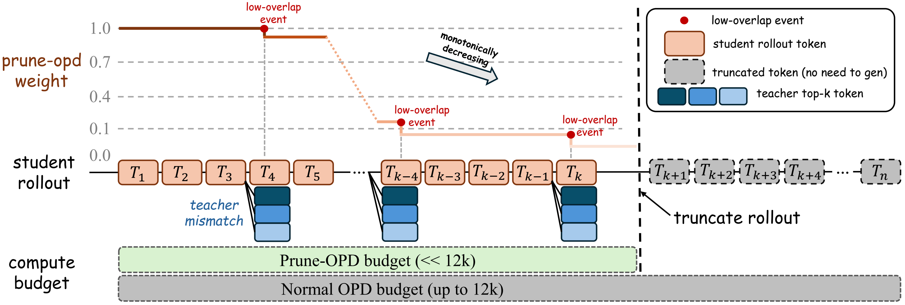
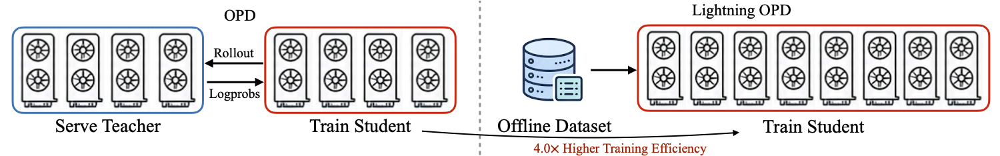
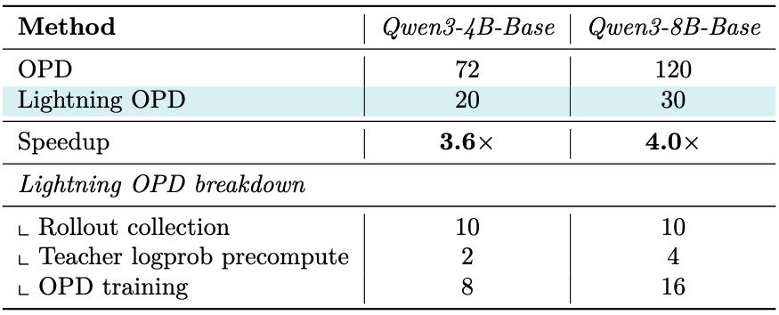

## 0. 一步 OPD 花在哪里

第 3 篇里 Qwen3 报告 OPD 只用了 RL 约十分之一的 GPU 小时，这容易让人以为 OPD 已经很便宜。但和 SFT 相比，OPD 每一步都要多付两笔钱：

$$F_{\rm OPD}\approx \underbrace{F_{\rm gen}(S)}_{\text{student 采样}}+\underbrace{F_{\rm fwd}(T)}_{\text{teacher 打分}}+\underbrace{F_{\rm train}(S)}_{\text{student 更新}}$$

这是 Prefix OPD 论文附录 B 的成本模型的简化写法。在长思维链和多轮 agent 场景下，前两项占大头：student 要先把 8k–32k token 的回答生成出来（自回归，难以并行），teacher 要对每个 token 做一次前向；agent 场景还要加上环境交互的时间。teacher 越大、序列越长，问题越明显。

第 4 篇讲过另一面：长序列后段的 teacher 信号本身就不可靠（THUNLP 的前缀实验里，1K 前缀的收益是 +0.37，16K 只剩 +0.02）。**所以"少生成、少打分"不只是省钱，很多时候也是在去掉噪声。** 这是本篇大多数方法的共同出发点。

2026 年的降本工作可以分成四组：

| 思路 | 代表工作 | 省下的是哪一项 | 是否严格 on-policy |
|---|---|---|---|
| 少生成 token | Prefix OPD、Prune-OPD、STRIDE | 采样 + teacher 打分 | 是（截断后的样本仍来自当前 student），STRIDE 部分复用旧前缀 |
| 复用样本和 teacher 打分 | Lightning OPD、f-OPD、ReOPD | 采样 + teacher 打分，或等待时间 | 否：分别是离线、异步（过时样本）、teacher 前缀 |
| 少走优化步 | EffOPD | 步数 | 是 |
| teacher 侧工程 | DeepSeek-V4 | 显存与 teacher 前向 | 是 |

表里最后一列很重要：**不少"降本"其实是在 on-policy 程度上做让步**。读这些论文时要问的不是"快了几倍"，而是"在什么条件下，放弃新鲜样本几乎没有代价"。

## 1. 少生成 token

### 1.1 Prefix OPD：只在前缀上蒸馏

Zhang et al.（Optum AI, 2602.15260）的做法最直接：student 生成到 $L_{\rm train}$ 个 token 就停，只在这段前缀上算 reverse KL。$L_{\rm train}$ 从 1 开始，每次更新增加 256。

在 Qwen3-8B 做 teacher、Qwen3-8B-Base 做 student、训练 60 步的设置下（论文 Table 2）：

| 方法 | MATH500 | AIME24 | AIME25 | FLOPs |
|---|---|---|---|---|
| 逐步加长的前缀 | 86.9 | 44.0 | 33.5 | 7.5e19 |
| 完整 OPD | 87.4 | 44.2 | 33.5 | 1.8e20 |

准确率基本持平，FLOPs 约为完整 OPD 的 1/2.4（我按表中数字计算）。摘要里写的"2×–47×"上限来自一个只训练 10 步、固定前缀 256 的配置，而且这个配置的 FLOPs 在正文 §5.1（5.7e17）和 Table 1（9.4e17）里不一致，所以这里不引用 47×。

需要注意的两点：

- 固定前缀 256 在 1.7B student 上会严重损害域外能力（GPQA 1.0，MMLU-Pro 1.5），说明**前缀不能太短**，逐步加长的调度是必要的。
- 检查点是按 AIME24 挑选的，而 AIME24 同时是评测集。

这篇论文的价值在于提供了一个简单、合理的基线：任何更复杂的截断方法都应该和"逐步加长的前缀"比。

### 1.2 Prune-OPD：检测到 teacher 失去区分力就停

Prefix OPD 对所有样本用同一个长度。Prune-OPD（Yang et al., 2605.07804）根据每条样本的情况决定在哪里截断，依据是第 4 篇讲过的 top-k 重合度：

$$O_\tau=\frac{|K^S_\tau\cap K^T_\tau|}{k},\qquad B_\tau=\mathbb 1[O_\tau<\gamma]$$

其中 $K^S_\tau$、$K^T_\tau$ 是 student 和 teacher 在位置 $\tau$ 的 top-k 集合（k=16，γ=0.7）。$B_\tau=1$ 记作一次"低重合事件"。累计事件数 $C_\tau=\sum_{i\le\tau}B_i$ 越多，这个位置之后的监督越不可信：

$$R_\tau={\rm clip}(1-w_{\rm drop}C_\tau,\,0,\,1),\qquad L_\tau=R_\tau+w_{\rm base}$$

$L_\tau$ 用来缩放该位置的 OPD 奖励（w_drop=0.01，w_base=0.5）。论文再用每条样本的"有效可靠长度"驱动一个自适应的生成预算（Algorithm 1），可靠部分结束后就不再生成。



*图 1：Prune-OPD 的权重随低重合事件（红点）单调下降，权重衰减到底之后的 token 不再生成（灰色），计算预算因此远小于普通 OPD 的 12k 上限。图片来源：Yang et al., "Efficient and Reliable On-Policy Distillation for Long-Horizon Reasoning", 2026；取自官方仓库 yangzhch6/Prune-OPD 的 README 方法总览图。*

下面的玩具脚本在一条合成样本上演示权重怎样衰减。重合度的期望值从 0.95 线性降到 0.55，这是我为演示设定的，不是论文的数据；截断点也简化成 $R_\tau$ 降到 0 的位置，论文实际用的是上面说的自适应预算。

```python
import random
random.seed(0)
k, gamma, w_drop, w_base = 16, 0.7, 0.01, 0.5
T = 12000
def overlap(t):                      # 期望重合度随位置从 0.95 降到 0.55
    p = 0.95 - 0.40 * t / T
    return sum(random.random() < p for _ in range(k)) / k
C, first_zero = 0, None
for t in range(T):
    C += overlap(t) < gamma           # 低重合事件 B_t
    R = max(0.0, min(1.0, 1 - w_drop * C))
    if R == 0 and first_zero is None: first_zero = t
    if t in (1000, 3000, 5000, 7000) or t == first_zero:
        print(f"t={t:5d}  bad events so far={C:4d}  R_t={R:.2f}  weight R_t+w_base={R + w_base:.2f}")
print(f"\nR_t hits 0 at token {first_zero}; generating past it only buys the constant w_base weight.")
print(f"Truncating there saves {1 - first_zero / T:.0%} of rollout tokens for this sample.")
```

输出：

```text
t= 1000  bad events so far=   5  R_t=0.95  weight R_t+w_base=1.45
t= 3000  bad events so far=  69  R_t=0.31  weight R_t+w_base=0.81
t= 3316  bad events so far= 100  R_t=0.00  weight R_t+w_base=0.50
t= 5000  bad events so far= 389  R_t=0.00  weight R_t+w_base=0.50
t= 7000  bad events so far=1121  R_t=0.00  weight R_t+w_base=0.50

R_t hits 0 at token 3316; generating past it only buys the constant w_base weight.
Truncating there saves 72% of rollout tokens for this sample.
```

前 1000 个 token 几乎没有低重合事件；重合度一旦降到 γ 附近，事件数迅速累积，$R_\tau$ 在几百个 token 内归零。这和第 4 篇的观察一致：teacher 的区分力不是均匀消失的，而是在某个区间之后整体失效。

论文的结果（Table 1）：R1-Distill-7B 做 teacher 的那组，训练时间从 12.5 小时降到 4.0 小时（−68%）；Qwen3-1.7B 那组从 16.5 小时降到 10.3 小时（−37.6%）。准确率有升有降，大多在 ±1–2 分以内，考虑到评测集只有 30 道题，可以看作持平。

我认为最有说服力的是 Table 2 的对照：在 teacher 和 student 高度兼容的一组里，Prune-OPD 只省了 2.9%。这正是方法应有的表现：漂移少，就没什么可剪的。它说明省下的时间来自"跳过不可靠的部分"，而不是随意截断。

不足：正文 §4.2 和表格中 JustRL 那组的节省比例不一致（35.7% vs 40.6%），指标在 Pass@1 和 Avg@16 之间也不统一，没有报告种子数。

### 1.3 STRIDE：多轮 agent 里在第一个错误处停下

多轮 agent 的样本更长，而且每一轮都要和环境交互。STRIDE（Gui et al., 2609.14636）先在 τ²-bench retail（456 个任务、5,856 轮）上做了分析，有两个发现：

1. 每一轮内部，有用的监督集中在这一轮的开头。
2. teacher 对 student 的"认可"（teacher 给 student 动作的平均 log-prob）不是逐渐下降的，而是**在 student 第一次做错动作时突然掉下去**。

据此它设计了两个规则。记第 $k$ 轮的平均 teacher log-prob 为 $\bar l_k$：

- **何时停**：累计和 $\sum_{k\le K}\bar l_k$ 第一次低于阈值 λ 就停止这条轨迹，后面的轮次不再生成。
- **从哪里重启**：在"每轮都高于 α"的最长前缀里，找 $\bar l_k$ 最低的那一轮，下次从这里重新采样，之前的前缀直接复用缓存。

作者报告的结果（我只读到摘要和引言，没看到表格）：在 retail 上以 3.73 倍的速度达到完整 OPD 的效果并超过 30B teacher；2.34 倍加速时比完整 OPD 高 1.3%（mean@16）；多 teacher 设置下 4.51 倍；AIME25 上 5.10 倍。

需要说明：复用的前缀来自较早的 student 检查点，所以 STRIDE **不是严格 on-policy**。这篇论文 2026 年 9 月才发布，加速数字目前只能当作作者的报告。它的分析结论（错误集中在第一个错误动作处）比具体倍数更值得记住，因为这个结论解释了为什么截断在 agent 场景下几乎没有损失。

## 2. 复用样本和 teacher 打分

### 2.1 Lightning OPD：只采样一次

Lightning OPD（Wu, Han, Cai, NVIDIA, 2604.13010）走得最远：

1. 用 SFT 后的模型 $\pi_{\rm ref}$ 对每个 prompt 采样**一次**。
2. 预先算好 teacher 在这些样本上的逐 token log-prob，存起来。
3. student 从 $\pi_{\rm ref}$ 初始化，在这份固定数据上训练，优势仍是 $A_t=\log\pi_T-\log\pi_\theta$。student 的 log-prob 每步重算，但**样本从不重新生成**。

所以它优化的是

$$J_{\rm off}=\mathbb E_{x\sim\pi_{\rm ref}}\Big[\sum_t A_t\Big],$$

只相对于初始策略是 on-policy 的。训练开始后就是离线的。



*图 2：普通 OPD 训练时要同时部署 teacher（左侧蓝框）和 student，每步交换样本和 log-prob；Lightning OPD 把 teacher 打分做成离线数据集，训练时只需要 student。图片来源：Wu, Han, Cai, "Efficient Post-Training for Large Reasoning Models with Offline On-Policy Distillation", 2026；取自官方仓库 jet-ai-projects/Lightning-OPD 的 README 示意图。*

论文的理论部分说明了为什么这样做可行：离线梯度和真正 on-policy 梯度的差距被 $G\sigma_A\sqrt{\chi^2(\pi_\theta\|\pi_{\rm ref})}$ 控制（Th. 3.5），也就是 student 离初始策略越近，差距越小；两者有相同的不动点（Th. 3.7）。

结果（Table 1，Qwen3-8B-Base 学 Qwen3-32B）：

| 指标 | SFT | OPD | Lightning OPD |
|---|---|---|---|
| AIME24 | 63.7 | 68.5 | 69.9 |
| 数学平均 | 50.8 | 55.6 | 57.0 |
| 代码平均 | 40.8 | 44.2 | 46.7 |

4B 上数学平均 54.4 → 55.4，代码平均 41.8 → 41.5（略低）。成本见 Table 2：



*图 3：OPD 与 Lightning OPD 的 GPU 小时。8B 从 120 降到 30（4.0 倍），4B 从 72 降到 20（3.6 倍）；Lightning OPD 的时间主要花在一次性的样本采集和 student 训练上。图片来源：Wu, Han, Cai, 2026, Table 2；取自官方仓库 jet-ai-projects/Lightning-OPD。*

这篇论文另一个重要结果是 **teacher 一致性** 的消融（Tables 3–4）：如果 SFT 数据来自 Qwen3-32B，但 OPD 阶段换成 QwQ-32B 做 teacher，Lightning OPD 从 69.9 掉到 63.1，普通 OPD 从 68.5 掉到 64.8。离线方法对这个错配更敏感，理论上对应 Th. 3.11 中一项无法消除的误差。直观地说，SFT 后的 student 已经接近 SFT 数据的来源；如果 teacher 是另一个模型，student 和 teacher 的差距就大，固定在初始策略上的样本很快就不代表当前 student 了。

怎么解读：训练只有 150 步、回答上限 4096 token，student 一直离初始化不远。在这个范围内，新鲜样本几乎没有带来好处。这本身是一个有用的结论，**它告诉我们 on-policy 的价值取决于 student 能走多远**；但不能推广成"OPD 不需要 on-policy"。另外代码实验是从数学 OPD 的检查点继续训练的，所有结果都是单次运行。

### 2.2 f-OPD：异步训练的过时问题

工业系统通常让采样和训练异步进行：采样端用旧一点的 student 参数持续生成，训练端不用等。代价是样本"过时"。f-OPD（Chen, Zhang, Wu, PolyU, 2605.17862）指出，OPD 里过时有两个来源（Prop. 3.2）：

- **样本漂移** $D^{\rm roll}$：当前 student 和生成样本时的 student 之间的 KL。
- **监督漂移** $D^{\rm sup}$：同一个 teacher 在两个不同上下文下给出的分布之间的 KL。

它给每条样本打一个新鲜度分数：

$$f_i=\frac{1}{\tau_i+1}\exp\Big(-\alpha\sqrt{D_i^{\rm roll}}-\beta\sqrt{D_i^{\rm sup}}\Big)$$

$\tau_i$ 是样本落后的步数。新鲜度低于阈值 ξ 的样本不参与训练，其余样本按 $f_i-\xi$ 加权，并加一项 $\lambda D_i^{\rm roll}$ 把 student 拉回到生成时的策略附近；平均新鲜度过低时整体刷新（最多每 200 步一次）。

在 SWE-bench Verified（250 个 issue，mini-SWE-agent，Qwen3-8B 学 Qwen3-Coder-30B-A3B，5 个种子）上（Table 1）：

| 方法 | 解决率 | 吞吐 | 崩溃次数 |
|---|---|---|---|
| 同步 OPD | 41.8 | 1.00× | |
| 直接异步 | 26.8 | 1.61× | 5 次中 3 次 |
| f-OPD | 39.4 | 1.46× | 0 |

工具使用任务（Table 2）上三者分别是 74.8、61.6、74.4。

这篇论文的证据质量在本系列里算好的：5 个种子，报告了崩溃次数，总计约 16k H100 小时。它说明的主要不是 f-OPD 有多快，而是**直接异步在 OPD 里会出大问题**：5 次中 3 次训练崩溃，解决率从 41.8 掉到 26.8。f-OPD 只恢复了一部分（39.4，约为同步的 94%），新鲜度分数也是启发式的，α 和 β 需要按领域调。Table 1 和 Table 2 中个别对照数字不一致。

### 2.3 ReOPD：多轮场景下复用 teacher 的前缀

注意名字：这里的 ReOPD（Liao et al., Microsoft Research / UvA, 2607.04763，"Replayed-Prefix OPD"）和第 5 篇提到的 REOPD（2608.11698，可靠性自适应的 ExOPD）是两篇不同的论文。

多轮 agent 每生成一步都要调用环境，很慢。ReOPD 的做法是：先收集 teacher 的完整轨迹（包含环境返回的观察），训练时从中取出前 $t-1$ 轮作为历史 $H_t$，student 只生成第 $t$ 轮的动作，在这一轮上算逐 token 的 reverse KL。这样训练时完全不用调用环境。轮次按 $p_t\propto\kappa^t$（κ=0.6）抽样，偏向前面的轮次。

论文自己说得很清楚：这是"在被监督的那一步上 on-policy，但前缀是 teacher 强制给定的"。它的理论部分把这种做法的误差拆成两项（Prop. 1）：student 的状态分布和 teacher 前缀的分布不同（占据项），以及 teacher 在这些前缀上是否可靠（可靠性项）。

结果：数学加 Python 工具（Table 4）上，OPD → ReOPD 分别是 55.1 → 57.2（4B teacher）、51.0 → 53.7（8B）、51.1 → 52.5（30B）；搜索任务（Table 5）上 40.6 vs 40.5，持平。采样速度至少快 4 倍（Fig. 1：数学 4.2 倍，搜索 9.1 倍），算上 teacher 重新打分后约 2 倍以上。

我把它当作"便宜但不完全 on-policy"的 agent 基线。搜索任务持平这个结果也照实报告了，这一点值得肯定。

## 3. 少走优化步：EffOPD

EffOPD（Cai et al., 2605.11739）的出发点是一个机制观察（Table 1、§2–3）：

- OPD 的参数更新集中在中间层的 MLP，RL 则更多更新底层和顶层。
- OPD 的更新很早就落在一个低秩子空间里：前 1% 子空间所占的范数比例，OPD 是 94.7%，RL 是 88.5%；有效秩分别是 2341 和 2754。
- 训练进度 10% 时的检查点，把更新幅度按比例放大后，就能达到最终效果的约 80%（Fig. 5c）。

既然方向早就定了，就可以沿方向外推。在第 $2^n$ 步取 $\Delta_n=W_{2^n}-W_{2^{n-1}}$，尝试 $W_{2^n}+2^k\Delta_n$（k=1..5），用 50 条验证样本选最好的，第一次变差就停。

作者报告平均 3 倍加速，数学上约 10 步收敛，普通 OPD 需要 30–40 步。但我读到的正文中没有准确率表，3 倍是从训练曲线上读出来的，图的编号引用也有错误。作为方法，证据偏弱；作为对 OPD 更新结构的观察，它和第 4 篇 THUNLP 的结论一致（OPD 主要在少量方向上做调整），值得记住。

## 4. teacher 侧的工程：DeepSeek-V4

第 3 篇说过 DeepSeek-V4（2606.19348）用 OPD 把多个领域专家合并成一个模型，并承诺在这一篇补充 teacher 调度的细节。先说能从原文核实的部分（报告引言）：

- 流程是"先独立培养各领域专家，再通过 on-policy distillation 合并成统一模型"。专家（数学、代码、agent、指令遵循等）各自经过 SFT 和 GRPO。
- 统一模型作为 student，"以 reverse KL 为损失向 teacher 模型学习"。

报告 §5.2.2 "Efficient Teacher Scheduling for Full-Vocabulary OPD" 的正文我没能读到（arXiv 页面的文本在第 4 节就截断了）。以下内容来自几篇二手解读（vessl.ai、fireworks.ai、Maxime Labonne 的博客，其中 vessl.ai 引用了报告原文），它们的说法一致，但**我没有核对原文，请把它们当作待核实的信息**：

- teacher 超过 10 个；损失是对每个 teacher 的 reverse KL 按静态权重加权求和。
- 用**全词表** reverse KL，不是只看采样 token 或 top-k。
- 词表超过 10 万，把所有 teacher 的 logits 都存下来代价太大。做法是缓存每个 teacher 最后一层的隐藏状态，训练时用该 teacher 的输出头临时重建 logits。
- 数据分发时按 teacher 编号排序样本，使每个 mini-batch 中每个 teacher 的输出头只加载一次，设备上同一时刻最多只有一个 teacher 的输出头。
- 精确的 KL 用一个 TileLang 写的自定义算子计算。

如果这些描述属实，它解决的是一个本篇其他论文都没碰到的问题：**多 teacher、全词表 OPD 的显存和 I/O**。学术论文大多是一个 teacher、只看采样 token 或 top-k，所以不存在这个问题。工业界选择全词表，说明他们认为第 4 篇讲的采样 token / top-k 估计器的偏差和方差值得用工程代价换掉。这一节没有消融实验，只能作为参考设计。

## 5. 小结

| 方法 | 加速（同等效果下） | 证据 | 代价 |
|---|---|---|---|
| Prefix OPD | 约 2.4 倍 FLOPs | 中等；按评测集挑选检查点 | 前缀太短会伤域外能力 |
| Prune-OPD | 时间 −37.6% 到 −68% | 中等偏强；有高兼容度对照 | 无种子；个别数字不一致 |
| STRIDE | 作者报告 3.73 倍 | 表格未核实 | 复用旧前缀 |
| Lightning OPD | 3.6–4.0 倍 GPU 小时 | 中等；单次运行 | 训练开始后离线；对 teacher 错配敏感 |
| f-OPD | 吞吐 1.46 倍，保留 94% 效果 | 中等偏强；5 个种子 | 新鲜度超参按领域调 |
| ReOPD | 采样约 2 倍以上 | 中等 | 前缀来自 teacher |
| EffOPD | 3 倍（来自曲线） | 弱 | 用验证集挑选外推步长 |
| DeepSeek-V4 | 无数字 | 工业报告；工程细节待核实 | 需要大量系统工作 |

三条经验：

1. **长序列后段的 teacher 信号本来就不可靠，所以截断几乎不损失效果。** Prefix OPD、Prune-OPD、STRIDE 都是在利用这一点。Prune-OPD 在高兼容度组只省 2.9% 的对照最能说明问题：省多少，取决于 teacher 和 student 的差距有多大。
2. **放弃新鲜样本的代价取决于 student 离采样策略有多远。** Lightning OPD 在 150 步、4k 长度下几乎没有代价；f-OPD 显示长时间、大规模的异步训练里，不加控制就会崩溃。这两个结论并不矛盾，它们处在这条轴的两端。
3. **看加速倍数时要找"同等效果下"的数字。** Prefix OPD 的 47 倍、EffOPD 的 3 倍、STRIDE 的各个倍数，要么不在同等效果下比较，要么证据不完整。本篇表格里只列了能核实的部分。

## 参考文献

- Zhang et al. *Fast and Effective On-policy Distillation from Reasoning Prefixes.* 2026. arXiv:2602.15260.
- Yang et al. *Efficient and Reliable On-Policy Distillation for Long-Horizon Reasoning*（Prune-OPD）. 2026. arXiv:2605.07804.
- Gui et al. *Know When to Stop, Where to Restart: Accelerating Multi-Turn Agentic On-Policy Distillation*（STRIDE）. 2026. arXiv:2609.14636.（读到摘要和正文到 §4.3）
- Wu, Han, Cai. *Efficient Post-Training for Large Reasoning Models with Offline On-Policy Distillation*（Lightning OPD）. 2026. arXiv:2604.13010.
- Chen, Zhang, Wu. *Stabilizing Long-Horizon On-Policy Distillation with Freshness-Aware Control*（f-OPD）. 2026. arXiv:2605.17862.
- Liao et al. *Multi-Turn On-Policy Distillation with Prefix Replay*（ReOPD）. 2026. arXiv:2607.04763.
- Cai et al. *Learning to Foresee: Unveiling the Unlocking Efficiency of On-Policy Distillation*（EffOPD）. 2026. arXiv:2605.11739.
- DeepSeek-AI. *DeepSeek-V4* technical report. 2026. arXiv:2606.19348.
- 关于 DeepSeek-V4 OPD 工程细节的二手解读：vessl.ai, "On-Policy Distillation, Part 2"；fireworks.ai, "What DeepSeek-V4 says about training platforms"；Maxime Labonne, "DeepSeek-V4: ten teachers, one student"。
