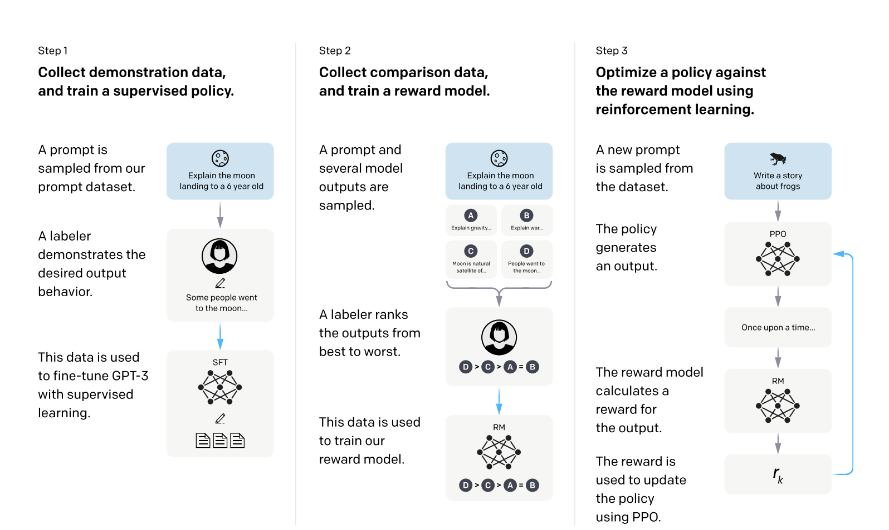
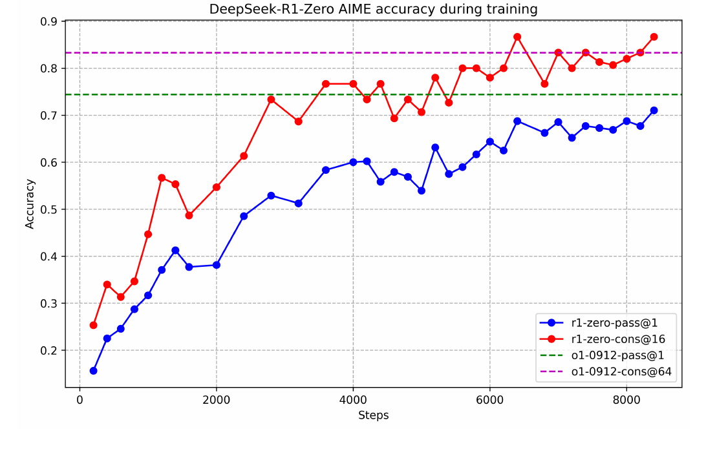

## 0. 这一篇讲什么

这个系列讲大语言模型（LLM）后训练中的强化学习（Reinforcement Learning, RL）。主线有三条：

- **PPO**：经典 RLHF 的做法，训练一个 Critic 来估计每个 token 的价值，再用它构造优势函数。
- **DPO**：在偏好数据上把 RL 的优化过程解析地消掉，直接做一个分类损失。
- **GRPO**：回到在线 RL，但不训练 Critic，用同一个问题的一组回答互相比较来构造优势函数。

三条线回答的是同一个问题：**怎样让模型更偏向好的回答、远离差的回答。** 区别在于"好不好"这个信号怎么变成训练信号，以及需不需要额外的模型来估计它。

这一篇是后面所有内容的公共基础，包括：

1. RL 在后训练流程中的位置；
2. 怎样把文本生成写成一个 RL 问题；
3. 策略梯度、baseline 和优势函数的推导；
4. 重要性采样和信赖域；
5. KL 约束的目标、它的闭式最优解，以及 KL 的几种估计方法；
6. 奖励从哪里来，以及奖励被"钻空子"的问题；
7. 什么时候值得用 RL，什么时候 SFT 或蒸馏更合适；
8. 三条主线的地图和训练系统的大致结构。

第 2、3、4 篇分别讲 PPO、DPO、GRPO 三条主线，包括各自的变体、当前的分析与争论，以及适合的任务。第 5 篇按任务类型讨论怎么选方法、怎么设计奖励。

## 1. RL 在后训练中的位置

### 1.1 三阶段流程

预训练得到的模型只会"续写"：给一段文字，它预测下一个 token。它并不知道用户想要什么样的回答。后训练（post-training）要把它变成一个能遵循指令、回答有用、行为安全的助手。

InstructGPT（Ouyang et al., 2022）确立了后来被广泛沿用的三阶段流程：



*图 1：RLHF 的三个阶段。第 1 步，标注者为采样到的提示词写出示范回答，用来做监督微调（SFT）。第 2 步，对同一个提示词采样多个模型回答，标注者从好到差排序，用这些比较数据训练奖励模型（RM）。第 3 步，对新的提示词，策略模型生成回答，奖励模型打分，用 PPO 根据分数更新策略。图片来源：Ouyang et al., "Training language models to follow instructions with human feedback", NeurIPS 2022, Figure 2。*

三个阶段分别是：

1. **监督微调（SFT）**：在人工写的示范回答上做最大似然训练。论文中 SFT 用了约 1.3 万条训练提示词。
2. **训练奖励模型（RM）**：对同一个提示词，让模型生成 $K$ 个回答（论文中 $K$ 在 4 到 9 之间），标注者排序。排序被拆成两两比较，用来训练一个给回答打分的模型。论文中 RM 用了约 3.3 万条提示词，模型大小为 6B。
3. **强化学习（PPO）**：以 SFT 模型为起点，用 RM 的分数作为奖励，用 PPO 优化策略，同时用 KL 惩罚限制策略不要离 SFT 模型太远。论文中这一步用了约 3.1 万条提示词。

最常被引用的结果是：1.3B 参数的 InstructGPT 的回答，比 175B 参数的 GPT-3 更受标注者偏好。也就是说，后训练带来的提升可以超过 100 倍的参数量差距。

论文还发现，RL 之后模型在一些公开 NLP 基准上会退化，作者称之为"对齐税"（alignment tax）。他们的解决办法是在 PPO 的梯度中混入一部分预训练数据的语言模型梯度，称为 **PPO-ptx**。

这个流程的思想来源更早：Christiano et al.（2017）在 Atari 和机器人控制上用人类的两两比较训练奖励模型；Ziegler et al.（2019）和 Stiennon et al.（2020）把它用在了语言模型的风格续写和摘要任务上。

### 1.2 两类奖励信号：RLHF 与 RLVR

InstructGPT 的奖励来自一个学出来的奖励模型，它拟合的是人类偏好，这类方法叫 **RLHF**（RL from Human Feedback）。

2024 年以后，另一类做法变得同样重要：在数学、代码这类任务上，回答对不对可以用程序检查。数学题比对最终答案，代码题运行单元测试。这时奖励不需要学，直接由规则给出，通常是 0/1。Tülu 3（Lambert et al., 2024）把这类做法称为 **RLVR**（RL with Verifiable Rewards）。DeepSeek-R1（DeepSeek-AI, 2025）用 RLVR 训练出了很长的思维链和反思行为，让这条路线受到了广泛关注。



*图 2：DeepSeek-R1-Zero 在 RL 训练过程中 AIME 2024 准确率的变化。蓝线是单次采样的准确率（pass@1），红线是 16 次采样多数投票的准确率（cons@16），虚线是 OpenAI o1-0912 的对应成绩。R1-Zero 直接从基座模型开始做 RL，没有经过 SFT。图片来源：DeepSeek-AI, "DeepSeek-R1: Incentivizing Reasoning Capability in LLMs via Reinforcement Learning", 2025, Figure 2。*

两类奖励的差别会影响后面每一个设计选择：

| | RLHF | RLVR |
|---|---|---|
| 奖励来源 | 学出来的奖励模型（拟合人类偏好） | 规则或程序（答案比对、单元测试） |
| 奖励形式 | 连续分数 | 通常是 0/1 |
| 主要风险 | 奖励模型不准，被策略钻空子 | 验证器有漏洞；奖励稀疏，全错时没有信号 |
| 典型任务 | 对话、写作、安全 | 数学、代码、逻辑题、有标准答案的任务 |
| 常用算法 | PPO、DPO 及其变体 | GRPO 及其变体，PPO |

### 1.3 现在常见的后训练流程

今天的流程比 InstructGPT 复杂，但骨架没有变。一个常见的组合是：

1. **SFT 冷启动**：先用高质量示范数据教会模型输出格式、基本的推理风格和工具调用协议。
2. **偏好优化**：用 DPO 一类的离线方法，或在线的 RLHF，调整回答的风格和有用性。
3. **RLVR**：在可验证的任务上用 GRPO、PPO 一类的方法提升推理能力。
4. **蒸馏**：把大模型的能力蒸馏到小模型，或者把 RL 之后的模型再整理一遍。

这几步之间没有固定顺序，很多模型会交替进行多轮。第 5 篇会按任务类型讨论具体的组合。

## 2. 把文本生成写成 RL 问题

### 2.1 基本要素

RL 研究的是一个**智能体**（agent）在**环境**（environment）中反复做决策、根据得到的**奖励**（reward）改进自己的过程。用到 LLM 上，各个要素对应如下：

| RL 概念 | 在 LLM 中 |
|---|---|
| 智能体 / 策略 $\pi_\theta$ | 语言模型本身，参数为 $\theta$ |
| 状态 $s_t$ | 提示词 $x$ 加上已经生成的 token $y_{<t}$ |
| 动作 $a_t$ | 下一个 token $y_t$，从词表中选一个 |
| 状态转移 | 确定性的：把 $a_t$ 拼到末尾，$s_{t+1} = (s_t, a_t)$ |
| 一条轨迹 $\tau$ | 一条完整的回答 $y = (y_1, \dots, y_T)$ |
| 奖励 $r$ | 通常只在回答结束时给一个标量，中间步骤为 0 |

策略就是语言模型给出的下一个 token 的分布：

$$
\pi_\theta(a_t \mid s_t) = p_\theta(y_t \mid x, y_{<t}).
$$

一整条回答的概率是每一步概率的乘积：

$$
\pi_\theta(y \mid x) = \prod_{t=1}^{T} \pi_\theta(y_t \mid x, y_{<t}),
\qquad
\log \pi_\theta(y \mid x) = \sum_{t=1}^{T} \log \pi_\theta(y_t \mid x, y_{<t}).
$$

RL 的目标是最大化期望奖励：

$$
J(\theta) = \mathbb{E}_{x \sim \mathcal{D}}\, \mathbb{E}_{y \sim \pi_\theta(\cdot \mid x)} \big[ r(x, y) \big].
$$

### 2.2 LLM 的 RL 和经典 RL 有什么不同

和 Atari、机器人控制这类经典 RL 问题相比，LLM 的 RL 有几个特点，后面的很多设计都由它们决定：

**动作空间极大.** 每一步要从 10 万量级的词表中选一个 token。不过策略本身已经过预训练，绝大部分 token 的概率几乎为 0，真正需要探索的空间比看起来小得多。

**转移是确定的，环境是已知的.** 在单轮对话中，"环境"只是把 token 拼接到上下文末尾，没有随机性。这和机器人与物理世界交互完全不同。

**奖励极其稀疏.** 一条回答可能有几千个 token，但奖励只在最后出现一次。怎样把这一个分数分配给前面的每个 token，就是**信用分配**（credit assignment）问题，它是 PPO 引入 Critic、GRPO 被批评"太粗"的根本原因。

**起点是一个很强的策略.** 经典 RL 常常从随机策略开始；LLM 的 RL 从 SFT 模型或基座模型开始，它已经能生成合理的文本。所以 LLM 的 RL 更像是在一个好的初始策略附近做**微调**，这也是 KL 约束如此重要的原因。

**采样很贵.** 生成一条回答需要逐 token 地做前向计算，比一次训练前向慢得多。在 RL 训练中，生成（rollout）往往占总时间的一半以上。

**多轮交互时，有些 token 不是模型生成的.** 在 Agent 任务中，模型调用工具，工具的返回结果（observation）也会拼进上下文。这些 token 来自环境，不是策略的动作，所以计算损失时要把它们**掩掉**（mask），只在模型自己生成的 token 上更新。

### 2.3 两种视角：token 级 MDP 与序列级 bandit

同一个问题可以用两种方式建模，后面的算法分别对应其中一种：

**token 级 MDP**：每生成一个 token 是一步决策，一条回答是一条有 $T$ 步的轨迹。这时可以为每个状态定义价值、为每个动作定义优势，PPO 就是这样做的。

**序列级 bandit**：把整条回答 $y$ 看成一个动作，一次决策就结束（"bandit"指只有一步的决策问题）。奖励直接定义在 $(x, y)$ 上。DPO 的推导和 GRPO 的优势函数都是在这个视角下进行的。

两种视角在数学上可以互相转换：序列的对数概率是 token 对数概率之和，所以对整条序列的梯度会自然分摊到每个 token 上。区别在于**每个 token 得到的权重是否相同**：序列级视角下，同一条回答中的所有 token 共享一个权重；token 级视角下，每个 token 可以有自己的权重。

## 3. 策略梯度

### 3.1 对数导数技巧

我们要最大化 $J(\theta) = \mathbb{E}_{y \sim \pi_\theta}[r(y)]$（为简洁起见省略 $x$）。困难在于期望所依赖的分布本身含有 $\theta$，而奖励 $r$ 对 $\theta$ 不可微（答案对不对、测试通不通过，都不是 $\theta$ 的光滑函数）。

**对数导数技巧**（log-derivative trick）解决了这个问题。利用 $\nabla_\theta \pi_\theta = \pi_\theta \nabla_\theta \log \pi_\theta$：

$$
\nabla_\theta J
= \nabla_\theta \sum_y \pi_\theta(y)\, r(y)
= \sum_y \pi_\theta(y)\, \nabla_\theta \log \pi_\theta(y)\, r(y)
= \mathbb{E}_{y \sim \pi_\theta}\big[ r(y)\, \nabla_\theta \log \pi_\theta(y) \big].
$$

这个式子只需要两样东西：从当前策略采样，以及计算样本的对数概率的梯度。奖励只作为一个标量权重出现，**不需要可微**。这就是 RL 能优化"任务成功率"这类不可微目标的原因。

用蒙特卡洛估计，采样 $N$ 条回答：

$$
\nabla_\theta J \approx \frac{1}{N} \sum_{i=1}^{N} r(y_i)\, \nabla_\theta \log \pi_\theta(y_i).
$$

这就是 **REINFORCE**（Williams, 1992）。它的直觉很简单：奖励为正的样本，提高它的对数概率；奖励越高，提高得越多。

和 SFT 对比一下。SFT 的梯度是 $\nabla_\theta \log \pi_\theta(y^*)$，其中 $y^*$ 是人工示范。REINFORCE 相当于**在模型自己生成的样本上做加权的 SFT**，权重是奖励。如果只保留奖励为 1 的样本、权重都取 1，它就退化成"拒绝采样微调"（rejection sampling fine-tuning, RFT）。这个视角很有用：很多 RL 方法和 SFT 之间的区别，只是"在谁的样本上训练"和"每个样本的权重是多少"。

### 3.2 展开到 token：因果性与 reward-to-go

把序列对数概率展开成 token 之和：

$$
\nabla_\theta J = \mathbb{E}\Big[ \sum_{t=1}^{T} \nabla_\theta \log \pi_\theta(a_t \mid s_t) \cdot R \Big],
$$

其中 $R$ 是整条轨迹的总奖励。在一般的多步问题中，每一步都可能有奖励 $r_t$。这时有一个重要的改进：**第 $t$ 步的动作不会影响它之前已经得到的奖励**，所以可以只用它之后的奖励之和（reward-to-go）作为权重：

$$
\nabla_\theta J = \mathbb{E}\Big[ \sum_{t=1}^{T} \nabla_\theta \log \pi_\theta(a_t \mid s_t) \cdot G_t \Big],
\qquad
G_t = \sum_{t' \ge t} \gamma^{t'-t} r_{t'}.
$$

去掉过去的奖励不改变期望（它们和当前动作的得分函数的乘积期望为 0），但能减小方差。在 LLM 中，如果只有最后一个 token 有奖励，那么每个 token 的 $G_t$ 都等于最终奖励（取 $\gamma = 1$ 时），这一改进没有作用；但当奖励中含有逐 token 的 KL 惩罚（PPO 的做法，见第 2 篇）时，它就有意义了。

### 3.3 baseline：不改变期望，减小方差

REINFORCE 的梯度估计方差很大。一个常见的情况是：如果所有奖励都是正数，那么每个样本的概率都会被提高，只是提高的幅度不同。模型要靠大量样本之间的抵消才能分辨出谁好谁坏。

解决办法是减去一个 **baseline** $b$：

$$
\nabla_\theta J = \mathbb{E}\big[ (r(y) - b)\, \nabla_\theta \log \pi_\theta(y) \big].
$$

只要 $b$ 不依赖于采样的动作，这一项就不改变期望，因为：

$$
\mathbb{E}_{y \sim \pi_\theta}\big[ b\, \nabla_\theta \log \pi_\theta(y) \big]
= b \sum_y \pi_\theta(y) \nabla_\theta \log \pi_\theta(y)
= b \sum_y \nabla_\theta \pi_\theta(y)
= b\, \nabla_\theta \sum_y \pi_\theta(y)
= b\, \nabla_\theta 1 = 0.
$$

减去 baseline 之后，比平均水平好的样本概率上升，比平均水平差的样本概率下降。信号变得有正有负，方差大大降低。

baseline 的选择，正是三条主线的分歧所在：

- **PPO**：训练一个价值网络 $V_\phi(s_t)$，对每个状态给出一个 baseline。
- **GRPO**：对同一个提示词采样 $G$ 条回答，用它们奖励的平均值作 baseline。
- **RLOO**：同样采样一组，但用"除自己以外"其他回答的平均奖励作 baseline。
- **ReMax**：用贪心解码得到的回答的奖励作 baseline。

下面用一个 4 个动作的 bandit 验证：baseline 不改变梯度的期望，但能显著降低方差。

```python
import numpy as np
rng = np.random.default_rng(0)

def softmax(z):
    z = z - z.max()
    e = np.exp(z)
    return e / e.sum()

# 一个 4 个动作的 bandit：每个动作的奖励是 r_mean[a] 加高斯噪声
r_mean = np.array([1.0, 2.0, 3.0, 10.0])   # 奖励整体偏大，模拟“奖励没有居中”
theta = np.zeros(4)
pi = softmax(theta)

# 精确梯度：∇J = Σ_a π(a) r(a) ∇log π(a)，对 softmax 有 ∇_θ log π(a) = e_a − π
exact = sum(pi[a] * r_mean[a] * (np.eye(4)[a] - pi) for a in range(4))

def estimate(n, baseline):
    grads = []
    for _ in range(n):
        a = rng.choice(4, p=pi)
        r = r_mean[a] + rng.normal(0, 1.0)
        grads.append((r - baseline) * (np.eye(4)[a] - pi))
    return np.array(grads)

for name, b in [("无 baseline", 0.0), ("baseline = E[r]", float(pi @ r_mean))]:
    g = estimate(200_000, b)
    print(f"{name:16s} 均值误差 {np.abs(g.mean(0) - exact).max():.4f}  "
          f"单样本梯度方差(求和) {g.var(0).sum():.2f}")
print("精确梯度", np.round(exact, 3))
```

输出：

```
无 baseline       均值误差 0.0028  单样本梯度方差(求和) 19.01
baseline = E[r]  均值误差 0.0015  单样本梯度方差(求和) 7.01
精确梯度 [-0.75 -0.5  -0.25  1.5 ]
```

两种估计的均值都收敛到精确梯度，但减去 baseline 后单样本梯度的方差从 19.0 降到 7.0。在 LLM 中，奖励的偏移往往更大（比如奖励模型的分数整体在 5 左右），baseline 的作用也更明显。

### 3.4 价值函数与优势函数

最好的 baseline 应该依赖于状态：同一个模型，在一道简单题上平均能拿 0.9 分，在一道难题上平均只能拿 0.1 分。用同一个常数作 baseline，简单题上的回答几乎都会被鼓励，难题上的回答几乎都会被抑制，这显然不对。

为此定义三个函数：

- **状态价值** $V^\pi(s_t) = \mathbb{E}_\pi[G_t \mid s_t]$：从状态 $s_t$ 出发，按当前策略继续生成，期望能拿到多少回报。
- **动作价值** $Q^\pi(s_t, a_t) = \mathbb{E}_\pi[G_t \mid s_t, a_t]$：在 $s_t$ 先选定动作 $a_t$，之后按策略继续，期望能拿到多少回报。
- **优势函数** $A^\pi(s_t, a_t) = Q^\pi(s_t, a_t) - V^\pi(s_t)$：选这个动作，比在这个状态下"平均地"选一个动作好多少。

用优势函数代替奖励，就得到最常用的策略梯度形式：

$$
\nabla_\theta J = \mathbb{E}\Big[ \sum_{t} \nabla_\theta \log \pi_\theta(a_t \mid s_t)\, A^\pi(s_t, a_t) \Big].
$$

$A > 0$ 的 token 概率上升，$A < 0$ 的下降。整个系列中，三条主线的区别都可以归结为**优势函数怎么估计**：

| 方法 | 优势函数的估计 | 粒度 |
|---|---|---|
| REINFORCE | $r - b$，$b$ 为常数或滑动平均 | 序列级 |
| PPO | $\hat A_t$ 由 Critic $V_\phi$ 和 GAE 计算 | token 级 |
| GRPO | $(r_i - \text{mean}) / \text{std}$，在同一提示词的一组回答内计算 | 序列级 |
| RLOO | $r_i - \frac{1}{G-1}\sum_{j \ne i} r_j$ | 序列级 |
| DPO | 没有显式的优势函数，偏好对的相对差距起到类似作用 | 序列级 |

PPO 中优势函数的具体估计方法（时序差分误差和 GAE）放在第 2 篇。

## 4. 重要性采样与信赖域

### 4.1 为什么需要重要性采样

策略梯度要求样本来自**当前**策略。但采样很贵，我们希望一批样本能用来更新好几次。第一次更新之后，策略就变了，样本不再来自当前策略。

**重要性采样**（importance sampling）可以修正这个偏差。如果样本来自旧策略 $\pi_{\text{old}}$，那么：

$$
\mathbb{E}_{a \sim \pi_\theta}[f(a)] = \mathbb{E}_{a \sim \pi_{\text{old}}}\Big[ \frac{\pi_\theta(a)}{\pi_{\text{old}}(a)} f(a) \Big].
$$

比值 $\rho = \pi_\theta / \pi_{\text{old}}$ 称为重要性权重。据此可以写出一个替代目标（surrogate objective）：

$$
L(\theta) = \mathbb{E}_{s, a \sim \pi_{\text{old}}}\Big[ \frac{\pi_\theta(a \mid s)}{\pi_{\text{old}}(a \mid s)}\, \hat A(s, a) \Big].
$$

在 $\theta = \theta_{\text{old}}$ 处，它的梯度恰好等于策略梯度。

### 4.2 为什么还需要信赖域

问题在于，当新旧策略差得很远时，重要性权重的方差会爆炸：某个动作在旧策略下概率很小、在新策略下概率很大，它的权重就会非常大，一个样本就能主导整个梯度。而且上面的替代目标只在 $\theta_{\text{old}}$ 附近才是真实目标的好近似（它忽略了状态分布的变化）。

所以每次更新都要把新策略限制在旧策略的附近，这个范围叫**信赖域**（trust region）：

- **TRPO**（Schulman et al., 2015）把它写成一个硬约束 $\mathrm{KL}(\pi_{\text{old}} \Vert \pi_\theta) \le \delta$，用二阶方法（共轭梯度加线搜索）求解，计算复杂。
- **PPO**（Schulman et al., 2017）改用一个简单的技巧：把重要性权重裁剪到 $[1-\epsilon, 1+\epsilon]$ 区间。超出这个区间之后，继续朝同一方向移动不再带来收益，梯度变为 0。这只需要一阶优化，成为了最常用的方法。

PPO 的裁剪目标、它的几种情形，以及 GRPO、DAPO、GSPO 对它的修改，在第 2 篇和第 4 篇详细讨论。这里只需要记住：**重要性权重让一批样本可以多用几次，裁剪让每次更新不要走太远。**

### 4.3 on-policy、off-policy 与 offline

这三个词在后面会反复出现，含义如下：

- **on-policy**：用当前策略采样，用完就丢。严格的 REINFORCE 是 on-policy 的。PPO 和 GRPO 允许一批数据在小范围内复用几次，用重要性权重修正，仍然被归为 on-policy（有时称"近似 on-policy"）。
- **off-policy**：用别的策略（比如很久以前的旧策略）采集的数据训练，需要更强的修正。
- **offline**：数据集事先固定，训练中完全不采样。DPO 是典型的 offline 方法。

在实际系统中，这三者的界限并不清楚。即使是"on-policy"的 GRPO，生成样本的推理引擎（如 vLLM）和计算梯度的训练引擎之间也存在数值差异，导致采样策略和被优化的策略并不完全相同。这个"训练和推理不一致"的问题在第 4 篇讨论。

## 5. KL 约束

### 5.1 为什么要加 KL 约束

几乎所有 LLM 的 RL 方法都在目标中加一项 KL 惩罚，约束策略不要离一个参考模型 $\pi_{\text{ref}}$（通常是 SFT 模型）太远：

$$
\max_{\pi}\; \mathbb{E}_{x \sim \mathcal{D},\, y \sim \pi(\cdot \mid x)}\big[ r(x, y) \big] - \beta\, \mathrm{KL}\big( \pi(\cdot \mid x) \,\Vert\, \pi_{\text{ref}}(\cdot \mid x) \big).
$$

理由有三个：

1. **奖励模型只在 SFT 模型的分布附近可信.** 奖励模型是在 SFT 模型生成的回答上训练的。策略离这个分布越远，奖励模型的分数越不可靠，越容易被钻空子（第 6.4 节）。
2. **保留语言能力和通用能力.** 没有约束时，策略可能为了奖励退化成重复某些短语，或者丢失其他任务上的能力。
3. **防止分布坍缩.** RL 会让策略集中到少数高奖励的回答上，KL 约束让它保留一定的多样性。

不过在 RLVR 中，KL 约束经常被去掉。DAPO（Yu et al., 2025）等工作认为：训练长思维链时，模型本来就需要离初始模型很远，KL 约束会限制这一点；而且规则奖励不像奖励模型那样容易被钻空子。这个选择在第 4 篇讨论。

### 5.2 闭式最优解

KL 约束的目标有一个非常重要的性质：**它的最优解有闭式表达**。对固定的 $x$，在 $\sum_y \pi(y \mid x) = 1$ 的约束下求解，可以得到：

$$
\pi^*(y \mid x) = \frac{1}{Z(x)}\, \pi_{\text{ref}}(y \mid x) \exp\Big( \frac{r(x, y)}{\beta} \Big),
\qquad
Z(x) = \sum_y \pi_{\text{ref}}(y \mid x) \exp\Big( \frac{r(x, y)}{\beta} \Big).
$$

**推导.** 把目标改写一下：

$$
\begin{aligned}
\mathbb{E}_{\pi}[r] - \beta\, \mathrm{KL}(\pi \Vert \pi_{\text{ref}})
&= \sum_y \pi(y) \Big[ r(y) - \beta \log \frac{\pi(y)}{\pi_{\text{ref}}(y)} \Big] \\
&= -\beta \sum_y \pi(y) \log \frac{\pi(y)}{\pi_{\text{ref}}(y) \exp(r(y)/\beta)} \\
&= -\beta \sum_y \pi(y) \log \frac{\pi(y)}{\pi^*(y)} + \beta \log Z \\
&= -\beta\, \mathrm{KL}(\pi \Vert \pi^*) + \beta \log Z.
\end{aligned}
$$

$\beta \log Z$ 与 $\pi$ 无关，而 KL 散度非负、当且仅当两个分布相等时为 0。所以目标在 $\pi = \pi^*$ 时取到最大值。

这个解的含义是：最优策略**以参考模型为底，按 $\exp(r/\beta)$ 重新加权**。奖励高的回答被放大，奖励低的被缩小。$\beta$ 越小，加权越激进；$\beta \to \infty$ 时，$\pi^* \to \pi_{\text{ref}}$；$\beta \to 0$ 时，$\pi^*$ 集中到奖励最高的回答上。

这个闭式解有几个用途：

- **DPO 的出发点.** 把它反过来写成 $r = \beta \log(\pi^* / \pi_{\text{ref}}) + \beta \log Z$，就可以用策略来表示奖励，从而绕过奖励模型。这是第 3 篇的核心。
- **理解 Best-of-N.** 从 $\pi_{\text{ref}}$ 采样 $N$ 个回答、选奖励最高的一个，也是一种对 $\pi_{\text{ref}}$ 按奖励重新加权的方法，可以看作逼近 $\pi^*$ 的一种朴素方式。
- **理解 RL 在做什么.** RL 并不是凭空创造新的回答，而是在参考模型已有的分布上重新分配概率。这和第 9 节"RL 是否扩展了能力边界"的讨论直接相关。

下面用数值验证闭式解：直接对一个小分布做梯度上升，结果和闭式解一致。

```python
import numpy as np
rng = np.random.default_rng(1)
def softmax(z):
    e = np.exp(z - z.max()); return e / e.sum()

V, beta = 8, 0.5
ref = softmax(rng.normal(0, 1, V))
r = rng.normal(0, 1, V)

# 闭式解：π*(y) ∝ π_ref(y) exp(r(y)/β)
closed = ref * np.exp(r / beta); closed /= closed.sum()

# 直接对 logits 做梯度上升，目标 J(π) = Σ π r − β KL(π || π_ref)
theta = np.log(ref).copy()
for _ in range(20000):
    pi = softmax(theta)
    f = r - beta * (np.log(pi / ref) + 1)        # ∂J/∂π
    theta += 0.5 * pi * (f - pi @ f)              # 链式法则穿过 softmax
pi = softmax(theta)
print("闭式解  ", np.round(closed, 4))
print("梯度上升", np.round(pi, 4))
print("最大差  ", np.abs(pi - closed).max())
```

输出：

```
闭式解   [0.1708 0.2388 0.0859 0.0473 0.0331 0.0658 0.013  0.3454]
梯度上升 [0.1708 0.2388 0.0859 0.0473 0.0331 0.0658 0.013  0.3454]
最大差   1.7694179454963432e-15
```

### 5.3 KL 的三种估计方法

对 LLM，回答空间无法枚举，KL 不能精确计算，只能用样本估计。常用的是对每个 token 做单样本估计。记 $\rho = \pi_{\text{ref}}(a \mid s) / \pi_\theta(a \mid s)$，$a$ 从 $\pi_\theta$ 中采样。Schulman（2020）在一篇博客中总结了三种估计量：

$$
k_1 = -\log \rho, \qquad
k_2 = \tfrac{1}{2} (\log \rho)^2, \qquad
k_3 = \rho - 1 - \log \rho.
$$

它们的性质：

- $k_1$ **无偏**：$\mathbb{E}_{\pi_\theta}[-\log \rho] = \mathrm{KL}(\pi_\theta \Vert \pi_{\text{ref}})$，正是 KL 的定义。但单个样本可能是负数，方差大。
- $k_2$ **有偏但总是非负**，方差小。当两个分布接近时，它的偏差很小。
- $k_3$ **无偏且总是非负**。无偏是因为 $\mathbb{E}_{\pi_\theta}[\rho] = \sum_a \pi_{\text{ref}}(a) = 1$，所以 $\mathbb{E}[\rho - 1] = 0$，加上的这一项期望为 0，只起到控制方差的作用。非负是因为 $\log x \le x - 1$。

GRPO（Shao et al., 2024）在损失函数中用的就是 $k_3$。

### 5.4 估计量当作损失时，梯度对吗

这里有一个容易忽略的问题：上面讨论的是估计量的**数值**是否无偏。但训练时我们把它放进损失函数直接求导，而采样分布本身也依赖 $\theta$，求导时却没有对采样分布求导。这时得到的梯度并不一定是 KL 的梯度。

逐个计算（$a \sim \pi_\theta$，只对估计量本身求导）：

- $\nabla_\theta k_1 = \nabla_\theta \log \pi_\theta(a)$。它的期望 $\mathbb{E}_{\pi_\theta}[\nabla_\theta \log \pi_\theta] = 0$。**把 $k_1$ 直接当损失，期望梯度为 0**，起不到任何约束作用。
- $\nabla_\theta k_2 = -\log \rho \cdot \nabla_\theta \log \pi_\theta(a)$。期望为 $\mathbb{E}_{\pi_\theta}[\log(\pi_\theta / \pi_{\text{ref}}) \nabla_\theta \log \pi_\theta]$，这恰好等于反向 KL 的梯度 $\nabla_\theta \mathrm{KL}(\pi_\theta \Vert \pi_{\text{ref}})$。
- $\nabla_\theta k_3 = (1 - \rho) \nabla_\theta \log \pi_\theta(a)$。期望为 $-\sum_a \pi_{\text{ref}}(a) \nabla_\theta \log \pi_\theta(a)$，这等于**正向 KL** 的梯度 $\nabla_\theta \mathrm{KL}(\pi_{\text{ref}} \Vert \pi_\theta)$，而不是我们想要的反向 KL。

所以 GRPO 把 $k_3$ 放进损失直接求导，实际上优化的是正向 KL。两者在 $\pi_\theta$ 接近 $\pi_{\text{ref}}$ 时差别不大，但性质不同：反向 KL 是"寻找众数"的（mode-seeking），正向 KL 是"覆盖分布"的（mass-covering）。近一年有多篇工作分析了这个问题，并讨论了 KL 应该放在奖励里（PPO 的做法）还是放在损失里（GRPO 的做法）。

PPO 的做法是把 $k_1$ 作为逐 token 的惩罚加到奖励里，再用策略梯度优化。这时 KL 项被当作奖励的一部分，乘以 $\nabla \log \pi_\theta$，得到的是正确的反向 KL 梯度。

下面的代码验证三种估计量的数值性质，以及把它们当作损失时的期望梯度：

```python
import numpy as np
rng = np.random.default_rng(0)

def softmax(z):
    e = np.exp(z - z.max())
    return e / e.sum()

V = 50
theta = rng.normal(0, 1.0, V)          # 当前策略 π_θ 的 logits
pi = softmax(theta)
ref = softmax(theta + rng.normal(0, 0.5, V))   # 参考策略：在 π_θ 附近扰动

true_kl = np.sum(pi * np.log(pi / ref))        # 反向 KL：KL(π_θ || π_ref)

# 从 π_θ 采样，计算三种单样本估计
a = rng.choice(V, size=1_000_000, p=pi)
logr = np.log(ref[a] / pi[a])                  # log ρ，ρ = π_ref / π_θ
k1 = -logr
k2 = 0.5 * logr**2
k3 = np.exp(logr) - 1 - logr
print(f"真实 KL = {true_kl:.4f}")
for n, k in [("k1", k1), ("k2", k2), ("k3", k3)]:
    print(f"{n}: 均值 {k.mean():.4f}  标准差 {k.std():.4f}  出现负值 {np.mean(k < 0):.1%}")

# 把估计量当作 loss 直接求导（不对采样分布求导）时，期望梯度是什么？
# 对 softmax logits：∇_θ log π(a) = e_a − π
def expected_grad(coef):
    # coef[a]：loss 对 log π(a) 的导数；期望梯度 = Σ_a π(a) coef[a] (e_a − π)
    return (pi * coef) - pi * np.sum(pi * coef)

lr = np.log(ref / pi)
g_k1 = expected_grad(-np.ones(V))              # ∇k1 = −∇log ρ = ∇log π
g_k2 = expected_grad(-lr)                      # ∇k2 = log ρ ∇log ρ = −log ρ ∇log π
g_k3 = expected_grad(1 - ref / pi)             # ∇k3 = (1 − ρ) ∇log π
g_rev = pi * (np.log(pi / ref) - true_kl)      # ∇ KL(π_θ||π_ref) 的解析式
g_fwd = pi - ref                               # ∇ KL(π_ref||π_θ) 的解析式
print("k1 当 loss 的期望梯度范数:", np.abs(g_k1).max().round(6))
print("k2 当 loss 与 ∇反向KL 的最大差:", np.abs(g_k2 - g_rev).max().round(6))
print("k3 当 loss 与 ∇正向KL 的最大差:", np.abs(g_k3 - g_fwd).max().round(6))
print("k3 当 loss 与 ∇反向KL 的最大差:", np.abs(g_k3 - g_rev).max().round(6))
```

输出：

```
真实 KL = 0.1461
k1: 均值 0.1474  标准差 0.5406  出现负值 40.4%
k2: 均值 0.1570  标准差 0.1654  出现负值 0.0%
k3: 均值 0.1460  标准差 0.1436  出现负值 0.0%
k1 当 loss 的期望梯度范数: 0.0
k2 当 loss 与 ∇反向KL 的最大差: 0.0
k3 当 loss 与 ∇正向KL 的最大差: 0.0
k3 当 loss 与 ∇反向KL 的最大差: 0.012678
```

数值部分：$k_1$ 和 $k_3$ 都无偏，但 $k_1$ 有 40% 的样本是负数，标准差是 $k_3$ 的近 4 倍；$k_2$ 略有偏差。梯度部分：$k_1$ 当损失没有作用，$k_2$ 给出反向 KL 的梯度，$k_3$ 给出正向 KL 的梯度。

## 6. 奖励从哪里来

### 6.1 Bradley–Terry 奖励模型

人类很难给一个回答打出稳定的绝对分数，但比较两个回答哪个更好要容易得多。**Bradley–Terry（BT）模型**把两两比较转化为奖励：假设每个回答有一个潜在的分数 $r(x, y)$，$y_w$ 胜过 $y_l$ 的概率是：

$$
P(y_w \succ y_l \mid x) = \sigma\big( r(x, y_w) - r(x, y_l) \big),
\qquad \sigma(z) = \frac{1}{1 + e^{-z}}.
$$

奖励模型 $r_\phi$ 通过最大似然训练，即最小化：

$$
\mathcal{L}_{\text{RM}}(\phi) = -\mathbb{E}_{(x, y_w, y_l)}\big[ \log \sigma\big( r_\phi(x, y_w) - r_\phi(x, y_l) \big) \big].
$$

几个要点：

- **只有差值有意义.** 给所有回答的分数加上同一个常数，偏好概率不变。所以奖励模型的绝对分数没有意义，不同提示词之间的分数也不能直接比较。这是 PPO 中常常要对奖励做归一化的原因，也是 GRPO 在组内做比较的一个理由。
- **结构.** 奖励模型通常用 SFT 模型初始化，把输出词表的线性层换成一个输出标量的线性层（value head），取最后一个 token 位置的输出作为分数。
- **排序数据的利用.** InstructGPT 让标注者对 $K$ 个回答排序，再拆成 $\binom{K}{2}$ 个比较对。同一个提示词的所有比较对放在同一个 batch 里训练，避免过拟合。
- **标注噪声的上限.** 人类标注者之间本身就有分歧。InstructGPT 报告的标注者间一致率约为 73% 左右。奖励模型在测试集上的偏好准确率通常在 65% 到 75% 之间，不可能接近 100%。

下面的例子用合成数据训练一个线性 BT 奖励模型：标签按 BT 概率随机生成，奖励模型能恢复真实奖励的方向，但偏好准确率被标签噪声限制在 90% 左右。

```python
import numpy as np
rng = np.random.default_rng(0)

# 每个回答用一个 16 维特征表示；真实奖励 r*(y) = w*·φ(y) + c（c 是任意常数）
d, n = 16, 20000
w_true = rng.normal(0, 1, d)
phi_a = rng.normal(0, 1, (n, d))
phi_b = rng.normal(0, 1, (n, d))
diff_true = (phi_a - phi_b) @ w_true
# 标注者按 Bradley–Terry 概率 σ(r*(a) − r*(b)) 选择 a
a_wins = rng.random(n) < 1 / (1 + np.exp(-diff_true))
phi_w = np.where(a_wins[:, None], phi_a, phi_b)
phi_l = np.where(a_wins[:, None], phi_b, phi_a)

# 奖励模型 r_θ(y) = w·φ(y)，最小化 −log σ(r_θ(y_w) − r_θ(y_l))
w = np.zeros(d)
for step in range(500):
    z = (phi_w - phi_l) @ w
    grad = -((1 - 1 / (1 + np.exp(-z)))[:, None] * (phi_w - phi_l)).mean(0)
    w -= 0.5 * grad
acc = np.mean((phi_w - phi_l) @ w > 0)
print("与真实权重的余弦相似度:", round(float(w @ w_true / np.linalg.norm(w) / np.linalg.norm(w_true)), 4))
print("训练集偏好准确率:", round(float(acc), 4))
print("真实奖励能达到的准确率:", round(float(np.mean((phi_w - phi_l) @ w_true > 0)), 4))
```

输出：

```
与真实权重的余弦相似度: 0.9998
训练集偏好准确率: 0.897
真实奖励能达到的准确率: 0.8978
```

奖励模型几乎完全恢复了真实奖励的方向（余弦相似度 0.9998），但偏好准确率只有 89.7%，和用真实奖励去预测的准确率一样。剩下的 10% 是标签本身的随机性，任何模型都无法预测。所以**不能用偏好准确率接近 100% 来要求奖励模型**；准确率不高也不一定说明奖励模型差，可能只是数据噪声大。

### 6.2 可验证奖励

在数学、代码等任务上，奖励可以由程序直接给出：

- **数学**：从回答中提取最终答案（比如 `\boxed{}` 里的内容），和标准答案比较。难点在于等价判断：$1/2$、$0.5$、$\frac{2}{4}$ 应该都算对。常用符号计算库来判断等价。
- **代码**：运行单元测试，全部通过给 1，否则给 0；也可以按通过的比例给部分分数。
- **格式**：检查输出是否符合要求（比如思考过程是否放在指定的标签里），常作为一个附加的小奖励。
- **指令遵循**：检查"不超过 100 字""用 JSON 输出"这类可以程序化验证的约束。

可验证奖励的优点是**不会被系统性地欺骗**（只要验证器本身没有漏洞），而且不需要标注。缺点是：只适用于有明确对错的任务；奖励稀疏，模型全错时没有任何信号；验证器的漏洞（比如只检查最终数字而不检查推理）同样可能被利用。

### 6.3 过程奖励、生成式奖励与评分细则

除了对整条回答打分的**结果奖励**（outcome reward），还有几种常见的奖励形式：

**过程奖励模型（PRM）**：对推理的每一步打分。Lightman et al.（2023）发布了 PRM800K 数据集，对数学题解答的每一步做了人工标注，发现在用于从多个候选答案中挑选最好的一个时，过程监督比结果监督更有效。PRM 提供了更密集的信号，有助于信用分配，但标注昂贵；用模型自动构造步骤标签（比如从某一步出发多次续写，看最终正确率）则会引入噪声。PRM 在 RL 训练中是否值得使用仍有争议：DeepSeek-R1 的报告中把 PRM 列为不成功的尝试之一，原因是难以定义细粒度的步骤、自动标注不准、以及容易被钻空子。

**生成式奖励模型 / LLM 评判**：让一个大模型阅读回答后给出评价和分数。它不需要专门训练，能处理开放式任务，但有明显的偏差：偏好更长的回答、偏好自己风格的回答、对回答的先后顺序敏感，而且同样可能被策略钻空子。

**评分细则（rubric）**：把"好回答"拆成若干条可检查的标准（比如"是否给出了出处""是否提醒了副作用"），让评判模型逐条检查。这是把 RLVR 的思路推广到没有标准答案的任务上的一种方式。

第 5 篇会按任务类型讨论奖励怎么设计。

### 6.4 奖励被钻空子：过优化

奖励模型只是人类偏好的一个近似。当策略对它优化得足够用力时，就会找到奖励模型的漏洞：分数在上升，真实质量却在下降。这叫**奖励过优化**（reward over-optimization）或 **reward hacking**，是 Goodhart 定律的一个例子："一个指标一旦成为目标，就不再是好的指标。"

Gao, Schulman & Hilton（2022）系统地研究了这个现象。他们用一个大的"金标准"奖励模型代替人类，用它的标签训练较小的"代理"奖励模型，再用代理奖励模型去优化策略，观察金标准分数的变化。结论是：随着策略离初始模型越来越远，代理分数持续上升，而金标准分数先上升、后下降。用 $d = \sqrt{\mathrm{KL}(\pi \Vert \pi_{\text{ref}})}$ 衡量离初始模型的距离，金标准分数可以拟合为：

$$
R_{\text{BoN}}(d) = d\,(\alpha_{\text{bon}} - \beta_{\text{bon}}\, d),
\qquad
R_{\text{RL}}(d) = d\,(\alpha_{\text{RL}} - \beta_{\text{RL}} \log d),
$$

分别对应 Best-of-N 采样和 RL 优化。系数随奖励模型的大小平滑变化：奖励模型越大，过优化越晚出现。

常见的 hacking 现象：

- **长度**：奖励模型偏好更长、更详细的回答，策略就会越写越长。这是 RLHF 中最普遍的问题。
- **讨好**（sycophancy）：附和用户的观点，即使用户是错的。
- **格式**：大量使用列表、加粗、表情符号。
- **验证器漏洞**：在 RLVR 中，比如修改单元测试、输出能骗过答案提取规则的格式。在 Agent 任务中，比如直接读取测试文件里的答案。

应对方法包括：KL 约束和早停、奖励模型集成、对长度做显式惩罚或归一化、定期用新数据重新训练奖励模型、用更强的模型抽查等。这些在后面的篇目中会结合具体方法讨论。

## 7. 三条主线的地图

有了上面的基础，三条主线可以放在同一张图里比较：

| | PPO | DPO | GRPO |
|---|---|---|---|
| 数据 | 在线采样 | 离线偏好对 $(x, y_w, y_l)$ | 在线采样，每个提示词采 $G$ 条 |
| 奖励 | 奖励模型或规则 | 不显式使用，隐含在偏好对中 | 奖励模型或规则（多用规则） |
| 优势函数 | Critic + GAE，token 级 | 无显式优势 | 组内归一化，序列级 |
| 需要的模型 | 策略、参考、奖励、Critic | 策略、参考 | 策略、参考、奖励（可用规则代替） |
| 更新约束 | 裁剪 + KL（放在奖励里） | 隐式 KL（由 $\beta$ 控制） | 裁剪 + KL（放在损失里，常被去掉） |
| 主要优点 | 通用，信用分配最细 | 简单、稳定、便宜 | 省掉 Critic，适合可验证任务 |
| 主要缺点 | 模型多，调参难 | 不探索，受数据分布限制 | 采样开销大，信用分配粗 |

一句话概括它们的关系：

- **PPO**：奖励 → Critic 估值 → 优势函数 → 带裁剪的策略更新。
- **DPO**：利用 KL 约束目标的闭式最优解，把奖励、Critic 和优势函数都折叠掉，直接在偏好对上做分类。
- **GRPO**：回到在线 RL，但不用 Critic，用同一个提示词的多次采样做组内比较来构造优势函数，再做和 PPO 类似的带裁剪更新。

从优势函数这条线看，就是：**PPO 的学习出来的状态价值 baseline → DPO 不需要显式的优势函数 → GRPO 的组内相对 baseline。**

## 8. 训练系统的大致结构

RL 训练的系统复杂度远高于 SFT。理解它的结构，有助于理解很多算法设计背后的工程考虑。

**一轮迭代的流程.** 以 PPO 为例：

1. **生成**：策略模型对一批提示词生成回答。通常用 vLLM、SGLang 这类推理引擎，因为逐 token 生成在训练框架里很慢。
2. **打分**：奖励模型或验证器给每条回答打分；参考模型计算每个 token 的对数概率，用于 KL；Critic 计算每个 token 的价值。
3. **计算优势**：根据奖励、KL 和价值计算每个 token 的优势函数。
4. **训练**：用这批数据更新策略（和 Critic）若干步。
5. **同步权重**：把更新后的策略权重同步到推理引擎，进入下一轮。

**生成是瓶颈.** 长思维链的回答可能有上万个 token，而一个 batch 中回答的长度差异很大，最长的那条决定了这一轮生成的时间（长尾问题）。很多工作因此采用**异步**训练：生成和训练同时进行，训练用的是稍旧一点的策略生成的数据。这让训练变得轻微 off-policy，需要额外的修正。

**显存与部署.** PPO 需要同时维护四个模型（策略、参考、奖励、Critic），其中策略和 Critic 需要训练（要保存优化器状态）。常见的部署方式有两种：

- **共置**（colocate）：所有模型放在同一组 GPU 上，生成和训练轮流使用显存，不用的模型临时卸载。
- **分离**（disaggregate）：生成和训练放在不同的 GPU 上，通过网络同步权重。适合异步训练和大规模部署。

**常用框架.** 开源的 RL 训练框架包括 OpenRLHF（Hu et al., 2024）、verl（Sheng et al., 2025，即 HybridFlow 论文的实现）和 Hugging Face 的 TRL 等。阅读这些框架时，最值得关注的是 rollout 的实现（同步还是异步、怎样处理多轮交互）和优势函数的计算。

**训练和推理不一致.** 推理引擎和训练引擎使用不同的算子实现（比如不同的注意力内核、不同的精度），即使权重完全相同，对同一个 token 算出的概率也会有细微差别。在 MoE 模型中，这种差别还可能让两边选中不同的专家，差别被进一步放大。这会让"on-policy"的训练实际上变成 off-policy，是近一年训练崩溃的一个重要原因。第 4 篇专门讨论。

## 9. 什么时候值得用 RL

### 9.1 SFT 和 RL 在做什么

把 SFT 和 RL 放在一起比较，可以从三个层面看：

**数据分布.** SFT 在固定的人工或教师轨迹上训练，模型学到的是数据中展示过的行为。推理时，模型要在**自己生成的**前缀上继续生成，这些前缀可能从未在训练数据中出现过，这叫**暴露偏差**（exposure bias）。RL 让当前策略自己生成，在它**实际会访问的状态**上更新，没有这个问题。

**优化目标.** SFT 在 token 级做最大似然，等价于最小化数据分布到模型的正向 KL，倾向于覆盖数据中的所有模式。RL 直接优化序列级的、可以不可微的目标（任务成功率、单元测试通过率、用户偏好），不要求存在唯一的标准答案。

**学到什么.** SFT 是模仿，监督信号密集（每个 token 都有正确答案），训练稳定。RL 是探索和重新加权：它能提高已有正确路径被单次采样到的概率，也可能通过试错发现数据中没有示范过的策略。

### 9.2 RL 值得用的场景

如果任务主要是固定格式、知识迁移，或者已经有教师模型能稳定地给出高质量轨迹，SFT 或蒸馏通常更便宜、更稳定，应该优先使用。DeepSeek-R1 的报告中有一个很说明问题的对比：在 Qwen-32B 上，从 R1 蒸馏得到的模型，效果明显好于直接在这个模型上做大规模 RL。对于小模型，从强模型蒸馏往往比自己做 RL 更划算。

RL 真正有价值的场景大致有四类：

1. **没有唯一的标准轨迹，但有可验证的最终目标.** 数学题有很多种解法，代码有很多种写法，只要结果正确就行。SFT 需要选定一种写法去模仿，RL 只需要判断结果。
2. **需要和环境交互、主动探索.** Agent 任务中，模型的每个动作都会改变环境，固定的示范轨迹无法覆盖模型自己会遇到的所有状态。
3. **要直接优化不可微的目标.** 任务成功率、工具执行结果、某个业务指标。
4. **模型部署后会进入自己生成导致的新状态.** 长对话、长推理中，模型需要学会从自己的错误中恢复，这只能在自己的分布上学。

### 9.3 RL 有没有扩展能力边界

这是近一年争论最多的问题之一。Yue et al.（2025）比较了基座模型和 RLVR 训练后的模型在不同采样次数 $k$ 下的 pass@k（$k$ 次采样中至少有一次正确的比例），发现：$k$ 很小时，RL 模型更好；$k$ 很大时（比如 256），基座模型反而更好。他们据此认为，当前的 RLVR 主要是让模型更高效地采样到它本来就能找到的正确路径，而不是让它学会新的推理能力，甚至会缩小能解决的问题范围。

这个问题的分析与反驳（训练步数和数据规模的影响、pass@k 指标本身的局限、长时间训练是否能突破边界等），放在第 4 篇详细讨论。这里先说结论层面的共识：

- RL 的一部分作用确实是提高已有正确路径的采样概率，这和第 5.2 节闭式解"在参考分布上重新加权"的形式是一致的。
- 但从产品角度看，**把偶尔正确变成稳定正确，本身就是重要的能力提升**。用户只会采样一次。
- RL 可能牺牲多样性，所以评估时不能只看 pass@1，还要看大 $k$ 下的 pass@k、生成熵和域外泛化。
- 如果基座模型几乎采不到正确答案、奖励又稀疏，RL 学不到东西。这时需要 SFT 冷启动、课程学习或教师引导。

另外两个相关的观察：Chu et al.（2025）的"SFT Memorizes, RL Generalizes"在文字和视觉的规则推理任务上发现，SFT 倾向于记住训练分布中的规则，RL 学到的规则在分布外泛化得更好；Shenfeld et al.（2025）报告在线 RL 比 SFT 更少遗忘原有能力，并把原因归结为 on-policy 的更新天然地偏向离原模型 KL 最小的解。这两项结论都还在被进一步检验，但它们和本节的框架一致：**SFT 负责建立协议和基础行为，RL 负责在当前策略的分布上探索并对齐最终目标**，两者是互补关系而不是替代关系。

### 9.4 什么时候从 SFT 转向 RL

一个实用的判断方法是看几个信号，而不是看训练损失或固定的数据量：

1. **基础协议已经学会**：输出格式、标签空间、指令遵循、非法输出率已经满足要求。RL 不适合教格式，格式错误会让奖励全部为 0，没有学习信号。
2. **SFT 的收益进入平台期**：在独立的验证集上，继续增加高质量 SFT 数据或训练步数，核心指标的提升已经很小。
3. **错误的性质变了**：对剩下的错误做切片分析，如果主要不是"模型不知道某个知识或格式"，而是"同一道题多次采样偶尔能对，但单次输出不稳定"，这正是 RL 擅长的。一个简单的检查是比较 Best-of-N 和单次采样的成绩：差距越大，RL 的空间越大。
4. **奖励可靠**：奖励能覆盖真正关心的指标，并经过人工抽查，确认不会鼓励投机行为。

满足这些条件后，RL 是在"显化和稳定已有的能力"。否则应该继续补数据、改标签定义或做 SFT，而不是过早地上 RL。

实际训练中常用的组合是：**SFT 冷启动 → 稠密的教师纠正（如在线蒸馏）→ RL 优化可验证的目标 → 再蒸馏回一个稳定的模型**，而不是只押注一种方法。

## 10. 系列地图

| 篇目 | 内容 |
|---|---|
| 第 1 篇（本篇） | 基础：MDP 建模、策略梯度、KL 约束、奖励、RL 与 SFT 的关系 |
| 第 2 篇 | PPO 主线：四个模型、GAE、裁剪与价值损失；VAPO、VinePPO 等变体；过优化、实现细节、长程 Agent 任务中 Critic 的回归 |
| 第 3 篇 | DPO 主线：推导；IPO、KTO、ORPO、SimPO、在线 DPO 等变体；离线与在线之争、likelihood displacement、长度偏见 |
| 第 4 篇 | GRPO 主线：GRPO、RLOO、REINFORCE++；DAPO、Dr.GRPO、GSPO 等变体；pass@k 之争、熵坍缩、训练和推理不一致 |
| 第 5 篇 | 选型与落地：按任务类型讨论奖励设计、方法选择和常见陷阱 |

## 参考文献

- Williams. *Simple Statistical Gradient-Following Algorithms for Connectionist Reinforcement Learning.* Machine Learning, 1992.
- Sutton & Barto. *Reinforcement Learning: An Introduction.* 2nd ed., MIT Press, 2018.
- Schulman et al. *Trust Region Policy Optimization.* ICML 2015.
- Schulman et al. *Proximal Policy Optimization Algorithms.* 2017.
- Christiano et al. *Deep Reinforcement Learning from Human Preferences.* NeurIPS 2017.
- Ziegler et al. *Fine-Tuning Language Models from Human Preferences.* 2019.
- Stiennon et al. *Learning to Summarize from Human Feedback.* NeurIPS 2020.
- Schulman. *Approximating KL Divergence.* Blog post, 2020.
- Ouyang et al. *Training Language Models to Follow Instructions with Human Feedback.* NeurIPS 2022.
- Gao, Schulman & Hilton. *Scaling Laws for Reward Model Overoptimization.* ICML 2023.
- Lightman et al. *Let's Verify Step by Step.* ICLR 2024.
- Shao et al. *DeepSeekMath: Pushing the Limits of Mathematical Reasoning in Open Language Models.* 2024.
- Lambert et al. *Tülu 3: Pushing Frontiers in Open Language Model Post-Training.* 2024.
- Hu et al. *OpenRLHF: An Easy-to-use, Scalable and High-performance RLHF Framework.* 2024.
- Sheng et al. *HybridFlow: A Flexible and Efficient RLHF Framework.* EuroSys 2025.
- DeepSeek-AI. *DeepSeek-R1: Incentivizing Reasoning Capability in LLMs via Reinforcement Learning.* 2025.
- Yu et al. *DAPO: An Open-Source LLM Reinforcement Learning System at Scale.* 2025.
- Yue et al. *Does Reinforcement Learning Really Incentivize Reasoning Capacity in LLMs Beyond the Base Model?* 2025.
- Chu et al. *SFT Memorizes, RL Generalizes: A Comparative Study of Foundation Model Post-training.* ICML 2025.
- Shenfeld, Pari & Agrawal. *RL's Razor: Why Online Reinforcement Learning Forgets Less.* 2025.
