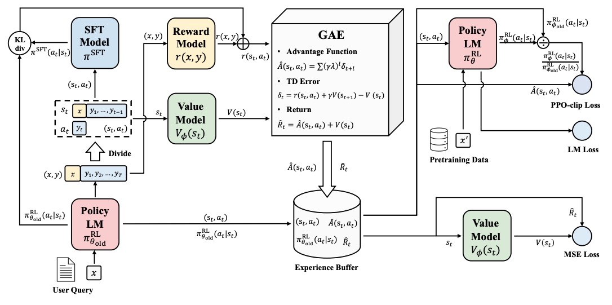
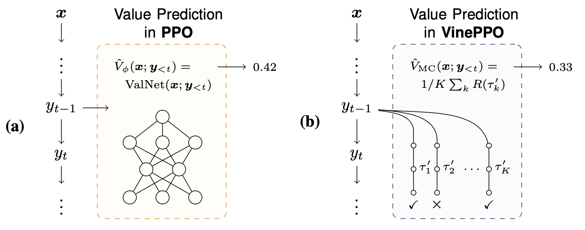
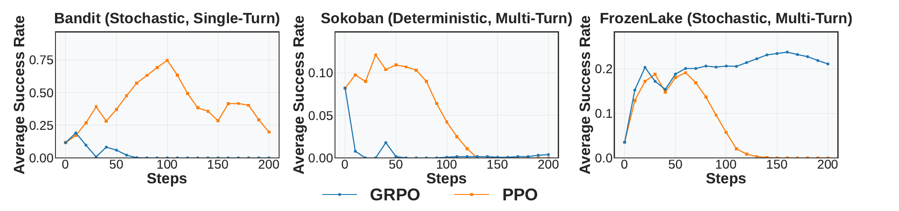

## 0. 这一篇讲什么

PPO（Proximal Policy Optimization，Schulman et al., 2017）是经典 RLHF 的标准算法，InstructGPT 和早期的 ChatGPT 都用它做最后一步优化。它的结构最完整：用一个 Critic 估计每个状态的价值，用 GAE 把序列末尾的奖励分配到每个 token 上，再用裁剪的目标函数限制每一步更新的幅度。

后来的 DPO 和 GRPO 都可以看成是在 PPO 的基础上**删掉一部分**：DPO 删掉了在线采样、奖励模型和 Critic；GRPO 删掉了 Critic。所以理解 PPO 的每个部件是做什么用的，就能理解后面的方法删掉它们之后付出了什么代价。

这一篇的内容：

1. 四个模型和它们的成本；
2. 从逐 token 的奖励到优势函数：TD 误差、蒙特卡洛回报和 GAE；
3. 裁剪的目标函数、价值损失和总损失；
4. 让 PPO 能工作的实现细节；
5. 针对 Critic 和奖励的改进：VC-PPO、VAPO、VinePPO、PRIME、PSGPO、PF-PPO；
6. 围绕 PPO 的争论：裁剪到底重不重要、奖励过优化和长度问题、PPO 与 DPO 谁更好；
7. 长程 Agent 任务中，为什么 Critic 重新受到重视；
8. PPO 适合什么样的任务。

策略梯度、baseline、优势函数和重要性采样的基础推导见第 1 篇。

## 1. 四个模型

在 RLHF 的 PPO 训练中，系统由四个模型组成：**四个模型，两个需要训练，分两个阶段**。先训练奖励模型；然后冻结奖励模型和参考模型，同时训练策略模型和 Critic。

| 模型 | 作用 | 初始化 | 是否训练 | 输出 |
|---|---|---|---|---|
| 策略模型（Actor） $\pi_\theta$ | 最终要得到的模型，根据提示词生成回答 | SFT 模型 | 是 | 每个 token 的概率分布 |
| 参考模型 $\pi_{\text{ref}}$ | 计算 KL，防止策略离 SFT 模型太远 | SFT 模型 | 否 | 每个 token 的概率 |
| 奖励模型 $r_\phi$ | 给完整回答打分 | 在偏好数据上训练好 | 否（PPO 阶段） | 一个标量 |
| Critic（价值模型） $V_\psi$ | 估计每个位置往后能拿到多少回报 | 奖励模型或 SFT 模型 | 是 | 每个 token 位置一个标量 |

几个容易混淆的地方：

**策略模型和参考模型同源.** 训练开始时两者完全相同，都来自 SFT。训练中策略不断更新，参考模型始终冻结。两者之间的 KL 衡量策略"跑偏了多少"。

**Critic 常从奖励模型初始化.** 两者都需要"判断一段文本好不好"的能力，奖励模型已经具备这种能力，价值头收敛更快。也有实现直接从 SFT 模型初始化，或者用一个更小的模型做 Critic。

**Critic 是 token 级的，奖励是序列级的.** PPO 把生成看成逐 token 的决策过程，Critic 在每个 token 位置都输出一个价值 $V(s_t)$。而奖励模型通常只对完整回答在最后一个 token 给一个分数。"奖励稀疏"是 PPO 训练 LLM 的固有难点，要靠 Critic 和 GAE 把它分摊到每个 token 上。

**Critic 拟合的不是奖励模型的输出，而是回报.** Critic 预测的是从当前位置往后的累计奖励（包括逐 token 的 KL 惩罚），奖励模型的分数只是构成回报的一部分。



*图 1：RLHF 中 PPO 的完整流程。左下：策略模型对用户提示词生成回答，回答被拆成逐 token 的状态和动作 $(s_t, a_t)$；奖励模型对整条回答打分，SFT 模型（即参考模型）给出每个 token 的概率用于计算 KL，二者合成逐 token 的奖励；价值模型给出 $V(s_t)$。中间：GAE 计算 TD 误差、优势和回报，存入经验缓冲区。右侧：用缓冲区中的数据计算三个损失，即策略的裁剪损失（PPO-clip Loss）、价值模型的均方误差损失（MSE Loss），以及在预训练数据上的语言模型损失（LM Loss，即 InstructGPT 的 PPO-ptx）。图片来源：Zheng et al., "Secrets of RLHF in Large Language Models Part I: PPO", 2023, Figure 1。*

**成本.** 四个模型中有两个需要训练，训练的模型要保存梯度和优化器状态（用 Adam 时约为参数量的 3 倍以上）。如果 Critic 和策略一样大，显存和计算开销接近训练两个模型。这是 GRPO 去掉 Critic 的直接动机。

## 2. 从奖励到优势函数

PPO 的核心是先给**每个 token** 算一个优势值 $\hat A_t$（这一步到底好不好），再用它加权更新策略。这一节分四步推到底。

### 2.1 第一步：构造每个 token 的奖励

奖励模型只在最后一个 token 给一个序列级的分数。为了防止策略钻奖励模型的空子，在每个 token 上减去一个 KL 惩罚：

$$
r_t = \underbrace{R(x, y) \cdot \mathbb{1}[t = T]}_{\text{奖励模型，只在末尾}} - \beta\, \mathrm{KL}_t,
\qquad
\mathrm{KL}_t = \log \frac{\pi_\theta(a_t \mid s_t)}{\pi_{\text{ref}}(a_t \mid s_t)}.
$$

- **参考模型就是为这一步存在的.** 没有它就算不出 KL。
- 这里的 $\mathrm{KL}_t$ 就是第 1 篇第 5.3 节中的 $k_1$ 估计。它被当作奖励的一部分，乘以 $\nabla \log \pi_\theta$ 进入策略梯度，所以给出的是正确的反向 KL 梯度。
- $\beta$ 大，策略被拉得紧、更保守；$\beta$ 小，策略更敢偏离 SFT 模型。InstructGPT 之前的工作（Ziegler et al., 2019）用了**自适应** $\beta$：设定一个目标 KL，实际 KL 超过目标就增大 $\beta$，低于目标就减小。

到这一步，每个 token 都有了一个奖励：中间的 token 主要是 $-\beta\,\mathrm{KL}_t$，最后一个 token 还加上了奖励模型的分数。

### 2.2 第二步：TD 误差，单步的优势

Critic 对每个状态输出 $V(s_t)$，预测的是**从当前位置继续生成，未来还能拿到多少累计奖励**：

$$
V(s_t) \approx \mathbb{E}\Big[ \sum_{l=0}^{T-t} \gamma^l r_{t+l} \Bigm| s_t \Big].
$$

在状态 $s_t$，Critic 原来预测 $V(s_t)$。生成 token $a_t$ 之后，得到了当前奖励 $r_t$，进入下一个状态 $s_{t+1}$，它的预测价值是 $V(s_{t+1})$。所以走一步之后的新估计是 $r_t + \gamma V(s_{t+1})$。新旧估计之差就是**时序差分误差**（TD error）：

$$
\delta_t = \underbrace{r_t + \gamma V(s_{t+1})}_{\text{走一步后的新估计}} - \underbrace{V(s_t)}_{\text{原来的估计}}.
$$

$\delta_t > 0$ 说明这一步的结果比预期好，这个动作值得加强；$\delta_t < 0$ 说明比预期差，应该削弱。所以 $\delta_t$ 本身就是一个**单步的优势估计**。$\gamma$ 是折扣因子，LLM 中通常取 1 或非常接近 1。

**为什么不直接用 TD 误差当优势？** 它只用了当前这一步的真实奖励，更远的结果全部依赖 Critic 的预测 $V(s_{t+1})$。如果 Critic 不准，优势就会有系统性的偏差。训练初期 Critic 往往不准，所以单步 TD 的特点是**方差低、偏差高**。

**另一个极端：蒙特卡洛.** 也可以等回答生成完，直接用真实的累计回报：

$$
\hat A_t^{\text{MC}} = G_t - V(s_t), \qquad G_t = r_t + \gamma r_{t+1} + \gamma^2 r_{t+2} + \cdots.
$$

它不依赖 Critic 对未来的预测（只用 $V(s_t)$ 作 baseline），偏差低。但回答中后面所有 token 的采样随机性都会影响前面 token 的优势值，所以**偏差低、方差高**。

### 2.3 第三步：GAE，在两个极端之间取折中

**GAE**（Generalized Advantage Estimation，Schulman et al., 2016）把各步的 TD 误差按指数衰减加权求和：

$$
\hat A_t^{\text{GAE}} = \sum_{l=0}^{T-t} (\gamma \lambda)^l \delta_{t+l} = \delta_t + \gamma\lambda\, \hat A_{t+1}^{\text{GAE}}.
$$

第二个等号给出了递推形式：当前的优势等于当前的 TD 误差，加上衰减后的下一步优势。所以实现时**从最后一个 token 倒着往前算**。

$\lambda$ 是偏差和方差之间的旋钮：

- $\lambda = 0$：$\hat A_t = \delta_t$，退化为单步 TD，完全相信 Critic。
- $\lambda = 1$：$\hat A_t = \sum_l \gamma^l \delta_{t+l} = G_t - V(s_t)$（中间的 $V$ 全部抵消），退化为蒙特卡洛，只用 Critic 作 baseline。
- 实践中常取 $\lambda \approx 0.95$。

在 LLM 中，奖励集中在最后一个 token，$(\gamma\lambda)^l$ 的权重负责把这个奖励**反向、衰减地**传回前面的每个 token：离结尾越近的 token 分到的信用越多。这就是 PPO 处理奖励稀疏的机制。但它也带来一个问题：回答很长时（比如几千个 token），$0.95^{1000}$ 几乎为 0，开头的 token 几乎收不到末尾奖励的信号，只能依赖 Critic 的估计。这正是第 5 节 VC-PPO 和 VAPO 要解决的问题。

GAE 的作用可以概括为：**把一条轨迹最终得到的奖励，以一种相对稳定的方式分配到每一个动作上。** 它同时利用真实奖励和 Critic 的预测：只信 Critic，方差小但有偏差；只信真实回报，偏差小但方差大；GAE 用 $\lambda$ 在两者之间平衡。它的目标是让训练更稳定，而不是让单个估计更准确。

下面是 GAE 的实现，并用一条 6 个 token 的回答比较不同 $\lambda$ 的效果：

```python
import numpy as np

def compute_gae(rewards, values, gamma=1.0, lam=0.95):
    """rewards[t]、values[t] 对应回答中第 t 个 token；回答结束后价值为 0。"""
    T = len(rewards)
    adv = np.zeros(T)
    last = 0.0
    for t in reversed(range(T)):                      # 从最后一个 token 往前算
        next_v = values[t + 1] if t + 1 < T else 0.0
        delta = rewards[t] + gamma * next_v - values[t]   # TD 误差 δ_t
        last = delta + gamma * lam * last                 # Â_t = δ_t + γλ Â_{t+1}
        adv[t] = last
    returns = adv + values                            # Critic 的回归目标
    return adv, returns

# 一条 6 个 token 的回答：RM 在最后给 1.0，每个 token 还有 −β·KL 的小惩罚
kl = np.array([0.02, 0.05, 0.01, 0.30, 0.02, 0.01])
beta, R = 0.1, 1.0
rewards = -beta * kl
rewards[-1] += R
values = np.array([0.5, 0.55, 0.6, 0.4, 0.7, 0.9])  # 某个 Critic 的估计

for lam in [0.0, 0.95, 1.0]:
    adv, ret = compute_gae(rewards, values, lam=lam)
    print(f"λ={lam:<4}  Â =", np.round(adv, 3))

# 检查：λ=1 时 Â_t = G_t − V(s_t)（蒙特卡洛回报减 baseline）
G = np.cumsum(rewards[::-1])[::-1]
adv1, _ = compute_gae(rewards, values, lam=1.0)
print("λ=1 与 G_t − V_t 的最大差:", np.abs(adv1 - (G - values)).max())
```

输出：

```
λ=0.0   Â = [ 0.048  0.045 -0.201  0.27   0.198  0.099]
λ=0.95  Â = [0.379 0.348 0.319 0.547 0.292 0.099]
λ=1.0   Â = [0.459 0.411 0.366 0.567 0.297 0.099]
λ=1 与 G_t − V_t 的最大差: 0.0
```

看第 3 个 token（下标 2）。这条回答最终得到了奖励，但 Critic 认为生成这个 token 之后，价值从 0.6 掉到了 0.4。在 $\lambda = 0$ 时，它的优势是 $-0.201$，被当作一个坏动作抑制；在 $\lambda = 0.95$ 或 1 时，末尾的奖励传回来，它的优势变成正的。

这个例子说明了两件事。一是 Critic 能给出 **token 级的区分**：同一条成功的回答中，不同 token 的优势值可以差别很大，这是 GRPO 的序列级优势做不到的。二是这种区分**完全依赖 Critic 的判断是否正确**：如果 Critic 对第 3 个 token 的判断是错的，$\lambda$ 越小，这个错误对训练的影响就越大。

### 2.4 第四步：重要性采样与裁剪

生成一次回答很贵，还要跑奖励模型、参考模型和 Critic。如果每次梯度更新后都丢掉这批数据重新采样，成本会非常高。所以 PPO 允许同一批数据训练好几个 epoch（或者把一个大 batch 切成若干个 mini-batch 依次更新）。第一次更新之后，策略就变了，需要用重要性权重修正：

$$
\rho_t(\theta) = \frac{\pi_\theta(a_t \mid s_t)}{\pi_{\theta_{\text{old}}}(a_t \mid s_t)}.
$$

$\rho_t$ 表示新策略相对于采样时的旧策略，把这个 token 的概率提高了还是降低了。最直接的目标是 $\rho_t \hat A_t$：优势为正时，增大 $\rho_t$ 能提高目标；优势为负时，减小 $\rho_t$ 能提高目标。

但当 $\rho_t$ 离 1 太远时，这个近似就失效了，更新会过猛，甚至破坏模型原来的语言能力。PPO 用裁剪来近似 TRPO 的信赖域，不需要二阶计算：

$$
L^{\text{CLIP}}(\theta) = \mathbb{E}_t\Big[ \min\big( \rho_t(\theta)\, \hat A_t,\; \mathrm{clip}(\rho_t(\theta), 1-\epsilon, 1+\epsilon)\, \hat A_t \big) \Big],
$$

通常 $\epsilon = 0.1 \sim 0.2$。

$\min$ 的作用是**只在保守的那一侧裁剪**。分六种情况看：

| 优势 | $\rho$ 的位置 | 取到哪一项 | 梯度 | 含义 |
|---|---|---|---|---|
| $\hat A > 0$ | $\rho \le 1 + \epsilon$ | 未裁剪 | 有 | 好动作，还可以继续提高概率 |
| $\hat A > 0$ | $\rho > 1 + \epsilon$ | 裁剪 | 0 | 好动作，但已经提高得够多了，停止 |
| $\hat A > 0$ | $\rho < 1 - \epsilon$ | 未裁剪 | 有 | 好动作被意外降低了概率，允许纠正 |
| $\hat A < 0$ | $\rho \ge 1 - \epsilon$ | 未裁剪 | 有 | 坏动作，还可以继续降低概率 |
| $\hat A < 0$ | $\rho < 1 - \epsilon$ | 裁剪 | 0 | 坏动作，已经降低得够多了，停止 |
| $\hat A < 0$ | $\rho > 1 + \epsilon$ | 未裁剪 | 有 | 坏动作被意外提高了概率，允许纠正 |

也就是说，裁剪只阻止"在正确的方向上走得太远"，不阻止"纠正错误的方向"。

```python
import numpy as np

def ppo_clip_term(ratio, adv, eps=0.2):
    """返回单个 token 的目标值（要最大化），以及它对 ratio 的导数。"""
    unclipped = ratio * adv
    clipped = np.clip(ratio, 1 - eps, 1 + eps) * adv
    obj = np.minimum(unclipped, clipped)
    # 只有当取到未裁剪的那一项时，梯度才能传回 ratio
    grad = adv if unclipped <= clipped else 0.0
    return obj, grad

cases = [(1.10, +1), (1.30, +1), (0.70, +1), (0.90, -1), (0.70, -1), (1.30, -1)]
for ratio, adv in cases:
    obj, g = ppo_clip_term(ratio, adv)
    print(f"ratio={ratio:.2f}  A={adv:+d}  目标={obj:+.2f}  对 ratio 的梯度={g:+.0f}")
```

输出：

```
ratio=1.10  A=+1  目标=+1.10  对 ratio 的梯度=+1
ratio=1.30  A=+1  目标=+1.20  对 ratio 的梯度=+0
ratio=0.70  A=+1  目标=+0.70  对 ratio 的梯度=+1
ratio=0.90  A=-1  目标=-0.90  对 ratio 的梯度=-1
ratio=0.70  A=-1  目标=-0.80  对 ratio 的梯度=+0
ratio=1.30  A=-1  目标=-1.30  对 ratio 的梯度=-1
```

**双重裁剪（dual-clip）.** 最后一种情况有一个隐患：优势为负、$\rho$ 很大时，目标 $\rho \hat A$ 没有下界。如果某个 token 的 $\rho$ 因为数值问题变得极大（比如旧策略下概率极小），一个 token 就能产生巨大的梯度。Ye et al.（2020）提出对优势为负的情况再加一个下界：

$$
L = \max\big( \min(\rho \hat A,\, \mathrm{clip}(\rho, 1-\epsilon, 1+\epsilon) \hat A),\; c\, \hat A \big), \qquad \hat A < 0,
$$

其中 $c > 1$（常取 3）。很多 LLM 的 RL 框架默认开启这个选项。在训练和推理不一致导致 $\rho$ 出现极端值时，它尤其重要（第 4 篇）。

## 3. 价值损失与总损失

### 3.1 价值损失

Critic 要估得准，优势值才可信，所以 Critic 也要训练。它需要一个回归目标。由 $\hat A_t = Q_t - V(s_t)$ 得到 $Q_t = \hat A_t + V(s_t)$，于是用 GAE 构造价值目标：

$$
V_t^{\text{targ}} = \hat A_t + V_{\text{old}}(s_t).
$$

它的含义是：根据这次采样和 GAE 修正之后，我们认为这个状态真正的未来回报大约是多少。（上面代码中的 `returns` 就是它。）

然后做均方误差回归，常带有价值裁剪，防止 Critic 一次更新过猛：

$$
L^{\text{VF}} = \max\Big( \big(V_\psi(s_t) - V_t^{\text{targ}}\big)^2,\; \big(\mathrm{clip}(V_\psi(s_t), V_{\text{old}} - \epsilon_v, V_{\text{old}} + \epsilon_v) - V_t^{\text{targ}}\big)^2 \Big).
$$

注意 **GAE 被用了两次**：策略损失用它作为优势权重，价值损失用它构造回归目标。所以 GAE 是整个 PPO 的核心。这也意味着两个用途对 $\lambda$ 的需求可能不同：策略需要一个低方差的优势，Critic 需要一个无偏的回报目标。VC-PPO 和 VAPO 正是从这里入手的（第 5.1 节）。

### 3.2 总损失

$$
L = -L^{\text{CLIP}} + c_1 L^{\text{VF}} - c_2 H[\pi_\theta].
$$

- $H[\pi_\theta]$ 是策略的熵（entropy bonus），鼓励探索、防止策略过早坍缩到确定的输出。不过在 LLM 中，熵奖励常常被设为 0 或很小，因为它很容易让模型输出乱码。熵的控制在第 4 篇讨论。
- 写成最小化的形式时，策略项和熵项取负号，价值项取正号。
- 策略和 Critic 是两个独立的网络时，两个损失分别反向传播，$c_1$ 只影响学习率的相对大小。

### 3.3 小结

| 部件 | 作用 |
|---|---|
| 奖励模型 | 判断完整回答好不好 |
| 参考模型 | 判断策略偏离原模型多少 |
| Critic | 预测每个位置的未来回报 |
| GAE | 从后往前计算每个 token 的优势值 |
| 策略损失 | 根据优势值调整 token 概率，裁剪限制更新幅度 |
| 价值损失 | 训练 Critic 更准确地预测回报 |

### 3.4 PPO 是 on-policy 还是 off-policy

严格来说，PPO 是 **on-policy** 的：采样数据的策略和被优化的策略必须相同，或者差异很小。重要性采样有一个前提：两个分布不能差得太远。如果用很久以前的旧模型采的数据，$\rho$ 要么接近 0，要么非常大，权重的方差会爆炸，梯度估计完全失真。

这对 LLM 的训练有直接影响：必须一边生成一边训练，训练过程中频繁地做推理生成，显存占用大、速度慢（生成是逐 token 的，无法像训练那样并行）。这是 RLHF 训练昂贵的主要原因。

## 4. 让 PPO 能工作的实现细节

PPO 在 LLM 上以"难调"著称。很多失败并不是算法本身的问题，而是实现细节。Engstrom et al.（2020）在经典的控制任务上发现，PPO 相对于更简单的方法的优势，很大程度上来自代码层面的优化（价值裁剪、奖励缩放、学习率退火、正交初始化等），而不是裁剪目标本身。Huang et al.（2024）在 LLM 上复现了 OpenAI 早期的 RLHF 工作，整理了数十条实现细节；Zheng et al.（2023）的"Secrets of RLHF"系列也做了类似的系统研究，提出了一套稳定的配置 PPO-max。

常见的细节：

**奖励的处理.**

- **奖励归一化**：奖励模型的分数尺度随意（第 1 篇第 6.1 节），常用滑动平均和标准差把奖励归一化，或者减去 SFT 模型在同一批提示词上的平均奖励。
- **奖励裁剪**：把奖励限制在一个范围内，防止个别极端分数主导训练。
- **没有正常结束的回答**：如果回答因为长度上限被截断、没有生成结束符，给一个固定的惩罚分数，而不是用奖励模型打分。否则模型可能学会不结束。

**优势的处理.**

- **优势白化**：在一个 batch 内把优势值减去均值、除以标准差。这几乎是必须的。
- **只在回答部分计算**：提示词和 padding 的位置要掩掉。多轮任务中，工具返回的 token 也要掩掉。

**KL 的处理.**

- KL 惩罚放在奖励里，逐 token 计算。
- 自适应 $\beta$ 或固定一个较小的 $\beta$。
- 监控实际的 KL：KL 突然增大往往是训练将要崩溃的信号。

**采样与概率的一致性.**

- 采样时如果使用了温度 $T$，计算对数概率时也要用同样的温度（把 logits 除以 $T$），否则 $\pi_{\text{old}}$ 和采样分布不一致。
- 采样时如果用了 top-p、top-k，被截断的分布和训练时计算的完整分布也不一致。RL 采样通常用温度 1、不截断（Transformer 系列第 7 篇）。

**Critic 的处理.**

- 用奖励模型初始化 Critic，或者在开始训练策略之前先单独训练 Critic 一段时间（"价值预热"）。
- 价值损失的裁剪。

**监控指标.** 平均奖励、KL、回答长度、策略熵、裁剪比例（有多少 token 的 $\rho$ 超出了范围）、价值损失和价值的解释方差。回答长度持续增长、熵快速下降，是最常见的两个异常信号。

## 5. 后续改进工作

PPO 的改进主要针对两个问题：**Critic 估不准**，以及**奖励不可靠或太稀疏**。

### 5.1 让 Critic 估得更准：VC-PPO 与 VAPO

在长思维链的推理任务上，PPO 常常训练失败，而 GRPO 能工作，这一度被当作"Critic 没用"的证据。Yuan et al.（2025，VC-PPO）分析了失败的原因，认为问题出在 Critic 而不是 PPO 本身：

1. **价值初始化的偏差.** Critic 从奖励模型初始化，但奖励模型只在最后一个 token 被训练过，在中间的 token 上它的输出没有意义。训练初期，Critic 对中间 token 的估计是系统性有偏的，导致优势值也有偏。
2. **长序列中奖励信号的衰减.** 用 $\lambda = 0.95$ 时，末尾的奖励传到几千个 token 之前已经衰减到几乎为 0，Critic 学不到开头的价值。

对应的两个修改：

- **价值预训练**：先固定策略，用它生成一批回答，用 $\lambda = 1$ 的蒙特卡洛回报训练 Critic，等它能基本正确地估值后，再开始更新策略。
- **解耦的 GAE**：策略和 Critic 用不同的 $\lambda$。Critic 用 $\lambda = 1$，得到无偏的回报目标；策略用较小的 $\lambda$，得到低方差的优势。

VAPO（Yue et al., 2025）在此基础上又加入了几项改进，并把它们组合成一个完整的系统：

- **长度自适应的 GAE**：策略的 $\lambda$ 随回答长度 $l$ 变化，形如 $\lambda = 1 - \frac{1}{\alpha l}$。回答越长，$\lambda$ 越接近 1，保证末尾的奖励能传回开头，而不是对所有长度都用同一个参数。
- 采用了 DAPO 中的几项技巧：token 级的损失平均、非对称的裁剪上界（Clip-Higher）、按组采样。
- 对正确的回答额外加一个语言模型损失（相当于在正样本上做 SFT），加速学习。

VAPO 在 Qwen2.5-32B 基座模型上训练，报告 AIME 2024 达到 60.4 分，并且在多次独立训练中都没有出现崩溃。它的意义在于说明：**PPO 在长思维链上训练不好，主要是 Critic 的工程问题，修好之后 Critic 提供的 token 级信用分配是有价值的。**

### 5.2 不训练 Critic，用采样估计价值：VinePPO

Kazemnejad et al.（2024，VinePPO）走了另一条路。他们发现，在复杂的推理任务上，价值网络很难准确判断一个中间步骤之后成功的概率，错误的价值会产生错误的优势。

VinePPO 的做法是：不训练 Critic，而是从选定的中间状态（比如每个推理步骤结束的位置）出发，用当前策略继续生成若干条完整的回答，用它们最终奖励的平均值作为这个状态的**蒙特卡洛价值估计**，再据此计算优势。



*图 2：两种价值估计方式。(a) PPO 用一个价值网络读入前缀 $(x; y_{<t})$，直接输出一个估计值。(b) VinePPO 从同一个前缀出发，用当前策略续写 $K$ 条完整回答 $\tau'_1, \dots, \tau'_K$，用它们最终奖励的平均值作为价值估计。图片来源：Kazemnejad et al., "VinePPO: Refining Credit Assignment in RL Training of LLMs", ICML 2025，方法示意图（取自作者的 GitHub 仓库 McGill-NLP/VinePPO）。*

LLM 的一个特点让这种做法可行：环境是确定的，可以从任意前缀"重启"生成（经典 RL 中很多环境无法回到任意状态）。代价是需要大量额外的采样。VinePPO 报告用更少的训练步数和更短的实际时间达到了更好的效果，但每一步的计算量更大。

### 5.3 让奖励更密集：PRIME 与 PSGPO

另一类改进针对奖励的稀疏性，用过程奖励给中间步骤打分。

**PRIME**（Cui et al., 2025）使用**隐式过程奖励**：训练一个只需要结果标签的奖励模型，它的形式和 DPO 的隐式奖励相同，$\beta \log \frac{\pi_\phi(y_t \mid y_{<t})}{\pi_{\text{ref}}(y_t \mid y_{<t})}$，可以自然地分解到每个 token 上。这个奖励模型和策略一起在线更新，用结果奖励的标签训练，从而避免过程奖励模型因为分布变化而失效、被钻空子的问题。

**PSGPO**（Dai et al., 2024）针对代码生成：通常只在完整代码生成后运行单元测试，模型只知道最终是否失败，不知道从哪一行开始出错。PSGPO 从不同的代码前缀继续采样并运行测试，据此构造**行级的过程标签**，训练一个过程奖励模型。PPO 训练时，它既用这个模型给出逐行的密集奖励，又用它初始化 Critic，让模型更快地定位具体的错误。

### 5.4 只用可信的奖励：PF-PPO

PPO 默认奖励模型的打分是可信的，但奖励模型在不同分数区间的可靠程度不同，可能给错误的回答高分。**PF-PPO**（Policy Filtration，Zhang et al., 2024）在有真实答案或执行结果的验证集上，比较奖励模型的分数和真实质量，用决定系数 $R^2$ 寻找奖励模型最可靠的分数区间（比如只保留分数最高和最低的样本）。训练时只用这些可信的样本更新策略，提高奖励信号的信噪比。

### 5.5 去掉 Critic 的 PPO

还有一类工作保留 PPO 的裁剪目标，但去掉 Critic，用组内的多个采样估计 baseline。GRPO 就是其中最有名的一个。Liu et al.（2025）系统地比较了 GRPO 类方法中的各种技巧，提出了一个只保留两项技巧的简化版本 **LitePPO**：组内减均值、在整个 batch 上除以标准差（而不是在组内除），再加上 token 级的损失平均。这些放在第 4 篇讨论。

## 6. 围绕 PPO 的分析与争论

### 6.1 Critic 在 LLM 上到底有没有用

这是贯穿整个系列的核心争论。

**反对的一方**认为，在 LLM 上 Critic 价值不大，甚至有害：

- 状态是一个很长的文本前缀，要预测"从这里往下继续生成能拿多少分"，本质上就是要判断这道题接下来能不能做对，难度不亚于解题本身。
- Critic 和策略同样大，成本翻倍；训练不稳定，初始化困难。
- 对 RLHF，Ahmadian et al.（2024）认为 PPO 的很多设计是为经典 RL 中的高方差、多步问题准备的，而 LLM 从一个很强的预训练策略出发，更简单的 REINFORCE 类方法（比如 RLOO）就足够，而且效果更好。Li et al.（2023，ReMax）也提出用贪心解码的奖励作 baseline 来代替 Critic。
- GRPO 在数学和代码推理上的成功，被认为证明了组内 baseline 可以代替 Critic。

**支持的一方**认为，Critic 的问题是工程问题，而它提供的 token 级信用分配是组内 baseline 给不了的：

- VC-PPO 和 VAPO 说明，修好初始化和 GAE 之后，PPO 在长思维链上可以比 GRPO 更好、更稳定。
- 当任务需要在一条很长的轨迹中区分好的步骤和坏的步骤时（第 7 节），序列级的优势是不够的。
- 对每个提示词只需要采样一条回答，不需要像 GRPO 那样采一组。当单次采样很贵时（比如 Agent 任务），这是一个重要的优势。

比较公允的结论是：**Critic 的价值取决于任务结构**。回答短、奖励可验证、同一个问题的多次采样容易比较时，组内 baseline 足够好，省掉 Critic 是合算的。轨迹长、中间状态差异大、采样贵时，Critic 的价值就显现出来。

### 6.2 裁剪到底重不重要

PPO 的名字来自裁剪，但裁剪的作用一直有争议：

- Engstrom et al.（2020）发现，在控制任务中，去掉代码层面的优化之后，PPO 并不比 TRPO 更好，而裁剪本身并不能可靠地把策略限制在信赖域内。
- 在 LLM 的 RL 中，裁剪又重新成为关注的焦点，但关注的方向变了：不是"裁剪能不能维持信赖域"，而是"裁剪是否过度限制了探索"。DAPO 发现，对称的裁剪会让低概率的好 token 很难被提高（$\rho$ 的上界 $1+\epsilon$ 对一个概率为 0.01 的 token 来说，只允许它提高到 0.012），导致熵快速下降。它的解决办法是把上界放宽（Clip-Higher）。还有一些工作发现，被裁剪掉的往往正是那些对推理很关键的低概率 token，于是提出了只对梯度做裁剪而保留 token 的方法。这些在第 4 篇讨论。

### 6.3 奖励过优化与长度问题

RLHF 中最普遍的过优化现象是**回答越来越长**。Singhal et al.（2023）研究了几个 RLHF 数据集和模型，发现 RLHF 带来的奖励提升中有相当大的部分可以用回答长度的增加来解释；只用长度作为奖励来优化，就能复现大部分提升。这说明奖励模型在很大程度上学到的是"越长越好"。

常见的应对方法：

- 在奖励中加长度惩罚，或者对奖励按长度做归一化；
- 在奖励模型训练时，构造长度相同但质量不同的对比数据，削弱长度和偏好之间的相关性；
- 评估时使用长度控制的指标，比如 AlpacaEval 2 的长度控制胜率（length-controlled win rate）。

在 RLVR 中，回答变长有时是有益的（更长的思维链能解决更难的题，见第 1 篇图 2），有时是有害的（无意义的重复、为了"看起来在思考"而拉长）。怎样区分这两种情况，是第 4 篇的一个话题。

### 6.4 PPO 和 DPO 谁更好

DPO 出现之后，很多人认为它可以取代 PPO。几项系统比较的结论是：**正确调好的 PPO 通常更好，但调好很难。**

- Xu et al.（2024）比较了 PPO 和 DPO 在对话和代码任务上的表现，认为 DPO 的效果受限于偏好数据和模型生成的分布之间的差异，而 PPO 的关键在于几个实现细节：优势归一化、大的 batch size、以及用滑动平均（EMA）的方式更新参考模型。调好之后，PPO 在他们的实验中全面超过了 DPO，包括有挑战性的代码竞赛任务。
- Ivison et al.（2024）在相同的偏好数据上比较了两者，发现 PPO 在多数设置下优于 DPO，但优势并不大；而偏好数据的质量对结果的影响比算法的选择更大。

更多讨论见第 3 篇。

## 7. 长程 Agent 任务：为什么 Critic 重新受到重视

### 7.1 现象

在数学和代码推理上，GRPO 类方法大获成功。但在长程（long-horizon）的 Agent 任务上，有越来越多的报告发现 GRPO 的效果不理想，带 Critic 的方法重新受到重视。RAGEN（Wang et al., 2025）在几个简单的多轮环境上比较了两者：



*图 3：在三个环境中，PPO（橙色）和 GRPO（蓝色）训练过程中平均成功率的变化。两种方法起初都有提升，但最终都会崩溃；在 Bandit 和 Sokoban 上，PPO 保持稳定的时间明显更长；在 Frozen Lake 上则是 GRPO 更稳定。图片来源：Wang et al., "RAGEN: Understanding Self-Evolution in LLM Agents via Multi-Turn Reinforcement Learning", 2025, Figure 5。*

作者的解释是：Critic 能在一定程度上延缓多轮训练中的不稳定；而在 Frozen Lake 这样状态价值难以估计的随机环境中，Critic 本身不准，反而降低了 PPO 的稳定性。他们还发现，两种方法最终都会陷入一种模式：模型反复使用几种固定的推理模板，多样性坍缩，作者称之为"回声陷阱"（Echo Trap）。

这个结果只是一个小规模的例子，但它和本节要讨论的结构性原因是一致的。

### 7.2 原因：沿着"优势怎么估计"这条线看

GRPO 在数学和代码上效果好，背后有一个隐含的假设：**一条轨迹最终的结果奖励，能够比较可靠地代表整条轨迹的质量。** 一道数学题答案对了，通常可以认为这条推理路径整体是有效的；代码通过了测试，也可以比较放心地给这条回答正奖励。所以不训练 Critic、直接用同一个提示词下其他回答的平均奖励作 baseline，既简单又有效。

到了长程 Agent 任务，这个假设不再成立。原因有四个。

**一、结果奖励和每一步的真实质量严重错位.** 一个 Agent 要连续执行 30 步：搜索网页、打开页面、提取信息、调用工具、修改文件、再验证结果，最后任务失败了。GRPO 拿到的只有最终的 $R = 0$，这个序列级的优势会被广播到整条轨迹的每一个 token 上。但前 25 步可能都是正确的，真正导致失败的只是第 26 步调用了错误的工具。反过来，一条最终成功的轨迹中，也可能有很多无效的探索和错误操作，只是后来恢复了。轨迹越长，这个信用分配问题越严重。问题不只是"GRPO 的优势估得不准"，而是：**GRPO 的优势本质上是轨迹之间的相对比较，却被拿去指导一条长轨迹中大量不同状态下的动作更新。**

**二、组内 baseline 太粗.** 对同一个任务采样 8 条轨迹，GRPO 比较的是"这条完整轨迹相对于另外 7 条好不好"。但 Agent 在第 20 步真正需要知道的是：**我现在处于状态 $s_{20}$，执行动作 $a_{20}$ 之后，未来成功的概率是提高了还是降低了？** 这正是 Critic 要回答的问题。PPO 中的 $V(s_t)$ 是一个依赖状态的 baseline，$\hat A_t$ 衡量的是当前动作相对于当前状态的预期好不好。短程任务中，用组内平均代替 Critic 可能已经够用；长程任务中，不同时间步对应完全不同的状态，**一个提示词级别的 baseline 很难代替依赖状态的价值函数**。

**三、奖励稀疏，采样昂贵.** 一道数学题的一次采样可能是几百到几千个 token，可以一次采很多条。一条真实的 Agent 轨迹可能包含几十轮模型调用和工具调用，甚至要和真实环境交互。为了得到可靠的组内优势，每个任务要采 8、16 甚至 32 条轨迹，成本非常高。更麻烦的是，长程任务在训练初期的成功率可能只有 1%，同一个任务采 8 次很可能全部失败，组内奖励全是 0，**没有方差，GRPO 就没有学习信号**。而 Critic 至少有机会跨轨迹地学习"哪些中间状态更接近成功"，把最终的稀疏奖励向前传播。所以在成功率低、轨迹长的环境中，Critic 虽然更难训练，却可能提供比组内归一化更有信息量的信号。

**四、不同的轨迹很难直接比较.** 数学题的 8 次采样都在解同一个静态的问题。Agent 的轨迹会迅速进入不同的环境状态：A 在第 3 步打开了页面 X，B 打开了页面 Y，到第 10 步两条轨迹已经处在完全不同的状态里。这时说"B 最终奖励比 A 高，所以 B 整条轨迹的优势更高"，是一个非常粗糙的比较。Critic 学习的是 $V(s)$，至少在形式上允许不同的轨迹进入不同的状态之后，在各自的状态上判断动作的价值。

### 7.3 结论：不一定回到原始的 PPO

所以长程 Agent 任务重新关注 PPO，并不是因为"GRPO 被证明不行"，而是因为任务结构变了。**GRPO 最大的优势是用组内比较省掉 Critic，但长程任务恰恰是最需要信用分配和依赖状态的价值估计的地方：省掉的 Critic，可能正是这个场景最需要的东西。**

一个简洁的总结：数学和代码更像是"哪个答案更好"的问题，轨迹级的相对优势已经很有效；长程 Agent 任务更像是"这条几十步的轨迹里，到底是哪一步让成功的概率发生了变化"的问题，训练的重点因此从结果比较回到了**时序上的信用分配**，而这正是 PPO 当初引入 Critic 和优势函数的原因。

这并不意味着一定要回到最原始的 PPO。更值得关注的方向是：**保留组内比较的低成本，同时提供更细粒度的信用分配。** 近期的工作大致有几类：

- **轮次级的 Critic**：在每一轮交互（而不是每个 token）上估计价值。ArCHer（Zhou et al., 2024）用一个高层的、轮次级的 Critic 配合低层的 token 级策略；SWEET-RL（Zhou et al., 2025）在训练时让 Critic 能看到额外的信息（比如参考答案），用它给每一轮打分。
- **步骤级的分组**：GiGPO（Feng et al., 2025）在 GRPO 的轨迹级分组之外，把不同轨迹中**处于相同环境状态**的步骤归为一组，在组内比较这些步骤之后的回报，得到不需要 Critic 的步骤级优势。它利用了一个事实：很多环境中，不同的轨迹会反复经过相同的状态。
- **过程奖励和事后信用分配**：用过程奖励模型、或者在轨迹结束后回头判断哪些步骤是关键的，把稀疏的结果奖励拆分到各个步骤上。
- **轨迹切分**：把一条长轨迹切成若干段，在段的粒度上做比较或估值。

这些方法在第 5 篇的 Agent 部分还会提到。某种意义上，近期长程 RL 的很多工作都在重新回答一个经典的问题：**最终只知道成败，应该把功劳和责任分给前面的哪些动作？**

## 8. PPO 适合什么样的任务

| 场景 | PPO 是否合适 | 理由 |
|---|---|---|
| 通用对话的 RLHF（有奖励模型） | 合适，但成本高 | 奖励模型给出连续的分数，Critic 能利用；需要在线采样来避免分布偏移 |
| 数学、代码推理（可验证奖励） | 可以，但需要 VAPO 一类的改进 | 原始 PPO 的 Critic 在长思维链上容易出问题；GRPO 类方法更简单 |
| 长程、多轮 Agent 任务 | 值得考虑 | 需要状态相关的信用分配；每个任务只需一次采样 |
| 有过程奖励或密集奖励 | 合适 | Critic 和 GAE 能自然地利用逐步的奖励 |
| 资源有限、需要快速迭代 | 不太合适 | 四个模型、调参复杂；DPO 或 GRPO 更省事 |
| 只有离线偏好数据，无法在线采样 | 不适用 | PPO 必须在线采样；用 DPO 类方法 |

选择 PPO 的核心判断是：**任务是否真的需要 token 级或步骤级的信用分配，以及是否有足够的资源把 Critic 训练好。** 如果答案都是肯定的，PPO 仍然是最通用、上限最高的方法。

## 参考文献

- Schulman et al. *High-Dimensional Continuous Control Using Generalized Advantage Estimation.* ICLR 2016.
- Schulman et al. *Proximal Policy Optimization Algorithms.* 2017.
- Ziegler et al. *Fine-Tuning Language Models from Human Preferences.* 2019.
- Engstrom et al. *Implementation Matters in Deep Policy Gradients: A Case Study on PPO and TRPO.* ICLR 2020.
- Ye et al. *Mastering Complex Control in MOBA Games with Deep Reinforcement Learning.* AAAI 2020.（dual-clip PPO）
- Ouyang et al. *Training Language Models to Follow Instructions with Human Feedback.* NeurIPS 2022.
- Zheng et al. *Secrets of RLHF in Large Language Models Part I: PPO.* 2023.
- Singhal et al. *A Long Way to Go: Investigating Length Correlations in RLHF.* 2023.
- Li et al. *ReMax: A Simple, Effective, and Efficient Reinforcement Learning Method for Aligning Large Language Models.* ICML 2024.
- Ahmadian et al. *Back to Basics: Revisiting REINFORCE Style Optimization for Learning from Human Feedback in LLMs.* ACL 2024.
- Huang et al. *The N+ Implementation Details of RLHF with PPO: A Case Study on TL;DR Summarization.* COLM 2024.
- Xu et al. *Is DPO Superior to PPO for LLM Alignment? A Comprehensive Study.* ICML 2024.
- Ivison et al. *Unpacking DPO and PPO: Disentangling Best Practices for Learning from Preference Feedback.* NeurIPS 2024.
- Zhou et al. *ArCHer: Training Language Model Agents via Hierarchical Multi-Turn RL.* ICML 2024.
- Kazemnejad et al. *VinePPO: Refining Credit Assignment in RL Training of LLMs.* ICML 2025.
- Zhang et al. *Policy Filtration in RLHF to Fine-Tune LLM for Code Generation.* 2024.（PF-PPO）
- Dai et al. *Process Supervision-Guided Policy Optimization for Code Generation.* 2024.（PSGPO）
- Cui et al. *Process Reinforcement through Implicit Rewards.* 2025.（PRIME）
- Yuan et al. *What's Behind PPO's Collapse in Long-CoT? Value Optimization Holds the Secret.* 2025.（VC-PPO）
- Yue et al. *VAPO: Efficient and Reliable Reinforcement Learning for Advanced Reasoning Tasks.* 2025.
- Liu et al. *Part I: Tricks or Traps? A Deep Dive into RL for LLM Reasoning.* 2025.（LitePPO）
- Zhou et al. *SWEET-RL: Training Multi-Turn LLM Agents on Collaborative Reasoning Tasks.* 2025.
- Wang et al. *RAGEN: Understanding Self-Evolution in LLM Agents via Multi-Turn Reinforcement Learning.* 2025.
- Feng et al. *Group-in-Group Policy Optimization for LLM Agent Training.* 2025.（GiGPO）
