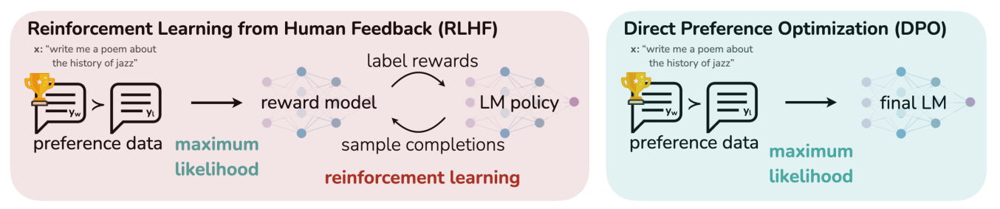
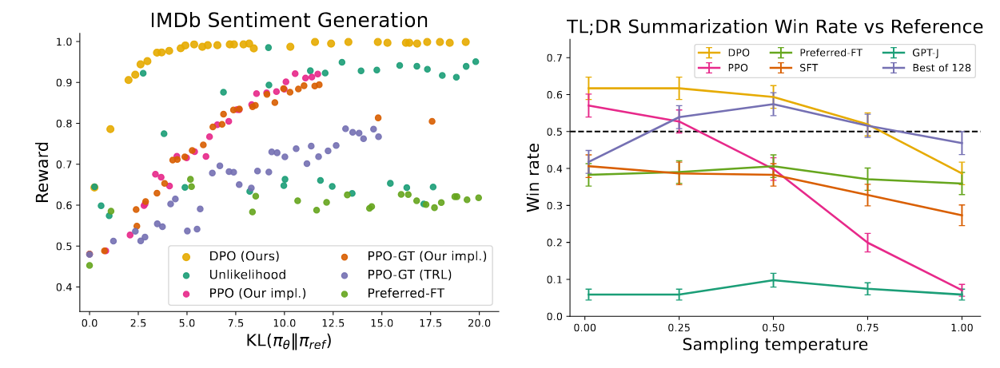
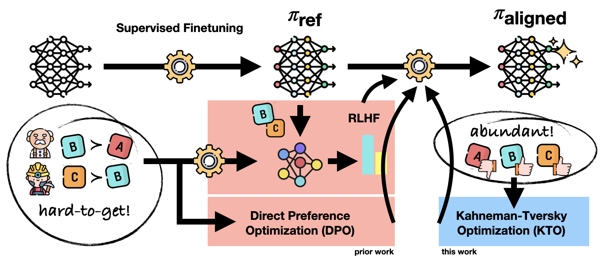
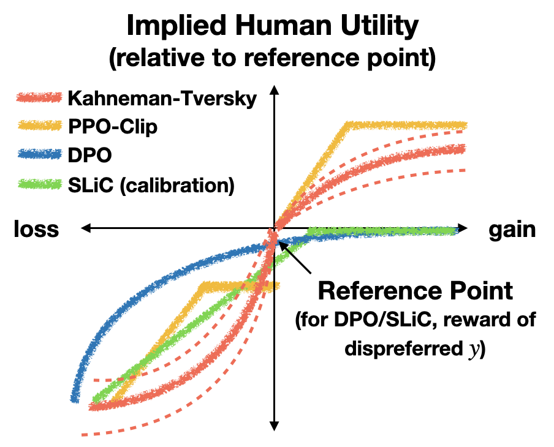
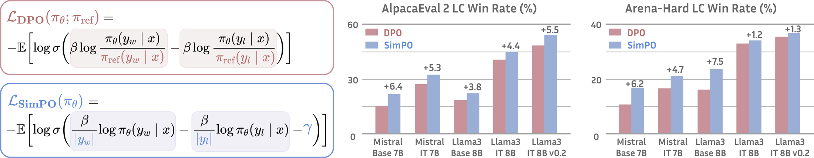

## 0. 这一篇讲什么

DPO（Direct Preference Optimization，Rafailov et al., 2023）的核心观察是：在偏好数据的场景下，可以利用 KL 约束目标的闭式最优解，**把奖励模型、Critic 和优势函数全部折叠掉**，直接在偏好对上做一个分类损失。

PPO 显式地经历"奖励 → 价值 → 优势 → 策略更新"这条链；DPO 把中间的这些东西全部折叠进一个偏好损失里。它不需要在线采样，不需要奖励模型，也不需要 Critic，只需要策略模型和一个冻结的参考模型。



*图 1：左边是 RLHF：先在偏好数据上用最大似然训练奖励模型，再用强化学习优化策略，策略采样回答、奖励模型打分，循环往复。右边是 DPO：直接在偏好数据上用最大似然训练最终的模型，不需要奖励模型，也不需要强化学习的采样循环。图片来源：Rafailov et al., "Direct Preference Optimization: Your Language Model is Secretly a Reward Model", NeurIPS 2023, Figure 1。*

这种简洁让 DPO 迅速成为开源模型对齐的主流方法。但它也付出了代价：依赖固定的离线数据，没有探索，也没有 token 级的信用分配。这一篇的内容：

1. DPO 的完整推导和梯度分析；
2. 实现：两个模型、四个标量；
3. DPO 的已知问题：分布偏移、likelihood displacement、长度偏见、过拟合；
4. 针对这些问题的变体：IPO、KTO、ORPO、SimPO、RSO、在线 DPO、Step-DPO、TDPO、$\beta$-DPO；
5. 围绕 DPO 的争论：离线与在线、DPO 与 PPO；
6. DPO 适合什么样的数据条件和任务。

## 1. 推导

训练数据由三元组 $(x, y_w, y_l)$ 组成：$x$ 是提示词，$y_w$ 是更受偏好的回答（chosen），$y_l$ 是不受偏好的回答（rejected）。

### 1.1 第一步：用 Bradley–Terry 模型表示偏好

偏好数据只告诉我们 $y_w$ 比 $y_l$ 好，没有给出两个回答的绝对分数。Bradley–Terry 模型假设，$y_w$ 胜过 $y_l$ 的概率由两者的奖励差决定（第 1 篇第 6.1 节）：

$$
P(y_w \succ y_l \mid x) = \sigma\big( r(x, y_w) - r(x, y_l) \big).
$$

最重要的性质是：**偏好概率只取决于两个回答的奖励差，而不取决于奖励的绝对值。**

### 1.2 第二步：KL 约束下的最优策略

RLHF 的目标是在提高奖励的同时，限制策略不要离参考模型太远：

$$
\max_\pi\; \mathbb{E}_{x \sim \mathcal{D}}\Big[ \mathbb{E}_{y \sim \pi(\cdot \mid x)}[r(x, y)] - \beta\, \mathrm{KL}\big( \pi(\cdot \mid x) \,\Vert\, \pi_{\text{ref}}(\cdot \mid x) \big) \Big].
$$

第 1 篇第 5.2 节证明了它的最优解是：

$$
\pi^*(y \mid x) = \frac{1}{Z(x)}\, \pi_{\text{ref}}(y \mid x) \exp\Big( \frac{r(x, y)}{\beta} \Big),
\qquad
Z(x) = \sum_y \pi_{\text{ref}}(y \mid x) \exp\Big( \frac{r(x, y)}{\beta} \Big).
$$

最优策略以参考模型为基础，通过 $\exp(r/\beta)$ 提高高奖励回答的相对概率。严格地说，"降低低奖励回答的概率"是归一化之后的相对结果：公式先根据奖励对所有回答重新加权，再由 $Z(x)$ 归一化。

对 LLM，$y$ 是一整条 token 序列，可能的回答数量是天文数字，无法枚举所有 $y$ 来计算 $Z(x)$。但下面会看到，DPO 只用到两个回答的奖励差，$Z(x)$ 会在相减时消失。

### 1.3 第三步：反过来，用策略表示奖励

对最优策略的等式两边取对数，反解出奖励：

$$
r(x, y) = \beta \log \frac{\pi^*(y \mid x)}{\pi_{\text{ref}}(y \mid x)} + \beta \log Z(x).
$$

这一步是 DPO 的关键：**任何一个奖励函数，都可以用它对应的最优策略和参考模型来表示。** 反过来，如果我们直接训练一个策略 $\pi_\theta$，就可以把它看作某个奖励函数的最优策略，这个奖励就是：

$$
\hat r_\theta(x, y) = \beta \log \frac{\pi_\theta(y \mid x)}{\pi_{\text{ref}}(y \mid x)}.
$$

这叫**隐式奖励**（implicit reward）。论文的副标题"Your Language Model is Secretly a Reward Model"说的就是这件事。

计算 chosen 和 rejected 的奖励差时，无法计算的 $\beta \log Z(x)$ 正好抵消：

$$
r(x, y_w) - r(x, y_l) = \beta \Big[ \log \frac{\pi_\theta(y_w \mid x)}{\pi_{\text{ref}}(y_w \mid x)} - \log \frac{\pi_\theta(y_l \mid x)}{\pi_{\text{ref}}(y_l \mid x)} \Big].
$$

### 1.4 第四步：代回 Bradley–Terry 模型

把奖励差代回 BT 模型，最小化负对数似然，就得到 DPO 的损失：

$$
\mathcal{L}_{\text{DPO}} = -\mathbb{E}_{(x, y_w, y_l) \sim \mathcal{D}}\Big[ \log \sigma\Big( \beta \log \frac{\pi_\theta(y_w \mid x)}{\pi_{\text{ref}}(y_w \mid x)} - \beta \log \frac{\pi_\theta(y_l \mid x)}{\pi_{\text{ref}}(y_l \mid x)} \Big) \Big].
$$

记括号里的量为 $z$，损失可以简写为 $-\mathbb{E}[\log \sigma(z)]$。把 $z$ 重新整理一下：

$$
z = \beta \Big( \big[ \log \pi_\theta(y_w) - \log \pi_\theta(y_l) \big] - \big[ \log \pi_{\text{ref}}(y_w) - \log \pi_{\text{ref}}(y_l) \big] \Big).
$$

可以看到，DPO 优化的不是简单的 $\log \pi_\theta(y_w) - \log \pi_\theta(y_l)$，而是**策略模型相对于参考模型的偏好变化**。策略模型不只是要偏好 $y_w$，还要比参考模型**更加**偏好 $y_w$。如果参考模型已经很偏好 $y_w$，DPO 不会再额外奖励这一点。

注意整个推导的逻辑：我们并没有求解 RL 问题，而是利用 RL 问题的解的**形式**，把"学习奖励模型"直接变成了"学习策略"。奖励模型的训练目标（BT 似然）原封不动，只是奖励被换成了策略的函数。所以 DPO 本质上是一个**奖励建模**的过程，策略是它的副产品。

### 1.5 第五步：梯度在做什么

对单个样本求梯度：

$$
\nabla_\theta \mathcal{L} = -\beta\, \sigma(-z) \Big[ \nabla_\theta \log \pi_\theta(y_w \mid x) - \nabla_\theta \log \pi_\theta(y_l \mid x) \Big].
$$

梯度由两部分组成：

1. **方向**（括号内）：提高 $y_w$ 的对数概率，降低 $y_l$ 的对数概率。
2. **权重**（括号外的 $\sigma(-z)$）：隐式奖励模型对这一对的判断越错，权重越大。
   - $z < 0$（排序错了）：$\sigma(-z) \approx 1$，大梯度；
   - $z \approx 0$（还分不清）：权重约 0.5；
   - $z \gg 0$（已经很偏好 $y_w$）：$\sigma(-z) \approx 0$，梯度自动衰减。

这个加权非常重要。DPO 论文做过消融：去掉 $\sigma(-z)$、对所有样本用相同的权重（即简单的"提高 chosen、降低 rejected"，称为 unlikelihood 训练），模型会很快退化。

把梯度和 SFT 对比：SFT 的梯度是 $\nabla \log \pi_\theta(y)$。所以 **DPO 相当于在 chosen 上做加权的 SFT，在 rejected 上做加权的"反向 SFT"，权重由隐式奖励模型的错误程度决定。** 同一条回答中的所有 token 共享同一个权重。这和 PPO 中每个 token 有自己的优势值不同。

### 1.6 $\beta$ 的作用

$\beta$ 同时出现在 KL 约束和隐式奖励中：

- **$\beta$ 越大**，同样的对数概率变化对应越大的隐式奖励差，$\sigma$ 很快饱和，梯度很快衰减。策略只需要偏离参考模型一点点就"够了"，所以被拉得更紧，更保守。
- **$\beta$ 越小**，策略需要偏离参考模型更远才能让损失下降，所以可以更明显地改变行为。

常用的取值在 0.01 到 0.5 之间，0.1 是最常见的默认值。$\beta$ 对结果的影响很大，而且最优值和数据、模型有关，通常需要调。

### 1.7 DPO 里还有 KL 约束吗

**有，但它是隐式的。** DPO 的损失里没有显式的 KL 项，但它是从带 KL 惩罚的 RLHF 目标推导出来的，$\beta$ 就是控制 KL 约束强度的超参数。

不过要注意，这个隐式约束只在推导的假设下成立。实际训练中，DPO 只在数据集中的回答上施加约束，对数据集之外的回答没有任何约束。第 3 节会看到，这正是 DPO 很多问题的来源。

### 1.8 实验结果



*图 2：左：IMDb 情感生成任务上，期望奖励与 KL 的前沿曲线。每个点是一次训练，横轴是策略相对参考模型的 KL，纵轴是奖励。在所有 KL 值下，DPO（黄色）都给出了最高的奖励，说明它对 KL 约束目标的优化效率最高。右：TL;DR 摘要任务上，各方法与人工摘要相比的胜率（用 GPT-4 评判），横轴是采样温度。DPO 超过了 PPO 的最好成绩，并且对采样温度更稳健。图片来源：Rafailov et al., "Direct Preference Optimization: Your Language Model is Secretly a Reward Model", NeurIPS 2023, Figure 2。*

左图值得多看一眼。它说明在一个**受控的**设置下（奖励函数已知、偏好数据来自参考模型的采样），DPO 确实能非常高效地优化 KL 约束的目标。但这个设置和实际情况有一个重要区别：实际的偏好数据往往不是参考模型采样得到的。这引出了第 3 节的分布偏移问题。

## 2. 实现：两个模型、四个标量

### 2.1 两个模型

| 模型 | 作用 | 初始化 | 是否训练 |
|---|---|---|---|
| 策略模型 $\pi_\theta$ | 最终要得到的模型 | SFT 模型 | 是 |
| 参考模型 $\pi_{\text{ref}}$ | 锚点，衡量策略改变了多少 | 与策略相同的 SFT 模型 | 否，冻结 |

和 PPO 相比，DPO 少了三样东西：

- **不需要单独训练奖励模型**：奖励被隐式地表示为策略相对于参考模型的概率变化。
- **不需要 Critic**：它直接比较完整的回答，不估计中间状态的价值，所以没有 TD 误差、GAE 和价值损失。
- **不需要在线采样**：训练数据事先固定，训练中不需要用当前策略生成回答。

### 2.2 四个标量

一个偏好样本最终只需要四个数：

$$
\log \pi_\theta(y_w \mid x),\quad \log \pi_\theta(y_l \mid x),\quad \log \pi_{\text{ref}}(y_w \mid x),\quad \log \pi_{\text{ref}}(y_l \mid x).
$$

每个对数概率都是用 teacher forcing 在回答部分逐 token 求和得到的：

$$
\log \pi_\theta(y \mid x) = \sum_{t=1}^{T} \log \pi_\theta(y_t \mid x, y_{<t}).
$$

提示词部分只提供上下文，不计入求和。参考模型不更新，它的两个对数概率可以在训练前一次算好、存下来，训练时不需要加载参考模型，显存只比 SFT 多一点。

下面是一个 PyTorch 风格的实现（未在本文环境中运行，逻辑与上面的公式一一对应）：

```python
import torch
import torch.nn.functional as F

def sequence_logprob(logits, labels, loss_mask):
    """logits: [B, T, V]；labels: [B, T]；loss_mask: [B, T]，回答部分为 1，提示词和 padding 为 0。
    logits 已经右移对齐：logits[:, t] 预测 labels[:, t]。"""
    logp = torch.log_softmax(logits.float(), dim=-1)
    token_logp = torch.gather(logp, 2, labels.unsqueeze(-1)).squeeze(-1)
    return (token_logp * loss_mask).sum(-1)          # 对回答的 token 求和

def dpo_loss(pi_w, pi_l, ref_w, ref_l, beta=0.1):
    """四个参数都是 [B] 的序列对数概率。"""
    z = beta * ((pi_w - ref_w) - (pi_l - ref_l))
    loss = -F.logsigmoid(z).mean()
    # 两个常用的监控指标：隐式奖励和偏好准确率
    reward_w = beta * (pi_w - ref_w).detach()
    reward_l = beta * (pi_l - ref_l).detach()
    acc = (reward_w > reward_l).float().mean()
    return loss, reward_w.mean(), reward_l.mean(), acc
```

训练中常监控的指标有：chosen 和 rejected 的隐式奖励、两者之差（margin）、偏好准确率，以及 chosen 和 rejected 各自的对数概率。最后一项特别重要，原因见第 3.2 节。

### 2.3 参考模型能扔掉吗

在原始的 DPO 中，**不能**。参考模型起两个作用：

1. **锚点**：计算 $\pi_\theta / \pi_{\text{ref}}$ 这个比值。没有参考模型，模型可能单纯地压低 $y_l$ 的概率、或者把概率推向极端，输出质量下降。
2. **稳定性**：它提供了隐式的 KL 约束，保证微调后的模型不会忘记原来的能力。

（参考模型的对数概率可以预先算好，所以训练时实际上不需要加载它；推理时更不需要。）

后面会看到，ORPO 和 SimPO 确实去掉了参考模型，但它们用别的机制代替了锚点的作用。

## 3. DPO 的已知问题

### 3.1 分布偏移：离线数据的根本限制

这是 DPO 效果普遍不如在线方法的最根本的原因。

DPO 推导中的 KL 约束，以及"隐式奖励在所有回答上都定义良好"的假设，都要求优化覆盖到策略可能生成的回答。但 DPO 只在数据集中的固定回答上训练。这带来两个问题：

**数据不是当前策略生成的.** 偏好数据通常来自别的模型（比如 GPT-4 的回答和某个开源模型的回答），或者来自训练开始前的 SFT 模型。训练开始后，策略越来越偏离这批数据，"压低 $y_l$"对它**现在真正会生成**的坏回答已经管不着了。

**数据之外没有约束.** 隐式奖励只在数据集中的回答上被训练过。对没见过的回答，它的值是任意的。策略完全可能把概率转移到一些数据集里没有、隐式奖励却很高的回答上，而这些回答的真实质量可能很差。

这和 PPO 形成对比：PPO 每一轮都用当前策略采样，奖励模型直接评估策略**正在生成**的回答，坏回答一旦出现就会被惩罚。

### 3.2 likelihood displacement：chosen 的概率也在下降

训练 DPO 时有一个常见的、反直觉的现象：**chosen 和 rejected 的对数概率都在下降**，只是 rejected 下降得更快，所以 margin 在增大，损失在下降。

如果 chosen 的概率在下降，概率质量去了哪里？它被转移到了数据集之外的其他回答上，而这些回答不一定好。Razin et al.（2024）把这个现象称为 **likelihood displacement**，并展示了一个危险的例子：在安全对齐的数据上训练时（chosen 是拒绝回答，rejected 是有害的回答），模型拒绝回答的概率反而下降了，概率被转移到了其他的、可能有害的回答上。他们发现，当 chosen 和 rejected 在模型的表示空间中很相似时（比如两者只差几个 token），这个现象最严重。

原因可以从梯度看出来。DPO 的梯度方向是 $\nabla \log \pi(y_w) - \nabla \log \pi(y_l)$。在真实的模型中，参数在所有回答之间共享。当 $y_w$ 和 $y_l$ 很相似时，两个梯度大部分相互抵消，剩下的只是它们**不同**的那一小部分方向。沿着这个方向更新，可能同时降低 $y_w$ 和 $y_l$ 的概率，把概率质量推向数据集之外的、恰好在这个方向上得分很高的回答。

下面用一个很小的对数线性模型复现这个现象。50 个候选回答共享 8 维的参数，$y_w$ 和 $y_l$ 的特征很相似：

```python
import numpy as np
rng = np.random.default_rng(0)

# 一个对数线性的“策略”：50 个候选回答，每个回答有 8 维特征，π(y) ∝ exp(θ·φ(y))
# 参数在回答之间共享，这正是真实 LLM 的情况（不同回答共用同一套权重）
V, d, beta = 50, 8, 0.1
phi = rng.normal(0, 1, (V, d))
w, l = 0, 1
phi[l] = phi[w] + 0.3 * rng.normal(0, 1, d)      # y_l 与 y_w 很相似（只差几个 token）

def logp(theta):
    z = phi @ theta
    return z - np.log(np.exp(z - z.max()).sum()) - z.max()

theta = rng.normal(0, 0.1, d)
ref = logp(theta).copy()
for step in range(301):
    lp = logp(theta)
    m = beta * ((lp[w] - ref[w]) - (lp[l] - ref[l]))       # DPO 的隐式奖励差
    if step % 100 == 0:
        other = np.delete(np.arange(V), [w, l])
        print(f"step {step:3d}  margin {m:6.2f}  log π(y_w) {lp[w]:7.2f}  "
              f"log π(y_l) {lp[l]:7.2f}  其他回答总概率 {np.exp(lp[other]).sum():.3f}")
    pi = np.exp(lp)
    # ∇ log π(y) = φ(y) − E_π[φ]；DPO 梯度 = −β σ(−m) (∇log π(y_w) − ∇log π(y_l))
    g = -beta / (1 + np.exp(m)) * (phi[w] - phi[l])          # E_π[φ] 在两项中抵消
    theta -= 1.0 * g
```

输出：

```
step   0  margin   0.00  log π(y_w)   -4.17  log π(y_l)   -4.13  其他回答总概率 0.968
step 100  margin   0.48  log π(y_w)   -8.37  log π(y_l)  -13.17  其他回答总概率 1.000
step 200  margin   0.86  log π(y_w)  -13.76  log π(y_l)  -22.28  其他回答总概率 1.000
step 300  margin   1.15  log π(y_w)  -18.17  log π(y_l)  -29.65  其他回答总概率 1.000
```

DPO 的损失在顺利下降（margin 从 0 增长到 1.15），但 chosen 的对数概率从 $-4.17$ 降到了 $-18.17$，概率几乎降为 0。所有的概率质量都流向了数据集之外的 48 个回答。

注意代码中的一行注释：DPO 梯度中的 $\mathbb{E}_\pi[\phi]$ 在两项中正好抵消，所以更新方向只有 $\phi(y_w) - \phi(y_l)$。$y_w$ 和 $y_l$ 越相似，这个方向就越"偏"，越可能和 $\phi(y_w)$ 本身的方向不一致。

几种应对方法：

- **在 chosen 上加 SFT 损失**：直接托住 $\log \pi(y_w)$。RPO（Pang et al., 2024，迭代式推理偏好优化）和 ORPO 都这样做。Pal et al.（2024）的 DPO-Positive（DPOP）在损失中加了一项，惩罚 chosen 的概率低于参考模型。
- **过滤相似的偏好对**：Razin et al. 提出用表示空间的相似度识别容易引起 displacement 的样本，把它们过滤掉。
- **在线采样**：让数据来自当前策略，坏的去向一旦出现就会被惩罚。

### 3.3 长度偏见

$\log \pi(y)$ 是逐 token 累加的，回答越长，绝对值越大。如果数据集中 chosen 系统性地比 rejected 长（这在人类和 AI 标注的数据中都很常见），模型就会把"长"当作"好"，回答越训越长。

Park et al.（2024）系统地研究了 DPO 中的长度问题，发现 DPO 比 RLHF 更容易利用长度，并提出在损失中加入一个长度差的正则项（R-DPO）。SimPO 的长度归一化也是针对这个问题（第 4.4 节）。

### 3.4 Bradley–Terry 假设太强：过拟合

当偏好接近确定（数据中 $y_w$ 总是比 $y_l$ 好）时，BT 模型的最大似然解要求 $r(y_w) - r(y_l) \to \infty$。对 DPO 来说，这意味着 $\log \sigma(z)$ 一直在催着 $z$ 变大，最终 $\pi_\theta(y_l) \to 0$，无论 $\beta$ 取多少。KL 约束实际上被架空了。

在有限的数据上，这种情况很容易发生：每个偏好对只出现一次，从数据的角度看，它就是"确定的"偏好。Azar et al.（2023）分析了这个问题，并提出了 IPO（第 4.1 节）。

### 3.5 其他问题

- **怕噪声**：偏好数据中常有标注错误。DPO 会用很大的权重（$\sigma(-z) \approx 1$）去拟合那些"排序错了"的样本，而标注错误的样本恰好就表现为模型怎么也学不会的样本。一个简单的办法是标签平滑（conservative DPO），假设每个标签有一定概率是反的。
- **依赖 SFT 的起点**：DPO 只在两条回答之间调整相对概率，不教模型生成新东西。如果参考模型本身就不好，DPO 很难把它变好。KTO 的论文报告，不经过 SFT 直接做 DPO，模型会出现胡言乱语、编造整段对话的情况。
- **数据中两个回答都很好或都很差时学不到东西**：偏好对的区分度决定了信号的质量。

## 4. 后续改进工作

下面按它们要解决的问题来介绍。

### 4.1 IPO：修正 BT 带来的过拟合

IPO（Azar et al., 2023）提出了一个更一般的框架 $\Psi$PO，DPO 是其中 $\Psi$ 取 BT 模型的特例。IPO 让 $\Psi$ 取恒等映射，得到一个对隐式奖励差做**平方损失**的目标：

$$
\mathcal{L}_{\text{IPO}} = \mathbb{E}\Big[ \Big( \log \frac{\pi_\theta(y_w)\, \pi_{\text{ref}}(y_l)}{\pi_\theta(y_l)\, \pi_{\text{ref}}(y_w)} - \frac{1}{2\tau} \Big)^2 \Big].
$$

它不再要求奖励差趋于无穷，而是让它回归到一个有限的目标值 $\frac{1}{2\tau}$。达到目标值之后就不再有梯度，KL 约束因此始终有效。$\tau$ 起到了类似 $\beta$ 的作用。

### 4.2 KTO：不需要成对的数据

DPO 必须要成对的数据。但现实中更容易拿到的是**单条反馈**：用户对一条回答点赞或点踩。成对的偏好需要同一个提示词下的两个回答，并且需要有人做比较，收集成本高得多。



*图 3：传统的对齐流程先做监督微调，再用 RLHF 或 DPO 在成对的偏好数据上训练，而成对数据"难以获得"。KTO 只需要知道某个回答对于某个输入是"好的"还是"不好的"，这类数据在现实中"丰富得多"，也更便宜、更快收集。图片来源：Ethayarajh et al., "KTO: Model Alignment as Prospect Theoretic Optimization", ICML 2024, Figure 1。*

KTO（Ethayarajh et al., 2024）借用了行为经济学中 Kahneman 和 Tversky 的**前景理论**。前景理论描述人们如何评价不确定的收益和损失，有几个特点：人们根据相对于某个参考点的**变化**来评价结果；对收益是风险厌恶的（价值函数在收益区是凹的），对损失是风险寻求的（在损失区是凸的）；而且**损失厌恶**：同样大小的损失带来的痛苦大于收益带来的快乐。

作者把对齐方法看作在优化某种"人的效用"，并发现 DPO、PPO 的裁剪目标等方法隐含的价值函数，都具有前景理论中的一些性质。他们称这类方法为 HALO（human-aware loss）：



*图 4：各种对齐方法的损失函数隐含的"人类效用"，横轴是相对于参考点的收益或损失。红色是 Kahneman–Tversky 的价值函数（虚线表示不同参数下的变化），黄色是 PPO 的裁剪目标，蓝色是 DPO，绿色是 SLiC。对 DPO 和 SLiC，参考点是 rejected 回答的奖励。图片来源：Ethayarajh et al., "KTO: Model Alignment as Prospect Theoretic Optimization", ICML 2024, Figure 2。*

KTO 的损失直接按前景理论的形式构造。仍然用隐式奖励 $r_\theta(x, y) = \beta \log \frac{\pi_\theta(y \mid x)}{\pi_{\text{ref}}(y \mid x)}$，参考点 $z_0$ 取策略与参考模型之间 KL 的估计（在实现中用同一个 batch 内错配的提示词和回答来估计，不对它求梯度）。价值函数为：

$$
v(x, y) =
\begin{cases}
\lambda_D\, \sigma\big( r_\theta(x, y) - z_0 \big), & y \text{ 是好的回答} \\
\lambda_U\, \sigma\big( z_0 - r_\theta(x, y) \big), & y \text{ 是不好的回答}
\end{cases}
$$

损失为 $\mathcal{L}_{\text{KTO}} = \mathbb{E}\big[ \lambda_y - v(x, y) \big]$。直觉是：好的回答的隐式奖励要高于参考点，不好的回答要低于参考点。参考点的作用很巧妙：如果模型用一种"笼统"的方式提高好回答的奖励（比如把所有回答的概率都推高），KL 也会随之上升，参考点上移，就没有收益。模型只有学会真正区分好坏，才能降低损失。

$\lambda_D$ 和 $\lambda_U$ 是好样本和坏样本的权重，可以用来处理两类数据数量不平衡的问题。论文建议让 $\frac{\lambda_D n_D}{\lambda_U n_U}$ 落在 $[1, \frac{4}{3}]$ 之间，其中 $n_D$、$n_U$ 是两类样本的数量。论文报告：在 1B 到 30B 的模型上，KTO 的效果与 DPO 相当或更好；即使丢掉 90% 的好样本，KTO 仍然能达到 DPO 的效果；对 Llama 模型，不经过 SFT 直接做 KTO，效果就能和 SFT 加 DPO 相当。

### 4.3 ORPO：连参考模型和 SFT 阶段都省掉

ORPO（Hong et al., 2024）把 SFT 和偏好优化合并到一个阶段，并且不需要参考模型。它的损失是 SFT 的负对数似然加上一个基于**赔率比**（odds ratio）的惩罚项：

$$
\mathcal{L}_{\text{ORPO}} = \mathcal{L}_{\text{SFT}}(y_w) + \lambda\, \mathcal{L}_{\text{OR}},
\qquad
\mathcal{L}_{\text{OR}} = -\log \sigma\Big( \log \frac{\mathrm{odds}_\theta(y_w \mid x)}{\mathrm{odds}_\theta(y_l \mid x)} \Big),
$$

其中 $\mathrm{odds}_\theta(y \mid x) = \frac{P_\theta(y \mid x)}{1 - P_\theta(y \mid x)}$，$P_\theta$ 是长度归一化后的序列概率（每个 token 平均对数概率的指数）。

一个阶段里同时完成"学会 chosen"和"拉开与 rejected 的差距"。SFT 项直接把 $\log \pi(y_w)$ 托住，顺带缓解了 likelihood displacement。代价是失去了参考模型提供的锚点，对超参数更敏感。

### 4.4 SimPO：让奖励和生成时的指标一致

SimPO（Meng et al., 2024）指出了 DPO 的两个不一致：

1. DPO 的隐式奖励 $\beta \log \frac{\pi_\theta(y)}{\pi_{\text{ref}}(y)}$，和模型生成时真正用到的指标（每个 token 的平均对数概率，它决定了哪个回答更可能被生成）**对不上**。训练时 $y_w$ 的隐式奖励比 $y_l$ 高，不代表生成时 $y_w$ 更可能被生成。
2. 序列对数概率的求和带来长度偏见。

SimPO 直接用**长度归一化后的平均对数概率**作为奖励，不需要参考模型；再加一个间隔 $\gamma$，要求 chosen 必须领先一定幅度，而不是领先一点点就算过关：

$$
\mathcal{L}_{\text{SimPO}} = -\mathbb{E}\Big[ \log \sigma\Big( \frac{\beta}{|y_w|} \log \pi_\theta(y_w \mid x) - \frac{\beta}{|y_l|} \log \pi_\theta(y_l \mid x) - \gamma \Big) \Big].
$$



*图 5：左：DPO 和 SimPO 的损失函数。SimPO 去掉了参考模型，用回答长度 $|y|$ 对对数概率做归一化，并加入目标间隔 $\gamma$。右：在 AlpacaEval 2 和 Arena-Hard 上，SimPO 在多个基座和指令模型上的长度控制胜率都高于 DPO。图片来源：Meng et al., "SimPO: Simple Preference Optimization with a Reference-Free Reward", NeurIPS 2024, Figure 1。*

SimPO 在对话基准上效果很好，但没有参考模型的锚点，它在一些需要保留原有能力的任务（比如数学推理）上可能出现退化，需要较小的学习率和较少的训练步数。

### 4.5 RSO：让训练数据对上理论假设

DPO 的推导假设偏好数据中的回答来自最优策略 $\pi^*$，实际却来自其他模型。RSO（Liu et al., 2024，统计拒绝采样优化）直接针对这个问题：先训练一个奖励模型，再用**拒绝采样**从 SFT 模型的输出中筛选出近似服从最优策略 $\pi^* \propto \pi_{\text{ref}} \exp(r/\beta)$ 的样本，用奖励模型给它们标注偏好，最后在这批数据上做偏好优化。这样训练数据的分布就和理论假设对得上了。

### 4.6 在线和迭代式 DPO：把探索找回来

最直接的补救办法是把 DPO 变回在线的。每一轮：用**当前**的模型对一批提示词采样若干回答；用奖励模型、更强的模型或者模型自己给它们标注偏好；构造新的偏好对，训练一轮 DPO；然后进入下一轮。

这相当于用"多轮离线"来逼近在线 RL，找回探索能力和对当前分布的约束。代价是采样和打分的开销又回来了。代表性的工作有：

- **迭代式 DPO**（Xiong et al., 2024）从理论和实验两方面说明了在线迭代的好处，并给出了一套用奖励模型做在线标注的流程。
- **在线 AI 反馈**（OAIF，Guo et al., 2024）在每一步训练时用一个大模型实时标注当前策略生成的回答。
- **自我奖励**（Self-Rewarding，Yuan et al., 2024）让模型自己充当评判者，给自己的回答打分，构造偏好对，迭代训练。
- 很多开源模型的后训练采用了这种模式。例如 Llama 3 的后训练（Grattafiori et al., 2024）由多轮组成，每一轮包括拒绝采样、SFT 和 DPO，用上一轮的模型为下一轮生成数据。

### 4.7 Step-DPO 与 TDPO：更细的粒度

DPO 的 KL 约束是整条回答级别的，管得太粗；在长推理中，只知道最终答案的对错，不知道是哪一步错了。

- **TDPO**（Zeng et al., 2024）把 KL 约束下放到 **token 级**，在每个 token 上控制与参考模型的偏离，提高训练的稳定性和生成的多样性。
- **Step-DPO**（Lai et al., 2024）构造**步骤级**的偏好对：同一个推理前缀下，正确的下一步对比错误的下一步。这样就把责任落到了具体的推理步骤上。

这和 PPO 那边的 PSGPO、VinePPO 的思路是对应的：都在想办法做更细粒度的信用分配。

另外，Rafailov et al.（2024）从理论上说明，DPO 可以被重新解释为在 token 级 MDP 上的优化，此时隐式奖励对应的是一个 Q 函数，所以 DPO 在原则上也具有一定的 token 级信用分配能力。

### 4.8 $\beta$-DPO：根据数据调整 $\beta$

固定的 $\beta$ 对所有样本一视同仁，但数据质量差别很大：干净、区分度高的样本适合小的 $\beta$（大胆更新），噪声大的样本适合大的 $\beta$（保守一点）。$\beta$-DPO（Wu et al., 2024）根据 batch 中隐式奖励差的分布**动态调整** $\beta$，同时把离群的偏好对过滤掉。

### 4.9 变体一览

| 方法 | 解决的问题 | 主要改动 | 参考模型 | 数据 |
|---|---|---|---|---|
| DPO | RLHF 太复杂 | 用策略表示奖励，BT 损失 | 需要 | 成对 |
| IPO | BT 过拟合 | 平方损失，回归到有限目标 | 需要 | 成对 |
| KTO | 成对数据难得 | 前景理论，好坏样本分别建模 | 需要 | 单条好/坏 |
| ORPO | 两阶段、需要参考模型 | SFT + 赔率比惩罚，一个阶段完成 | 不需要 | 成对 |
| SimPO | 奖励与生成不一致、长度偏见 | 长度归一化的平均对数概率 + 间隔 | 不需要 | 成对 |
| RSO | 数据不服从最优策略 | 拒绝采样构造训练数据 | 需要 | 奖励模型 + 采样 |
| 在线 / 迭代 DPO | 离线、无探索 | 每轮用当前模型采样并标注 | 需要 | 在线标注 |
| Step-DPO / TDPO | 粒度太粗 | 步骤级偏好对 / token 级 KL | 需要 | 步骤级 / 成对 |
| $\beta$-DPO | 固定 $\beta$ 不适应数据 | 动态 $\beta$ + 过滤离群样本 | 需要 | 成对 |
| DPOP / RPO | likelihood displacement | 托住 chosen 的概率 | 需要 | 成对 |

## 5. 围绕 DPO 的分析与争论

### 5.1 离线与在线

这是 DPO 最核心的争论。几项研究的结论比较一致：**在线方法通常更好，而且在线采样本身是关键。**

- Tang et al.（2024）系统地比较了在线和离线的对齐方法，发现在相同的设置下，在线方法明显优于离线方法。他们检验了几种解释（比如离线数据的覆盖范围不够、数据质量不够），发现都不能完全解释这个差距。一个有意思的发现是：离线训练得到的策略，**作为分类器**判断哪个回答更好时表现不错，但**作为生成器**表现较差。也就是说，DPO 学会了区分好坏，但这种区分能力没有充分转化为生成好回答的能力。
- Tajwar et al.（2024）从"偏好微调到底需要什么"的角度分析，发现两个因素最重要：**在当前策略上采样**（on-policy 数据），以及**对坏回答施加负梯度**（DPO 有这一项，单纯的 SFT 没有）。他们认为，这类目标具有"寻找众数"的性质，能更快地把概率集中到好的回答上。

这些结论解释了为什么 4.6 节的迭代式 DPO 有效：它保留了 DPO 的简单损失，同时引入了在线采样。

### 5.2 DPO 和 PPO 谁更好

第 2 篇第 6.4 节提到过：正确调好的 PPO 通常优于 DPO（Xu et al., 2024；Ivison et al., 2024），但调好 PPO 很难，而且 Ivison 等人发现差距并不大，偏好数据的质量比算法选择影响更大。

需要注意的是，这些比较大多用的是"离线 DPO 对比在线 PPO"。把 DPO 改成在线的之后，它和 PPO 的差距会明显缩小。所以更准确的说法是：**在线比离线重要，具体用哪个损失函数是次要的。**

### 5.3 DPO 学到的隐式奖励能泛化吗

DPO 的副标题说"语言模型是一个隐藏的奖励模型"。那么这个隐式奖励模型和显式训练的奖励模型相比如何？Lin et al.（2024）比较了两者，发现在训练数据的分布内，两者的准确率相近；但在分布外的数据上，DPO 的隐式奖励模型泛化得更差。这和第 3.1 节的分析一致：隐式奖励只在数据集中的回答上被训练过。

这个结论对实践有一个直接的启发：如果要做在线迭代，用一个**单独训练的奖励模型**来标注新数据，通常比用 DPO 模型自己的隐式奖励更可靠。

### 5.4 DPO 适合推理任务吗

在数学、代码这类推理任务上，DPO 的效果通常不如 RLVR。原因有三个：

- 推理任务的价值在于**探索**出正确的解法，而离线 DPO 不探索；
- 偏好对是整条回答级别的，一条错误的推理可能只错了一步，DPO 却要压低整条回答的概率，包括其中正确的部分；
- likelihood displacement 在推理任务上尤其有害：chosen 的推理过程概率下降，意味着模型连正确的解法都不太会生成了。

改进的方向包括：Step-DPO 的步骤级偏好对；Pang et al.（2024）的迭代式推理偏好优化，每轮用当前模型生成多条推理，按最终答案的对错构造偏好对，并在 DPO 损失中加入 chosen 的 SFT 损失，在 GSM8K 等任务上取得了明显的提升。但总的来说，对有可验证奖励的推理任务，GRPO 一类的在线 RL 已经成为主流（第 4 篇）。

### 5.5 DPO 既然这么好，为什么 DeepSeek-R1 还是用 GRPO

把上面的讨论汇总一下：

1. **数据依赖**：DPO 极其依赖成对偏好数据的质量。如果数据中两个回答都很差或都很好，DPO 学不到东西。
2. **不探索**：DPO 只能在给定的数据上做"二选一"，而 PPO 和 GRPO 允许模型在探索中生成新的、更好的解。这在数学和代码推理中尤其重要，能突破现有数据的上限。
3. **上限问题**：在需要多步推理的复杂任务上，在线 RL 的上限通常更高。

## 6. DPO 适合什么样的任务

### 6.1 按数据条件选方法

| 你手里的数据 | 推荐的方法 |
|---|---|
| 成对的偏好数据，质量较高 | DPO；担心长度偏见可以用 SimPO 或 R-DPO |
| 成对数据，但噪声大 | IPO、标签平滑的 DPO、$\beta$-DPO |
| 只有点赞点踩这样的单条反馈 | KTO |
| 只有好的示范，加上少量坏样本，且不想分两个阶段训练 | ORPO |
| 有奖励模型或评判模型，可以在线采样 | 迭代式 DPO，或直接用 PPO / GRPO |
| 有可验证的奖励（答案、测试） | 一般优先考虑 GRPO 类方法；资源有限时可以用迭代式 DPO 加正确性构造的偏好对 |
| 用户对模型输出的修改记录 | 修改后的版本作 chosen、原版本作 rejected，天然就是成对数据，但要注意两者很相似，容易引起 likelihood displacement |

### 6.2 适合的任务

- **风格、语气和格式的对齐**：让回答更简洁、更有礼貌、符合某种品牌语气、使用特定的格式。这类目标很难写成规则，但很容易做比较，是 DPO 最擅长的场景。
- **安全对齐**：学会拒绝有害请求，同时不过度拒绝正常请求。要特别注意 likelihood displacement（第 3.2 节的例子），建议在 chosen 上加 SFT 损失并监控拒绝率。
- **资源有限时的快速迭代**：DPO 的成本只比 SFT 略高，不需要采样和奖励模型，适合小团队和需要频繁更新的场景。
- **作为在线 RL 之前的一步**：先用 DPO 把模型的风格和基本偏好调好，再在可验证的任务上做 RLVR。Tülu 3（Lambert et al., 2024）就采用了"SFT → DPO → RLVR"的流程。

### 6.3 不太适合的任务

- 需要探索、能突破数据上限的推理任务；
- 长程的 Agent 任务（偏好对很难构造，信用分配太粗）；
- 偏好数据和当前模型的分布差距很大，又无法在线采样的情况。

选择 DPO 的核心判断是：**你的问题是"在已有的几种回答之间选更好的"，还是"探索出新的、更好的回答"。** 前者用 DPO 简单有效；后者需要在线 RL。

## 参考文献

- Rafailov et al. *Direct Preference Optimization: Your Language Model is Secretly a Reward Model.* NeurIPS 2023.
- Azar et al. *A General Theoretical Paradigm to Understand Learning from Human Preferences.* AISTATS 2024.（IPO）
- Ethayarajh et al. *KTO: Model Alignment as Prospect Theoretic Optimization.* ICML 2024.
- Hong, Lee & Thorne. *ORPO: Monolithic Preference Optimization without Reference Model.* EMNLP 2024.
- Meng, Xia & Chen. *SimPO: Simple Preference Optimization with a Reference-Free Reward.* NeurIPS 2024.
- Liu et al. *Statistical Rejection Sampling Improves Preference Optimization.* ICLR 2024.（RSO）
- Xiong et al. *Iterative Preference Learning from Human Feedback: Bridging Theory and Practice for RLHF under KL-Constraint.* ICML 2024.
- Guo et al. *Direct Language Model Alignment from Online AI Feedback.* 2024.
- Yuan et al. *Self-Rewarding Language Models.* ICML 2024.
- Pang et al. *Iterative Reasoning Preference Optimization.* NeurIPS 2024.
- Lai et al. *Step-DPO: Step-wise Preference Optimization for Long-chain Reasoning of LLMs.* 2024.
- Zeng et al. *Token-level Direct Preference Optimization.* ICML 2024.
- Wu et al. *β-DPO: Direct Preference Optimization with Dynamic β.* NeurIPS 2024.
- Rafailov et al. *From r to Q\*: Your Language Model is Secretly a Q-Function.* COLM 2024.
- Park et al. *Disentangling Length from Quality in Direct Preference Optimization.* Findings of ACL 2024.
- Pal et al. *Smaug: Fixing Failure Modes of Preference Optimisation with DPO-Positive.* 2024.
- Razin et al. *Unintentional Unalignment: Likelihood Displacement in Direct Preference Optimization.* ICLR 2025.
- Tang et al. *Understanding the Performance Gap between Online and Offline Alignment Algorithms.* 2024.
- Tajwar et al. *Preference Fine-Tuning of LLMs Should Leverage Suboptimal, On-Policy Data.* ICML 2024.
- Xu et al. *Is DPO Superior to PPO for LLM Alignment? A Comprehensive Study.* ICML 2024.
- Ivison et al. *Unpacking DPO and PPO: Disentangling Best Practices for Learning from Preference Feedback.* NeurIPS 2024.
- Lin et al. *On the Limited Generalization Capability of the Implicit Reward Model Induced by Direct Preference Optimization.* Findings of EMNLP 2024.
- Grattafiori et al. *The Llama 3 Herd of Models.* 2024.
- Lambert et al. *Tülu 3: Pushing Frontiers in Open Language Model Post-Training.* 2024.
