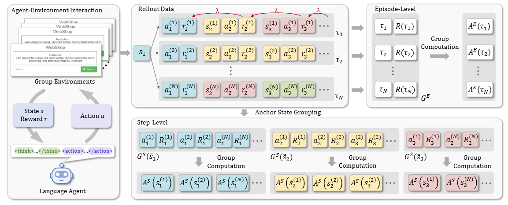

## 0. 这一篇讲什么

前四篇分别讲了基础和三条主线。这一篇把它们落到具体的决策上：**面对一个具体的任务，应该怎样设计奖励、选择哪种方法、要防哪些坑。**

内容安排：

1. 选方法之前要回答的三个问题；
2. 奖励设计的通用原则；
3. 按任务类型逐一讨论：通用助手对齐、数学与代码推理、工具调用与长程 Agent、分类与抽取等结构化输出任务、安全与拒答、风格与个性化；
4. 常见的训练流程模板；
5. 一张选型总表和一份常见陷阱的检查清单。

这一篇讨论的是通用的方法论，具体的数值（学习率、组大小、KL 系数等）和任务、模型、数据关系很大，需要在自己的设置上调整。

## 1. 选方法之前的三个问题

### 1.1 有没有可靠的自动奖励

这是最重要的问题，它基本决定了走哪条路线：

- **有可靠的规则或程序**（答案比对、单元测试、格式检查、和标注比较的 F1）：RLVR 是首选，GRPO 类方法最常用。
- **只能靠模型判断**（奖励模型、LLM 评判）：奖励会被钻空子，需要 KL 约束、早停和定期更新奖励模型；PPO 或在线迭代的 DPO 更常见。
- **只有离线的偏好或反馈数据，没有奖励**：DPO 及其变体。

"可靠"的含义是：奖励高的回答，确实是你想要的回答。这需要人工抽查来确认，而不是想当然。第 2 节会详细讨论。

### 1.2 能不能在线采样

在线方法（PPO、GRPO、在线 DPO）的效果通常好于离线方法（第 3 篇第 5.1 节），但需要：

- 一套能在训练中高效生成的推理服务；
- 一个能对新生成的回答实时打分的奖励（规则、奖励模型或评判模型）；
- 足够的算力：在线 RL 的成本通常是同等数据量 SFT 的数倍到数十倍，其中生成往往占一半以上。

如果条件不具备，离线 DPO 是一个合理的起点；条件具备后，可以把它改成迭代式的在线 DPO，或者换成 GRPO、PPO。

### 1.3 轨迹有多长，信用分配有多难

- **单轮、回答较短、结果能直接判断**：序列级的优势就够了，GRPO、RLOO、DPO 都可以。
- **单轮但思维链很长**：GRPO 仍然有效，但要注意长度偏差、熵坍缩和截断（第 4 篇）；PPO 需要 VAPO 一类的改进。
- **多轮、长程、中间状态差异大**：需要更细粒度的信用分配，考虑 PPO、轮次级的 Critic、步骤级分组（GiGPO）或过程奖励（第 2 篇第 7 节）。

把三个问题的答案组合起来，大多数任务的方法选择就很清楚了。第 5 节给出了一张总表。

## 2. 奖励设计的通用原则

RL 优化的是奖励，而不是你心里想的目标。奖励和目标之间的任何差距，都会被策略找到并利用。所以奖励设计是 RL 落地中最关键、也最容易出问题的环节。

### 2.1 奖励要对准真正关心的指标

先写下这个任务**最终**要用什么指标衡量，再设计奖励去逼近它。常见的错位：

- 业务关心的是一批样本上的宏平均 F1，奖励却是单条样本的准确率，导致模型忽视少数类别；
- 关心的是回答对用户有没有帮助，奖励模型却偏好更长的回答；
- 关心的是代码能否正确运行，测试却覆盖不全，模型学会了只通过测试的特殊处理。

如果目标是一个集合级的指标（比如宏平均 F1、长尾类别的召回率），单条样本的奖励很难直接表达它。常用的近似方法是对少数类别加权、对长尾样本过采样，或者在奖励中对少数类别的正确预测给更高的分数。

### 2.2 先过格式关，再评内容

结构化输出的任务中，奖励通常分两层：先检查格式是否合法（能否解析、字段是否齐全、标签是否在允许的集合内），不合法直接给一个明确的负奖励；合法之后，再按内容打分。

这样做的好处是信号清楚：格式错误和内容错误被区分开，模型不会把"格式错了"和"答案错了"混为一谈。但前提是 **SFT 阶段已经把格式教会了**：如果大多数输出的格式都是错的，奖励几乎全是负的，RL 没有有效的信号（第 1 篇第 9.4 节）。

### 2.3 二值奖励还是部分得分

- **二值奖励**（对为 1，错为 0）：干净，难以被钻空子，但信号稀疏，题目太难时全是 0。
- **部分得分**（比如通过测试的比例、F1）：信号更密，但可能鼓励"部分正确就够了"的行为，或者被利用（比如多标签任务中多预测一些标签来提高召回率）。

下面是一个多标签分类任务的奖励函数，演示"格式门控 + 单条样本 F1"的设计：

```python
import json
import numpy as np

LABELS = {"体育", "财经", "科技", "娱乐", "健康"}

def multilabel_reward(output: str, gold: set) -> float:
    """多标签分类的奖励：先检查格式，再用单条样本的 F1 打分。"""
    try:
        pred = json.loads(output)["labels"]
    except (json.JSONDecodeError, KeyError, TypeError):
        return -1.0                                   # 格式错误：明确的负奖励
    if not isinstance(pred, list) or not set(pred) <= LABELS:
        return -1.0                                   # 出现标签集合之外的标签
    pred = set(pred)
    if not pred and not gold:
        return 1.0
    tp = len(pred & gold)
    if tp == 0:
        return 0.0
    p, r = tp / len(pred), tp / len(gold)
    return 2 * p * r / (p + r)

gold = {"财经", "科技"}
for out in ['{"labels": ["财经", "科技"]}', '{"labels": ["财经"]}',
            '{"labels": ["财经", "科技", "体育", "娱乐", "健康"]}',
            '{"labels": ["股票"]}', '标签是财经和科技']:
    print(f"{multilabel_reward(out, gold):+.2f}  {out}")
```

输出：

```
+1.00  {"labels": ["财经", "科技"]}
+0.67  {"labels": ["财经"]}
+0.57  {"labels": ["财经", "科技", "体育", "娱乐", "健康"]}
-1.00  {"labels": ["股票"]}
-1.00  标签是财经和科技
```

注意第三行：把所有标签都选上，也能拿到 0.57 分，比完全不对的 0 分高得多。如果数据中大部分样本有很多标签，"多选"就可能成为一个有利可图的策略。这类风险要在训练中通过监控"平均预测标签数"这类指标来发现。

### 2.4 组合多个奖励

实际任务常常需要同时满足多个目标：正确、格式合规、长度适中、语言一致。组合时要注意：

- **主次分明**：正确性应该是主导的信号，格式、长度等是次要的约束。次要奖励的权重太大，模型可能牺牲正确性去满足它们。
- **门控优于加权**：对于"必须满足"的约束（比如格式），用门控（不满足就直接给负分）比加权求和更不容易被权衡掉。
- **小心互相冲突的奖励**：比如"简洁"和"详细"。冲突的奖励会让训练不稳定，最好在设计时就明确优先级。

### 2.5 防止被钻空子

不管是规则奖励还是模型奖励，都可能被利用。常见的防范措施：

- **人工抽查高奖励的样本**：训练过程中定期查看奖励最高的一批回答，判断它们是否真的好。这是发现钻空子最有效的方法。
- **保留一个独立的评估集和评估指标**：评估时用和训练奖励不同的方式（比如人工评估、更强的模型评判、不同的测试用例），观察两者是否同步提升。如果训练奖励在升、独立指标在降，就是过优化的信号。
- **限制策略能接触到的东西**：在 Agent 和代码任务中，不让模型能修改测试文件、读到标准答案；在沙箱中运行代码。
- **KL 约束和早停**：限制策略离初始模型的距离。
- **奖励模型的集成和更新**：用多个奖励模型取保守的估计，或者定期用策略的新输出重新训练奖励模型。

### 2.6 用 LLM 做评判时

LLM 评判的灵活性很高，但有一些已知的偏差：偏好更长的回答、偏好和自己风格接近的回答、对回答出现的先后顺序敏感、对自信的语气打分更高。使用时建议：

- 用评分细则（rubric）把评判拆成若干条可检查的标准，比整体打分更稳定；
- 对成对比较，交换两个回答的顺序各评一次；
- 在一批有人工标注的样本上校准评判模型，确认它和人的判断一致；
- 评判模型最好比被训练的模型更强，并且不是同一个模型。

## 3. 按任务类型讨论

### 3.1 通用助手对齐

**目标.** 让模型的回答更有用、更诚实、更安全，符合人的偏好。这是 RLHF 最初的应用场景（第 1 篇第 1 节）。

**奖励.** 通常是在人类或 AI 标注的偏好数据上训练的奖励模型，也可以用 LLM 评判加评分细则。

**方法.**

- 资源有限或只有离线偏好数据：DPO 及其变体。注意长度偏见，可以考虑 SimPO 或加长度正则。
- 有奖励模型、能在线采样：迭代式 DPO 或 PPO。多项比较表明在线方法更好（第 3 篇第 5.1 节）。

**常见的问题.**

- **回答越来越长**：最普遍的过优化现象（第 2 篇第 6.3 节）。用长度控制的指标评估，在奖励中加长度惩罚。
- **讨好**：附和用户的错误观点。在偏好数据中加入"用户说错了、模型应该纠正"的样本。
- **格式泛滥**：过度使用列表、加粗。
- **对齐税**：在其他能力（数学、代码、知识问答）上退化。混入其他任务的数据或用 KL 约束。

### 3.2 数学与代码推理

**目标.** 提高推理的正确率，这是 RLVR 最成功的领域。

**奖励.**

- 数学：从回答中提取最终答案，和标准答案做等价判断。用符号计算工具判断等价，比字符串比较可靠得多。
- 代码：在沙箱中运行单元测试。测试要足够全面，否则模型会学会只针对测试的特殊处理。
- 可以加一个小的格式奖励（比如思考过程放在指定标签中），但不要让它主导。

**方法.** GRPO 及其改进版本（DAPO、Dr.GRPO 的修正，第 4 篇）；资源充足、想要 token 级的信用分配时，可以考虑 VAPO 一类改进后的 PPO。

**数据.**

- **难度筛选**：用当前模型对每道题采样若干次估计通过率，去掉全对和全错的题（第 4 篇第 9.2 节）。下面的模拟中，题目的真实通过率服从一个两端多、中间少的分布，采样 8 次之后，约 40% 的题会因为全对或全错被去掉：

```python
# 难度过滤：用当前模型对每道题采样 G 次，只保留通过率在 (0, 1) 之间的题
rng = np.random.default_rng(0)
true_p = rng.beta(0.5, 0.5, 1000)                     # 1000 道题各自的真实通过率
G = 8
pass_rate = rng.binomial(G, true_p) / G
keep = (pass_rate > 0) & (pass_rate < 1)
print(f"保留 {keep.mean():.0%} 的题；全错 {np.mean(pass_rate == 0):.0%}，全对 {np.mean(pass_rate == 1):.0%}")
```

输出：

```
保留 59% 的题；全错 22%，全对 19%
```

- **答案要可验证**：选择答案唯一、容易判断的题目，去掉证明题、开放式答案的题，或者为它们设计专门的验证方法。
- **防止污染**：评估集不能出现在训练数据中；最好在新出的题目上验证效果（第 4 篇第 7 节）。

**流程.** 先用长思维链数据做 SFT 冷启动，再做 RLVR。对小模型，从更强的推理模型蒸馏往往比直接做 RL 更有效（第 4 篇第 1.8 节）。

**常见的问题.** 熵坍缩、长度失控、截断的回答带来噪声、训练和推理不一致导致的崩溃（第 4 篇第 5 到 8 节）。

### 3.3 工具调用与长程 Agent

**目标.** 让模型在多轮交互中完成任务：搜索、调用 API、操作文件、修改代码、浏览网页。

**建模.** 多轮的 MDP：模型的每一轮输出（思考和工具调用）是动作，工具的返回结果是环境的观察。**工具返回的 token 不是模型生成的，计算损失时要掩掉**，只在模型自己生成的 token 上更新。例如 Search-R1（Jin et al., 2025）在训练搜索增强的推理模型时，就对检索返回的内容做了这样的掩码。

**奖励.**

- **结果奖励**：任务最终是否完成（比如代码修改后测试是否通过、问题的最终答案是否正确）。
- **中间检查**：工具调用是否合法、是否有执行错误。可以作为小的惩罚，但要小心模型为了避免出错而不敢调用工具。
- **效率**：完成任务用的轮数或调用次数。

**方法.** 这是第 2 篇第 7 节讨论的场景。轨迹短（几轮以内）时，GRPO 类方法仍然有效；轨迹长时，序列级的优势太粗，需要更细的信用分配：

- 带 Critic 的 PPO，或轮次级的 Critic；
- 步骤级的分组，比如 GiGPO：



*图 1：GiGPO 的方法总览。左：Agent 在一组相同的环境中交互（例子是购物网站 WebShop）。中上：从同一个初始状态出发采样 $N$ 条轨迹，每条轨迹由一系列状态、动作和奖励组成。右上：轨迹级的分组，和 GRPO 一样，用整条轨迹的回报 $R(\tau)$ 在组内计算轨迹级的优势 $A^E$。下：步骤级的分组，把不同轨迹中处于相同状态（图中同一颜色的"锚点状态"）的步骤归为一组，比较这些步骤之后的回报，计算步骤级的优势 $A^S$。两层优势结合起来使用，不需要 Critic。图片来源：Feng et al., "Group-in-Group Policy Optimization for LLM Agent Training", 2025，方法总览图（取自作者的 GitHub 仓库 langfengQ/verl-agent）。*

**基础设施.** Agent 的 RL 对系统的要求比单轮任务高得多：

- 需要大量并行的环境实例（每条轨迹一个），环境要能快速重置；
- 不同轨迹的长度差异极大，同步采样会被最长的轨迹拖慢，通常需要异步的采样和训练；
- 环境要在沙箱中运行，既为了安全，也为了防止模型通过修改环境来"完成"任务。

**常见的问题.**

- **成功率太低，没有信号**：从简单的任务开始做课程学习，或者先用示范轨迹做 SFT。
- **钻环境的空子**：比如直接读取测试文件中的答案、修改评测脚本。需要从环境设计上杜绝。
- **多样性坍缩**：模型反复使用几种固定的模式（RAGEN 中的"回声陷阱"，第 2 篇第 7.1 节）。监控组内奖励的标准差和输出的多样性，过滤掉组内方差很低的样本。

### 3.4 分类、抽取与结构化输出

**目标.** 很多业务任务本质上是分类（意图识别、多标签打标、情感判断）、信息抽取（从文本中提取字段）或生成结构化的输出（JSON、SQL）。这类任务有标准答案，可以自动评估，看起来很适合 RLVR。

**什么时候值得用 RL.** 这类任务用 SFT 通常就能做得很好，RL 不一定有必要。第 1 篇第 9.4 节的几个信号在这里尤其适用：

- SFT 的收益已经进入平台期，继续加数据提升很小；
- 剩下的错误主要不是"不懂这个领域的知识或标签定义"，而是"同一个样本多次采样，有时对有时错"。一个简单的检查是比较 Best-of-N 和单次采样的成绩：如果 Best-of-N 明显更好，说明模型能做对，只是不稳定，这正是 RL 擅长的；
- 奖励能准确地反映业务指标。

如果剩下的错误主要来自标签定义不清、标注不一致或者知识缺失，应该先去修数据和标签定义，而不是上 RL。

**奖励.** 格式门控加内容得分（第 2.2 和 2.3 节）。

- 分类：预测正确为 1，否则为 0；多标签用单条样本的 F1。
- 抽取：逐字段比较，可以按字段给部分分数。
- SQL：在数据库上执行，比较结果是否一致（比字符串比较可靠）。

**方法.** GRPO 类方法就足够了，回答一般很短，组大小可以小一些。如果有推理过程（先分析再给出标签），要注意推理过程的长度控制。

**常见的问题.**

- 奖励和集合级指标的错位（第 2.1 节）；
- 少数类别被忽视：RL 会优先提高常见类别的正确率；
- 多标签任务中通过"多选"或"少选"来投机（第 2.3 节的例子）；
- 标签的分布在训练中发生漂移：监控各类别的预测比例。

### 3.5 安全与拒答

**目标.** 拒绝真正有害的请求，同时不过度拒绝正常的请求。两者需要平衡：安全训练太强，模型会拒绝很多无害的问题。

**奖励与方法.**

- **偏好数据 + DPO / KTO**：最常见。要特别注意 likelihood displacement：在拒答数据上做 DPO，拒答的概率可能反而下降（第 3 篇第 3.2 节）。建议在 chosen 上加 SFT 损失，并在训练中持续监控拒答率。
- **把有用性和无害性分开建模**：Dai et al.（2024，Safe RLHF）分别训练一个奖励模型（衡量有用性）和一个代价模型（衡量有害性），把安全作为约束，用拉格朗日方法在两者之间动态平衡，避免两个目标在一个奖励模型中互相干扰。
- **基于规则的奖励**：Mu et al.（2024）把期望的安全行为写成一系列具体的规则（比如"拒绝时不应该说教""应该给出简短的道歉"），用 LLM 评判每条规则是否满足，作为 RL 的奖励。这让安全行为更可控，也更容易随着政策的变化而更新。

**评估.** 同时评估有害请求的拒绝率和无害请求的过度拒绝率，两者缺一不可。

### 3.6 风格与个性化

**目标.** 让回答符合某种风格、语气或特定用户的偏好。

**数据.** 这类任务的数据通常来自产品中的用户反馈：

- **点赞点踩**：单条的好坏反馈，适合 KTO（第 3 篇第 4.2 节）。注意正负样本的数量往往很不平衡，用 KTO 的权重来调整。
- **用户对输出的修改**：修改后的版本作为 chosen、原版本作为 rejected，就是天然的成对数据。但两者往往非常相似，容易引起 likelihood displacement，可以过滤掉改动太小的样本，或者在 chosen 上加 SFT 损失。
- **用户的选择**：在多个候选中选了哪一个，可以直接构造偏好对。

**方法.** DPO、KTO、SimPO 这类离线方法通常就足够，成本低，便于频繁更新。

**常见的问题.** 用户反馈有很强的偏差：点赞的往往是简单、讨喜的回答，而不一定是正确的回答。不加区分地优化用户反馈，可能导致讨好和准确性下降。

### 3.7 资源有限的情况

- **小模型**：如果有更强的教师模型，先蒸馏；RL 作为蒸馏之后的补充。
- **显存有限**：DPO 的成本只比 SFT 略高；GRPO 比 PPO 少一个 Critic。也有工作报告，用低秩适配（LoRA）做 RL，效果可以接近全参数训练，因为 RL 每一步提供的信息量远少于 SFT，所需的可训练参数也更少（以具体的实验报告为准）。
- **采样成本高**：减小组大小、使用 REINFORCE++ 这类每个提示词只需一次采样的方法，或者先用离线方法。

## 4. 常见的训练流程模板

把前面的内容组合起来，常见的流程有以下几种：

**模板一：通用助手.**
SFT → 偏好优化（DPO 或迭代式 DPO）→（可选）PPO 或在线 RLHF。

**模板二：推理模型.**
长思维链的 SFT 冷启动 → RLVR（GRPO 类方法）→ 拒绝采样生成新的 SFT 数据，重新训练 → 面向通用场景的 RL（规则奖励和奖励模型结合）。这是 DeepSeek-R1 的流程（第 4 篇第 1.8 节）。

**模板三：在已有的对齐模型上提升推理.**
SFT → DPO → RLVR。Tülu 3 采用了这种流程（第 3 篇第 6.2 节）。

**模板四：小模型.**
从强模型蒸馏 →（可选）轻量的 RLVR 或 DPO。

**模板五：Agent.**
用示范轨迹做 SFT，教会工具调用的格式和基本流程 → 在简单任务上做 RL → 逐步增加任务难度和轨迹长度（课程学习）→ 必要时引入步骤级的信用分配。

一个更一般的原则是：**SFT 负责建立协议和基础行为，稠密的教师信号（蒸馏、在线蒸馏）负责快速纠正，RL 负责在当前策略的分布上探索并对齐最终目标，最后可以再蒸馏回一个稳定的模型。** 不要只押注一种方法。

## 5. 选型总表

| 任务 | 奖励 | 首选方法 | 备选 | 最需要注意 |
|---|---|---|---|---|
| 通用助手对齐 | 奖励模型 / LLM 评判 | 迭代式 DPO、PPO | 离线 DPO、SimPO | 长度、讨好、对齐税 |
| 数学推理 | 答案比对 | GRPO + DAPO 的技巧 | VAPO、PPO | 熵坍缩、长度、污染 |
| 代码生成 | 单元测试 | GRPO 类方法 | PPO + 过程奖励 | 测试覆盖、钻测试的空子 |
| 短程工具调用 | 结果 + 调用合法性 | GRPO 类方法 | PPO | 掩掉工具返回的 token |
| 长程 Agent | 结果奖励（稀疏） | PPO、GiGPO 等步骤级方法 | 轮次级 Critic | 成功率低、多样性坍缩、环境漏洞 |
| 分类与抽取 | 格式门控 + F1 / 准确率 | GRPO 类方法 | 继续 SFT | 是否真的需要 RL；奖励与业务指标的错位 |
| 安全与拒答 | 偏好 / 规则 / 代价模型 | DPO / KTO + SFT 损失 | Safe RLHF | 过度拒绝、likelihood displacement |
| 风格与个性化 | 用户反馈 | KTO、DPO | SimPO | 反馈的偏差、相似的偏好对 |
| 小模型 | 依任务而定 | 蒸馏 | 轻量 RL | 不要跳过蒸馏 |

## 6. 常见陷阱检查清单

训练开始前：

- [ ] SFT 是否已经把格式教会了？格式错误率是否足够低？
- [ ] 奖励是否对准了真正关心的指标？有没有人工抽查过奖励的打分？
- [ ] 训练数据的难度是否合适？全对和全错的题是否已经过滤？
- [ ] 评估集是否和训练集隔离？有没有独立于训练奖励的评估方式？
- [ ] 在 Agent 和代码任务中，模型是否可能接触到答案或修改评测？

训练过程中：

- [ ] 奖励在上升的同时，独立的评估指标是否同步上升？
- [ ] 生成的熵是否在快速下降？
- [ ] 回答长度是否异常增长？
- [ ] 组内全对和全错的比例是多少？
- [ ] KL 是否突然增大？裁剪的比例是否异常？
- [ ] 推理引擎和训练引擎算出的概率之间的差异是否在可控范围内？
- [ ] 定期查看奖励最高和最低的样本，它们是否符合预期？

训练结束后：

- [ ] 除了 pass@1，大 $k$ 下的 pass@k 是否下降？
- [ ] 其他能力（通用对话、知识、其他任务）是否退化？
- [ ] 在分布外的数据和新出的题目上，提升是否依然存在？

## 7. 系列回顾

| 篇目 | 一句话总结 |
|---|---|
| 第 1 篇 基础 | RL 用"在自己的样本上做加权的 SFT"来优化不可微的目标；KL 约束的最优解是在参考模型上按奖励重新加权 |
| 第 2 篇 PPO | 用 Critic 和 GAE 把稀疏的奖励分配到每个 token；最通用、上限最高，但成本和调参难度也最高；长程 Agent 任务重新需要它的信用分配能力 |
| 第 3 篇 DPO | 利用闭式解把 RL 折叠成一个分类损失；简单、便宜，但离线、不探索，有 likelihood displacement 等问题；在线化之后效果明显提升 |
| 第 4 篇 GRPO | 用组内比较代替 Critic，在可验证奖励的推理任务上大获成功；同时引出了能力边界、熵坍缩、训练推理不一致等一系列问题 |
| 第 5 篇 选型与落地 | 先问奖励是否可靠、能否在线采样、轨迹有多长，再选方法；奖励设计是成败的关键 |

三条主线的区别最终可以归结为一个问题：**"好不好"这个信号从哪里来，又怎样变成每个 token 的训练信号。** PPO 用学出来的价值函数，DPO 用偏好对的相对差距，GRPO 用同一个问题的多次尝试互相比较。理解了这一点，面对新的方法和新的任务时，就能很快判断它属于哪一类、解决了什么问题、又付出了什么代价。

## 参考文献

- Ouyang et al. *Training Language Models to Follow Instructions with Human Feedback.* NeurIPS 2022.
- Dai et al. *Safe RLHF: Safe Reinforcement Learning from Human Feedback.* ICLR 2024.
- Mu et al. *Rule Based Rewards for Language Model Safety.* NeurIPS 2024.
- Ethayarajh et al. *KTO: Model Alignment as Prospect Theoretic Optimization.* ICML 2024.
- Lambert et al. *Tülu 3: Pushing Frontiers in Open Language Model Post-Training.* 2024.
- DeepSeek-AI. *DeepSeek-R1: Incentivizing Reasoning Capability in LLMs via Reinforcement Learning.* 2025.
- Jin et al. *Search-R1: Training LLMs to Reason and Leverage Search Engines with Reinforcement Learning.* 2025.
- Wang et al. *RAGEN: Understanding Self-Evolution in LLM Agents via Multi-Turn Reinforcement Learning.* 2025.
- Feng et al. *Group-in-Group Policy Optimization for LLM Agent Training.* 2025.
- Yu et al. *DAPO: An Open-Source LLM Reinforcement Learning System at Scale.* 2025.
