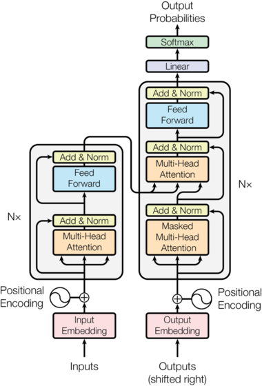
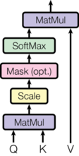
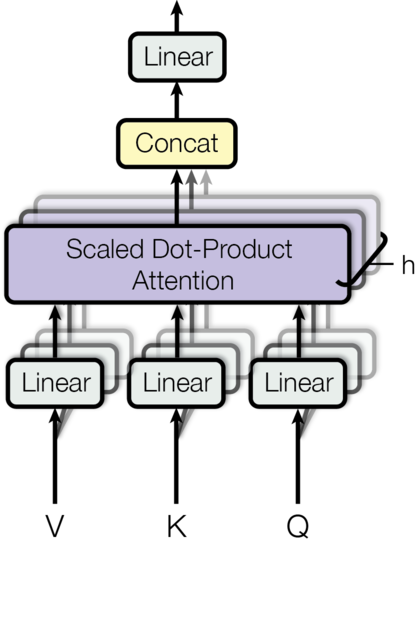

## 0. 为什么从原始 Transformer 开始

今天几乎所有大语言模型都建立在 Transformer（Vaswani et al., 2017, *Attention Is All You Need*）之上。但过去几年里，它的每一个部件几乎都被替换或改造过：位置编码、注意力、归一化、前馈网络、残差连接，都有了一长串变体。

要看懂这些变体，先要清楚**基础版本是什么样子**：每个部件原本是怎么设计的、为什么这样设计、哪里不够好。变体几乎都是针对基础版本的某个具体缺陷提出的。

这一篇就做这件事：按数据流经模型的顺序，把 2017 年原始 Transformer 的每个部件拆开，给出原始公式、设计理由和已知局限，并标注后续哪一篇讨论它的变体。最后给出原始的训练方法、推理方法和一份完整的 PyTorch 实现。之后的每一篇，都以这里的基础版本为起点。

## 1. 整体结构

原始 Transformer 是一个用于机器翻译的 **Encoder-Decoder**（编码器-解码器）模型：输入一句英文，输出一句德文。



*图 1：Transformer 模型结构，左侧为编码器，右侧为解码器。图片来源：Vaswani et al., "Attention Is All You Need", NeurIPS 2017, Figure 1。*

读图的顺序：左下方的源序列经过嵌入（Input Embedding）、加上位置编码（Positional Encoding），进入 $N$ 个编码器 block，每个 block 是"多头注意力 → Add & Norm → 前馈网络 → Add & Norm"。右下方的目标序列右移一位（Outputs, shifted right）后同样经过嵌入和位置编码，进入 $N$ 个解码器 block，每个 block 多了一个中间的多头注意力，它的 K、V 来自编码器输出（图中从左侧引过来的箭头）。最后经过线性层（Linear）和 Softmax 得到输出概率。每个 "Add & Norm" 旁边绕过子层的箭头就是残差连接。

原论文的两个配置：

| 超参数 | 记号 | Base | Big |
|---|---|---|---|
| 层数（编码器、解码器各） | $N$ | 6 | 6 |
| 隐藏维度 | $d_{\text{model}}$ | 512 | 1024 |
| 注意力头数 | $h$ | 8 | 16 |
| 每个头的维度 | $d_k = d_v = d_{\text{model}}/h$ | 64 | 64 |
| FFN 中间维度 | $d_{\text{ff}}$ | 2048 | 4096 |
| Dropout | $P_{\text{drop}}$ | 0.1 | 0.3 |
| 参数量 | | 65M | 213M |

下文记批大小为 $B$，序列长度为 $L$，词表大小为 $V$，$d = d_{\text{model}}$。

## 2. 每个部件的基础版本

### 2.1 分词器

**做什么.** 把文本切成 token，映射成整数 id。

**原始做法.** 英德翻译使用 **BPE**（Byte Pair Encoding），源语言和目标语言**共享**一个约 37000 个 token 的词表；英法翻译使用 32000 个 token 的 word-piece 词表。BPE 从字符出发，反复把出现次数最多的相邻符号对合并成新符号，直到达到目标词表大小。

**为什么.** 按词切分有词表外（OOV）问题，按字符切分序列太长；子词切分让常见词完整、罕见词拆成可复用的片段。源语言和目标语言共享词表，才能共享嵌入矩阵（见 2.2）。

**局限与变体.** 以字符为初始词表仍可能遇到没见过的字符；后来 GPT-2 改为以字节为初始词表的**字节级 BPE**，并加入预分词规则。词表也从几万扩大到十几二十万。→ 第 1 篇。

输出形状：$[B, L]$ 的整数张量。

### 2.2 Token Embedding 与输出层

**做什么.** 嵌入层把 token id 变成向量；输出层把最后的隐藏向量变回词表上的分数（logits）。

**原始做法.** 嵌入矩阵 $E\in\mathbb R^{V\times d}$，查表得到向量后**乘以 $\sqrt{d}$**：

$$
x_t = \sqrt{d}\cdot E[\text{token}_t]
$$

输出层是一个线性变换加 softmax：

$$
z_t = h_t E^\top,\qquad p(y_{t+1}\mid\cdot) = \mathrm{softmax}(z_t)
$$

原论文让**编码器嵌入、解码器嵌入和输出层三者共享同一个矩阵 $E$**（weight tying）。

**为什么.**

- **共享权重**：输入嵌入和输出层都在建立"token 与 $d$ 维向量"之间的对应关系，共享让两者处于同一语义空间，并且省下 $2Vd$ 个参数（Base 模型中约 3800 万，比一半参数还多）；
- **乘以 $\sqrt{d}$**：嵌入的初始化方差约为 $1/d$，每个分量很小；而接下来要加的正弦位置编码每个分量在 $[-1,1]$。乘以 $\sqrt{d}$ 让嵌入的分量回到 $O(1)$ 的量级，位置信息不至于盖过内容信息。

**局限与变体.** 现代大模型中，小模型多数仍共享权重，大模型多数不共享（参数占比小，解除共享能提供更多自由度）；大词表使嵌入层和输出层成为显著的计算成本。→ 第 2 篇。

输出形状：$[B, L, d]$。

### 2.3 位置编码：正弦函数

**做什么.** 注意力本身不知道 token 的顺序（见 2.4 末尾），必须显式注入位置信息。

**原始做法.** 使用固定的正弦函数，**加**到嵌入上：

$$
PE_{(pos,\,2i)} = \sin\!\left(\frac{pos}{10000^{2i/d}}\right),\qquad
PE_{(pos,\,2i+1)} = \cos\!\left(\frac{pos}{10000^{2i/d}}\right)
$$

$$
h^{(0)}_t = \sqrt{d}\cdot E[\text{token}_t] + PE_t
$$

第 $i$ 对维度用一个频率 $\omega_i = 10000^{-2i/d}$ 的正弦和余弦，频率从 $1$（波长 $2\pi$）几何递减到约 $1/10000$（波长约 $2\pi\cdot 10^4$）。

**为什么.**

- **相对位置可以线性表示**：对任意固定偏移 $k$，$PE_{pos+k}$ 是 $PE_{pos}$ 的线性函数。对每一对维度，

$$
\begin{pmatrix}\sin\omega_i(pos+k)\\ \cos\omega_i(pos+k)\end{pmatrix}
=
\begin{pmatrix}\cos\omega_i k & \sin\omega_i k\\ -\sin\omega_i k & \cos\omega_i k\end{pmatrix}
\begin{pmatrix}\sin\omega_i pos\\ \cos\omega_i pos\end{pmatrix}
$$

  这是一个只依赖 $k$ 的旋转矩阵。论文认为这让模型容易学到按相对位置关注；
- **多频率**：高频维度区分相邻位置，低频维度区分远距离位置，类似二进制计数中低位翻转快、高位翻转慢；
- **无参数**：论文也试过可学习的位置嵌入，效果几乎相同，选择正弦是希望能外推到比训练更长的序列。

**局限与变体.** 实践中正弦编码的长度外推并不好；位置信息加在嵌入上，经过注意力投影后与内容混在一起，相对位置只能被间接利用；靠后的维度频率很低，在常见长度内几乎不变。后来出现了可学习位置编码（BERT、GPT-2）、相对位置偏置（T5）、RoPE、各种长度扩展方法，以及部分维度或部分层不加位置编码的做法。→ 第 3 到 7 篇。

### 2.4 缩放点积注意力

**做什么.** 让每个 token 根据内容的相关性，从其他 token 那里收集信息。

**原始做法.** 对输入 $X\in\mathbb R^{L\times d}$，投影出查询、键、值，然后

$$
\mathrm{Attention}(Q,K,V) = \mathrm{softmax}\!\left(\frac{QK^\top}{\sqrt{d_k}}\right)V
$$

逐步看：

1. $S = QK^\top\in\mathbb R^{L\times L}$，$S_{ij} = q_i^\top k_j$ 衡量 token $i$ 的查询与 token $j$ 的键有多匹配；
2. 除以 $\sqrt{d_k}$；
3. 对每一行做 softmax，得到注意力权重 $A_{ij}\ge 0$，$\sum_j A_{ij} = 1$；
4. 输出 $o_i = \sum_j A_{ij}v_j$，是所有值向量的加权平均。



*图 2（左）：缩放点积注意力。图片来源：Vaswani et al., "Attention Is All You Need", NeurIPS 2017, Figure 2 左。*

图中自下而上依次是：$Q$ 与 $K$ 做矩阵乘法（MatMul）、缩放（Scale，即除以 $\sqrt{d_k}$）、可选的掩码（Mask）、SoftMax，最后与 $V$ 做矩阵乘法。

**为什么除以 $\sqrt{d_k}$.** 设 $q, k$ 的各分量独立、均值 0、方差 1，则

$$
\mathrm{Var}(q^\top k) = \sum_{m=1}^{d_k}\mathrm{Var}(q_mk_m) = \sum_{m=1}^{d_k}\mathrm{Var}(q_m)\mathrm{Var}(k_m) = d_k
$$

（独立且均值为 0 时，$\mathrm{Var}(XY) = \mathrm{Var}(X)\mathrm{Var}(Y)$。）点积的标准差随 $\sqrt{d_k}$ 增长。$d_k$ 较大时 softmax 的输入差距很大，输出接近 one-hot，梯度几乎为 0。除以 $\sqrt{d_k}$ 把方差拉回 1。论文还比较了加性注意力（用一个小 MLP 打分），点积注意力在理论复杂度相近的情况下可以用高度优化的矩阵乘法实现，因此更快。

**为什么用注意力而不是 RNN 或 CNN.** 论文从三个角度比较：

| | 每层计算量 | 串行操作数 | 任意两位置间的最长路径 |
|---|---|---|---|
| 自注意力 | $O(L^2d)$ | $O(1)$ | $O(1)$ |
| RNN | $O(Ld^2)$ | $O(L)$ | $O(L)$ |
| CNN（卷积核 $k$） | $O(kLd^2)$ | $O(1)$ | $O(\log_k L)$ |

自注意力的优势是**完全并行**（训练时不需要按时间步串行）和**任意两个位置一步直达**（长距离依赖的信号不必经过很多层传递）。代价是计算量和显存随 $L$ 平方增长。

**一个重要性质：置换等变.** 如果把输入序列打乱（左乘一个置换矩阵 $P$），则 $Q,K,V$ 都变成 $PQ,PK,PV$，

$$
\mathrm{softmax}\!\left(\frac{PQK^\top P^\top}{\sqrt{d_k}}\right)PV = P\,\mathrm{softmax}\!\left(\frac{QK^\top}{\sqrt{d_k}}\right)P^\top P V = P\cdot\mathrm{Attention}(Q,K,V)
$$

（逐行 softmax 与对行列做同一置换可交换，$P^\top P = I$。）输出只是跟着重排，数值不变。所以注意力本身看不到顺序，这就是 2.3 节需要位置编码的原因。

**局限与变体.** 平方复杂度限制了上下文长度。→ 第 8 篇（注意力本身）、第 12 到 20 篇（稀疏、线性、混合、IO 优化）。

### 2.5 多头注意力

**做什么.** 让模型在多个子空间里同时关注不同类型的关系。

**原始做法.** 把 $d$ 维拆成 $h$ 个 $d_k = d/h$ 维的头，每个头用自己的投影独立计算注意力，拼接后再做一次输出投影：

$$
\text{head}_i = \mathrm{Attention}\big(XW_Q^{(i)},\ XW_K^{(i)},\ XW_V^{(i)}\big),\qquad W_Q^{(i)},W_K^{(i)},W_V^{(i)}\in\mathbb R^{d\times d_k}
$$

$$
\mathrm{MultiHead}(X) = \mathrm{Concat}(\text{head}_1,\dots,\text{head}_h)\,W_O,\qquad W_O\in\mathbb R^{d\times d}
$$



*图 2（右）：多头注意力，$h$ 个缩放点积注意力并行计算。图片来源：Vaswani et al., "Attention Is All You Need", NeurIPS 2017, Figure 2 右。*

图中 $V$、$K$、$Q$ 各自经过线性投影（叠在一起的多层方框表示 $h$ 组投影），送入 $h$ 个并行的缩放点积注意力，结果拼接（Concat）后再经过一个线性层。

**为什么.** 单个头的注意力权重是一个分布，对每个位置只能给出一种"关注模式"的加权平均。多个头可以分别关注句法依存、指代、相邻词等不同关系。论文的消融实验显示，单头比 8 头的 BLEU 低约 0.9，头太多（每个头维度太小）也会变差。

**多头不增加参数.** $h$ 个 $d\times d_k$ 的投影拼起来正好是一个 $d\times d$ 矩阵，所以多头注意力的四个投影共 $4d^2$ 个参数，与单头相同。实现时就是一个大投影，再把结果 reshape 成 $h$ 个头。

**局限与变体.** 推理时每个头都要缓存自己的 K、V，KV Cache 很大。→ 第 9 篇（KV Cache）、第 10 篇（MQA、GQA 让多个查询头共享 K、V）、第 11 篇（MLA 把 K、V 压缩成低维隐变量）。

### 2.6 掩码

**做什么.** 在 softmax 之前把不该看的位置的分数设为 $-\infty$，使其权重为 0。

**原始做法.** 两种掩码：

- **Padding mask**：批内句子长短不一，用 padding 补齐。所有注意力都要屏蔽 padding 位置作为键；
- **因果掩码**（causal mask）：解码器自注意力中，位置 $i$ 不能看到 $j>i$ 的位置：

$$
\mathrm{scores}_{ij} =
\begin{cases}
\dfrac{q_i^\top k_j}{\sqrt{d_k}}, & j\le i \\[6pt]
-\infty, & j > i
\end{cases}
$$

**为什么.** 训练时整个目标序列一次性输入，如果位置 $t$ 能看到 $t+1$，预测下一个词就成了抄答案。因果掩码让一次前向传播同时得到所有位置的预测，且每个位置只依赖之前的 token，训练与推理时的信息条件一致。

### 2.7 三种注意力

原始 Transformer 中注意力以三种方式出现：

| | Q 来源 | K、V 来源 | 掩码 | 作用 |
|---|---|---|---|---|
| 编码器自注意力 | 源序列 | 源序列 | padding | 理解源句，双向 |
| 解码器自注意力 | 目标序列 | 目标序列 | 因果 + padding | 理解已生成的部分 |
| 交叉注意力 | 解码器 | 编码器输出 | 源序列 padding | 从源句取信息，学习对齐 |

交叉注意力是源序列和目标序列之间的唯一通道。解码器在生成每个词时，用自己的状态作为查询，去编码器输出中"查找"相关的部分，翻译中的词对齐就在这里学到。今天的 decoder-only 大模型没有交叉注意力，但它在多模态模型（文本查询图像特征）和编码器-解码器模型中仍然常见。

### 2.8 前馈网络（FFN）

**做什么.** 对每个位置**独立地**做一次非线性变换。

**原始做法.** 两层线性变换，中间是 ReLU：

$$
\mathrm{FFN}(x) = \max(0,\ xW_1 + b_1)\,W_2 + b_2,\qquad
W_1\in\mathbb R^{d\times d_{\text{ff}}},\ W_2\in\mathbb R^{d_{\text{ff}}\times d},\ d_{\text{ff}} = 4d
$$

论文称之为 position-wise：同一层的 FFN 对所有位置共享参数，等价于两个卷积核大小为 1 的卷积。

**为什么.** 注意力的输出是值向量的加权平均，对值向量而言是线性的（非线性只在 softmax 权重里）。注意力负责"从别的 token 取信息"，FFN 负责"对取到的信息做加工"。先升维到 $4d$ 再降回，给了足够的容量。FFN 占每层参数的三分之二，也被认为是存储事实性知识的主要位置。

**局限与变体.** ReLU 后来被 GELU、SwiGLU 等门控激活取代；把一个 FFN 换成多个、每个 token 只激活其中几个，就得到 MoE。→ 第 24 到 27 篇。

### 2.9 残差连接

**做什么.** 让每个子层只学习"在输入上加什么"，并为梯度提供直通路径。

**原始做法.** 每个子层（注意力或 FFN）的输出加回它的输入：$x + \mathrm{Sublayer}(x)$。为了让相加成立，模型中所有子层和嵌入层的输出维度都是 $d$。

**为什么.** 设 $y = x + F(x)$，则

$$
\frac{\partial y}{\partial x} = I + \frac{\partial F}{\partial x}
$$

即使 $F$ 的梯度很小，恒等项 $I$ 也能让梯度直接传到更浅的层。这是 ResNet（He et al., 2016）的核心思想，使几十上百层的网络可以训练。

**局限与变体.** 所有层的输出不断累加在同一条"残差流"上，层数很多时每一层新增的贡献相对越来越小。新模型开始尝试多条残差流、沿深度方向的注意力等可学习的跨层连接。→ 第 28 到 30 篇。

### 2.10 层归一化：Post-LN

**做什么.** 控制激活值的尺度，稳定训练。

**原始做法.** LayerNorm 对**每个 token 的 $d$ 维向量**单独归一化：

$$
\mathrm{LayerNorm}(x) = \gamma\odot\frac{x - \mu}{\sqrt{\sigma^2 + \epsilon}} + \beta,\qquad
\mu = \frac1d\sum_{m=1}^d x_m,\quad \sigma^2 = \frac1d\sum_{m=1}^d(x_m - \mu)^2
$$

$\gamma,\beta\in\mathbb R^d$ 是可学习的缩放和偏移。放置位置是**先加残差，再归一化**，称为 **Post-LN**：

$$
x\leftarrow\mathrm{LayerNorm}\big(x + \mathrm{Sublayer}(x)\big)
$$

结构图中的 "Add & Norm" 就是这个意思。

**为什么用 LayerNorm 而不是 BatchNorm.** BatchNorm 对同一特征在整个批内求统计量，在 NLP 中会受到变长序列和 padding 的干扰，依赖较大的批，且训练和推理的统计量不一致。LayerNorm 只看单个 token 自己的特征，与批大小和序列长度无关。

**局限与变体.** Post-LN 下梯度从深层回传时要连续经过每一层的 LayerNorm，深层模型训练不稳定，非常依赖学习率预热（见第 3 节）。现代模型几乎都改为 **Pre-LN**（$x\leftarrow x + \mathrm{Sublayer}(\mathrm{Norm}(x))$），并把 LayerNorm 换成去掉均值的 **RMSNorm**，有的还对 Q、K 单独做归一化（QK-Norm）。→ 第 21 到 23 篇。

### 2.11 Dropout

**原始做法.** 原论文称之为 residual dropout，用在两处：

- 每个子层的输出在加到残差**之前**做 dropout：$\mathrm{LayerNorm}\big(x + \mathrm{Dropout}(\mathrm{Sublayer}(x))\big)$；
- 嵌入与位置编码之和做 dropout。

Base 模型 $P_{\text{drop}} = 0.1$。常见实现还会对注意力权重做 dropout。

**现代做法.** 大语言模型预训练的数据量远大于模型能记住的量，过拟合不是主要问题，多数模型在预训练时**不使用 dropout**，只在微调等小数据场景下视情况使用。

### 2.12 一个 block 的完整计算

把以上部件组合起来，编码器 block：

$$
\begin{aligned}
x' &= \mathrm{LayerNorm}\Big(x + \mathrm{Dropout}\big(\mathrm{MultiHeadSelfAttn}(x)\big)\Big) \\
x'' &= \mathrm{LayerNorm}\Big(x' + \mathrm{Dropout}\big(\mathrm{FFN}(x')\big)\Big)
\end{aligned}
$$

解码器 block：

$$
\begin{aligned}
y' &= \mathrm{LayerNorm}\Big(y + \mathrm{Dropout}\big(\mathrm{MaskedSelfAttn}(y)\big)\Big) \\
y'' &= \mathrm{LayerNorm}\Big(y' + \mathrm{Dropout}\big(\mathrm{CrossAttn}(y', H_{\text{enc}})\big)\Big) \\
y''' &= \mathrm{LayerNorm}\Big(y'' + \mathrm{Dropout}\big(\mathrm{FFN}(y'')\big)\Big)
\end{aligned}
$$

每个 block 的输入输出形状都是 $[B, L, d]$，可以任意堆叠。

## 3. 训练

**目标：Teacher Forcing 下的交叉熵.** 训练时，目标序列右移一位作为解码器输入（开头加起始符），模型在每个位置预测下一个 token：

$$
\mathcal L = -\sum_{t=1}^{L_{\text{tgt}}}\log p_\theta(y_t\mid y_{<t}, x)
$$

无论模型在位置 $t-1$ 预测得对不对，位置 $t$ 的输入都是**真实的** $y_{t-1}$。配合因果掩码，一条序列的所有位置在一次前向传播中并行训练，这是 Transformer 相对 RNN 最大的训练效率优势。

**优化器与学习率.** Adam，$\beta_1 = 0.9$，$\beta_2 = 0.98$，$\epsilon = 10^{-9}$。学习率先线性预热，再按步数的平方根倒数衰减：

$$
\text{lr} = d^{-0.5}\cdot\min\big(\text{step}^{-0.5},\ \text{step}\cdot\text{warmup}^{-1.5}\big),\qquad \text{warmup} = 4000
$$

两段在 step = warmup 时相等，峰值约为 $512^{-0.5}\times 4000^{-0.5}\approx 7\times 10^{-4}$。预热对 Post-LN 至关重要：训练初期 Post-LN 靠近输出的层梯度很大，直接用大学习率容易发散（第 22 篇会推导）。

**标签平滑.** $\epsilon_{ls} = 0.1$：目标分布从 one-hot 改成正确 token 占 0.9、其余 token 平分 0.1。这会让模型"不那么确定"，困惑度变差，但 BLEU 提高。

**规模.** 每个批次约含 25000 个源 token 和 25000 个目标 token（按长度相近的句子分组）。在 8 张 P100 上，Base 模型训练 10 万步约 12 小时，Big 模型训练 30 万步约 3.5 天。评估时对最后若干个检查点的参数取平均。

## 4. 推理

推理时没有真实的目标序列，只能**自回归**地生成：

1. 编码器对源序列前向一次，得到 $H_{\text{enc}}$（只算一次，之后每步复用）；
2. 解码器输入起始符，得到第一个位置的分布，选出 $y_1$；
3. 把 $y_1$ 接到输入后面，预测 $y_2$；
4. 重复，直到生成结束符或达到最大长度（原论文设为源长度 + 50）。

原论文用**束搜索**（beam search）选择输出：每一步保留得分最高的 4 条候选序列，并用长度惩罚 $\alpha = 0.6$ 避免偏向短句。

训练时并行、推理时串行，这种不对称是自回归 Transformer 的基本特征。朴素实现每一步都要把整个前缀重新算一遍；缓存历史 token 的 K、V 可以避免重复计算（第 9 篇）。大语言模型中，束搜索大多被温度采样、Top-p 采样等随机解码方法取代（第 31 篇）。

## 5. 完整实现

下面是原始 Transformer（Post-LN、正弦位置编码、ReLU FFN、共享嵌入）的一份精简 PyTorch 实现，用于对照上面每个部件。

```python
import math
import torch
import torch.nn as nn
import torch.nn.functional as F


class SinusoidalPositionalEncoding(nn.Module):
    def __init__(self, d_model, max_len=5000):
        super().__init__()
        pos = torch.arange(max_len).unsqueeze(1)                       # (max_len, 1)
        freq = torch.exp(torch.arange(0, d_model, 2) * (-math.log(10000.0) / d_model))
        pe = torch.zeros(max_len, d_model)
        pe[:, 0::2] = torch.sin(pos * freq)                            # 偶数维 sin
        pe[:, 1::2] = torch.cos(pos * freq)                            # 奇数维 cos
        self.register_buffer("pe", pe)                                 # 固定，不训练

    def forward(self, x):                                              # x: (B, L, d)
        return x + self.pe[: x.size(1)]


class MultiHeadAttention(nn.Module):
    def __init__(self, d_model, n_heads, dropout):
        super().__init__()
        assert d_model % n_heads == 0
        self.h, self.d_k = n_heads, d_model // n_heads
        self.W_q = nn.Linear(d_model, d_model)
        self.W_k = nn.Linear(d_model, d_model)
        self.W_v = nn.Linear(d_model, d_model)
        self.W_o = nn.Linear(d_model, d_model)
        self.drop = nn.Dropout(dropout)

    def forward(self, x_q, x_kv, mask=None):
        """x_q: (B, Lq, d)；x_kv: (B, Lk, d)；mask: 可广播到 (B, h, Lq, Lk)，True 表示屏蔽"""
        B, Lq, _ = x_q.shape
        Lk = x_kv.size(1)
        # 投影并拆成 h 个头: (B, L, d) -> (B, h, L, d_k)
        q = self.W_q(x_q).view(B, Lq, self.h, self.d_k).transpose(1, 2)
        k = self.W_k(x_kv).view(B, Lk, self.h, self.d_k).transpose(1, 2)
        v = self.W_v(x_kv).view(B, Lk, self.h, self.d_k).transpose(1, 2)

        scores = q @ k.transpose(-2, -1) / math.sqrt(self.d_k)        # (B, h, Lq, Lk)
        if mask is not None:
            scores = scores.masked_fill(mask, float("-inf"))
        attn = self.drop(F.softmax(scores, dim=-1))
        out = attn @ v                                                 # (B, h, Lq, d_k)

        out = out.transpose(1, 2).contiguous().view(B, Lq, -1)        # 拼接各头
        return self.W_o(out)


class FeedForward(nn.Module):
    def __init__(self, d_model, d_ff):
        super().__init__()
        self.w1 = nn.Linear(d_model, d_ff)
        self.w2 = nn.Linear(d_ff, d_model)

    def forward(self, x):
        return self.w2(F.relu(self.w1(x)))


class EncoderLayer(nn.Module):
    def __init__(self, d_model, n_heads, d_ff, dropout):
        super().__init__()
        self.self_attn = MultiHeadAttention(d_model, n_heads, dropout)
        self.ffn = FeedForward(d_model, d_ff)
        self.norm1, self.norm2 = nn.LayerNorm(d_model), nn.LayerNorm(d_model)
        self.drop = nn.Dropout(dropout)

    def forward(self, x, src_mask):
        # Post-LN：先加残差，再归一化
        x = self.norm1(x + self.drop(self.self_attn(x, x, src_mask)))
        x = self.norm2(x + self.drop(self.ffn(x)))
        return x


class DecoderLayer(nn.Module):
    def __init__(self, d_model, n_heads, d_ff, dropout):
        super().__init__()
        self.self_attn = MultiHeadAttention(d_model, n_heads, dropout)
        self.cross_attn = MultiHeadAttention(d_model, n_heads, dropout)
        self.ffn = FeedForward(d_model, d_ff)
        self.norm1, self.norm2, self.norm3 = (nn.LayerNorm(d_model) for _ in range(3))
        self.drop = nn.Dropout(dropout)

    def forward(self, y, memory, tgt_mask, src_mask):
        y = self.norm1(y + self.drop(self.self_attn(y, y, tgt_mask)))            # 因果自注意力
        y = self.norm2(y + self.drop(self.cross_attn(y, memory, src_mask)))      # 交叉注意力
        y = self.norm3(y + self.drop(self.ffn(y)))
        return y


class Transformer(nn.Module):
    def __init__(self, vocab_size, d_model=512, n_heads=8, d_ff=2048, n_layers=6,
                 dropout=0.1, pad_id=0):
        super().__init__()
        self.d_model, self.pad_id = d_model, pad_id
        self.embed = nn.Embedding(vocab_size, d_model)        # 编码器、解码器、输出层共享
        self.pos = SinusoidalPositionalEncoding(d_model)
        self.drop = nn.Dropout(dropout)
        self.encoder = nn.ModuleList(EncoderLayer(d_model, n_heads, d_ff, dropout) for _ in range(n_layers))
        self.decoder = nn.ModuleList(DecoderLayer(d_model, n_heads, d_ff, dropout) for _ in range(n_layers))

    def embed_tokens(self, ids):
        return self.drop(self.pos(self.embed(ids) * math.sqrt(self.d_model)))

    def make_masks(self, src, tgt):
        # padding mask: (B, 1, 1, Lk)，屏蔽作为键的 padding 位置
        src_mask = (src == self.pad_id)[:, None, None, :]
        tgt_pad = (tgt == self.pad_id)[:, None, None, :]
        # 因果掩码: (1, 1, Lt, Lt)，上三角为 True
        Lt = tgt.size(1)
        causal = torch.triu(torch.ones(Lt, Lt, dtype=torch.bool, device=tgt.device), diagonal=1)
        tgt_mask = tgt_pad | causal[None, None]
        return src_mask, tgt_mask

    def encode(self, src, src_mask):
        x = self.embed_tokens(src)
        for layer in self.encoder:
            x = layer(x, src_mask)
        return x

    def decode(self, tgt, memory, tgt_mask, src_mask):
        y = self.embed_tokens(tgt)
        for layer in self.decoder:
            y = layer(y, memory, tgt_mask, src_mask)
        return y @ self.embed.weight.T                        # 共享权重的输出层 -> logits

    def forward(self, src, tgt_in):
        src_mask, tgt_mask = self.make_masks(src, tgt_in)
        memory = self.encode(src, src_mask)
        return self.decode(tgt_in, memory, tgt_mask, src_mask)  # (B, Lt, V)


# 训练一步（teacher forcing）：解码器输入是目标右移一位，标签是目标本身
def train_step(model, src, tgt, optimizer, label_smoothing=0.1):
    tgt_in, tgt_out = tgt[:, :-1], tgt[:, 1:]                 # tgt 以 <s> 开头、</s> 结尾
    logits = model(src, tgt_in)
    loss = F.cross_entropy(logits.reshape(-1, logits.size(-1)), tgt_out.reshape(-1),
                           ignore_index=model.pad_id, label_smoothing=label_smoothing)
    optimizer.zero_grad()
    loss.backward()
    optimizer.step()
    return loss.item()


# 贪心解码（原论文用束搜索，这里为简洁起见用贪心）
@torch.no_grad()
def greedy_decode(model, src, bos_id, eos_id, max_len=100):
    src_mask = (src == model.pad_id)[:, None, None, :]
    memory = model.encode(src, src_mask)                      # 编码器只算一次
    ys = torch.full((src.size(0), 1), bos_id, dtype=torch.long, device=src.device)
    for _ in range(max_len):
        _, tgt_mask = model.make_masks(src, ys)
        logits = model.decode(ys, memory, tgt_mask, src_mask)
        next_id = logits[:, -1].argmax(-1, keepdim=True)      # 只取最后一个位置
        ys = torch.cat([ys, next_id], dim=1)
        if (next_id == eos_id).all():
            break
    return ys
```

注意 `greedy_decode` 每一步都把整个前缀重新送进解码器，这正是第 9 篇 KV Cache 要优化的地方。

## 6. 参数量与计算量

### 6.1 参数量

忽略偏置和 LayerNorm 参数（它们很少），对 $d_{\text{ff}} = 4d$：

| 部件 | 参数量 |
|---|---|
| 一个多头注意力（$W_Q,W_K,W_V,W_O$） | $4d^2$ |
| 一个 FFN（$W_1,W_2$） | $8d^2$ |
| 编码器 block | $12d^2$ |
| 解码器 block（多一个交叉注意力） | $16d^2$ |
| 嵌入（三处共享） | $Vd$ |

Base 模型：编码器 $6\times 12\times 512^2\approx 18.9$M，解码器 $6\times 16\times 512^2\approx 25.2$M，嵌入 $37000\times 512\approx 18.9$M，合计约 63M，与论文的 65M 吻合。

对 decoder-only 模型（没有交叉注意力），总参数量近似为

$$
N_{\text{params}}\approx 12\,n_{\text{layer}}\,d^2
$$

例如 GPT-3 175B：$12\times 96\times 12288^2\approx 174$B。这个公式很适合快速估算，也说明 FFN 占了大约三分之二的参数。

### 6.2 计算量

一次 $[m\times n]\cdot[n\times p]$ 的矩阵乘法约需 $2mnp$ 次浮点运算。对一个 token 做一次前向：

- 所有线性层：每个参数参与一次乘加，约 $2N_{\text{params}}$；
- 注意力分数与加权求和：对长度为 $L$ 的上下文，$QK^\top$ 和 $AV$ 各约 $2Ld$，每层 $4Ld$。

$$
C_{\text{forward}}\approx 2N_{\text{params}} + 4\,n_{\text{layer}}\,L\,d
$$

反向传播约为前向的两倍，所以常用的估算是**每个训练 token 约 $6N_{\text{params}}$ 次浮点运算**（上下文不太长时注意力项可以忽略）。

对整条长度为 $L$ 的序列，线性层是 $O(Ld^2)$，注意力是 $O(L^2d)$。上下文越长，注意力的平方项越成为瓶颈。

## 7. 结果

原论文在 WMT 2014 翻译任务上的 BLEU：

| | 英德 | 英法 |
|---|---|---|
| Transformer Base | 27.3 | 38.1 |
| Transformer Big | 28.4 | 41.8 |

两者都超过了当时最好的单模型和集成模型，而训练成本只是先前方法的一小部分。论文还在英语成分句法分析上验证了模型的泛化能力。

但这篇论文更大的影响在翻译之外：它证明了一个**完全基于注意力、可以高度并行训练**的架构是可行的。一年之后，BERT 和 GPT 分别取了它的编码器和解码器，开启了预训练语言模型的时代。

## 8. 三种架构家族

| | Encoder-only | Decoder-only | Encoder-Decoder |
|---|---|---|---|
| 代表 | BERT、RoBERTa | GPT 系列、Llama、Qwen、DeepSeek | 原始 Transformer、T5、BART |
| 注意力 | 双向 | 因果 | 编码器双向 + 解码器因果 + 交叉 |
| 预训练目标 | 掩码语言模型（MLM） | 下一个 token 预测 | 去噪 / 序列到序列 |
| 擅长 | 理解：分类、抽取、检索表示 | 生成，以及把一切任务转成生成 | 输入输出差异大的转换：翻译、摘要 |

今天的大语言模型几乎都是 decoder-only。常见的解释有：

- **目标统一**：下一个 token 预测可以直接用海量无标注文本训练，所有任务都能写成"给定前文，续写"；
- **训练信号密集**：因果掩码下每个位置都产生一个训练目标；MLM 只在约 15% 被掩码的位置上计算损失；
- **推理友好**：因果注意力下旧 token 的表示不会被新 token 改变，KV Cache 天然成立；
- **规模化验证**：GPT-3 之后，decoder-only 在扩展规律和涌现能力上被大量验证，工程优化也都围绕它展开。

这些是经验性的解释，不是严格的理论结论。

## 9. 从基础版本到现代 LLM

| 部件 | 原始 Transformer（2017） | 现代 LLM 常见做法 | 本系列 |
|---|---|---|---|
| 分词 | BPE，约 37K 共享词表 | 字节级 BPE，10 万到 25 万词表 | 第 1 篇 |
| 嵌入与输出 | 三处共享权重，乘 $\sqrt d$ | 小模型共享、大模型多不共享 | 第 2 篇 |
| 位置编码 | 正弦，加在嵌入上 | RoPE 作用在 Q、K 上；长度扩展；部分维度或部分层不用 | 第 3–7 篇 |
| 注意力 | 多头注意力（MHA） | GQA 或 MLA；长上下文用稀疏、线性或混合注意力 | 第 8–20 篇 |
| 归一化 | Post-LayerNorm | Pre-RMSNorm，加 QK-Norm | 第 21–23 篇 |
| FFN | ReLU，$d_{\text{ff}} = 4d$ | SwiGLU，或 MoE | 第 24–27 篇 |
| 残差 | $\mathrm{Norm}(x + F(x))$ | $x + F(\mathrm{Norm}(x))$；新模型尝试可学习的跨层连接 | 第 28–30 篇 |
| Dropout | 0.1 | 预训练通常不用 | — |
| 线性层偏置 | 有 | 大多去掉 | — |
| 解码 | 束搜索 | 温度 + Top-p 采样 | 第 31 篇 |

一个现代 decoder-only block 写成公式是

$$
\begin{aligned}
h &= x + \mathrm{Attn}\big(\mathrm{RMSNorm}(x)\big) \\
x_{\text{next}} &= h + \mathrm{FFN}_{\text{SwiGLU}}\big(\mathrm{RMSNorm}(h)\big)
\end{aligned}
$$

Attn 内部对 Q、K 施加 RoPE（可能还有 QK-Norm），并用 GQA 共享 K、V 头；所有 block 之后再接一个 RMSNorm 和 LM Head。骨架与 2017 年相同，几乎每个部件都换了实现。

## 10. 篇目地图

| 板块 | 篇目 |
|---|---|
| 基础 | 1 分词器 · 2 Embedding 与 LM Head |
| 位置编码 | 3 正弦与可学习绝对位置编码 · 4 T5 相对位置偏置 · 5 RoPE · 6 长度扩展（PI、RoPE base、YaRN、DCA） · 7 Partial RoPE、Decoupled RoPE 与 NoPE |
| 注意力 | 8 缩放点积与多头注意力 · 9 KV Cache 与 Prefill / Decode · 10 MQA 与 GQA · 11 MLA · 12 滑动窗口与局部 / 全局交错 · 13 NSA · 14 DSA 与 CSA / HCA · 15 线性注意力 · 16 Gated DeltaNet · 17 KDA · 18 Lightning Attention · 19 混合注意力架构 · 20 FlashAttention |
| 归一化 | 21 LayerNorm、BatchNorm 与 RMSNorm · 22 Pre-Norm 与 Post-Norm · 23 QK-Norm |
| FFN 与 MoE | 24 FFN 与激活函数 · 25 MoE 基础与负载均衡 · 26 DeepSeekMoE · 27 LatentMoE |
| 残差连接 | 28 残差连接与 Pre-Norm 稀释 · 29 Hyper-Connections 与 mHC · 30 Attention Residuals |
| 解码 | 31 采样策略 |

**怎么读.** 第一次系统学习，建议按 1、2、3、5、8、9、10、21、22、24、25、28、31 的顺序读，这是现代大语言模型的主干。关注长上下文与推理效率，读第 6、7、9 到 20 篇。关注前沿架构，读第 7、11、14、16、17、19、27、29、30 篇。前置知识只需要线性代数、softmax 与交叉熵，以及反向传播的基本概念。

## 参考文献

- He et al. *Deep Residual Learning for Image Recognition.* CVPR 2016.
- Ba, Kiros & Hinton. *Layer Normalization.* 2016.
- Sennrich, Haddow & Birch. *Neural Machine Translation of Rare Words with Subword Units.* ACL 2016.
- Press & Wolf. *Using the Output Embedding to Improve Language Models.* EACL 2017.
- Vaswani et al. *Attention Is All You Need.* NeurIPS 2017.
- Devlin et al. *BERT: Pre-training of Deep Bidirectional Transformers for Language Understanding.* NAACL 2019.
- Radford et al. *Language Models are Unsupervised Multitask Learners.* 2019.
- Raffel et al. *Exploring the Limits of Transfer Learning with a Unified Text-to-Text Transformer.* JMLR 2020.
- Brown et al. *Language Models are Few-Shot Learners.* NeurIPS 2020.
- Touvron et al. *LLaMA: Open and Efficient Foundation Language Models.* 2023.
