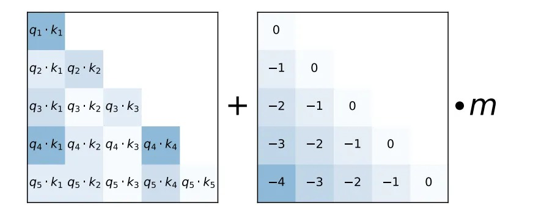
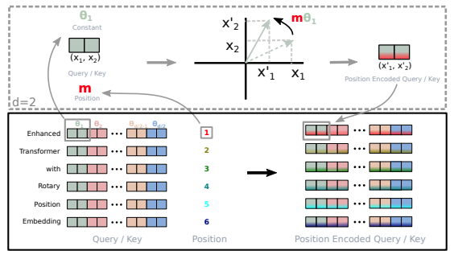

## 0. 为什么需要位置编码

### 0.1 注意力看不到顺序

第 1 篇 2.4 节提到，自注意力是**置换等变**的。这里完整写一遍。设输入 $X\in\mathbb R^{L\times d}$，$P$ 是任意一个 $L\times L$ 置换矩阵（把序列打乱）。打乱后的输入是 $PX$，于是

$$
Q' = PXW_Q = PQ,\qquad K' = PK,\qquad V' = PV
$$

$$
\mathrm{softmax}\!\left(\frac{Q'K'^\top}{\sqrt{d_k}}\right)V' = \mathrm{softmax}\!\left(\frac{PQK^\top P^\top}{\sqrt{d_k}}\right)PV
$$

$PSP^\top$ 是对矩阵 $S$ 的行和列做同一个置换。逐行 softmax 与这种置换可交换：$\mathrm{softmax}(PSP^\top) = P\,\mathrm{softmax}(S)\,P^\top$。再利用 $P^\top P = I$：

$$
= P\,\mathrm{softmax}\!\left(\frac{QK^\top}{\sqrt{d_k}}\right)P^\top P V = P\cdot\mathrm{Attention}(Q,K,V)
$$

输出只是跟着输入一起被打乱，每个 token 得到的向量与它在序列中的位置无关。FFN、LayerNorm、残差都是逐位置独立的，也不引入顺序信息。所以**一个没有位置编码的 Transformer 编码器，把"狗咬人"和"人咬狗"看成同一个词袋。**

（解码器有因果掩码，掩码本身是位置相关的：位置 $i$ 能看到 $i$ 个 token。所以严格说，带因果掩码的模型可以间接推断位置。第 6 节的 NoPE 就利用了这一点。但对双向注意力，位置编码是必需的。）

### 0.2 好的位置编码应该提供什么

RNN 按顺序逐个处理 token，位置信息天然包含在计算过程中。注意力是全局并行的，必须另外注入。理想的位置编码希望做到：

1. **区分绝对位置**：每个位置有唯一的表示；
2. **表达相对位置**：两个 token 相距多远、谁在前谁在后，最好能被模型直接利用。语言中很多规律是相对的（形容词通常紧挨在名词前面），而不是绝对的（"第 37 个词"本身没有意义）；
3. **对不同长度的序列一致**：同样的相对距离在长句和短句中应该有同样的含义；
4. **能外推**：在比训练时更长的序列上仍然有效。

### 0.3 这一篇的路线

位置编码的演化，基本上就是按上面四条逐条改进的过程：

```
绝对位置编码（加在输入上）            第 1、2 节
   正弦（原始 Transformer） / 可学习（BERT、GPT-2）
          │  问题：相对位置只能间接利用，不能外推
          ▼
相对位置编码（改注意力分数）          第 3 节
   Shaw → Transformer-XL → T5 偏置 → ALiBi
          │  问题：需要额外的偏置矩阵，不便于高效实现
          ▼
RoPE（旋转 q、k）                    第 4 节
          │  问题：本身外推不好
          ▼
长度扩展：PI、NTK、YaRN、DCA         第 5 节
          │
          ▼
位置信息要不要占满所有维度、所有层？  第 6 节
   Partial RoPE、Decoupled RoPE（MLA）、NoPE
```

## 1. 绝对位置编码（一）：正弦函数

### 1.1 定义

原始 Transformer 为每个位置 $pos$ 生成一个 $d$ 维向量，第 $2i$ 和 $2i+1$ 维分别是

$$
PE_{(pos,\,2i)} = \sin(\omega_i\,pos),\qquad
PE_{(pos,\,2i+1)} = \cos(\omega_i\,pos),\qquad
\omega_i = \frac{1}{10000^{2i/d}}
$$

$i = 0,1,\dots,d/2-1$。位置编码直接**加**到嵌入上：

$$
h^{(0)}_{pos} = \sqrt d\cdot E[\text{token}_{pos}] + PE_{pos}
$$

位置编码的维度与嵌入相同，所以可以相加。它不含任何可学习参数。

### 1.2 多频率：像一个连续的二进制计数器

$d/2$ 对维度各用一个频率 $\omega_i$，从 $\omega_0 = 1$ 几何递减到 $\omega_{d/2-1}\approx 1/10000$。对应的波长 $2\pi/\omega_i$ 从约 6.3 个位置增长到约 6.3 万个位置。

可以类比二进制计数：

```
位置   第 0 位  第 1 位  第 2 位  第 3 位
 0       0       0       0       0
 1       1       0       0       0
 2       0       1       0       0
 3       1       1       0       0
 4       0       0       1       0
 ...
```

低位翻转得快，高位翻转得慢，所有位合起来唯一确定一个数。正弦编码是这种思想的连续、平滑版本：高频维度（$i$ 小）随位置快速振荡，区分相邻位置；低频维度（$i$ 大）变化缓慢，区分相距很远的位置。

**为什么同时用 sin 和 cos.** 单独一个 $\sin(\omega pos)$ 在一个周期内会有两个位置取到相同的值。$(\sin\omega pos,\ \cos\omega pos)$ 是单位圆上的一个点，在一个周期内一一对应。这也是下一小节线性关系成立的关键。

### 1.3 相对位置是一个旋转

论文选择正弦函数的主要理由是：**对任意固定的偏移 $k$，$PE_{pos+k}$ 可以表示为 $PE_{pos}$ 的线性函数。** 对第 $i$ 对维度，由和角公式

$$
\begin{aligned}
\sin\omega_i(pos+k) &= \sin\omega_i pos\cos\omega_i k + \cos\omega_i pos\sin\omega_i k \\
\cos\omega_i(pos+k) &= \cos\omega_i pos\cos\omega_i k - \sin\omega_i pos\sin\omega_i k
\end{aligned}
$$

写成矩阵形式：

$$
\begin{pmatrix}\sin\omega_i(pos+k)\\ \cos\omega_i(pos+k)\end{pmatrix}
=
\underbrace{\begin{pmatrix}\cos\omega_i k & \sin\omega_i k\\ -\sin\omega_i k & \cos\omega_i k\end{pmatrix}}_{R_i(k)}
\begin{pmatrix}\sin\omega_i pos\\ \cos\omega_i pos\end{pmatrix}
$$

$R_i(k)$ 是一个只依赖偏移 $k$ 的旋转矩阵。把所有维度对拼起来，$PE_{pos+k} = R(k)\,PE_{pos}$。**从位置 $pos$ 移动 $k$ 步，等于在每个二维子空间里旋转一个固定角度 $\omega_ik$。** 这个观察正是第 4 节 RoPE 的出发点。

### 1.4 两个位置编码的内积只依赖距离

$$
PE_p^\top PE_q = \sum_{i=0}^{d/2-1}\big(\sin\omega_ip\sin\omega_iq + \cos\omega_ip\cos\omega_iq\big) = \sum_{i=0}^{d/2-1}\cos\big(\omega_i(p-q)\big)
$$

利用了 $\sin a\sin b + \cos a\cos b = \cos(a-b)$。结果**只依赖距离 $p-q$**，而且 $|p-q|$ 增大时各项相位逐渐错开，总和整体上倾向于减小（伴随波动）。

但有两个问题：

- **不区分方向**：余弦是偶函数，无法区分"在前 3 个位置"和"在后 3 个位置"；
- **进入注意力后被破坏**：注意力算的不是 $PE_p^\top PE_q$，而是经过投影后的内积，见下一小节。

### 1.5 四项展开：绝对位置编码的根本问题

位置编码加在嵌入上之后，注意力分数是（把 $x$、$p$ 写成行向量）

$$
\begin{aligned}
s_{ij} &= (x_i + p_i)\,W_QW_K^\top\,(x_j + p_j)^\top \\
&= \underbrace{x_iW_QW_K^\top x_j^\top}_{\text{内容-内容}} + \underbrace{x_iW_QW_K^\top p_j^\top}_{\text{内容-位置}} + \underbrace{p_iW_QW_K^\top x_j^\top}_{\text{位置-内容}} + \underbrace{p_iW_QW_K^\top p_j^\top}_{\text{位置-位置}}
\end{aligned}
$$

- **位置-位置**项中间夹了一个任意矩阵 $W_QW_K^\top$，不再是 1.4 节的纯余弦和，也就不再只依赖 $i-j$；
- **内容-位置**和**位置-内容**两项把内容和绝对位置混在一起。

正弦编码本身有良好的相对位置结构，但"加在输入上、再经过任意投影"的用法让这个结构只能被间接利用。**这个四项展开是理解后面所有方法的钥匙**：相对位置编码（第 3 节）直接改写这几项，RoPE（第 4 节）让投影之后的内积严格只依赖相对位置。

### 1.6 已知的缺点

1. **外推性差**：理论上正弦函数对任何位置都有定义，但推理长度超过训练长度时，低频维度会出现训练中没见过的相位组合。Press et al.（2022，ALiBi）的实验显示，正弦编码的模型超过训练长度后困惑度迅速上升；
2. **相对位置只能间接利用**：见 1.5 节；
3. **高维度区分度低**：$i$ 越大，频率越低。在常见的序列长度内，最后一些维度的相位几乎不变，相邻位置在这些维度上几乎无法区分。它们本该用来区分很远的位置，但训练长度覆盖不到它们的一个周期时，也学不到有用的东西。

## 2. 绝对位置编码（二）：可学习向量

### 2.1 做法

BERT 和 GPT-2 换了一个更直接的办法：把位置编码当作参数学出来。设最大长度为 $L_{\max}$，位置嵌入矩阵为 $P\in\mathbb R^{L_{\max}\times d}$：

$$
h^{(0)}_{pos} = E[\text{token}_{pos}] + P[pos]
$$

BERT 的 $L_{\max} = 512$，GPT-2 为 1024。BERT 还加了一个 segment embedding，区分句子对中的第一句和第二句。

### 2.2 优缺点

- **优点**：完全数据驱动。原始 Transformer 论文的消融实验中，可学习编码与正弦编码效果几乎相同；有研究可视化 GPT-2 学到的位置嵌入，发现它们自发呈现出类似正弦曲线的平滑周期结构；
- **完全不能外推**：超过 $L_{\max}$ 的位置根本没有对应的向量。要处理更长的序列，只能扩展 $P$ 并在长序列上继续训练；
- **靠后的位置学得不好**：长序列少时，大位置编号出现次数少，对应向量训练不充分（与罕见 token 的嵌入是同一个问题）；
- **同样只能间接表达相对位置**：四项展开对可学习编码同样成立。

### 2.3 加法还是拼接

把位置信息**加**到嵌入上，会不会造成信息失真？为什么不拼接？

**拼接在线性投影之后等价于加法.** 设拼接 $[x;\,p]$ 后经过线性层 $W = \begin{pmatrix}W_1\\ W_2\end{pmatrix}$：

$$
[x;\,p]\,W = xW_1 + pW_2
$$

Transformer 的每一层都先做线性投影，所以把 $p$ 直接加到 $x$ 上，相当于把 $W_2$ 约束为 $W_1$。拼接多提供的自由度有限，却要付出维度增加的代价。

**加法为什么不会严重失真.** 高维空间中随机方向几乎相互正交。经验上，训练好的模型中 token 嵌入和位置嵌入大致占据不同的子空间，余弦相似度很低。两类信息位于近似正交的子空间中，相加之后仍可被后续的线性投影分别读出。$d$ 维向量的表示能力远大于单个 token 语义所需，位置信息可以放在剩余的方向上。加入位置信息也让同一个 token 在不同位置有不同的表示，这正是我们想要的。

### 2.4 实现

```python
import math
import torch
import torch.nn as nn


class SinusoidalPositionalEncoding(nn.Module):
    """原始 Transformer：固定的正弦位置编码，加在嵌入上"""
    def __init__(self, d_model, max_len=8192, base=10000.0):
        super().__init__()
        pos = torch.arange(max_len, dtype=torch.float).unsqueeze(1)        # (max_len, 1)
        i = torch.arange(0, d_model, 2, dtype=torch.float)                  # 2i = 0, 2, 4, ...
        omega = base ** (-i / d_model)                                      # ω_i = 1 / base^{2i/d}
        pe = torch.zeros(max_len, d_model)
        pe[:, 0::2] = torch.sin(pos * omega)
        pe[:, 1::2] = torch.cos(pos * omega)
        self.register_buffer("pe", pe, persistent=False)

    def forward(self, x):                                                   # x: (B, L, d)
        return x + self.pe[: x.size(1)]


class LearnedPositionalEmbedding(nn.Module):
    """BERT / GPT-2：可学习的位置嵌入，最长 max_len"""
    def __init__(self, d_model, max_len=1024):
        super().__init__()
        self.pe = nn.Embedding(max_len, d_model)

    def forward(self, x):
        L = x.size(1)
        assert L <= self.pe.num_embeddings, "超过最大长度：可学习位置编码无法外推"
        return x + self.pe(torch.arange(L, device=x.device))


# 验证 1.4 节：正弦位置编码的内积只依赖距离，且不区分方向
pe = SinusoidalPositionalEncoding(64).pe
print(torch.allclose(pe[10] @ pe[13], pe[100] @ pe[103]))   # True
print(torch.allclose(pe[10] @ pe[13], pe[13] @ pe[10]))     # True
```

## 3. 相对位置编码：改写注意力分数

绝对位置编码的问题在于位置以绝对形式进入四项展开中的三项。**相对位置编码**的思路是：不再把位置加到输入上，而是在计算注意力时直接注入 $i - j$。这样同样的相对距离在任何位置、任何长度的序列中含义相同。

### 3.1 Shaw et al.（2018）：相对位置的键向量

最早的相对位置编码为每个相对距离学习一个向量 $a_{ij}^K\in\mathbb R^{d_k}$，加到键上：

$$
s_{ij} = \frac{q_i^\top\big(k_j + a_{ij}^K\big)}{\sqrt{d_k}},\qquad
a_{ij}^K = w^K_{\mathrm{clip}(j-i,\,-k_{\max},\,k_{\max})}
$$

距离截断在 $[-k_{\max}, k_{\max}]$ 内，只需要学 $2k_{\max}+1$ 个向量。理由是：远距离时精确的相对位置用处不大，"很远"就够了；截断后也能泛化到没见过的长度。缺点是 $q_i^\top a_{ij}^K$ 对每对 $(i,j)$ 都不同，不能直接写成一次大矩阵乘法，需要专门的计算技巧。

### 3.2 Transformer-XL（2019）：逐项替换

Transformer-XL 直接从四项展开出发逐项替换：

$$
s_{ij} = \underbrace{x_iW_QW_{K,E}^\top x_j^\top}_{\text{(a) 内容-内容}} + \underbrace{x_iW_QW_{K,R}^\top R_{i-j}^\top}_{\text{(b) 内容-相对位置}} + \underbrace{u\,W_{K,E}^\top x_j^\top}_{\text{(c) 全局内容偏置}} + \underbrace{v\,W_{K,R}^\top R_{i-j}^\top}_{\text{(d) 全局位置偏置}}
$$

- 键一侧的绝对位置 $p_j$ 换成相对位置的正弦编码 $R_{i-j}$；
- 查询一侧的 $p_iW_Q$ 换成两个可学习的全局向量 $u, v$：查询的绝对位置不应该影响"我该关注什么"；
- 内容和位置用不同的键投影 $W_{K,E}$、$W_{K,R}$。

Transformer-XL 需要相对编码，是因为它在段与段之间复用缓存的隐藏状态，绝对位置编码在跨段时会冲突。这个设计表达力强，但计算复杂。

### 3.3 T5 相对位置偏置

T5（Raffel et al., 2020）把上面的思路**简化到极致**：只保留一个与内容无关的**标量偏置**，直接加到注意力分数上。

**定义.** 对第 $h$ 个头：

$$
e_{ij}^{(h)} = \frac{q_i^{(h)\top}k_j^{(h)}}{\sqrt{d_k}} + r_{ij}^{(h)},\qquad
\alpha_{ij}^{(h)} = \mathrm{softmax}_j\big(e_{ij}^{(h)}\big)
$$

$q_i^\top k_j/\sqrt{d_k}$ 是**内容相关性**，$r_{ij}^{(h)}$ 是一个只依赖相对距离的**标量**。模型不给输入加任何位置向量。对照四项展开，T5 只保留了 (a) 内容-内容，再加上一个纯位置项。

（实际的 T5 实现没有除以 $\sqrt{d_k}$，缩放被合并进了 $W_Q$ 的初始化，不影响这里的讨论。）

**偏置从哪里来：查表.** 模型维护一个可学习的偏置表 $R\in\mathbb R^{H\times B}$，$H$ 是头数，$B$ 是**相对位置桶**的数量（T5 取 32）：

$$
r_{ij}^{(h)} = R_{h,\ b(i - j)}
$$

整条链路：

$$
i - j\ \longrightarrow\ \text{桶编号 } b(i-j)\ \longrightarrow\ r_{ij} = R_{h,b}\ \longrightarrow\ \frac{q_i^\top k_j}{\sqrt{d_k}} + r_{ij}\ \longrightarrow\ \mathrm{softmax}
$$

$R$ 是训练中学到的参数表，$r_{ij}$ 是按距离从表中查出的一个数。每个头有自己的一行，不同的头可以学到不同的距离偏好。偏置表只有 $H\times 32$ 个参数，并且**在所有层之间共享**。

**分桶：近处精细，远处粗糙.** T5 不为每个距离单独学参数，而是把距离分组。以编码器（双向注意力）为例，设 $n = i - j$：

1. **先按方向分成两半**：$n>0$（键在查询之前）和 $n\le 0$ 各用 16 个桶。这让偏置**区分方向**；
2. **每个方向内前一半精确**：$|n| = 0,1,\dots,7$ 各占一个桶；
3. **后一半按对数划分**：$|n|$ 从 8 到 127 按对数尺度分到剩下的 8 个桶，

$$
b = 8 + \left\lfloor\frac{\log(|n|/8)}{\log(128/8)}\times 8\right\rfloor
$$

   每个桶覆盖的距离范围约是前一个的 $16^{1/8}\approx 1.41$ 倍：8 到 11 一个桶、11 到 16 一个桶……；
4. **超过最大距离的归入最后一个桶**：$|n|\ge 128$ 共用一个桶。

解码器（因果注意力）只有 $n\ge 0$，32 个桶全部用于一个方向：$0\sim 15$ 精确，$16\sim 127$ 对数，$\ge 128$ 一个桶。

（常见的说法"T5 把小于 4 的距离归为一种位置"不准确：近距离是每个距离各占一个桶，只有远距离才合并。）

**为什么能处理训练之外的长度.** 所有 $|n|\ge 128$ 都映射到同一个桶，所以无论序列多长，偏置都有定义，模型学会的"很远就是很远"在更长的序列上依然适用。代价是远距离的位置分辨率为零：200 和 2000 的距离得到同样的偏置。

**核心理解：$QK^\top$ 决定"内容上应该关注谁"，$r_{ij}$ 调整"位置上应该关注谁"。**

```python
def relative_position_bucket(rel_pos, bidirectional=True, num_buckets=32, max_distance=128):
    """rel_pos = j - i（键位置 - 查询位置），返回桶编号 [0, num_buckets)"""
    n = -rel_pos                                   # n = i - j，正数表示键在查询之前
    bucket = torch.zeros_like(n)
    if bidirectional:
        num_buckets //= 2                          # 两个方向各一半
        bucket += (n < 0).long() * num_buckets     # 键在查询之后：用后一半的桶
        n = n.abs()
    else:
        n = n.clamp(min=0)
    max_exact = num_buckets // 2
    is_small = n < max_exact                       # 近距离：每个距离一个桶
    large = max_exact + (
        torch.log(n.float().clamp(min=1) / max_exact) / math.log(max_distance / max_exact)
        * (num_buckets - max_exact)
    ).long()
    large = large.clamp(max=num_buckets - 1)       # 超过 max_distance 归入最后一个桶
    return bucket + torch.where(is_small, n, large)


class T5RelativeBias(nn.Module):
    def __init__(self, n_heads, num_buckets=32, max_distance=128, bidirectional=True):
        super().__init__()
        self.bias = nn.Embedding(num_buckets, n_heads)   # 偏置表 R（转置存储）
        self.cfg = (bidirectional, num_buckets, max_distance)

    def forward(self, Lq, Lk, device=None):
        rel = torch.arange(Lk, device=device)[None, :] - torch.arange(Lq, device=device)[:, None]
        return self.bias(relative_position_bucket(rel, *self.cfg)).permute(2, 0, 1)  # (H, Lq, Lk)


print(relative_position_bucket(torch.tensor([0, -1, -7, -8, -20, -127, -500, 3])).tolist())
# [0, 1, 7, 8, 10, 15, 15, 19]
```

用法是 `scores = q @ k.transpose(-2, -1) / sqrt(d_k) + rel_bias(Lq, Lk)[None]`。T5 中偏置只在第一层算一次，之后各层复用。

### 3.4 ALiBi：不学习的线性偏置

ALiBi（Press et al., 2022）把偏置进一步简化成一个**固定的线性函数**：

$$
e_{ij}^{(h)} = \frac{q_i^{(h)\top}k_j^{(h)}}{\sqrt{d_k}} - m_h\cdot(i - j),\qquad j\le i
$$

距离越远惩罚越大。每个头一个固定斜率，取几何数列 $m_h = 2^{-8h/H}$；对 8 个头就是 $\tfrac12,\tfrac14,\dots,\tfrac1{256}$。斜率大的头只看附近，斜率小的头看得很远。



*图 1：ALiBi 的计算方式。左边是查询与键的点积（因果掩码下的下三角部分），加上一个只依赖距离的固定偏置矩阵（$0, -1, -2, \dots$）乘以每个头的斜率 $m$。图片来源：Press et al., "Train Short, Test Long: Attention with Linear Biases Enables Input Length Extrapolation", ICLR 2022, Figure 3。*


ALiBi 没有任何位置参数，主要卖点是**外推**（Train Short, Test Long）：在 1024 长度上训练，在 2048 甚至更长的序列上困惑度仍然稳定，优于正弦、RoPE 和 T5 偏置。原因是线性惩罚对任何距离都有定义，远处 token 的权重被持续压低，模型在更长序列上看到的注意力模式与训练时类似。BLOOM、MPT 等模型采用了 ALiBi。

但它的"外推"在一定程度上来自对远距离注意力的强烈抑制：很远的 token 几乎得不到注意力，模型实际上在一个有效窗口内工作。对需要从长上下文中精确检索的任务，这可能成为限制。

### 3.5 偏置类方法的共同代价

- 偏置是一个 $L\times L$ 的矩阵（每个头一个），要显式加到分数矩阵上，和 FlashAttention 这类高效内核结合不如无偏置的版本方便（ALiBi 因为形式简单，后来被一些内核直接支持）；
- 生成时每一步都要为新的查询位置重新计算偏置；
- T5 偏置外推一般且速度较慢（Press et al. 2022 的对比）。

## 4. RoPE：用绝对位置的旋转实现相对位置

### 4.1 目标

RoPE（Rotary Position Embedding，Su et al., 2021，RoFormer）要找一个作用在 $q$、$k$ 上的变换 $f$，只用各自的**绝对位置**，却让内积**只依赖相对位置**：

$$
\big\langle f(q, m),\ f(k, n)\big\rangle = g(q, k, m - n)
$$

如果做到了：

- 位置信息直接作用在 $q$、$k$ 上，注意力的计算形式完全不变，不需要偏置矩阵；
- 每个 token 只用自己的位置做变换，变换后的键可以直接存进 KV Cache；
- 内积严格只依赖 $m - n$。

RoPE 被 GPT-NeoX、PaLM、Llama、Qwen、DeepSeek、Mistral 等几乎所有主流开源大模型采用，是今天位置编码的事实标准。

### 4.2 二维情形：复数乘法就是旋转

把二维向量看成复数：$q = (q_1, q_2)\leftrightarrow\tilde q = q_1 + \mathrm i\,q_2$。内积可以写成

$$
\langle q, k\rangle = q_1k_1 + q_2k_2 = \mathrm{Re}\big[\tilde q\,\overline{\tilde k}\big]
$$

（$(q_1 + \mathrm iq_2)(k_1 - \mathrm ik_2)$ 的实部正是内积。）令

$$
f(q, m) = \tilde q\,e^{\mathrm im\theta},\qquad f(k, n) = \tilde k\,e^{\mathrm in\theta}
$$

乘以单位复数 $e^{\mathrm im\theta}$ 就是旋转 $m\theta$。于是

$$
\big\langle f(q,m),\ f(k,n)\big\rangle = \mathrm{Re}\Big[\tilde q\,e^{\mathrm im\theta}\ \overline{\tilde k\,e^{\mathrm in\theta}}\Big] = \mathrm{Re}\Big[\tilde q\,\overline{\tilde k}\,e^{\mathrm i(m-n)\theta}\Big]
$$

**只依赖 $m - n$**。直观上：查询旋转了 $m\theta$，键旋转了 $n\theta$，两者夹角改变了 $(m-n)\theta$，内积只取决于长度和夹角。

写成实数矩阵：

$$
f(q, m) = R(m\theta)\,q = \begin{pmatrix}\cos m\theta & -\sin m\theta\\ \sin m\theta & \cos m\theta\end{pmatrix}\begin{pmatrix}q_1\\ q_2\end{pmatrix}
$$

由 $R(\alpha)^\top = R(-\alpha)$、$R(\alpha)R(\beta) = R(\alpha+\beta)$：

$$
f(q,m)^\top f(k,n) = q^\top R(m\theta)^\top R(n\theta)\,k = q^\top R\big((n-m)\theta\big)\,k
$$

### 4.3 推广到 $d$ 维

把 $d$ 维向量分成 $d/2$ 个二维子空间，每个子空间用不同的频率旋转：

$$
R_m = \mathrm{diag}\Big(R(m\theta_0),\ R(m\theta_1),\ \dots,\ R(m\theta_{d/2-1})\Big),\qquad
f(q,m) = R_mq
$$

每个二维块独立满足上面的性质，所以

$$
(R_mq)^\top(R_nk) = q^\top R_m^\top R_n\,k = q^\top R_{n-m}\,k
$$

频率沿用正弦编码：$\theta_i = \text{base}^{-2i/d}$，$\text{base} = 10000$。这里的 $d$ 是**每个注意力头的维度** $d_k$（如 128），每个头独立旋转。



*图 2：RoPE 的实现。上方虚线框：在一个二维子空间里，把 $(x_1, x_2)$ 按位置 $m$ 旋转角度 $m\theta_1$。下方：把查询或键的 $d$ 维分成 $d/2$ 对，第 $i$ 对用频率 $\theta_i$ 旋转，不同位置的 token（1 到 6）旋转的角度不同。图片来源：Su et al., "RoFormer: Enhanced Transformer with Rotary Position Embedding", 2021, Figure 1。*


**与正弦编码的区别：**

| | 正弦位置编码 | RoPE |
|---|---|---|
| 作用方式 | **加**到输入嵌入上 | **旋转**投影后的 $q$、$k$ |
| 作用位置 | 第一层之前一次 | 每一层注意力内部 |
| 注意力分数是否只依赖相对位置 | 否（四项展开） | 是 |
| 区分方向 | 位置-位置项不区分 | 区分（$R_{n-m}\ne R_{m-n}$） |

RoPE 彻底消除了四项展开中"内容与绝对位置混杂"的问题：分数 $q^\top R_{n-m}k$ 中，内容只通过 $q, k$ 进入，位置只通过 $n-m$ 进入。

### 4.4 远程衰减

随着相对距离增大，注意力分数的**上界**倾向于减小。把第 $i$ 对维度写成复数，记 $h_i = \tilde q_i\overline{\tilde k_i}$，$\Delta = m - n$：

$$
q^\top R_{n-m}k = \mathrm{Re}\left[\sum_{i=0}^{d/2-1}h_i\,e^{\mathrm i\Delta\theta_i}\right]
$$

记部分和 $S_j = \sum_{l=0}^{j-1}e^{\mathrm i\Delta\theta_l}$（$S_0 = 0$），约定 $h_{d/2} = 0$，用**阿贝尔求和**（离散版的分部积分）：

$$
\sum_{i=0}^{d/2-1}h_i(S_{i+1} - S_i) = -\sum_{i=0}^{d/2-1}S_{i+1}(h_{i+1} - h_i)
\quad\Longrightarrow\quad
\left|\sum_ih_i\,e^{\mathrm i\Delta\theta_i}\right|\le\Big(\max_i|h_{i+1} - h_i|\Big)\sum_{i=1}^{d/2}|S_i|
$$

第一个因子只依赖内容，第二个只依赖距离。$\Delta = 0$ 时部分和最大；$\Delta$ 增大后不同频率的相位错开、互相抵消，$\frac2d\sum_i|S_i|$ 整体下降（伴随振荡）。注意这只是**上界**的衰减，模型完全可以学到对远处 token 的高注意力。

### 4.5 工程细节

**只旋转 Q 和 K.** 位置信息的目的是影响"关注谁"，只由 $q^\top k$ 决定。$v$ 不旋转：输出是值向量的加权平均，值向量各自带着旋转会让平均失去意义。旋转发生在线性投影之后：$q_m = R_mW_Qx_m$，$k_n = R_nW_Kx_n$，$v_n = W_Vx_n$。

**KV Cache 中存的是旋转后的 K.** 每个键只用自己的位置旋转，与查询无关，所以算好、转好就可以缓存：

$$
x_n\ \rightarrow\ W_K\ \rightarrow\ k_n\ \rightarrow\ R_nk_n\ \rightarrow\ \text{Cache}
$$

（这个性质给 MLA 带来了麻烦，第 6.2 节讲 Decoupled RoPE 如何解决。）

**逐元素实现.** 对每一对 $(x_{2i}, x_{2i+1})$ 的旋转可以写成

$$
x' = x\odot\cos(m\boldsymbol\theta) + \mathrm{rotate}(x)\odot\sin(m\boldsymbol\theta)
$$

$\mathrm{rotate}$ 把每一对 $(a, b)$ 变成 $(-b, a)$。只需两次逐元素乘法和一次加法。

**两种维度配对方式.** 原论文把相邻两维 $(2i, 2i+1)$ 配对（**交错式**）；GPT-NeoX 和 Hugging Face 的 Llama 实现把 $(i,\ i+d/2)$ 配对（**前后半式**），对应 $\mathrm{rotate\_half}([x_{\text{前}}, x_{\text{后}}]) = [-x_{\text{后}}, x_{\text{前}}]$。两者只差一个对 $q$、$k$ 相同的维度置换，点积不变。但**转换权重时**必须对 $W_Q$、$W_K$ 的行做对应的重排，否则位置编码会错乱。

```python
class RotaryEmbedding(nn.Module):
    def __init__(self, head_dim, max_seq_len=4096, base=10000.0):
        super().__init__()
        inv_freq = 1.0 / (base ** (torch.arange(0, head_dim, 2).float() / head_dim))  # θ_i
        self.register_buffer("inv_freq", inv_freq, persistent=False)
        pos = torch.arange(max_seq_len, dtype=torch.float)
        freqs = torch.outer(pos, inv_freq)                    # (L, d/2)，第 m 行为 m·θ_i
        emb = torch.cat([freqs, freqs], dim=-1)               # 前后半式：两半用同一组角度
        self.register_buffer("cos_cached", emb.cos(), persistent=False)
        self.register_buffer("sin_cached", emb.sin(), persistent=False)

    @staticmethod
    def rotate_half(x):
        x1, x2 = x.chunk(2, dim=-1)
        return torch.cat([-x2, x1], dim=-1)                   # [x1, x2] -> [-x2, x1]

    def forward(self, q, k, offset=0):
        """q, k: (B, H, L, d)；offset: 本块第一个 token 的绝对位置（KV Cache 解码时 = 已缓存长度）"""
        L = q.size(-2)
        cos = self.cos_cached[offset: offset + L]
        sin = self.sin_cached[offset: offset + L]
        return q * cos + self.rotate_half(q) * sin, k * cos + self.rotate_half(k) * sin


# 验证：旋转后的内积只依赖相对位置
rope = RotaryEmbedding(64)
q, k = torch.randn(1, 1, 1, 64), torch.randn(1, 1, 1, 64)
qa, _ = rope(q, q, offset=10); _, kb = rope(k, k, offset=7)      # m=10, n=7
qc, _ = rope(q, q, offset=110); _, kd = rope(k, k, offset=107)   # m=110, n=107
print(torch.allclose((qa * kb).sum(), (qc * kd).sum(), atol=1e-4))  # True
```

### 4.6 一个常见的误解：RoPE 本身能外推吗

常有说法认为"RoPE 最大的优点是外推性，能从 2K 外推到 8K"。这需要更正：**不加处理的 RoPE 外推能力并不好**，Press et al.（2022）的实验中，RoPE 模型超过训练长度后困惑度迅速上升，与正弦编码类似。

原因在于低频维度。设训练长度为 $L$，第 $i$ 对维度的波长为 $\lambda_i = 2\pi/\theta_i$：

- **高频维度**（$\lambda_i\ll L$）：训练中转过了很多圈，所有角度都见过；
- **低频维度**（$\lambda_i > L$）：训练中不到一圈，只见过 $[0,\ L\theta_i)$ 范围内的角度。推理时超过 $L$，这些维度出现**训练中从未见过的旋转角度**。

RoPE 真正的优势不是天然外推，而是**便于扩展**：位置以明确的角度 $m\theta_i$ 进入计算，可以通过修改位置编号或频率把超出范围的角度拉回训练见过的范围。这是下一节的内容。

## 5. 长度扩展：把模型用到更长的上下文

### 5.1 问题的形式化

训练长度为 $L$，希望扩展到 $L' = sL$（$s$ 为扩展倍数）。由 4.6 节，问题出在推理时某些维度的角度 $m\theta_i$ 超出了训练时的范围。各种方法的目标都是：**避免模型在长上下文中遇到完全超出训练分布的旋转角度**，同时尽量保留位置分辨率。

常见方法分三类，不能简单统称为"把 base 调大"：

- **压缩位置编号**：Position Interpolation；
- **调整频率分布**：修改 base（NTK-aware scaling）；
- **按频率分别处理**：YaRN（并修正注意力的尺度）。

此外还有不改频率、改相对位置计算方式的 DCA。

### 5.2 Position Interpolation（PI）：把长位置压回训练范围

Chen et al.（2023）的做法非常直接：

$$
m' = \frac{m}{s},\qquad \mathrm{RoPE}(x, m)\ \longrightarrow\ \mathrm{RoPE}\!\left(x, \frac ms\right)
$$

扩展到 $sL$ 的位置被线性映射回 $[0, L]$。例如训练长度 4K、扩展到 16K，$s = 4$，位置 12000 被映射到 3000。等价于把所有频率除以 $s$：$\theta_i' = \theta_i/s$。

**为什么插值比外推好.** 论文证明，插值得到的注意力分数的误差上界比直接外推小得多（外推的上界可以大到使模型完全失效）。直观上，插值后所有角度都在训练见过的范围内，只是出现在"位置之间"，而神经网络对插值的泛化远好于对外推的泛化。

**效果.** 在 Llama 上，PI 配合约 1000 步的长序列微调，就能把上下文从 2K 扩展到 32K。

**局限.** 所有位置被**整体压缩**，相邻 token 的角度差也缩小为原来的 $1/s$。对高频维度，这意味着模型区分相邻位置的能力下降；扩展倍数越大，位置之间越"拥挤"。PI 解决了超出训练范围的问题，但牺牲了局部的位置分辨率。

### 5.3 NTK-aware 缩放：调整 base

PI 对所有频率一视同仁地除以 $s$，但 4.6 节说过，**只有低频维度有超出范围的问题**，高频维度本来就没问题。NTK-aware 缩放（bloc97, 2023，社区提出）的思路是：**高频少压缩、低频多压缩**，通过修改 base 实现：

$$
\text{base}' = \text{base}\cdot s^{\frac{d}{d-2}}
$$

验证两端：

- 最高频 $i = 0$：$\theta_0' = \text{base}'^{0} = 1 = \theta_0$，**完全不变**，局部分辨率不受影响；
- 最低频 $i = d/2-1$：$\theta'_{d/2-1} = \text{base}'^{-(d-2)/d} = \text{base}^{-(d-2)/d}\cdot s^{-1} = \theta_{d/2-1}/s$，**恰好被压缩 $s$ 倍**，与 PI 相同。

中间的频率被压缩的程度在 $1$ 到 $s$ 之间按几何方式过渡。名字中的 NTK 来自神经正切核理论的启发：网络难以学习高频信息，所以高频分量不应被压缩。这种方法在不微调时的效果明显好于 PI，微调后也更好。

**动态 NTK.** 推理时根据当前长度动态计算 $s = \max(1, L_{\text{cur}}/L)$：序列短时不缩放，变长后逐渐加大缩放，避免短文本性能下降。

**在预训练中直接调大 base.** 另一种做法是从一开始就用更大的 base，让低频维度的波长足够长。Llama 2 的 base 是 10000，Llama 3 改为 500000，Code Llama 用 1000000。在长上下文继续训练阶段同时调大 base，是目前最常见的做法之一。

### 5.4 YaRN：按频率分区处理

YaRN（Peng et al., 2023）把 NTK 的思路做得更精细。对每个维度，计算它在训练长度内转了多少圈：

$$
r_i = \frac{L}{\lambda_i} = \frac{L\,\theta_i}{2\pi}
$$

然后按 $r_i$ 分三个区域：

- $r_i < \alpha$（低频，训练中转不满一圈）：**完全插值**，$\theta_i' = \theta_i/s$；
- $r_i > \beta$（高频，转了很多圈）：**完全不变**，$\theta_i' = \theta_i$；
- 中间：用一个线性斜坡 $\gamma(r_i)\in[0,1]$ 平滑过渡。

$$
\theta_i' = \big(1 - \gamma(r_i)\big)\frac{\theta_i}{s} + \gamma(r_i)\,\theta_i,\qquad
\gamma(r) = \begin{cases}0, & r<\alpha\\ \dfrac{r-\alpha}{\beta-\alpha}, & \alpha\le r\le\beta\\ 1, & r>\beta\end{cases}
$$

对 Llama 类模型推荐 $\alpha = 1$、$\beta = 32$。这种做法称为 "NTK-by-parts"。

**注意力温度修正.** 插值之后，长上下文中注意力的分布会变得更"平"（参与 softmax 的 token 更多，分数的分布也有变化），熵升高。YaRN 在 softmax 前对 logits 乘以一个系数：

$$
\mathrm{softmax}\!\left(\frac{q^\top k}{t\sqrt{d_k}}\right),\qquad \sqrt{\frac1t} = 0.1\ln s + 1
$$

实现时直接把 $q$、$k$ 各乘以 $\sqrt{1/t}$，不需要改注意力内核。

**效果.** YaRN 用约 0.1% 的预训练数据量进行微调，就能把 Llama 2 扩展到 64K 至 128K 的上下文，效果优于 PI 和 NTK。Qwen2/2.5、DeepSeek-V3 等模型都用 YaRN 做长上下文扩展。即使如此，YaRN 也不是"无需训练的外推"，高质量的长上下文能力仍然需要相应的长序列继续训练或微调。

### 5.5 DCA：不改频率，重新映射相对位置

Dual Chunk Attention（An et al., 2024，Qwen2 采用）走另一条路：**不修改 RoPE 的频率，而是保证注意力中出现的相对位置永远不超过训练时见过的范围。** 它不需要额外训练。

做法是把长序列切成长度为 $c$（小于训练长度）的块，按查询和键所在块的关系，用三种方式计算位置索引：

- **块内注意力**（intra-chunk）：查询和键在同一块内，用块内的局部位置（位置对 $c$ 取模），相对距离小于 $c$，正常计算；
- **块间注意力**（inter-chunk）：键在更早的块里。把查询的位置索引设为一个固定的较大值（不超过训练长度），使得所有块间的相对距离都落在训练见过的范围内；
- **相邻块注意力**（successive-chunk）：对紧邻的前一块单独处理，保持相邻 token 之间的相对距离准确，维护局部性。

三部分的结果合并（各自的 softmax 分子分母相加）就是最终的注意力输出。代价是远距离的相对位置被"压平"，模型无法精确区分很远的 token 之间的距离，但长距离依赖主要靠内容匹配，影响有限。DCA 与 YaRN 可以结合使用：Qwen2 用 YaRN 加 DCA 把上下文扩展到 128K。

（DCA 有时被和 Lightning Attention 混为一谈，因为两者都把序列分块、区分块内和块间。但它们解决的是不同的问题：DCA 处理的是**位置索引**，注意力仍是标准的 softmax 注意力；Lightning Attention 是一种线性注意力，块间分开计算是为了降低**计算复杂度**。后者见第 3 篇。）

### 5.6 一个参考实现

```python
def rope_inv_freq(head_dim, base=10000.0, scaling=None, s=1.0, L_train=4096,
                  alpha=1.0, beta=32.0):
    """返回扩展后的 θ_i'。scaling ∈ {None, 'pi', 'ntk', 'yarn'}"""
    i = torch.arange(0, head_dim, 2).float()
    if scaling == "ntk":
        base = base * s ** (head_dim / (head_dim - 2))        # base' = base · s^{d/(d-2)}
    theta = base ** (-i / head_dim)
    if scaling == "pi":
        return theta / s                                      # 所有频率除以 s
    if scaling == "yarn":
        r = L_train * theta / (2 * math.pi)                   # 训练长度内转了多少圈
        gamma = ((r - alpha) / (beta - alpha)).clamp(0, 1)    # 0: 完全插值，1: 不变
        return (1 - gamma) * theta / s + gamma * theta
    return theta


def yarn_attention_scale(s):
    """YaRN 的温度修正：q、k 各乘以这个系数"""
    return 0.1 * math.log(s) + 1.0 if s > 1 else 1.0
```

### 5.7 方法对比

| 方法 | 做法 | 高频维度 | 低频维度 | 是否需要训练 |
|---|---|---|---|---|
| 直接外推 | 什么都不改 | 不变 | 出现没见过的角度 | — |
| PI | 位置除以 $s$ | 压缩 $s$ 倍（损失局部分辨率） | 压缩 $s$ 倍 | 少量微调 |
| NTK-aware | base 乘以 $s^{d/(d-2)}$ | 几乎不变 | 压缩 $s$ 倍 | 可不训练，微调更好 |
| YaRN | 按转数分区插值 + 温度修正 | 不变 | 压缩 $s$ 倍 | 少量微调 |
| DCA | 重新映射相对位置 | 不改频率 | 不改频率 | 不需要 |

## 6. 位置信息要不要占满所有维度、所有层

前面的方法都默认：每一层、每个头、所有维度都使用位置编码。近年的模型开始质疑这个前提，形成了一个从"全部 RoPE"到"完全不用位置编码"的连续谱。

### 6.1 Partial RoPE：只给部分维度加位置

把每个头的 $q$、$k$ 拆成两部分，只旋转其中一部分：

$$
q = [q^{\text{rope}},\ q^{\text{nope}}],\qquad k = [k^{\text{rope}},\ k^{\text{nope}}]
$$

$$
\tilde q_m = [R_mq^{\text{rope}},\ q^{\text{nope}}],\qquad \tilde k_n = [R_nk^{\text{rope}},\ k^{\text{nope}}]
$$

注意力分数分成两部分：

$$
\tilde q_m^\top\tilde k_n = \underbrace{(q^{\text{rope}})^\top R_{n-m}\,k^{\text{rope}}}_{\text{位置相关}} + \underbrace{(q^{\text{nope}})^\top k^{\text{nope}}}_{\text{纯内容}}
$$

一个头同时拥有对相对距离敏感的位置子空间，和不受旋转影响的内容子空间。

**动机.** 局部的语序确实需要位置，但并不是所有语义匹配都应该被距离干扰。长距离检索时，"这段内容是否相关"往往比"相隔多少 token"更重要。而在全 RoPE 下，同样的内容在不同距离上会因为旋转产生不同的分数，远距离的内容匹配会受到噪声干扰。

**实践.** 这个做法出现得很早：GPT-J 和 GPT-NeoX 只对每个头的一部分维度（约四分之一）做旋转；ChatGLM 系列对一半维度使用 RoPE。近年 Qwen3-Next 等模型在全注意力层中也只对部分维度施加 RoPE。

### 6.2 Decoupled RoPE：为 MLA 而生

MLA（Multi-head Latent Attention，DeepSeek-V2，第 3 篇详述）为了压缩 KV Cache，不缓存完整的键，而是缓存一个低维隐变量 $c_n$，键由上投影得到：$k_n = W_{UK}c_n$。推理时，上投影可以被**吸收**进查询一侧：

$$
q_m^\top k_n = q_m^\top W_{UK}c_n = (W_{UK}^\top q_m)^\top c_n
$$

$W_{UK}^\top q_m$ 只需要对当前查询算一次，然后直接与缓存的 $c_n$ 做点积，不需要把每个 $c_n$ 还原成完整的键。

**RoPE 破坏了吸收.** 如果对键做旋转，$k_n = R_nW_{UK}c_n$，分数变成

$$
q_m^\top R_m^\top R_nW_{UK}c_n = q_m^\top R_{n-m}W_{UK}c_n
$$

中间的 $R_{n-m}$ 依赖于每一对位置，无法提前和 $W_{UK}$ 合并成一个固定矩阵。吸收失效，就必须为每个历史位置还原完整的键，MLA 省下的计算就没了。

**解耦.** DeepSeek-V2 把查询和键拆成两路：

$$
q = [q^C,\ q^R],\qquad k = [k^C,\ k^R]
$$

- **内容路径** $q^C, k^C$：由低秩隐变量生成，不加 RoPE，可以吸收；
- **位置路径** $q^R, k^R$：维度很小（DeepSeek-V2 中每个头 64 维），单独施加 RoPE。$k^R$ 在所有头之间**共享**，只额外缓存这一个小向量。

$$
s_{mn} = (q_m^C)^\top k_n^C + \big(R_mq_m^R\big)^\top\big(R_nk_n^R\big)
$$

形式上和 Partial RoPE 相同（一部分维度有位置、一部分没有），但**动机不同**：Partial RoPE 是为了让内容匹配不受距离干扰，Decoupled RoPE 是为了让 KV 压缩在数学上成立。

### 6.3 NoPE：注意力中不显式注入位置

NoPE（No Positional Encoding）指注意力的 $q$、$k$ 中不加任何显式位置编码：

$$
s_{mn} = \frac{q_m^\top k_n}{\sqrt d}
$$

**NoPE 不代表模型完全不知道顺序.** 0.1 节说过，因果掩码本身是位置相关的。Haviv et al.（2022）发现，不加位置编码的因果语言模型仍然能学到位置信息，困惑度接近有位置编码的模型；Kazemnejad et al.（2023）从理论上证明，因果注意力可以表示绝对位置和相对位置。一个简单的例子：如果第一层的注意力对所有可见 token 均匀分配权重，那么位置 $i$ 的输出是前 $i$ 个值向量的平均，其统计特性随 $i$ 变化，后续层就能从中读出位置。

在混合架构中，顺序信息还可能来自：

- 网络中其他带位置编码的层（交错使用）；
- 循环状态的更新顺序：$h_t = f(h_{t-1}, x_t)$，交换两个 token 会得到不同的状态；
- 因果卷积、滑动窗口注意力的边界等。

**潜在优势：**

- 不受固定旋转频率的限制，可能有更好的长度泛化（没有"没见过的角度"）；
- 内容匹配不会被距离旋转干扰，适合长距离检索；
- 便于和低秩 KV 压缩、状态空间模型结合。

**局限：**

- 对精细的绝对位置和局部顺序的表达可能较弱，依赖模型从因果结构中自行学习；
- 纯 NoPE 并没有成为大型语言模型的统一选择。

### 6.4 交错使用：RoPE 层与 NoPE 层混合

目前更常见的路线不是彻底去掉位置编码，而是**按层分工**：

- **局部层**（如滑动窗口注意力）使用完整 RoPE，负责精细的局部语序；
- **全局层**（全注意力）使用 NoPE 或 Partial RoPE，负责不受距离干扰的长距离检索。

例如 Llama 4 的 iRoPE 让大部分层使用 RoPE，每隔几层插入一个不使用位置编码的全局注意力层；Cohere 的 Command A 让滑动窗口层使用 RoPE、全注意力层使用 NoPE（约 3:1）；SmolLM3 每 4 层中有 1 层去掉 RoPE。这些设计的共同目标是兼顾局部语序和长上下文检索。

### 6.5 连续谱

```
全部维度、全部层 RoPE      Llama 2、Llama 3、Qwen2.5 等
        │
部分维度 RoPE              GPT-J、GPT-NeoX、ChatGLM、Qwen3-Next 全注意力层
        │
内容 / 位置两路解耦         DeepSeek MLA（Decoupled RoPE）
        │
RoPE 层与 NoPE 层交错       Llama 4（iRoPE）、Command A、SmolLM3
        │
不用显式位置编码            NoPE；线性注意力 / 状态空间层依靠循环顺序
```

## 7. 总结

### 7.1 全家族对比

| 方法 | 位置信息作用在哪里 | 形式 | 参数 | 区分方向 | 外推 / 扩展 | 代表模型 |
|---|---|---|---|---|---|---|
| 正弦 | 输入（加法） | 固定向量 | 无 | 否 | 差 | 原始 Transformer |
| 可学习 | 输入（加法） | 可学习向量 | $L_{\max}\times d$ | 可学习 | 不能 | BERT、GPT-2 |
| Shaw | 键（及值） | 截断的相对向量 | 少量 | 是 | 截断后可以 | — |
| Transformer-XL | 注意力分数（四项改写） | 相对正弦 + $u,v$ | 少量 | 是 | 一般 | Transformer-XL、XLNet |
| T5 偏置 | 注意力分数 | 分桶的可学习标量 | $H\times 32$ | 是 | 一般，较慢 | T5 |
| ALiBi | 注意力分数 | 固定线性惩罚 | 无 | 因果 | 好（偏向局部） | BLOOM、MPT |
| RoPE | 旋转 $q$、$k$ | 分块旋转 | 无 | 是 | 本身差，便于扩展 | Llama、Qwen、DeepSeek |
| RoPE + PI / NTK / YaRN | 同上，改位置或频率 | — | 无 | 是 | 好（配合少量训练） | Llama 3、Qwen2.5、DeepSeek-V3 |
| Partial / Decoupled RoPE | 部分维度旋转 | — | 无 | 是 | — | GPT-NeoX、MLA |
| NoPE | 不显式注入 | — | 无 | 靠因果结构 | 潜在更好 | 与 RoPE 层交错使用 |

### 7.2 小结

- 自注意力是**置换等变**的，必须显式注入位置信息。
- **绝对位置编码**（正弦、可学习）加在输入上。正弦编码中偏移等于旋转、内积只依赖距离，但经过投影后注意力分数分解为四项，内容与绝对位置混杂；两者都外推不好。
- **相对位置编码**直接在注意力中注入 $i - j$。T5 用分桶的可学习标量（近处精确、远处对数、128 以外合并），ALiBi 用固定的线性惩罚。代价是需要额外的偏置矩阵。
- **RoPE** 旋转 $q$、$k$，$R_m^\top R_n = R_{n-m}$ 让注意力分数严格只依赖相对位置，不需要偏置矩阵，兼容 KV Cache，是今天的事实标准。但它本身外推不好，问题出在训练中转不满一圈的低频维度。
- **长度扩展**：PI 把位置压回训练范围；NTK-aware 调大 base，高频不变、低频压缩；YaRN 按转数分区插值并修正注意力温度；DCA 不改频率，重新映射相对位置。
- **位置不必占满所有维度和层**：Partial RoPE 让一部分维度只做内容匹配；Decoupled RoPE 让 MLA 的 KV 压缩成立；NoPE 层依靠因果结构感知顺序，常与 RoPE 层交错使用。

## 参考文献

- Vaswani et al. *Attention Is All You Need.* NeurIPS 2017.
- Shaw, Uszkoreit & Vaswani. *Self-Attention with Relative Position Representations.* NAACL 2018.
- Devlin et al. *BERT: Pre-training of Deep Bidirectional Transformers for Language Understanding.* NAACL 2019.
- Dai et al. *Transformer-XL: Attentive Language Models Beyond a Fixed-Length Context.* ACL 2019.
- Raffel et al. *Exploring the Limits of Transfer Learning with a Unified Text-to-Text Transformer.* JMLR 2020.
- Wang & Chen. *What Do Position Embeddings Learn? An Empirical Study of Pre-Trained Language Model Positional Encoding.* EMNLP 2020.
- Ke, He & Liu. *Rethinking Positional Encoding in Language Pre-training.* ICLR 2021.
- Su et al. *RoFormer: Enhanced Transformer with Rotary Position Embedding.* 2021.
- Press, Smith & Lewis. *Train Short, Test Long: Attention with Linear Biases Enables Input Length Extrapolation.* ICLR 2022.
- Haviv et al. *Transformer Language Models without Positional Encodings Still Learn Positional Information.* Findings of EMNLP 2022.
- Chen et al. *Extending Context Window of Large Language Models via Positional Interpolation.* 2023.
- bloc97. *NTK-Aware Scaled RoPE allows LLaMA models to have extended (8k+) context size without any fine-tuning and minimal perplexity degradation.* Reddit r/LocalLLaMA, 2023.
- Peng et al. *YaRN: Efficient Context Window Extension of Large Language Models.* ICLR 2024.
- Kazemnejad et al. *The Impact of Positional Encoding on Length Generalization in Transformers.* NeurIPS 2023.
- An et al. *Training-Free Long-Context Scaling of Large Language Models.* ICML 2024.（Dual Chunk Attention）
- DeepSeek-AI. *DeepSeek-V2: A Strong, Economical, and Efficient Mixture-of-Experts Language Model.* 2024.
- Dubey et al. *The Llama 3 Herd of Models.* 2024.
- Yang et al. *Qwen2 Technical Report.* 2024.
