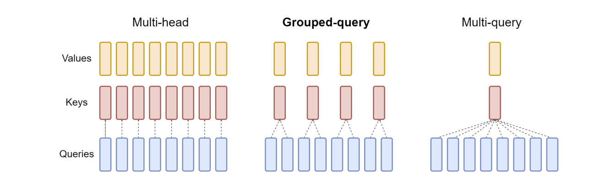
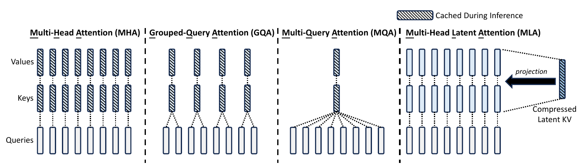
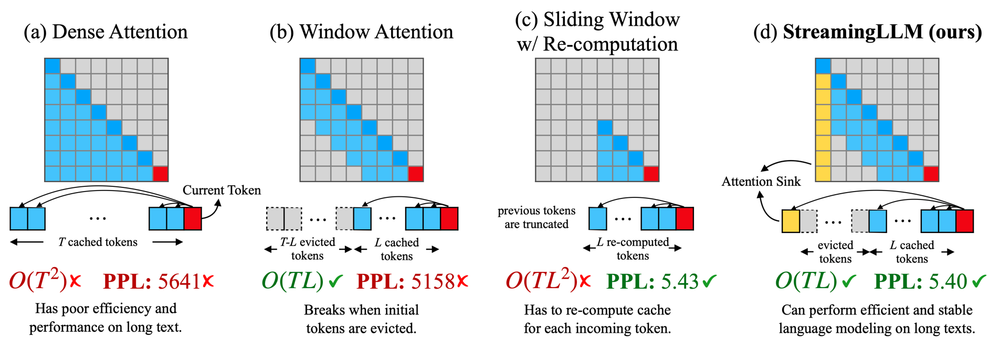
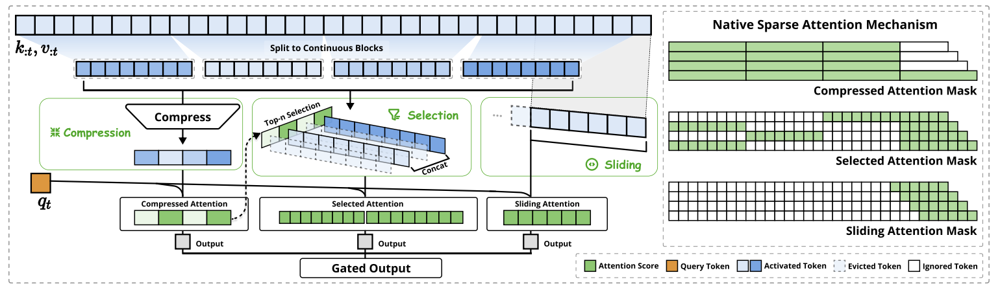
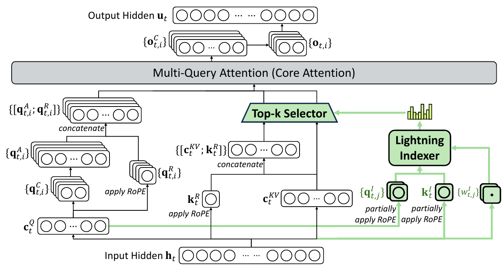
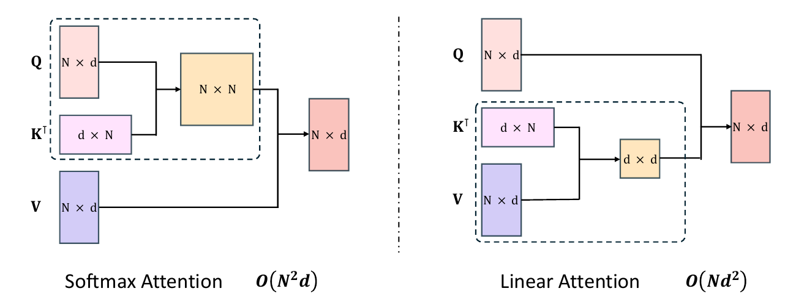
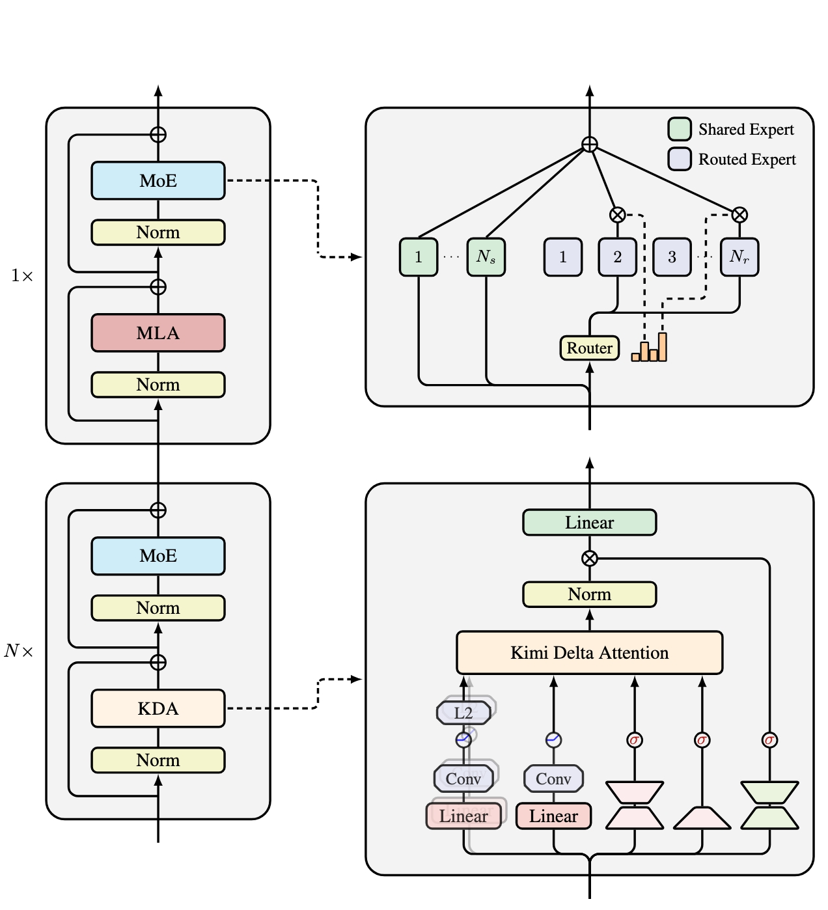
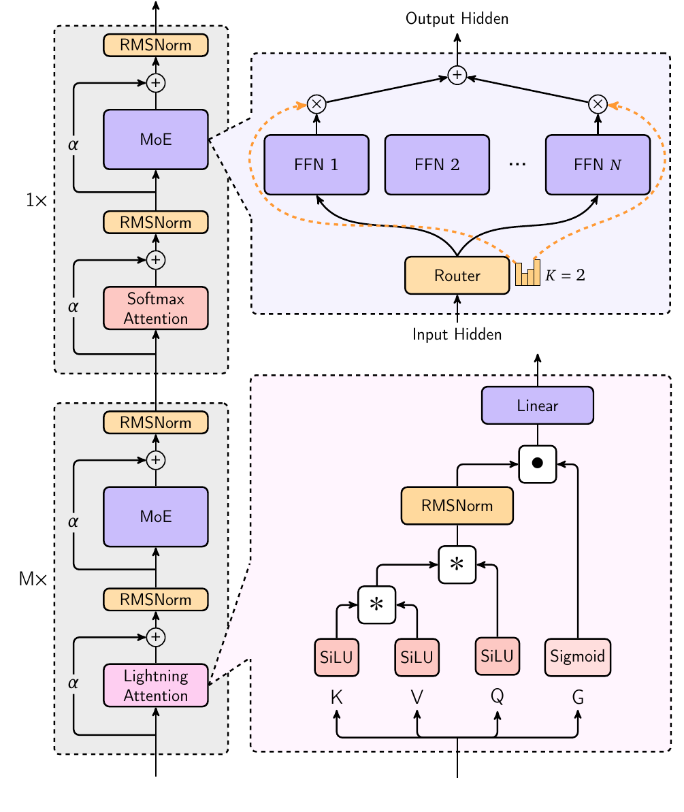
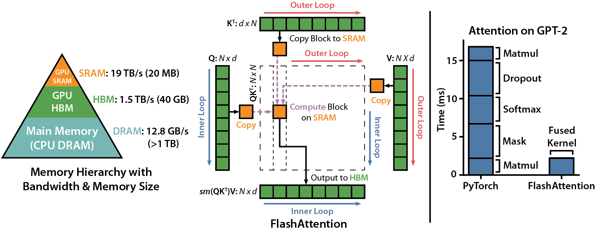

## 0. 这一篇讲什么

第 1 篇讲了缩放点积注意力和多头注意力的原始形式。它们有两个代价随序列长度 $L$ 增长：

- **计算**：每一层要算 $L\times L$ 的分数矩阵，训练和 prefill 的计算量是 $O(L^2d)$；
- **缓存**：自回归生成时要保存所有历史 token 的 K、V（KV Cache），显存随 $L$ 线性增长，而且每生成一个 token 都要把整个缓存读一遍。

过去几年出现的注意力变体，几乎都可以归入下面几类，这也是本篇的路线：

```
问题                                   做法                                   本篇
──────────────────────────────────────────────────────────────────────────────────────
KV Cache 太大                          多个查询头共享 K、V：MQA、GQA            第 3 节
                                      把 K、V 压成低维隐变量：MLA              第 4 节
每个 token 看的历史太多                 只看最近 w 个：滑动窗口、局部/全局交错    第 5 节
                                      按内容挑出少量历史：NSA、DSA             第 6 节
历史不必逐个保存                        压成固定大小的状态：线性注意力            第 7 节
                                      状态的增删改：DeltaNet、GDN、KDA         第 8 节
                                      分块高效计算：Lightning Attention        第 9 节
单一机制各有短板                        不同注意力按比例堆叠：混合架构           第 10 节
同样的数学，更少的显存读写               FlashAttention、PagedAttention          第 11 节
```

第 1 节先回顾基础版本，并补充第 1 篇没有展开的几个点；第 2 节讲 KV Cache 和推理的两个阶段，因为后面大部分变体都是为解码阶段服务的。

文中记 $L$ 为序列长度，$d$ 为隐藏维度，$n_h$ 为查询头数，$d_h$ 为每个头的维度，$n_{\text{layer}}$ 为层数。

## 1. 回顾：缩放点积与多头注意力

### 1.1 公式与形状

对输入 $X\in\mathbb R^{L\times d}$，每个头 $i$ 有自己的投影：

$$
Q_i = XW_Q^{(i)},\quad K_i = XW_K^{(i)},\quad V_i = XW_V^{(i)},\qquad W^{(i)}_{\{Q,K,V\}}\in\mathbb R^{d\times d_h}
$$

$$
\text{head}_i = \mathrm{softmax}\!\left(\frac{Q_iK_i^\top}{\sqrt{d_h}} + M\right)V_i,\qquad
\mathrm{MHA}(X) = [\text{head}_1;\dots;\text{head}_{n_h}]\,W_O
$$

$M$ 是掩码（因果注意力中 $M_{ij} = -\infty$ 当 $j>i$，否则为 0）。原始 Transformer 中 $n_hd_h = d$。

单个 token $t$ 的视角更适合讨论推理：

$$
o_{t,i} = \sum_{j\le t}\frac{\exp(q_{t,i}^\top k_{j,i}/\sqrt{d_h})}{\sum_{j'\le t}\exp(q_{t,i}^\top k_{j',i}/\sqrt{d_h})}\,v_{j,i}
$$

当前 token 的查询 $q_t$ 要和**所有历史 token** 的键 $k_j$ 做内积，再对所有历史的值 $v_j$ 加权平均。

### 1.2 为什么除以 $\sqrt{d_h}$：再补一个梯度的视角

第 1 篇从方差推导过：$q, k$ 各分量独立、均值 0、方差 1 时 $\mathrm{Var}(q^\top k) = d_h$，除以 $\sqrt{d_h}$ 把方差拉回 1。

为什么分数的方差大了不好？看 softmax 的雅可比矩阵。设 $a = \mathrm{softmax}(s)$，则

$$
\frac{\partial a_i}{\partial s_j} = a_i(\mathbb 1[i=j] - a_j)
$$

如果分数的尺度很大，softmax 接近 one-hot：某个 $a_m\approx 1$，其余 $\approx 0$。此时每一项 $a_i(\mathbb 1[i=j]-a_j)$ 都接近 0（$i=m$ 时 $a_m(1-a_m)\approx 0$，$i\ne m$ 时 $a_i\approx 0$）。**梯度几乎消失，注意力模式一旦"锁死"就很难再学。** 缩放把 softmax 保持在比较平滑的区域。

这个问题在训练中仍可能出现：即使初始化时方差合适，训练过程中 $q$、$k$ 的范数也可能不断变大，使分数尺度失控。第 4 篇的 QK-Norm 就是从这里出发的。

### 1.3 注意力在哪里花钱

每个 token 在一层中的前向计算量（一次乘加记 2 次浮点运算）：

| 部分 | 浮点运算 | 说明 |
|---|---|---|
| Q、K、V、O 四个投影 | $8d^2$ | 与 $L$ 无关 |
| $q^\top k$（对 $L$ 个历史） | $2Ld$ | 随 $L$ 线性增长 |
| 对 $v$ 加权求和 | $2Ld$ | 随 $L$ 线性增长 |
| FFN（$d_{\text{ff}} = 4d$） | $16d^2$ | 与 $L$ 无关 |

与 $L$ 有关的部分是 $4Ld$，与 $L$ 无关的部分是 $24d^2$。两者相等时 $L = 6d$。对 $d = 4096$ 的模型，大约 $L\approx 2.5$ 万时注意力的计算开始超过其余所有部分。所以**短上下文时注意力的平方复杂度并不是主要开销**，长上下文时才是。但 KV Cache 的显存和读取开销从很短的长度就开始重要了，见第 2 节。

### 1.4 注意力沉没（attention sink）

一个后面会反复出现的现象：训练好的语言模型中，很多头会把大量注意力权重放在**序列的第一个 token**（或者少数几个固定 token）上，不管它的内容是什么（Xiao et al., 2023）。

原因在于 softmax 的权重必须加起来等于 1。当一个头在当前位置"没什么需要关注的"时，它也必须把权重分给某些 token。模型学会了把多余的权重倒给一个几乎不贡献信息的位置（第一个 token 对所有后续位置都可见，最适合当这个"垃圾桶"）。这些 token 被称为**注意力沉没**。

这件事有两个直接后果：

- 用滑动窗口截掉开头的 token 时，模型会崩溃，因为沉没位置不见了（第 5 节）；
- 一些新设计会显式地给模型一个"不关注"的出口，例如可学习的沉没 logit，或者在注意力输出上加门控（第 10 节）。

## 2. KV Cache 与 Prefill / Decode

### 2.1 为什么可以缓存 K、V

自回归生成时，第 $t$ 步要计算

$$
o_t = \mathrm{Attn}(q_t;\ k_1,\dots,k_t;\ v_1,\dots,v_t)
$$

在因果掩码下，**历史 token 的表示不会因为新 token 的到来而改变**：位置 $j$ 只能看到 $\le j$ 的 token，所以 $k_j, v_j$ 在第 $j$ 步算出来之后就固定了（每一层都是如此，归纳可证）。于是：

- 第 $t$ 步只需要为新 token 计算 $q_t, k_t, v_t$；
- 把 $k_t, v_t$ 追加到缓存里，用 $q_t$ 和整个缓存做注意力。

不缓存的话，第 $t$ 步要把整个前缀重新算一遍，生成 $n$ 个 token 的总计算量是 $O(n^2)$ 次前向；缓存之后每一步只处理一个 token。

**本质.** KV Cache 省掉的是历史 token 的投影和所有之前层的计算。它成立的前提是**因果掩码**：双向注意力中，新 token 会改变所有旧 token 的表示，不能这样缓存。

**为什么没有 Q Cache.** 第 $t$ 步只用到当前的 $q_t$。过去的 $q_j$ 只在第 $j$ 步计算 $o_j$ 时用过一次，之后再也不会参与计算，缓存它没有意义。

**与 RoPE 配合.** 使用 RoPE 时，缓存的是**旋转之后**的 $k$（第 2 篇 4.5 节）：$x\to W_K\to k\to \mathrm{RoPE}(k, \text{pos})\to$ 缓存。因为 $k_j$ 的旋转角只取决于它自己的位置 $j$，之后不会变。

### 2.2 缓存有多大

每个 token、每一层要存 $K$ 和 $V$ 各 $n_{kv}\cdot d_h$ 个数（$n_{kv}$ 是 K、V 的头数，标准 MHA 中 $n_{kv} = n_h$）。总大小为

$$
\text{KV Cache} = 2\times n_{\text{layer}}\times n_{kv}\times d_h\times L\times B\times\text{每个数的字节数}
$$

几个例子（按公开配置，16 位精度）：

| 模型 | 注意力 | $n_{\text{layer}}$ | $n_{kv}\times d_h$ | 每 token 缓存 | 4K 上下文、单条序列 |
|---|---|---|---|---|---|
| Llama 2 7B | MHA | 32 | $32\times 128$ | 512 KiB | 2 GiB |
| Llama 2 70B | GQA | 80 | $8\times 128$ | 320 KiB | 1.25 GiB |
| Llama 3 8B | GQA | 32 | $8\times 128$ | 128 KiB | 0.5 GiB |
| DeepSeek-V2 | MLA | 60 | 每层 576 个数 | 约 67.5 KiB | 约 0.26 GiB |

Llama 2 7B 的权重本身约 13.5 GB，而 32 条 4K 序列的 KV Cache 就要 64 GiB。**服务大量并发请求或长上下文时，KV Cache 而不是权重才是显存的主要占用者。** 第 3、4 节的 GQA 和 MLA 都是在压缩这一项。

### 2.3 Prefill 与 Decode

一次生成分两个阶段：

- **Prefill（预填充）**：把用户的整个提示词一次性送进模型，并行算出所有位置的 K、V，填满缓存，并得到第一个输出 token；
- **Decode（解码）**：之后每一步只输入一个新 token，读出整个缓存，算出下一个 token，追加 K、V。

两个阶段的性能瓶颈完全不同。衡量方法是**算术强度**：每从显存读一个字节，能做多少次浮点运算。以 H100 为例，16 位稠密矩阵乘法约 989 TFLOPS，显存带宽约 3.35 TB/s，两者之比约为 **295 FLOPs/字节**。算术强度低于这个值，GPU 在等数据（访存瓶颈）；高于这个值，GPU 在全力计算（计算瓶颈）。

**Prefill 是计算瓶颈.** 权重读一次，要和提示词中的 $L$ 个 token 都相乘。一个 $d\times d$ 的权重矩阵读入 $2d^2$ 字节，做 $2Ld^2$ 次运算，算术强度约为 $L$。提示词有几百上千个 token 时，远高于 295。

**Decode 是访存瓶颈.** 每一步只有一个 token（每条序列），读入整个模型的权重（约 $2N$ 字节）只做 $2N$ 次运算，算术强度约为 1。GPU 的计算单元大部分时间在等数据。

批处理能缓解权重部分：$B$ 条序列同时解码时，权重读一次用 $B$ 次，算术强度约为 $B$。**但 KV Cache 不能这样分摊**：每条序列的缓存是它自己的，只被它自己的查询使用。标准 MHA 中，缓存里的每个 $k$ 只和一个查询头的 $q$ 做一次内积，每个数（2 字节）只参与 2 次运算，**算术强度约为 1，与批大小无关**。上下文越长，解码时间里读 KV Cache 的比例越大。

所以解码阶段的优化有两个方向：

1. **少存、少读**：缓存更小，读得更少（GQA、MLA、滑动窗口、稀疏选择、固定状态）；
2. **每读一个数多算几次**：让多个查询头共享同一份 K、V，算术强度从 1 提高到组大小（GQA）乃至所有头数（MLA）。

第 3、4 节会看到，MQA、GQA、MLA 恰好同时做到了这两点。

### 2.4 一个带 KV Cache 的实现

下面实现带 KV Cache 的因果 GQA（第 3 节解释 GQA；$n_{kv} = n_h$ 时就是普通的 MHA）。同一个函数同时用于训练、prefill 和 decode：

```python
import math
import torch
import torch.nn as nn
import torch.nn.functional as F

class CausalGQA(nn.Module):
    """带 KV Cache 的因果注意力。n_kv_heads == n_heads 是 MHA，== 1 是 MQA"""
    def __init__(self, d_model, n_heads, n_kv_heads):
        super().__init__()
        assert d_model % n_heads == 0 and n_heads % n_kv_heads == 0
        self.n_heads, self.n_kv_heads = n_heads, n_kv_heads
        self.d_head = d_model // n_heads
        self.W_q = nn.Linear(d_model, n_heads * self.d_head, bias=False)
        self.W_k = nn.Linear(d_model, n_kv_heads * self.d_head, bias=False)
        self.W_v = nn.Linear(d_model, n_kv_heads * self.d_head, bias=False)
        self.W_o = nn.Linear(n_heads * self.d_head, d_model, bias=False)

    def forward(self, x, cache=None):
        # x: [B, T, d]；cache: (K, V)，各为 [B, n_kv_heads, T_past, d_head]，或 None
        B, T, _ = x.shape
        q = self.W_q(x).view(B, T, self.n_heads, self.d_head).transpose(1, 2)
        k = self.W_k(x).view(B, T, self.n_kv_heads, self.d_head).transpose(1, 2)
        v = self.W_v(x).view(B, T, self.n_kv_heads, self.d_head).transpose(1, 2)
        # （使用 RoPE 时在这里旋转 q 和 k，缓存的是旋转后的 k）
        if cache is not None:
            k = torch.cat([cache[0], k], dim=2)
            v = torch.cat([cache[1], v], dim=2)
        new_cache = (k, v)                      # 缓存的是 n_kv_heads 个头，而不是 n_heads 个
        T_past = k.size(2) - T

        # 每个 KV 头复制给组内的 n_heads / n_kv_heads 个查询头
        rep = self.n_heads // self.n_kv_heads
        k = k.repeat_interleave(rep, dim=1)     # [B, n_heads, T_past + T, d_head]
        v = v.repeat_interleave(rep, dim=1)

        scores = q @ k.transpose(-2, -1) / math.sqrt(self.d_head)   # [B, H, T, T_past + T]
        # 第 i 个新 token 的绝对位置是 T_past + i，只能看到绝对位置不超过它的键
        i = torch.arange(T, device=x.device)[:, None] + T_past
        j = torch.arange(T_past + T, device=x.device)[None, :]
        scores = scores.masked_fill(j > i, float('-inf'))
        out = F.softmax(scores, dim=-1) @ v                          # [B, H, T, d_head]
        return self.W_o(out.transpose(1, 2).reshape(B, T, -1)), new_cache


attn = CausalGQA(d_model=512, n_heads=8, n_kv_heads=2)
x = torch.randn(1, 10, 512)
y_full, _ = attn(x)                       # 训练：一次处理全部 10 个 token
y, cache = attn(x[:, :6])                 # prefill：前 6 个 token
outs = [y]
for t in range(6, 10):                    # decode：逐个 token
    y, cache = attn(x[:, t:t + 1], cache)
    outs.append(y)
print(torch.allclose(y_full, torch.cat(outs, dim=1), atol=1e-5))   # True
```

几个细节：

- 掩码用的是**绝对位置**。prefill 时 $T>1$，新 token 之间有因果关系；decode 时 $T=1$，掩码全部为可见；
- `repeat_interleave` 让第 $h$ 个查询头使用第 $\lfloor h/\text{rep}\rfloor$ 个 KV 头。实际的高效实现（如 FlashAttention 的 GQA 支持）不会真的复制，而是在内核里按组索引；
- 这里用 `torch.cat` 拼接缓存，每步都会重新分配显存。工程实现会预先分配或分页管理（第 11.4 节）。

（本文的 PyTorch 代码没有在 PyTorch 环境中运行过；同样逻辑的 NumPy 版本验证过训练形式与逐步解码的输出一致。）

## 3. MQA 与 GQA：多个查询头共享 K、V

### 3.1 MQA

**Multi-Query Attention**（Shazeer, 2019）：保留 $n_h$ 个查询头，但所有头**共享同一组** $K$、$V$：

$$
\text{head}_i = \mathrm{softmax}\!\left(\frac{Q_iK^\top}{\sqrt{d_h}}\right)V,\qquad K = XW_K,\ V = XW_V,\ W_K, W_V\in\mathbb R^{d\times d_h}
$$

- KV Cache 缩小到 MHA 的 $1/n_h$；
- 解码时每个缓存的 $k$ 被 $n_h$ 个查询头使用，算术强度提高 $n_h$ 倍；
- 代价：所有头只能从同一组 K、V 中读取信息，表达能力下降，质量有损，训练也可能更不稳定。

PaLM、Falcon-7B、StarCoder、Gemma 2B 等使用 MQA。

### 3.2 GQA

**Grouped-Query Attention**（Ainslie et al., 2023）是折中：把 $n_h$ 个查询头分成 $g$ 组，**组内共享**一组 K、V，共有 $n_{kv} = g$ 组 K、V。

- $g = n_h$：每个查询头有自己的 K、V，就是 MHA；
- $g = 1$：所有头共享，就是 MQA；
- 典型配置 $n_h = 32$ 或 64，$g = 8$。



*图 1：多头注意力（左）中每个查询头有自己的键、值头；分组查询注意力（中）中每组查询头共享一个键、值头；多查询注意力（右）中所有查询头共享同一个键、值头。图片来源：Ainslie et al., "GQA: Training Generalized Multi-Query Transformer Models from Multi-Head Checkpoints", EMNLP 2023, Figure 2。*


KV Cache 是 MHA 的 $g/n_h$，解码时的算术强度约为组大小 $n_h/g$。经验上，$g = 8$ 时质量接近 MHA，而缓存缩小 4 到 8 倍。

**从 MHA 转换.** GQA 论文还给出了一个廉价的转换方法：把已训练的 MHA 模型中同组的 K、V 投影矩阵**取平均**，作为该组共享的投影，然后用原预训练约 5% 的计算量继续训练（uptraining），就能恢复大部分质量。

**谁在用.** Llama 2 的 34B、70B（7B、13B 仍是 MHA），Llama 3 全系列（8 个 KV 头），Mistral 7B，Qwen2 及之后的 Qwen 系列等。今天 GQA 是稠密注意力的默认选择。

### 3.3 为什么共享 K、V 损失不大

一个直观的解释：多头注意力中不同头的差异，主要体现在**查询**上，即每个头在"找什么"。K、V 是被查找的内容，同一个 token 被不同头查找时，所需的表示可以有很大重叠。GQA 保留了所有查询头的多样性，只在被查找的一侧共享。

另一个角度：MHA 的 $W_K$ 是 $d\times d$ 的，把它拆成 $n_h$ 个头后，各头的 K 之间往往有很强的相关性（实际上是低秩的）。共享 K、V 相当于显式地利用了这种低秩结构。MLA 把这个思路推到了极致。

## 4. MLA：把 K、V 压缩成低维隐变量

**Multi-head Latent Attention**（DeepSeek-V2, 2024）的出发点：GQA 通过减少 K、V 的头数来压缩缓存，代价是每组 K、V 被硬性共享；能不能让每个头仍有自己的 K、V，但**缓存一个更小的东西**，需要时再还原？

### 4.1 低秩联合压缩

对第 $t$ 个 token 的隐藏状态 $h_t\in\mathbb R^d$，先下投影成一个低维隐变量，再由它上投影出每个头的 K、V：

$$
c_t^{KV} = W^{DKV}h_t\in\mathbb R^{d_c}
$$

$$
k_{t,i}^C = W_i^{UK}c_t^{KV},\qquad v_{t,i}^C = W_i^{UV}c_t^{KV},\qquad W_i^{UK}, W_i^{UV}\in\mathbb R^{d_h\times d_c}
$$

"联合"指 K 和 V 共用同一个隐变量 $c_t^{KV}$。**推理时只缓存 $c_t^{KV}$**，它的维度 $d_c$ 远小于 $2n_hd_h$。DeepSeek-V2 中 $n_h = 128$，$d_h = 128$，$d_c = 512$：MHA 每层每 token 要存 $2\times 128\times 128 = 32768$ 个数，MLA 只存 512 个（加上 4.3 节的 64 个）。

查询也做了类似的低秩压缩（$c_t^Q = W^{DQ}h_t$，$d_c' = 1536$，$q_{t,i}^C = W_i^{UQ}c_t^Q$）。这不影响 KV Cache，作用是减少训练时的激活显存。



*图 2：四种注意力的对比，带斜线的方块表示推理时需要缓存的内容。MHA、GQA、MQA 缓存的是键和值本身，数量依次减少；MLA（最右）只缓存一个压缩后的隐变量（Compressed Latent KV），每个头的键和值由它投影得到。图片来源：DeepSeek-AI, "DeepSeek-V2: A Strong, Economical, and Efficient Mixture-of-Experts Language Model", 2024, Figure 3。*


### 4.2 矩阵吸收：不还原 K、V 也能算注意力

如果每次算注意力都要把所有历史的 $c_j$ 上投影成 $n_h$ 个头的 $k_{j,i}, v_{j,i}$，计算量会很大，缓存省下来的好处也被抵消。MLA 的关键在于**矩阵乘法结合律**。看第 $i$ 个头的分数：

$$
q_{t,i}^\top k_{j,i}^C = q_{t,i}^\top W_i^{UK}c_j = \big(\underbrace{W_i^{UK\top}q_{t,i}}_{\tilde q_{t,i}\in\mathbb R^{d_c}}\big)^\top c_j
$$

把 $W_i^{UK}$ "吸收"进查询一侧：先算 $\tilde q_{t,i} = W_i^{UK\top}q_{t,i}$，直接与缓存的 $c_j$ 做内积，完全不需要还原 $k_{j,i}$。

输出一侧同理。第 $i$ 个头的输出是

$$
o_{t,i} = \sum_j a_{tj,i}\,W_i^{UV}c_j = W_i^{UV}\Big(\sum_j a_{tj,i}\,c_j\Big)
$$

先在 $d_c$ 维的隐空间里对 $c_j$ 加权求和，再乘 $W_i^{UV}$。而 $W_i^{UV}$ 之后紧跟着输出投影 $W_O$ 中对应第 $i$ 个头的那一块 $W_{O,i}$，两者可以预先相乘成一个矩阵 $W_{O,i}W_i^{UV}$。

**吸收之后，解码时的 MLA 等价于一个特殊的 MQA**：所有 128 个查询头共享同一份"键" $c_j$ 和同一份"值" $c_j$，只是每个头的查询经过了自己的变换。这带来两个好处：

- 缓存极小（只有 $c_j$）；
- 每个缓存的数被所有 $n_h$ 个头使用，算术强度约为 $n_h$。在访存瓶颈的解码阶段，这正是需要的。

代价是注意力内部的计算量增加了：每个头的内积维度从 $d_h = 128$ 变成 $d_c = 512$。但解码阶段计算单元本来就闲着，用计算换访存是划算的。训练和 prefill 是计算瓶颈，通常反过来用不吸收的形式，先还原出每个头的 K、V 再做标准注意力。

下面用 NumPy 验证吸收前后完全等价：

```python
import numpy as np
rng = np.random.default_rng(0)
d, d_c, n_h, d_h, L = 64, 16, 4, 8, 10

W_DKV = rng.standard_normal((d_c, d)) / np.sqrt(d)          # 下投影：h -> c
W_UK = rng.standard_normal((n_h, d_h, d_c)) / np.sqrt(d_c)   # 每个头的 K 上投影
W_UV = rng.standard_normal((n_h, d_h, d_c)) / np.sqrt(d_c)   # 每个头的 V 上投影
W_Q = rng.standard_normal((n_h, d_h, d)) / np.sqrt(d)
W_O = rng.standard_normal((d, n_h * d_h)) / np.sqrt(n_h * d_h)

H = rng.standard_normal((L, d))      # 历史 token 的隐藏状态
h_t = rng.standard_normal(d)         # 当前 token

def softmax(x):
    e = np.exp(x - x.max()); return e / e.sum()

C = H @ W_DKV.T                      # [L, d_c]，KV Cache 只存这个

# 朴素做法：从 c 还原出每个头的 K、V，再做标准注意力
outs = []
for i in range(n_h):
    q = W_Q[i] @ h_t
    K = C @ W_UK[i].T                # [L, d_h]
    Vh = C @ W_UV[i].T
    outs.append(softmax(K @ q / np.sqrt(d_h)) @ Vh)
y_naive = W_O @ np.concatenate(outs)

# 吸收做法：W_UK 并入查询一侧，W_UV 并入输出一侧，全程不还原 K、V
W_O_heads = W_O.reshape(d, n_h, d_h)
y_absorb = np.zeros(d)
for i in range(n_h):
    q_lat = W_UK[i].T @ (W_Q[i] @ h_t)          # [d_c]
    a = softmax(C @ q_lat / np.sqrt(d_h))        # 直接与缓存的 c 做内积
    o_lat = a @ C                                # [d_c]：先在隐空间加权
    y_absorb += W_O_heads[:, i, :] @ (W_UV[i] @ o_lat)   # 部署时 W_O_i W_UV_i 预先相乘
print(np.abs(y_naive - y_absorb).max())          # 约 4e-16
```

### 4.3 RoPE 为什么会破坏吸收：Decoupled RoPE

如果对还原出的 $k_{j,i}$ 施加 RoPE，分数变成

$$
q_{t,i}^\top R_t^\top R_j\,W_i^{UK}c_j = q_{t,i}^\top R_{j-t}\,W_i^{UK}c_j
$$

旋转矩阵 $R_{j-t}$ 夹在 $q$ 和 $W_i^{UK}$ 之间，**并且随 $j$ 变化**。$W_i^{UK}$ 不能再预先并入查询一侧（每个历史位置需要的吸收矩阵都不同）。

MLA 的解决办法是把位置信息放到单独的一小部分维度上（第 2 篇 6.2 节详细推导过）：

$$
q_{t,i} = [\,q_{t,i}^C;\ q_{t,i}^R\,],\qquad k_{j,i} = [\,k_{j,i}^C;\ k_j^R\,]
$$

- $q^C, k^C$：内容部分，不加 RoPE，可以吸收；
- $q_{t,i}^R = \mathrm{RoPE}(W_i^{QR}c_t^Q)$：每个头有自己的位置查询；
- $k_j^R = \mathrm{RoPE}(W^{KR}h_j)$：**所有头共享**一个位置键，维度 $d_h^R = 64$；
- 分数 $= q_{t,i}^{C\top}k_{j,i}^C + q_{t,i}^{R\top}k_j^R$，除以 $\sqrt{d_h + d_h^R}$。

缓存的内容变成 $c_j^{KV}$（512 维）加 $k_j^R$（64 维），每层每 token 共 576 个数。

### 4.4 缓存对比

用"每层每 token 缓存多少个数"比较（$d_h = 128$）：

| 方法 | 每层每 token 缓存 | DeepSeek-V2 配置下 |
|---|---|---|
| MHA | $2n_hd_h$ | 32768 |
| GQA（$g$ 组） | $2gd_h$ | $g = 8$ 时 2048 |
| MQA | $2d_h$ | 256 |
| MLA | $d_c + d_h^R$ | 576 |

MLA 的缓存相当于 $g = 2.25$ 组的 GQA，接近 MQA 的量级。而 DeepSeek-V2 论文的实验中，MLA 的效果不仅好于 GQA 和 MQA，甚至略好于 MHA。一个解释是：GQA 是硬性地让组内的头使用完全相同的 K、V；MLA 则让每个头通过自己的 $W_i^{UK}, W_i^{UV}$ 从共享的隐变量中读出不同的 K、V，表达能力更强。

DeepSeek-V3 沿用了相同的 MLA 配置（$n_h = 128$，$d_c = 512$，$d_h^R = 64$）。Kimi K2 等模型也采用了 MLA。

## 5. 滑动窗口与局部 / 全局交错

从这一节开始，变体不再只是压缩每个 token 的缓存，而是让每个查询**少看一些历史 token**。

### 5.1 滑动窗口注意力（SWA）

每个 token 只关注最近的 $w$ 个 token：

$$
M_{ij} =
\begin{cases}
0, & i - w < j\le i \\
-\infty, & \text{否则}
\end{cases}
$$

在注意力矩阵上，相当于只保留主对角线附近宽度为 $w$ 的一条带。

- **计算**：每个查询只和 $w$ 个键做内积，复杂度从 $O(L^2d)$ 降到 $O(Lwd)$；
- **缓存**：只需保存最近 $w$ 个 token 的 K、V，缓存大小固定为 $w$，与总长度无关。Mistral 7B 用**环形缓冲区**实现：位置 $i$ 的 K、V 存在第 $i\bmod w$ 个槽里，新 token 覆盖最旧的那个。

**感受野随深度增长.** 窗口只限制了"一步"能看多远。第 $\ell$ 层的位置 $i$ 能看到第 $\ell - 1$ 层的 $[i-w+1, i]$，而那些位置又各自看到再往前 $w$ 个。堆叠 $n_{\text{layer}}$ 层后，理论上的感受野约为 $n_{\text{layer}}\times w$。Mistral 7B 的 $w = 4096$，32 层，理论感受野约 13 万个 token。

但"理论上能传过来"不等于"能精确取回"。远处的信息要经过很多层逐级转述，每一层都会损失细节。所以纯滑动窗口模型在需要精确检索远处内容的任务上（例如"在长文档中找到某个数字"）表现不好。

### 5.2 早期的稀疏模式

在 SWA 成为主流之前，Longformer（Beltagy et al., 2020）和 BigBird（Zaheer et al., 2020）组合了几种固定的稀疏模式：

- **局部窗口**：每个 token 看附近的 token；
- **全局 token**：少数指定的 token（如 `[CLS]`）看所有 token，也被所有 token 看到，充当信息中转站；
- **随机连接**（BigBird）：每个 token 额外随机看几个 token。

BigBird 证明了这种组合在理论上保留了完整注意力的表达能力。它们主要用于双向编码器，这些思想后来以别的形式出现在 decoder-only 模型中。

### 5.3 局部 / 全局交错

既然局部注意力便宜但检索弱、全局注意力贵但检索强，自然的做法是**按比例交错**：大部分层用滑动窗口，每隔几层放一个全局注意力层，负责远距离的信息交换。

| 模型 | 局部 : 全局 | 局部窗口 |
|---|---|---|
| Gemma 2 | 1 : 1 交替 | 4096 |
| Gemma 3 | 5 : 1 | 1024 |
| gpt-oss | 1 : 1 交替 | 128 |

笔记中还记录了 Mistral 系列、Apple 的基础模型、MAI-Thinking-1、Gemma 4 等采用类似的局部 / 全局设计（其中较新的几个模型我没有逐一核对配置，以各自技术报告为准）。

**能省多少缓存.** 以 Gemma 3 在 128K 上下文为例：每 6 层中 5 层只存 1024 个 token，1 层存全部 131072 个 token，平均每层的缓存是全注意力的

$$
\frac{5\times 1024 + 131072}{6\times 131072}\approx 17\%
$$

全局层的缓存仍随长度线性增长，长上下文下它占了缓存的绝大部分。所以这类模型的局部层比例越来越高、窗口越来越小。

**位置编码的配合.** 局部层和全局层常常使用不同的位置编码设置。例如 Gemma 3 的局部层 RoPE base 为 1 万，全局层为 100 万；也有模型让全局层使用部分维度的 RoPE 或完全不用位置编码（第 2 篇 6.4 节）。直觉是：局部层只需要精细地区分近距离位置，全局层需要在很长的距离上工作，对位置的需求不同。

### 5.4 注意力沉没与 StreamingLLM

1.4 节提到，模型会把多余的注意力倒在开头几个 token 上。如果用滑动窗口把这些 token 移出缓存，会发生什么？Xiao et al.（2023）发现，对一个用全注意力训练的模型直接截断缓存，一旦开头的 token 被挤出窗口，困惑度立刻暴涨。

**StreamingLLM** 的做法很简单：**始终保留开头的 4 个 token**，再加上最近的 $w$ 个 token。这样不需要重新训练，模型就能在无限长的流式输入上保持稳定的困惑度（论文测试到 400 万 token）。需要注意，这只是保持了生成的稳定，被挤出窗口的中间内容仍然无法被取回。



*图 3：（a）全注意力，缓存随长度增长，超过训练长度后困惑度很高；（b）滑动窗口，开头的 token 被挤出缓存后困惑度暴涨；（c）每步重新计算窗口内的注意力，效果好但成本为平方；（d）StreamingLLM，保留开头的注意力沉没 token（黄色）加最近的窗口，成本线性且困惑度稳定。图片来源：Xiao et al., "Efficient Streaming Language Models with Attention Sinks", ICLR 2024, Figure 1。*


从训练端解决的做法：

- **可学习的沉没**：在 softmax 的分母中加一个可学习的常数项（相当于一个虚拟的、值为 0 的 token），给每个头一个"什么都不关注"的出口。gpt-oss 为每个头设了一个可学习的沉没 logit；
- **门控注意力**：在注意力输出上乘一个与输入相关的门（第 10.3 节），头不需要靠 softmax 来"什么都不做"。

### 5.5 稀疏注意力的硬件问题

笔记中提到，稀疏注意力在 GPU 上效率可能很低。这一点需要区分：

- **不规则的逐元素稀疏**（每个查询随意挑一些键）确实难以高效实现：GPU 的 Tensor Core 为稠密的矩阵块乘法设计，零散的访存会让实际利用率很低；
- **块状的稀疏**则没有问题。滑动窗口在分块之后，大部分块要么完全在带内（照常计算），要么完全在带外（整块跳过），只有边界上的块需要掩码。FlashAttention 原生支持滑动窗口，就是这样实现的。

所以设计稀疏注意力时，**稀疏的粒度要和硬件的计算粒度对齐**。下一节的 NSA 就把这一点作为核心设计原则。

## 6. 按内容选择：NSA、DSA 与压缩注意力

滑动窗口按**位置**决定看哪些 token，这是一种与内容无关的规则。真正需要的远处信息不一定在窗口里。这一节的方法按**内容**动态挑选每个查询要看的历史 token。

### 6.1 NSA：原生稀疏注意力

**Native Sparse Attention**（Yuan et al., 2025，DeepSeek）对每个查询 $q_t$，用三条分支分别构造一组较小的键值集合，各自做注意力，再用门控加权：

$$
o_t = \sum_{c\in\{\text{cmp},\,\text{slc},\,\text{win}\}} g_t^c\cdot\mathrm{Attn}\big(q_t,\ \tilde K_t^c,\ \tilde V_t^c\big),\qquad g_t^c\in[0,1]
$$

门控 $g_t^c$ 由输入经过一个 MLP 和 sigmoid 得到。



*图 4：NSA 的结构。左：历史的键值被切成连续的块，分别经过压缩（Compression）、选择（Selection）和滑动窗口（Sliding）三条分支，三路注意力的输出经门控相加。右：三条分支各自的注意力模式，绿色是需要计算的位置，白色是可以跳过的位置。图片来源：Yuan et al., "Native Sparse Attention: Hardware-Aligned and Natively Trainable Sparse Attention", 2025, Figure 2。*


**分支一：压缩（compression）.** 把历史序列切成长度为 $l$、步长为 $s$ 的块（可以重叠），每块用一个可学习的小网络 $\varphi$（带块内位置编码的 MLP）压缩成**一个**键和一个值：

$$
\tilde K_t^{\text{cmp}} = \Big\{\varphi\big(k_{is+1:\,is+l}\big)\ \Big|\ 0\le i\le\big\lfloor\tfrac{t-l}{s}\big\rfloor\Big\}
$$

查询与这些压缩后的键做注意力，获得整个历史的粗粒度概览。键的数量约为 $t/s$。

**分支二：选择（selection）.** 粗粒度的信息不够精确，还要找出最相关的部分看原文。做法是**复用压缩分支的注意力分数**作为每一块的重要性：

$$
p_t^{\text{cmp}} = \mathrm{softmax}\big(q_t^\top\tilde K_t^{\text{cmp}}\big)
$$

把这些分数映射到长度为 $l'$ 的选择块上（压缩块和选择块划分不同时，按重叠关系求和），选出得分最高的 $n$ 个块，把这些块里的**全部原始 token** 拼起来作为键值。重要性分数是压缩分支顺带算出来的，几乎没有额外开销。

**分支三：滑动窗口（window）.** 最近的 $w$ 个 token 总是保留。局部上下文对语言建模非常重要；单独给它一条分支，避免压缩和选择分支被迫去学习局部模式，可以专注于远距离信息。

三条分支使用**各自独立的** K、V 投影，防止它们互相干扰。

论文的配置是 $l = 32$，$s = 16$，$l' = 64$，$n = 16$（其中固定包含开头的 1 块和最近的 2 块），$w = 512$。在 64K 的序列上，每个查询看到约 4K 个压缩键、1024 个选中的原始 token 和 512 个窗口 token，远少于 64K。

**硬件对齐.** NSA 的选择以**块**为单位，每个块是连续的 64 个 token，读取时是连续访存，可以直接用块状的矩阵乘法计算。在 GQA 中，同一组的所有查询头**共享同一组选中的块**（重要性分数在组内求和后再选），这样一组头只需要把这些块从显存读一次。

**原生可训练.** 之前很多稀疏注意力方法只用于推理：在全注意力训练好的模型上，推理时丢掉一部分。训练与推理不一致会损失质量，而且训练本身没有加速。NSA 从预训练开始就使用稀疏注意力，选择操作本身虽不可导，但压缩分支是可导的，并通过分数共享间接引导了选择。论文报告 NSA 在通用基准上与全注意力相当或更好，在 64K 序列上前向、反向和解码分别有约 9 倍、6 倍和 11.6 倍的加速。

（笔记中把 NSA 描述为"把一个 token 的注意力向量分成 $k$ 份"。更准确的说法是把**历史的 K、V 序列**分成块，每个查询通过三条分支分别看压缩块、选中块和最近窗口。）

### 6.2 DSA：DeepSeek 稀疏注意力

**DeepSeek Sparse Attention** 用于 DeepSeek-V3.2。与 NSA 相比，它的结构更简单：只有一条分支，按 **token** 而不是按块选择。

**闪电索引器（lightning indexer）.** 对当前查询 token $t$ 和每个历史 token $s$，用一个很轻量的模块算一个相关性分数：

$$
I_{t,s} = \sum_{j=1}^{H^I} w_{t,j}^I\cdot\mathrm{ReLU}\big(q_{t,j}^{I\top}k_s^I\big)
$$

索引器只有少数几个头（$H^I$ 很小），维度也小，并且可以用 FP8 计算。$w_{t,j}^I$ 是由当前 token 算出的头权重。

**Top-k 选择.** 对每个查询，选出索引分数最高的 $k$ 个历史 token（DeepSeek-V3.2 中 $k = 2048$），主注意力只在这 $k$ 个 token 的 K、V 上计算：

$$
o_t = \mathrm{Attn}\big(q_t,\ \{(k_s, v_s)\mid I_{t,s}\in\mathrm{TopK}(I_{t,:}, k)\}\big)
$$

主注意力的复杂度从 $O(L^2)$ 降到 $O(Lk)$。DSA 构建在 MLA 之上，使用 4.2 节的吸收形式（所有查询头共享同一份缓存），所以选中的每个 token 只需要读一次。



*图 5：DSA 在 MLA 上的实现。绿色部分是闪电索引器（Lightning Indexer）：由当前 token 算出索引查询 $q^I$ 和头权重 $w^I$，与历史的索引键 $k^I$ 打分，Top-k 选择器据此挑出 $k$ 个键值条目 $[c^{KV}; k^R]$，送入以 MQA 形式计算的核心注意力。图片来源：DeepSeek-AI, "DeepSeek-V3.2-Exp: Boosting Long-Context Efficiency with DeepSeek Sparse Attention", 2025, Figure 1。*


**从稠密模型继续训练.** DSA 不是从头训练的，而是在已有的稠密模型（DeepSeek-V3.1）上继续训练得到：

1. **稠密预热**：冻结主模型，只训练索引器，让索引分数的分布去拟合主注意力的分布（以 KL 散度为损失，主注意力分数在各头上求和并归一化作为目标）；
2. **稀疏训练**：切换到 top-k 稀疏注意力，所有参数一起训练，索引器继续在选中的 token 上对齐主注意力。

**与滑动窗口和 NSA 的区别.**

- 滑动窗口只能看附近的 token；DSA 可以直接选中距离很远但内容相关的 token；
- NSA 按块选择、三条分支、从头训练；DSA 按 token 选择、单一分支、在稠密模型上改造；
- **索引器本身仍然是 $O(L^2)$ 的**：每个查询都要和所有历史 token 算一遍索引分数。DSA 降低的是主注意力的成本，索引器靠"便宜"（头少、维度小、低精度）而不是靠"渐近复杂度低"。在非常长的上下文下，索引器的开销仍会显现。

笔记中记录 GLM-5 也采用了 MLA 加 DSA 的组合，GLM-5.2 又让多个稀疏注意力层共享同一个索引器（IndexShare），进一步摊薄索引器的开销。这些较新的细节我无法独立核实，以对应技术报告为准。

### 6.3 压缩注意力：CSA 与 HCA

笔记中记录了 DeepSeek V4 的 **Compressed Sparse Attention（CSA）** 与 **Hierarchical Compressed Attention（HCA）**。它们的思路可以看作 NSA 压缩分支的进一步发展：

- 不在全部原始 token 上做注意力，而是先把**连续的若干 token 压缩成更少的表示**；
- **CSA** 在压缩后的表示上做稀疏选择，只访问少量相关的压缩块；
- **HCA** 做更强的**层级压缩**（压缩之后再压缩），用很少的条目保留全局信息；
- 与局部、稀疏分支组合使用，降低超长上下文下的访问成本。

这两个方法比我能核实的资料更新，这里只给出思路，具体的压缩比例、分支组合和训练方式请以 DeepSeek V4 的技术报告为准。

### 6.4 小结：三种"少看"的方式

| | 选择依据 | 选择粒度 | 训练方式 | 缓存 |
|---|---|---|---|---|
| 滑动窗口 | 位置（最近 $w$ 个） | 连续一段 | 从头训练 | 固定 $w$ |
| NSA | 内容（压缩分数选块）+ 位置（窗口） | 块 | 从头训练 | 全部保留 |
| DSA | 内容（索引器选 token） | token | 稠密模型上改造 | 全部保留 |

注意后两者**并不减少缓存**：任何一个历史 token 都可能在将来被选中，所以全部 K、V 都要保留。它们减少的是每一步**读取和计算**的量。真正让缓存不随长度增长的，是下面的线性注意力。

## 7. 线性注意力：把历史压成固定大小的状态

### 7.1 从 softmax 注意力出发

把单个查询的注意力写成一般形式：

$$
o_t = \frac{\sum_{j\le t}\mathrm{sim}(q_t, k_j)\,v_j}{\sum_{j\le t}\mathrm{sim}(q_t, k_j)},\qquad \mathrm{sim}(q,k) = \exp(q^\top k/\sqrt{d_h})
$$

麻烦在于 $\exp(q^\top k)$ 不能拆成"只含 $q$ 的部分"乘"只含 $k$ 的部分"，所以每个查询都必须和每个键单独算一遍。

**线性注意力**（Katharopoulos et al., 2020）把相似度换成可分解的核函数 $\mathrm{sim}(q,k) = \phi(q)^\top\phi(k)$，例如 $\phi(x) = \mathrm{elu}(x) + 1$（保证非负）。于是

$$
o_t = \frac{\sum_{j\le t}\phi(q_t)^\top\phi(k_j)\,v_j}{\sum_{j\le t}\phi(q_t)^\top\phi(k_j)}
= \frac{\Big(\sum_{j\le t}v_j\phi(k_j)^\top\Big)\phi(q_t)}{\Big(\sum_{j\le t}\phi(k_j)\Big)^\top\phi(q_t)}
$$

$\phi(q_t)$ 被提到了求和号外面。括号里的两项与查询无关，可以对所有历史预先累加。

下文为简洁起见，把 $\phi$ 并入 $q, k$ 的计算（直接记 $q, k$），并且去掉分母。很多现代线性注意力确实不用分母，而是在输出上加一个归一化层，因为分母可能接近 0、数值不稳定。

### 7.2 矩阵形式：结合律

不考虑掩码时（双向注意力），去掉 softmax 后

$$
O = (QK^\top)V = Q(K^\top V)
$$

- 左边先算 $QK^\top$（$L\times L$），复杂度 $O(L^2d)$；
- 右边先算 $K^\top V$（$d\times d$），复杂度 $O(Ld^2)$。

通常 $d\ll L$，后者关于序列长度是线性的。这就是"线性注意力"名字的来源。



*图 6：softmax 注意力（左）先算 $N\times N$ 的 $QK^\top$，复杂度 $O(N^2d)$；线性注意力（右）先算 $d\times d$ 的 $K^\top V$，复杂度 $O(Nd^2)$。虚线框内的张量一起参与计算。图片来源：MiniMax, "MiniMax-01: Scaling Foundation Models with Lightning Attention", 2025, Figure 5。*


### 7.3 因果掩码下：循环形式

笔记中提出了一个关键问题：decoder-only 模型需要因果掩码，

$$
O = \big((QK^\top)\odot M\big)V
$$

逐元素乘掩码 $M$ 之后，不能再直接用结合律把括号移到右边。那线性注意力是不是只能用于双向模型？

不是。逐行看第 $t$ 个输出：

$$
o_t = \sum_{j\le t}(q_t^\top k_j)\,v_j = \Big(\sum_{j\le t}v_jk_j^\top\Big)q_t
$$

定义**状态** $S_t = \sum_{j\le t}k_jv_j^\top\in\mathbb R^{d_k\times d_v}$，它满足递推

$$
S_t = S_{t-1} + k_tv_t^\top,\qquad o_t = S_t^\top q_t
$$

因果掩码在这里体现为"状态只累加到当前位置为止"，结合律在每个前缀上依然成立。

**这就是一个 RNN.** 线性注意力在推理时是一个循环网络，状态 $S_t$ 的大小是 $d_k\times d_v$（每个头），**与序列长度无关**。每生成一个 token 只需要更新一次状态，不需要保存和读取所有历史的 K、V。这正是 Katharopoulos et al. 那篇论文的标题：*Transformers are RNNs*。

**一本键值笔记本.** 可以把 $S_t$ 看成一本联想记忆：

- **写入**：$k_tv_t^\top$ 把"键 $k_t$ 对应值 $v_t$"记进笔记本；
- **读取**：$S_t^\top q_t = \sum_j v_j(k_j^\top q_t)$，用查询去匹配所有键，按匹配程度取回对应的值。

如果所有的键两两正交且是单位向量，用 $q = k_m$ 查询会精确取回 $v_m$。但 $d_k$ 维空间中最多只有 $d_k$ 个互相正交的方向。**写入的键值对超过 $d_k$ 个之后，键之间必然互相干扰**，读出的结果是多个值的混合。这是线性注意力的根本局限：用一个固定大小的状态记住任意长的历史，容量是有限的。

### 7.4 三种计算形式

同一个因果线性注意力有三种等价的计算方式：

| 形式 | 计算 | 复杂度 | 适用 |
|---|---|---|---|
| 并行 | $((QK^\top)\odot M)V$ | $O(L^2d)$ | 短序列训练 |
| 循环 | $S_t = S_{t-1} + k_tv_t^\top$ | $O(Ld^2)$，但逐步串行 | 推理 |
| 分块 | 块内并行 + 块间循环 | $O(LCd + Ld^2)$ | 长序列训练 |

并行形式丢掉了线性复杂度；循环形式虽然是线性的，但 $L$ 步串行，无法利用 GPU 的并行能力，训练时反而很慢。**分块形式**兼顾两者，第 9 节的 Lightning Attention 就是它。下面验证三者等价：

```python
import numpy as np

def linear_attn_parallel(Q, K, V):
    """并行形式：O = ((Q K^T) ⊙ M) V"""
    L = Q.shape[0]
    M = np.tril(np.ones((L, L)))
    return ((Q @ K.T) * M) @ V

def linear_attn_recurrent(Q, K, V):
    """循环形式：S_t = S_{t-1} + k_t v_t^T，o_t = S_t^T q_t"""
    S = np.zeros((K.shape[1], V.shape[1]))
    out = []
    for q, k, v in zip(Q, K, V):
        S = S + np.outer(k, v)
        out.append(S.T @ q)
    return np.stack(out)

def linear_attn_chunkwise(Q, K, V, C=16):
    """分块形式：块内用带掩码的矩阵乘法，块间用累积状态"""
    L = Q.shape[0]
    S = np.zeros((K.shape[1], V.shape[1]))   # 之前所有块的 sum k v^T
    M = np.tril(np.ones((C, C)))
    out = np.zeros((L, V.shape[1]))
    for s in range(0, L, C):
        q, k, v = Q[s:s + C], K[s:s + C], V[s:s + C]
        n = len(q)
        intra = ((q @ k.T) * M[:n, :n]) @ v       # 块内：O(C^2 d)
        inter = q @ S                             # 块间：O(C d^2)
        out[s:s + n] = intra + inter
        S = S + k.T @ v                           # 更新状态
    return out

rng = np.random.default_rng(0)
Q, K, V = (rng.standard_normal((100, 8)) for _ in range(3))
a = linear_attn_parallel(Q, K, V)
print(np.abs(a - linear_attn_recurrent(Q, K, V)).max())   # 约 6e-14
print(np.abs(a - linear_attn_chunkwise(Q, K, V)).max())   # 约 4e-14
```

### 7.5 加入遗忘：衰减与门控

朴素的线性注意力只会累加，**旧信息永远不会被删除**，状态里塞满了过时的内容。后续工作的第一步改进是让状态衰减：

$$
S_t = \alpha_t S_{t-1} + k_tv_t^\top
$$

- **RetNet**（Sun et al., 2023）：$\alpha_t = \gamma$ 是每个头固定的常数，越早的信息按 $\gamma^{t-j}$ 指数衰减；
- **Mamba-2**（Dao & Gu, 2024）：$\alpha_t\in(0,1)$ 是由当前输入算出的标量，模型可以根据内容决定遗忘多少；
- **GLA**（Yang et al., 2023）：$\alpha_t\in(0,1)^{d_k}$ 是向量，$S_t = \mathrm{Diag}(\alpha_t)S_{t-1} + k_tv_t^\top$，每个键通道有自己的遗忘速度。

衰减解决了"不会忘"，但没有解决"写入时互相干扰"：新的 $k_tv_t^\top$ 仍然是直接叠加上去的。

## 8. Delta 规则：DeltaNet、Gated DeltaNet 与 KDA

### 8.1 Delta 规则：写入之前先纠错

**DeltaNet**（Schlag et al., 2021；Yang et al., 2024 给出了高效的并行训练算法）改变了写入方式。写入新的键值对之前，先看看旧状态对这个键会给出什么：

$$
\hat v_t = S_{t-1}^\top k_t
$$

然后只写入**真实值与旧预测之间的误差**：

$$
S_t = S_{t-1} + \beta_t\,k_t\big(v_t - \hat v_t\big)^\top,\qquad \beta_t\in(0,1)
$$

$\beta_t$ 是由输入算出的写入强度。展开得到

$$
S_t = \big(I - \beta_tk_tk_t^\top\big)S_{t-1} + \beta_tk_tv_t^\top
$$

（要求 $k_t$ 做了 L2 归一化。）这个形式可以这样读：

- $\big(I - \beta_tk_tk_t^\top\big)S_{t-1}$：把旧状态在 $k_t$ 方向上的分量**削去**比例 $\beta_t$，与 $k_t$ 正交的方向完全不动。也就是只擦除与当前键相关的旧记忆；
- $\beta_tk_tv_t^\top$：写入新的键值对。

$\beta_t = 1$ 时，旧状态中与 $k_t$ 相关的内容被完全替换成 $v_t$。这就像更新字典：同一个键出现了新的值，就**修改原来的记录**，而不是追加一条冲突的记录。

**从在线学习的角度看.** 把状态 $S$ 看成一个线性模型，任务是"给定 $k$ 预测 $v$"。每来一个新的 token，做一步梯度下降：

- 线性注意力相当于最小化 $\mathcal L(S) = -\langle S^\top k_t, v_t\rangle$，梯度为 $-k_tv_t^\top$，一步更新就是 $S_t = S_{t-1} + k_tv_t^\top$。这是**赫布学习**（Hebbian）：只管加强关联，不管当前预测对不对；
- Delta 规则相当于最小化 $\mathcal L(S) = \frac12\|S^\top k_t - v_t\|^2$，梯度为 $k_t(S^\top k_t - v_t)^\top$，学习率为 $\beta_t$ 的一步更新正好是上面的公式。这是**纠错学习**：预测对了就不改，预测错了按误差修正。

下面用一个例子看区别：同一个键先后写入两个不同的值。

```python
import numpy as np

def gated_delta_rule(Q, K, V, alpha, beta):
    """S_t = alpha_t (I - beta_t k_t k_t^T) S_{t-1} + beta_t k_t v_t^T,  o_t = S_t^T q_t
    alpha: 标量（Gated DeltaNet）或长度 d_k 的向量（KDA，逐通道）"""
    d_k, d_v = K.shape[1], V.shape[1]
    S = np.zeros((d_k, d_v))
    out = []
    for t in range(len(Q)):
        k = K[t] / np.linalg.norm(K[t])           # key 做 L2 归一化
        a = np.atleast_1d(alpha[t])
        if a.size == 1:
            S = a[0] * S                          # Gated DeltaNet：整个状态一起衰减
        else:
            S = a[:, None] * S                    # KDA：每个 key 通道各自衰减
        v_hat = S.T @ k                           # 旧记忆对 k 的预测
        S = S + beta[t] * np.outer(k, V[t] - v_hat)   # 只写入误差
        out.append(S.T @ Q[t])
    return np.stack(out), S

rng = np.random.default_rng(0)
d = 8
k = rng.standard_normal(d); k /= np.linalg.norm(k)
v1, v2 = rng.standard_normal(d), rng.standard_normal(d)
K = np.stack([k, k]); V = np.stack([v1, v2]); Q = K.copy()

_, S = gated_delta_rule(Q, K, V, alpha=np.ones(2), beta=np.ones(2))
print(np.allclose(S.T @ k, v2))                 # True：delta 规则用 v2 覆盖了 v1
S_lin = np.outer(k, v1) + np.outer(k, v2)
print(np.allclose(S_lin.T @ k, v1 + v2))        # True：线性注意力读出的是两者之和
```

### 8.2 Gated DeltaNet：纠错加遗忘

Delta 规则能精确修改某个键的记忆，但不能快速清空大量过时的内容；衰减能整体遗忘，但写入时会互相干扰。**Gated DeltaNet**（Yang et al., 2024）把两者结合起来：

$$
S_t = \alpha_t\big(I - \beta_tk_tk_t^\top\big)S_{t-1} + \beta_tk_tv_t^\top,\qquad o_t = S_t^\top q_t
$$

- $\alpha_t\in(0,1)$：旧记忆整体保留多少。$\alpha_t\approx 1$ 时大部分旧记忆保留，$\alpha_t\approx 0$ 时几乎清空（例如遇到文档边界、话题切换）；
- $\beta_t$：新记忆写入多少；
- $I - \beta_tk_tk_t^\top$：修正与当前键冲突的旧记忆；
- $\beta_tk_tv_t^\top$：写入新的键值关系。

Gated DeltaNet 的 $\alpha_t$ 是**每个头一个标量**：同一个头内所有记忆通道以相同的速度遗忘。

**谁在用.** Qwen3-Next 用 Gated DeltaNet 与门控的全注意力按 3 : 1 混合：48 层，每 4 层中 3 层是 Gated DeltaNet、1 层是全注意力。笔记中记录 Qwen3.5 延续了这一设计。

**训练.** Delta 规则的转移矩阵 $I - \beta_tk_tk_t^\top$ 是一个矩阵（不是标量），分块训练时需要计算多个这样的矩阵的连乘积。这些矩阵都是"单位矩阵减秩一矩阵"的形式（广义 Householder 变换），它们的乘积可以用紧凑的 WY 表示高效计算，从而实现与第 7.4 节类似的块内并行、块间循环。

### 8.3 KDA：逐通道遗忘

**Kimi Delta Attention**（Kimi Linear, 2025）把 Gated DeltaNet 的标量遗忘门换成**向量**：

$$
S_t = \big(I - \beta_tk_tk_t^\top\big)\mathrm{Diag}(\alpha_t)\,S_{t-1} + \beta_tk_tv_t^\top,\qquad \alpha_t\in(0,1)^{d_k}
$$

- Gated DeltaNet：$\alpha_t\in\mathbb R$，整个头一起遗忘；
- KDA：$\alpha_t\in\mathbb R^{d_k}$，**每个键通道有自己的遗忘率**。不同特征可以有不同的记忆周期：有的通道快速遗忘、只记最近的内容，有的通道长期保留。

这和 GLA 相对于 Mamba-2 的改进是同一个思路，只是加在了 delta 规则上。KDA 同样使用分块算法（块内并行、块间循环），并针对逐通道衰减设计了专门的高效内核。

**谁在用.** Kimi Linear 用 KDA 与 MLA 按 3 : 1 混合，总参数 48B、激活 3B，其中 MLA 层不使用位置编码（第 2 篇 6.3 节）。论文报告在 100 万 token 上下文下，KV Cache 最多减少 75%，解码吞吐最多提升 6 倍。笔记中记录 Kimi K3 使用了 69 个 KDA 层与 24 个门控 MLA 层，这比我能核实的资料更新，以其技术报告为准。



*图 7：Kimi Linear 的结构。每 $N$ 个 KDA 层（下）之后接 1 个 MLA 层（上），FFN 均为 MoE。右下展开了 KDA 层：$q, k, v$ 经过短卷积，$k$ 做 L2 归一化，另外几路投影分别产生写入强度 $\beta$、逐通道遗忘门 $\alpha$ 和输出门。图片来源：Kimi Team, "Kimi Linear: An Expressive, Efficient Attention Architecture", 2025, Figure 3。*


### 8.4 状态更新规则一览

把这一节和上一节的方法放在一起，它们只在状态更新规则上不同（读出都是 $o_t = S_t^\top q_t$）：

| 方法 | 状态更新 | 遗忘 | 纠错 |
|---|---|---|---|
| 线性注意力 | $S_{t-1} + k_tv_t^\top$ | 无 | 无 |
| RetNet | $\gamma S_{t-1} + k_tv_t^\top$ | 固定常数 | 无 |
| Mamba-2 | $\alpha_tS_{t-1} + k_tv_t^\top$ | 输入相关，标量 | 无 |
| GLA | $\mathrm{Diag}(\alpha_t)S_{t-1} + k_tv_t^\top$ | 输入相关，逐通道 | 无 |
| DeltaNet | $(I - \beta_tk_tk_t^\top)S_{t-1} + \beta_tk_tv_t^\top$ | 无 | 有 |
| Gated DeltaNet | $\alpha_t(I - \beta_tk_tk_t^\top)S_{t-1} + \beta_tk_tv_t^\top$ | 输入相关，标量 | 有 |
| KDA | $(I - \beta_tk_tk_t^\top)\mathrm{Diag}(\alpha_t)S_{t-1} + \beta_tk_tv_t^\top$ | 输入相关，逐通道 | 有 |

（Mamba-2 原本以状态空间模型的形式提出，写成这种形式是它与线性注意力的对偶关系。）

无论更新规则多精巧，状态的大小都是固定的 $d_k\times d_v$。**它能记住的东西有上限**，在需要从很长的上下文中精确取回某个细节的任务上，仍然不如全注意力。这就是第 10 节的混合架构要解决的问题。

## 9. Lightning Attention：分块计算因果线性注意力

7.4 节说过，因果线性注意力的循环形式在训练时要串行 $L$ 步（相当于沿序列做一次累加），无法充分利用 GPU。**Lightning Attention**（Qin et al., 2024）是因果线性注意力的一种高效分块实现，用于 MiniMax-01 和 MiniMax-M1。

把长度为 $L$ 的序列切成大小为 $C$ 的块。对第 $b$ 块（查询 $Q_b$、键 $K_b$、值 $V_b$）：

1. **块内**：块内的 token 之间用**带因果掩码的并行形式**计算，$O_b^{\text{intra}} = \big((Q_bK_b^\top)\odot M\big)V_b$，复杂度 $O(C^2d)$，是普通的矩阵乘法；
2. **块间**：之前所有块的贡献已经累积在状态 $S = \sum_{b'<b}K_{b'}^\top V_{b'}$ 中，$O_b^{\text{inter}} = Q_bS$，复杂度 $O(Cd^2)$；
3. 输出 $O_b = O_b^{\text{intra}} + O_b^{\text{inter}}$，然后更新 $S\leftarrow S + K_b^\top V_b$。

这正是 7.4 节代码中的 `linear_attn_chunkwise`。总复杂度 $O(LCd + Ld^2)$，对 $L$ 是线性的，而且所有操作都是块状的矩阵乘法。只有块之间的状态传递是串行的，串行步数从 $L$ 降到 $L/C$。Lightning Attention 还支持衰减（块内用衰减掩码 $M_{ij} = \lambda^{i-j}$，块间状态按 $\lambda^C$ 衰减），并采用了类似 FlashAttention 的分块 IO 优化。

**两处需要澄清的地方.**

- 笔记中写"块之间计算双向注意力"。实际上块间部分是严格因果的：第 $b$ 块只读取**之前所有块**累积的状态，不会看到之后的块。块间计算不需要掩码，是因果关系由"只累加之前的块"自然保证，而不是因为它是双向的；
- Lightning Attention 和第 2 篇的 DCA 都"分块、区分块内块间"，但解决的是不同问题。Lightning Attention 是线性注意力的**计算方法**，目的是降低复杂度；DCA 是 softmax 注意力的**位置索引重映射**，目的是让模型在超出训练长度时不遇到没见过的相对位置。

**谁在用.** MiniMax-01（总参数 456B、每 token 激活 45.9B）每 8 层中 7 层是 Lightning Attention、1 层是 softmax 注意力，训练上下文 100 万 token、推理可扩展到 400 万。MiniMax-M1 沿用了这一混合架构。



*图 8：MiniMax-Text-01 的结构。每 $M$ 个以 Lightning Attention 为注意力的 block（下）之后接 1 个以 softmax 注意力为注意力的 block（上）；右下展开了 Lightning Attention 层，右上是 Top-2 路由的 MoE。图片来源：MiniMax, "MiniMax-01: Scaling Foundation Models with Lightning Attention", 2025, Figure 3。*
值得一提的是，MiniMax 之后的 M2 又回到了全注意力，说明线性与混合架构在复杂推理和检索任务上的取舍仍在探索中。

## 10. 混合注意力架构

### 10.1 为什么要混合

到这里，每一类方法都有明确的长处和短处：

| | 长处 | 短处 |
|---|---|---|
| 全注意力 | 能精确取回任意位置的信息 | 计算 $O(L^2)$，缓存随 $L$ 增长 |
| 滑动窗口 | 便宜，缓存固定 | 看不到窗口外 |
| 线性 / 循环注意力 | 计算 $O(L)$，状态固定 | 容量有限，精确检索弱 |

**混合架构**不是一种新的注意力公式，而是一种模型设计策略：把不同类型的注意力层按一定比例堆叠起来。大部分层使用便宜的机制处理局部关系和逐步累积的上下文，少数全注意力层负责精确的远距离检索。经验上，**少量**全注意力层就足以恢复大部分检索能力。

### 10.2 常见组合

| 模型 | 组合 | 比例（便宜层 : 全注意力层） |
|---|---|---|
| Gemma 3 | 滑动窗口 + 全注意力 | 5 : 1 |
| Jamba | Mamba + 全注意力 | 7 : 1 |
| MiniMax-01 / M1 | Lightning Attention + softmax 注意力 | 7 : 1 |
| Nemotron-H | Mamba-2 为主，少量全注意力 | 全注意力约占 8% 的层 |
| Qwen3-Next | Gated DeltaNet + 门控全注意力 | 3 : 1 |
| Kimi Linear | KDA + MLA | 3 : 1 |

笔记中还记录了几个更新的例子：Kimi K3 使用 69 个 KDA 层与 24 个门控 MLA 层；DeepSeek V4 组合了 CSA、HCA、稀疏与局部分支；GLM-5 采用 MLA 加 DSA。这些模型比我能核实的资料更新，以各自技术报告为准。

**缓存的变化.** 若每 $r+1$ 层中有 $r$ 层是线性注意力，KV Cache 只来自全注意力层，大约是全注意力模型的 $1/(r+1)$，再加上与长度无关的线性层状态。3 : 1 的比例对应约 75% 的缓存节省，这正是 Kimi Linear 报告的数字的来源。

**位置编码的配合.** 线性注意力层和循环层的状态更新本身有方向性（$S_t$ 依赖 $S_{t-1}$），已经携带了顺序信息。所以混合架构中的全注意力层常常可以不用 RoPE，例如 Kimi Linear 的 MLA 层不使用位置编码。这一点在第 2 篇 6.3、6.4 节讨论过。

### 10.3 门控注意力

Qwen3-Next 的全注意力层和笔记中的"门控 MLA"都用到了**输出门控**（Qiu et al., 2025）：在缩放点积注意力的输出上，逐元素乘一个由当前输入算出的门：

$$
o_t' = o_t\odot\sigma\big(x_tW_\theta\big)
$$

$\sigma$ 是 sigmoid，门控对每个头、每个维度分别计算。论文分析了它起作用的两个原因：

- **引入非线性**：没有门控时，一个头的 $W_V$ 和 $W_O$ 之间只有注意力加权平均这一线性操作，两者合起来是一个低秩的线性映射。门控在中间加了一层非线性，提高了表达能力；
- **引入稀疏性，消除注意力沉没**：门控可以直接把某个头的输出关掉，头不再需要把多余的注意力倒到第一个 token 上来"什么都不做"（1.4 节）。论文观察到加门控后注意力沉没基本消失，训练更稳定，长上下文的外推也更好。

## 11. 不改变数学结果的工程优化

前面所有方法都改变了注意力计算的**结果**。这一节的方法计算的是完全相同的结果，只是更快、更省显存。

### 11.1 GPU 的显存层级

以 A100 为例（FlashAttention 论文中的数据）：

| | 容量 | 带宽 |
|---|---|---|
| HBM（显存） | 40 或 80 GB | 约 1.5 到 2.0 TB/s |
| SRAM（片上缓存） | 每个 SM 192 KB，共 108 个 SM | 约 19 TB/s |

SRAM 比 HBM 快一个数量级，但容量小了五六个数量级。计算单元只能直接处理 SRAM 中的数据，HBM 中的数据要先搬进来。

标准的注意力实现是这样的：

1. 从 HBM 读 $Q, K$，算出 $S = QK^\top$，**把 $L\times L$ 的 $S$ 写回 HBM**；
2. 从 HBM 读 $S$，算 softmax 得到 $P$，**把 $P$ 写回 HBM**；
3. 从 HBM 读 $P$ 和 $V$，算出 $O = PV$，写回 HBM。

$L\times L$ 的中间矩阵被写入、读出了好几次，HBM 访存量为 $\Theta(Ld + L^2)$。softmax、掩码、dropout 这些逐元素操作的计算量很小，时间几乎全花在读写 HBM 上。

### 11.2 FlashAttention：分块与在线 softmax

**FlashAttention**（Dao et al., 2022）的思路：把 $Q, K, V$ 切成小块，每次只把一块载入 SRAM，**在 SRAM 里把一块的注意力完整算完**，中间的 $S$、$P$ 从不写回 HBM。



*图 9：左：GPU 的存储层级，SRAM 快而小，HBM 慢而大。中：FlashAttention 的分块循环，外层循环遍历 $K$、$V$ 的块，内层循环遍历 $Q$ 的块，每次把一块载入 SRAM 计算，只把输出写回 HBM。右：GPT-2 上的注意力耗时，PyTorch 实现的大部分时间花在掩码、softmax、dropout 等访存密集的操作上，FlashAttention 把它们融合成一个内核。图片来源：Dao et al., "FlashAttention: Fast and Memory-Efficient Exact Attention with IO-Awareness", NeurIPS 2022, Figure 1。*


难点在 softmax。softmax 的分母要对整行求和，而分块计算时一次只能看到一行的一部分。解决方法是**在线 softmax**（online softmax）：对每一行维护三个量，每看到一个新的键块就更新一次。

- $m$：目前为止见过的最大分数；
- $\ell$：目前为止的 softmax 分母（以 $m$ 为基准）；
- $o$：目前为止的未归一化输出（以 $m$ 为基准）。

处理第 $j$ 个键块时，先算这一块的分数 $s^{(j)}$，然后

$$
\begin{aligned}
m^{\text{new}} &= \max\big(m,\ \max(s^{(j)})\big) \\
\ell^{\text{new}} &= e^{m - m^{\text{new}}}\,\ell + \textstyle\sum e^{s^{(j)} - m^{\text{new}}} \\
o^{\text{new}} &= e^{m - m^{\text{new}}}\,o + e^{s^{(j)} - m^{\text{new}}}\,V^{(j)}
\end{aligned}
$$

所有块处理完后，输出为 $o/\ell$。

**为什么结果完全相同.** 归纳可证：处理完前 $j$ 块后，$\ell = \sum_{\text{前 } j \text{ 块}} e^{s - m}$，$o = \sum_{\text{前 } j \text{ 块}} e^{s - m}v$，其中 $m$ 是前 $j$ 块的最大值。当最大值从 $m$ 变成 $m^{\text{new}}$ 时，旧的每一项 $e^{s - m}$ 都要变成 $e^{s - m^{\text{new}}} = e^{s-m}\cdot e^{m - m^{\text{new}}}$，所以旧的 $\ell$ 和 $o$ 整体乘以修正系数 $e^{m - m^{\text{new}}}$ 即可。最后 $o/\ell$ 中基准 $m$ 约掉，正好是 softmax 加权平均。减去最大值保证了指数不会溢出，与标准 softmax 的数值稳定技巧相同。

下面用 NumPy 实现，并与朴素实现对比：

```python
import numpy as np

def naive_attention(Q, K, V, causal=False):
    S = Q @ K.T / np.sqrt(Q.shape[-1])
    if causal:
        L = S.shape[0]
        S = np.where(np.tril(np.ones((L, L), dtype=bool)), S, -np.inf)
    P = np.exp(S - S.max(axis=-1, keepdims=True))
    P = P / P.sum(axis=-1, keepdims=True)
    return P @ V

def flash_attention(Q, K, V, block_q=16, block_k=16, causal=False):
    """分块 + 在线 softmax：任何时刻只持有一个 [block_q, block_k] 的分数块"""
    L, d = Q.shape
    O = np.zeros_like(V)
    scale = 1.0 / np.sqrt(d)
    for qs in range(0, L, block_q):
        q = Q[qs:qs + block_q]
        m = np.full(len(q), -np.inf)          # 每行目前见过的最大分数
        l = np.zeros(len(q))                  # 每行目前的 softmax 分母（相对 m）
        acc = np.zeros((len(q), V.shape[1]))  # 每行目前的未归一化输出（相对 m）
        for ks in range(0, L, block_k):
            if causal and ks > qs + len(q) - 1:
                break                         # 整块都在未来，跳过
            s = q @ K[ks:ks + block_k].T * scale
            if causal:
                qi = np.arange(qs, qs + len(q))[:, None]
                kj = np.arange(ks, ks + s.shape[1])[None, :]
                s = np.where(kj <= qi, s, -np.inf)
            m_new = np.maximum(m, s.max(axis=1))
            p = np.exp(s - m_new[:, None])
            corr = np.exp(m - m_new)          # 旧结果的修正系数
            l = corr * l + p.sum(axis=1)
            acc = corr[:, None] * acc + p @ V[ks:ks + block_k]
            m = m_new
        O[qs:qs + block_q] = acc / l[:, None]
    return O

rng = np.random.default_rng(0)
Q, K, V = (rng.standard_normal((100, 32)) for _ in range(3))
for causal in (False, True):
    print(np.abs(flash_attention(Q, K, V, causal=causal) - naive_attention(Q, K, V, causal)).max())
# 约 6e-16，两种情况都与朴素实现一致
```

注意因果掩码下整块位于"未来"的键块被直接跳过，这就是 5.5 节说的块状稀疏：计算量自然减半，不需要额外的稀疏内核。

**反向传播：重算而不是存储.** 标准实现要在前向时把 $L\times L$ 的 $P$ 存下来给反向传播用。FlashAttention 只存输出 $O$ 和每行的 $\log$-sum-exp（$m + \log\ell$，每行一个数），反向时按块**重新计算** $S$ 和 $P$。反向的核心公式是

$$
dV = P^\top dO,\qquad dP = dO\,V^\top,\qquad dS = P\odot\big(dP - D\big),\quad D_i = \textstyle\sum_c dO_{ic}O_{ic}
$$

$D_i$ 是每行一个数，可以预先算好，于是 $dS$ 也能逐块计算。重算增加了浮点运算，但省下的 HBM 读写更多，整体反而更快。

**效果.** 额外显存从 $O(L^2)$ 降到 $O(L)$；HBM 访存量从 $\Theta(Ld + L^2)$ 降到 $\Theta(L^2d^2/M)$（$M$ 是 SRAM 大小）。论文中 GPT-2 的注意力计算加速最多 7.6 倍。更重要的是，显存不再随 $L$ 平方增长，长上下文训练变得可行。

（笔记中说 FlashAttention "主要是在做 IO 优化而非算法优化"，这是准确的：它的计算量 FLOPs 与标准实现相同，反向时甚至更多，加速来自 HBM 读写的减少，结果与标准注意力在数学上等价。）

### 11.3 FlashAttention 2、3 与 Flash-Decoding

- **FlashAttention-2**（Dao, 2023）：调整循环顺序（外层循环遍历查询块，每个查询块的输出只由一个线程块负责），在序列长度方向上也做并行，减少非矩阵乘法的运算（例如把 $1/\ell$ 的缩放推迟到最后）。在 A100 上达到理论峰值的 50% 到 73%，约为第一版的 2 倍；
- **FlashAttention-3**（Shah et al., 2024）：针对 H100 的异步硬件特性（TMA 异步搬运、warp 专门化），让数据搬运、矩阵乘法和 softmax 互相重叠，并支持 FP8；
- **Flash-Decoding**：解码时每条序列只有一个查询，按查询分块无法并行。Flash-Decoding 把**键值序列**切成多段并行计算，每段得到局部的 $(m, \ell, o)$，最后用与在线 softmax 相同的公式合并。这在长上下文、小批量的解码中特别有效。

### 11.4 PagedAttention：KV Cache 的显存管理

**问题.** 早期的推理系统为每个请求按最大长度**预先分配一块连续的显存**存放 KV Cache。但实际生成的长度事先不知道：

- **内部碎片**：生成得比预分配的短，剩下的空间被浪费；
- **外部碎片**：请求长度各不相同，显存中出现大量无法利用的零碎空间。

vLLM 论文（Kwon et al., 2023）统计，已有系统中只有 20% 到 38% 的 KV Cache 显存真正存放了 token 的状态，60% 到 80% 被浪费。

**做法.** 借鉴操作系统的虚拟内存分页：

- 把 KV Cache 切成固定大小的**块**（例如每块存 16 个 token 的 K、V）；
- 每个请求的逻辑上连续的 token，通过一张**块表**映射到物理上不连续的块；
- 生成一个 token 就按需分配，满一块再申请下一块。

浪费只发生在每个请求的最后一个块中，降到 4% 以下。同样的显存可以同时服务更多请求，吞吐量大幅提升。块表还支持**共享**：并行采样多个回答、束搜索的多个候选，可以共享同一个提示词的物理块，写入时再复制（copy-on-write）。

注意力内核需要相应修改，按块表去不连续的物理块中读取 K、V，这就是 "PagedAttention" 这个名字的来源。在此基础上，**前缀缓存**（如 SGLang 的 RadixAttention）把不同请求之间相同的前缀（系统提示词、多轮对话的历史）也共享起来，避免重复的 prefill。

## 12. 总结

### 12.1 全家族对比

| 方法 | 改了什么 | 每层每 token 缓存 | 注意力计算 | 代表模型 |
|---|---|---|---|---|
| MHA | 基础版本 | $2n_hd_h$ | $O(L^2d)$ | GPT-2、GPT-3、Llama 2 7B |
| MQA | 所有头共享 K、V | $2d_h$ | 同上 | PaLM、Falcon-7B |
| GQA | 每组共享 K、V | $2gd_h$ | 同上 | Llama 2 70B、Llama 3、Mistral、Qwen |
| MLA | 缓存低维隐变量 | $d_c + d_h^R$ | 同上 | DeepSeek-V2/V3、Kimi K2 |
| 滑动窗口 | 只看最近 $w$ 个 | 最多 $w$ 个 token | $O(Lwd)$ | Mistral 7B、Gemma 2/3 的局部层 |
| NSA | 压缩 + 选块 + 窗口 | 全部保留 | 约 $O(L(L/s + nl' + w)d)$ | 论文 |
| DSA | 索引器选 top-k | 全部保留，另加索引键 | $O(Lkd)$ + 轻量的 $O(L^2)$ 索引 | DeepSeek-V3.2 |
| 线性注意力及其变体 | 固定大小的状态 | 与 $L$ 无关，每头 $d_kd_v$ | $O(Ld^2)$ | Qwen3-Next、Kimi Linear、MiniMax-01（混合） |
| FlashAttention | 只改 IO | 不变 | FLOPs 不变 | 几乎所有模型 |
| PagedAttention | 只改缓存的存放方式 | 不变 | 不变 | vLLM 等推理系统 |

### 12.2 小结

- 注意力的成本有两部分：训练和 prefill 时 $O(L^2)$ 的计算，以及解码时随长度增长、且无法被批处理分摊的 **KV Cache 读取**。解码是访存瓶颈，这决定了大部分变体的设计方向；
- **MQA、GQA、MLA** 压缩每个 token 的缓存，同时让多个查询头共享读入的 K、V，提高解码的算术强度。MLA 用低秩隐变量和矩阵吸收把缓存压到接近 MQA，质量却不输 MHA，代价是需要 Decoupled RoPE；
- **滑动窗口**按位置少看，**NSA、DSA** 按内容少看。后两者不减少缓存，减少的是每步的读取与计算；稀疏的粒度要和硬件的块状计算对齐；
- **线性注意力**把历史压成固定大小的状态，推理时是一个 RNN。它的发展脉络是：先加**遗忘**（RetNet、Mamba-2、GLA），再加**纠错**（DeltaNet），两者结合（Gated DeltaNet），再把遗忘细化到每个通道（KDA）。**Lightning Attention** 是因果线性注意力的分块计算方法；
- 固定大小的状态容量有限，所以前沿模型普遍采用**混合架构**：大部分层用便宜的机制，少数全注意力层负责精确检索；
- **FlashAttention** 和 **PagedAttention** 不改变数学结果，前者用分块和在线 softmax 减少 HBM 读写，后者用分页消除缓存的显存碎片。它们与上面所有方法都可以组合使用。

## 参考文献

- Vaswani et al. *Attention Is All You Need.* NeurIPS 2017.
- Shazeer. *Fast Transformer Decoding: One Write-Head is All You Need.* 2019.
- Beltagy, Peters & Cohan. *Longformer: The Long-Document Transformer.* 2020.
- Zaheer et al. *Big Bird: Transformers for Longer Sequences.* NeurIPS 2020.
- Katharopoulos et al. *Transformers are RNNs: Fast Autoregressive Transformers with Linear Attention.* ICML 2020.
- Schlag, Irie & Schmidhuber. *Linear Transformers Are Secretly Fast Weight Programmers.* ICML 2021.
- Dao et al. *FlashAttention: Fast and Memory-Efficient Exact Attention with IO-Awareness.* NeurIPS 2022.
- Ainslie et al. *GQA: Training Generalized Multi-Query Transformer Models from Multi-Head Checkpoints.* EMNLP 2023.
- Dao. *FlashAttention-2: Faster Attention with Better Parallelism and Work Partitioning.* 2023.
- Jiang et al. *Mistral 7B.* 2023.
- Kwon et al. *Efficient Memory Management for Large Language Model Serving with PagedAttention.* SOSP 2023.
- Sun et al. *Retentive Network: A Successor to Transformer for Large Language Models.* 2023.
- Xiao et al. *Efficient Streaming Language Models with Attention Sinks.* ICLR 2024.
- Yang et al. *Gated Linear Attention Transformers with Hardware-Efficient Training.* ICML 2024.
- DeepSeek-AI. *DeepSeek-V2: A Strong, Economical, and Efficient Mixture-of-Experts Language Model.* 2024.
- Dao & Gu. *Transformers are SSMs: Generalized Models and Efficient Algorithms Through Structured State Space Duality.* ICML 2024.
- Qin et al. *Lightning Attention-2: A Free Lunch for Handling Unlimited Sequence Lengths in Large Language Models.* 2024.
- Lieber et al. *Jamba: A Hybrid Transformer-Mamba Language Model.* 2024.
- Shah et al. *FlashAttention-3: Fast and Accurate Attention with Asynchrony and Low-precision.* 2024.
- Yang et al. *Parallelizing Linear Transformers with the Delta Rule over Sequence Length.* NeurIPS 2024.
- Yang, Kautz & Hatamizadeh. *Gated Delta Networks: Improving Mamba2 with Delta Rule.* ICLR 2025.
- Gemma Team. *Gemma 3 Technical Report.* 2025.
- MiniMax. *MiniMax-01: Scaling Foundation Models with Lightning Attention.* 2025.
- Yuan et al. *Native Sparse Attention: Hardware-Aligned and Natively Trainable Sparse Attention.* 2025.
- DeepSeek-AI. *DeepSeek-V3.2-Exp: Boosting Long-Context Efficiency with DeepSeek Sparse Attention.* 2025.
- Qiu et al. *Gated Attention for Large Language Models: Non-linearity, Sparsity, and Attention-Sink-Free.* 2025.
- Kimi Team. *Kimi Linear: An Expressive, Efficient Attention Architecture.* 2025.
- Qwen Team. *Qwen3-Next.* 2025.
