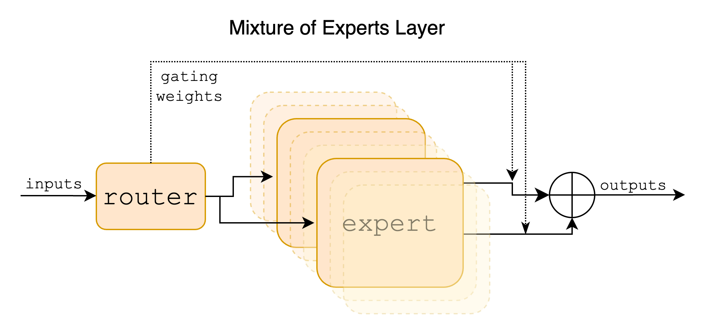
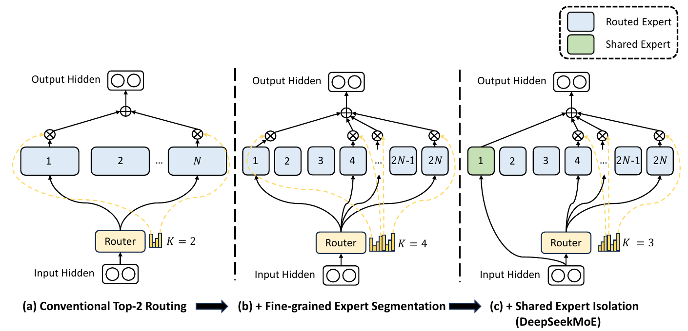
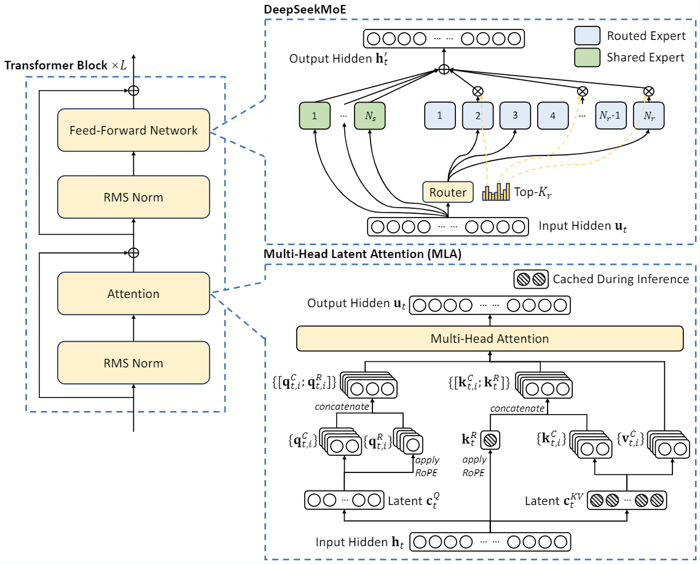

## 0. 这一篇讲什么

第 1 篇讲过原始 Transformer 的前馈网络：两层线性变换，中间一个 ReLU，中间维度是 $4d$。这一篇讲它的两条演化路线：

```
问题                              做法                                    本篇
──────────────────────────────────────────────────────────────────────────────────
FFN 在做什么                       逐 token 的键值记忆                      第 1 节
激活函数怎么选                     ReLU → GELU → SwiGLU 等门控激活          第 2 节
想要更多参数但不想增加计算          把一个 FFN 换成多个专家，每次只用几个     第 3 节
专家负载不均                       辅助损失、z-loss、无辅助损失的偏置        第 4 节
专家不够专业                       细粒度专家与共享专家：DeepSeekMoE         第 5 节
MoE 的系统代价                     专家并行与通信                          第 6 节
专家计算与通信仍然太贵              在低维空间里做专家：LatentMoE            第 7 节
```

## 1. FFN 在做什么

### 1.1 结构与成本

对每个 token 的隐藏向量 $x\in\mathbb R^d$ 独立地做：

$$
\mathrm{FFN}(x) = W_2\,\sigma(W_1x),\qquad W_1\in\mathbb R^{d_{\text{ff}}\times d},\ W_2\in\mathbb R^{d\times d_{\text{ff}}}
$$

原始 Transformer 中 $d_{\text{ff}} = 4d$，$\sigma$ 是 ReLU。参数量是 $2\cdot d\cdot 4d = 8d^2$，而注意力的四个投影是 $4d^2$。**FFN 占了每个 block 约三分之二的参数和与序列长度无关的计算量。**

### 1.2 注意力负责"交流"，FFN 负责"加工"

笔记中的说法很直观：经过多头注意力之后，token 之间只是互相查看了信息，把别处的信息聚合到了自己身上；接下来要通过 FFN 对这些信息做进一步的加工。注意力是 token 之间的操作，FFN 是每个 token 内部的操作，两者交替进行。

### 1.3 FFN 是一个键值记忆

Geva et al.（2021）给出了一个更具体的解读。把 $W_1$ 的第 $i$ 行记为 $k_i$，$W_2$ 的第 $i$ 列记为 $v_i$，则

$$
\mathrm{FFN}(x) = \sum_{i=1}^{d_{\text{ff}}}\sigma\big(k_i^\top x\big)\,v_i
$$

这和注意力的形式非常像：$k_i$ 是"键"，用来和输入匹配；$\sigma(k_i^\top x)$ 是匹配的强度；$v_i$ 是"值"，匹配上了就把它加到输出里。区别在于注意力的键和值来自上下文中的其他 token，而 FFN 的键和值是**训练中学到的固定参数**，像一本存储在权重里的记忆。他们的分析发现，许多 $k_i$ 会被特定的文本模式激活（例如某个 $k_i$ 专门响应"以某个词结尾的句子"），对应的 $v_i$ 则提高了相应的下一个 token 的概率。这也是"模型的事实知识主要存储在 FFN 中"这一说法的来源。

## 2. 激活函数：从 ReLU 到 SwiGLU

### 2.1 ReLU、GELU 与 Swish

- **ReLU**：$\max(0, x)$。简单、快，但输入为负时梯度为 0。如果一个神经元对所有输入都输出负值，它就永远不会再被更新（"死神经元"）；
- **GELU**（Hendrycks & Gimpel, 2016）：$x\cdot\Phi(x)$，$\Phi$ 是标准正态分布的累积分布函数。可以理解为按"$x$ 比一个随机标准正态变量大的概率"给 $x$ 加权。常用近似 $0.5x\big(1 + \tanh\big[\sqrt{2/\pi}(x + 0.044715x^3)\big]\big)$。BERT、GPT-2、GPT-3 使用 GELU；
- **Swish / SiLU**（Ramachandran et al., 2017）：$x\cdot\sigma(\beta x)$，$\sigma$ 是 sigmoid。$\beta = 1$ 时称为 SiLU。

GELU 和 SiLU 的形状很接近：正半轴接近恒等，负半轴有一个小的负值区域后趋于 0，整体光滑。和 ReLU 相比，负输入时仍有非零梯度，不会产生死神经元。

### 2.2 门控线性单元（GLU）

**GLU**（Dauphin et al., 2017）用两个线性变换，一个经过 sigmoid 作为"门"，逐元素乘到另一个上：

$$
\mathrm{GLU}(x) = \sigma(xW)\otimes(xV)
$$

门的值在 0 到 1 之间，决定另一支的每个分量通过多少。Shazeer（2020）把 GLU 用到 Transformer 的 FFN 中，并尝试把 sigmoid 换成其他激活函数：

$$
\begin{aligned}
\mathrm{FFN}_{\text{GLU}}(x) &= \big(\sigma(xW)\otimes xV\big)W_2 \\
\mathrm{FFN}_{\text{ReGLU}}(x) &= \big(\max(0, xW)\otimes xV\big)W_2 \\
\mathrm{FFN}_{\text{GEGLU}}(x) &= \big(\mathrm{GELU}(xW)\otimes xV\big)W_2 \\
\mathrm{FFN}_{\text{SwiGLU}}(x) &= \big(\mathrm{Swish}_1(xW)\otimes xV\big)W_2
\end{aligned}
$$

在 T5 的设置下，这些门控变体的困惑度都低于 ReLU 和 GELU 版本，其中 GEGLU 和 SwiGLU 最好，在下游任务上也有一致的提升。论文对于为什么有效的解释只有一句话："we offer no explanation... we attribute their success, as all else, to divine benevolence"。

### 2.3 为什么门控更好

笔记中给出了三点理由：Swish 相比 ReLU 能避免死神经元；GLU 的门控可以让某些信息通过或不通过；SwiGLU 中有额外的可学习参数，能更好地适应网络。

这里需要把第三点说得更准确一些：**多出来的可学习参数指的是门控分支的矩阵 $W$，而不是 Swish 本身**（大模型中的 Swish 一般固定 $\beta = 1$，即 SiLU，没有可学习的参数）。门控的意义在于引入了**乘法交互**：普通 FFN 的每个隐藏单元是 $\sigma(k_i^\top x)$，只是输入的一个线性函数经过逐元素非线性；门控 FFN 的隐藏单元是 $\mathrm{SiLU}(w_i^\top x)\cdot(v_i^\top x)$，包含输入的二次项，表达能力更强。用 1.3 节的记忆视角来看，一个分支决定"这条记忆是否被激活"，另一个分支决定"激活后写入什么"，两者可以独立学习。

### 2.4 为什么中间维度是 $\tfrac83d$

门控 FFN 有三个矩阵（$W, V, W_2$），比原来多一个。为了让参数量和计算量与原始的 $4d$ FFN 相同：

$$
3\cdot d\cdot d_{\text{ff}} = 2\cdot d\cdot 4d\quad\Longrightarrow\quad d_{\text{ff}} = \tfrac83d
$$

Llama 取 $\tfrac23\cdot 4d$ 并向上取整到 256 的倍数，以便高效地切分到多卡和对齐硬件。对 $d = 4096$：$\tfrac83\times 4096\approx 10923$，取整得到 **11008**，正是 Llama 7B 的配置。之后的模型不一定严格遵守这个比例，例如 Llama 3 8B 用的是 14336（$3.5d$）。

**谁在用.** PaLM、Llama、Qwen、DeepSeek、Mistral 等用 SwiGLU；Gemma 用 GeGLU。门控 FFN 已经是事实上的标准。

```python
import torch.nn as nn
import torch.nn.functional as F

class SwiGLU(nn.Module):
    def __init__(self, d_model, d_ff=None):
        super().__init__()
        if d_ff is None:                                   # Llama 风格：8/3 d，取整到 256 的倍数
            d_ff = int(8 * d_model / 3)
            d_ff = (d_ff + 255) // 256 * 256
        self.W_gate = nn.Linear(d_model, d_ff, bias=False) # 门控分支
        self.W_up = nn.Linear(d_model, d_ff, bias=False)   # 值分支
        self.W_down = nn.Linear(d_ff, d_model, bias=False)

    def forward(self, x):
        return self.W_down(F.silu(self.W_gate(x)) * self.W_up(x))

print(SwiGLU(4096).W_up.out_features)    # 11008
```

### 2.5 激活的稀疏性

ReLU 有一个 SwiGLU 没有的好处：它产生**精确的零**。训练好的 ReLU 模型中，对任意一个输入，FFN 隐藏层通常只有很小一部分神经元非零（Li et al., 2023）。推理时如果能预测哪些神经元为零，就可以跳过对应的 $W_2$ 列，节省计算和访存。这带来了一些反向的尝试，例如 Primer（So et al., 2021）发现平方 ReLU（$\max(0,x)^2$）在保持稀疏性的同时效果接近门控激活。这种"一个输入只用到一部分参数"的思想，在 MoE 中被做到了结构层面。

## 3. MoE：把一个 FFN 换成多个专家

### 3.1 基本形式

**混合专家**（Mixture of Experts）把一个 FFN 换成 $N$ 个结构相同、参数独立的 FFN（称为**专家**），再加一个**路由器**决定每个 token 用哪几个专家：

$$
s = \mathrm{softmax}(W_rx)\in\mathbb R^N,\qquad \mathcal T = \mathrm{TopK}(s, k)
$$

$$
y = \sum_{i\in\mathcal T}g_i\,E_i(x),\qquad g_i = \frac{s_i}{\sum_{j\in\mathcal T}s_j}
$$

$W_r\in\mathbb R^{N\times d}$ 是路由器的参数，可以把每一行看成一个专家的"中心向量"，与 $x$ 的内积越大，这个专家越适合处理它。$g_i$ 是门控权重，常见做法是在选中的 $k$ 个专家上重新归一化（也有实现直接对选中专家的 logits 做 softmax，结果相同）。



*图 1：MoE 层。路由器为每个输入选出少数几个专家，各专家的输出按门控权重加权求和。图片来源：Jiang et al., "Mixtral of Experts", 2024, Figure 1。*

MoE 只替换 FFN，注意力层仍是稠密的。

### 3.2 总参数与激活参数

MoE 模型有两个参数量：

- **总参数**：所有专家的参数之和，决定了模型的容量，也决定了需要多少显存来存放；
- **激活参数**：每个 token 实际经过的参数，决定了每个 token 的计算量。

| 模型 | 总参数 | 激活参数 | 路由专家 | 共享专家 | 每 token 选 |
|---|---|---|---|---|---|
| Mixtral 8x7B | 46.7B | 约 13B | 8 | 0 | 2 |
| DeepSeek-V2 | 236B | 21B | 160 | 2 | 6 |
| DeepSeek-V3 | 671B | 37B | 256 | 1 | 8 |
| Qwen3-235B-A22B | 235B | 22B | 128 | 0 | 8 |

Mixtral 的名字有点误导：它不是 8 个 7B 模型，只有 FFN 被复制成 8 份，注意力和嵌入是共享的，所以总参数是 46.7B 而不是 56B。

### 3.3 为什么 MoE 效果更好

笔记中的解释：MoE 大幅增加了参数量，但每个 token 的计算量不变；一个大的、部分激活的模型通常比一个小的、全部激活的模型效果好，这和大脑执行任务时只有部分神经元被激活的现象也是一致的。

从扩展规律的角度看，模型的效果主要取决于参数量和训练数据，而训练成本取决于每个 token 的计算量。MoE 把这两者**解耦**了：在相同的训练算力下，可以训练一个参数多得多的模型。Switch Transformer（Fedus et al., 2021）报告，在相同计算量下，MoE 版本达到 T5-Base 同样的效果，预训练速度快 7 倍。

需要注意两点：

- MoE 省的是**相对于同样总参数的稠密模型**的计算。和激活参数相同的稠密模型相比，计算量差不多（多了路由），效果更好；和总参数相同的稠密模型相比，效果通常略差，但计算少得多；
- 笔记中提到"可以认为 FFN 是推理能力的关键之一"。MoE 的成功说明增加 FFN 的容量很有效，但从这一点推出 FFN 对推理能力的特殊作用，还缺少直接的证据，这是一个推测。

### 3.4 MoE 的简史

- **Shazeer et al.（2017）**：稀疏门控 MoE，在 LSTM 层之间插入数千个专家，带噪声的 top-$k$ 路由，训练了 1370 亿参数的模型；
- **GShard（Lepikhin et al., 2020）**：把 MoE 用到 Transformer 的 FFN 上，top-2 路由，每隔一层放一个 MoE 层，6000 亿参数，并提出了专家容量和辅助损失；
- **Switch Transformer（Fedus et al., 2021）**：top-1 路由，进一步简化，扩展到万亿参数；
- **Mixtral（2024）**、**DeepSeekMoE（2024）**：开源 MoE 语言模型普及，之后的前沿模型大多采用 MoE。

### 3.5 专家容量与 token 丢弃

为了高效地批量计算，早期实现给每个专家预留固定大小的缓冲区，称为**专家容量**：

$$
\text{capacity} = \frac{\text{批内 token 数}}{N}\times\text{容量因子}
$$

容量因子通常取 1.0 到 1.25。如果路由到某个专家的 token 超过了容量，多出来的 token 会被**丢弃**：它们跳过这个 MoE 层，只通过残差连接传下去。容量因子越大，丢弃越少，但浪费的计算和显存越多。负载越不均衡，丢弃越严重，这是负载均衡重要的直接原因之一。DeepSeek-V3 依靠良好的负载均衡，训练和推理都不丢弃 token。

## 4. 负载均衡

### 4.1 为什么会失衡

路由器是和专家一起训练的，这里有一个自我强化的循环：某个专家一开始碰巧被选中得多一点 → 它得到更多训练、变得更好 → 路由器更倾向于选它 → 它得到更多训练。不加干预的话，路由会**塌缩**到少数几个专家，其余专家几乎不被使用，总参数大部分被浪费。

工程上，专家通常分布在不同的 GPU 上（第 6 节）。负载不均时，最忙的那个 GPU 决定了整体的速度，其余的 GPU 在等待。

### 4.2 辅助损失

Switch Transformer 的**负载均衡损失**：

$$
\mathcal L_{\text{aux}} = \alpha\cdot N\sum_{i=1}^Nf_i\,P_i
$$

- $f_i$：这个批次中被分配给专家 $i$ 的 token 比例（按 top-$k$ 的实际选择计数）；
- $P_i$：这个批次中所有 token 的路由概率 $s_i$ 的平均值；
- $\alpha$ 是系数，Switch 取 0.01。

$f_i$ 来自离散的 top-$k$ 选择，不可导；$P_i$ 是可导的。梯度通过 $P_i$ 回传，并以 $f_i$ 为权重：**被分配得越多的专家，它的路由概率被压得越多。** 均匀分配时 $f_i = P_i = 1/N$，损失为 $\alpha$；全部塌缩到一个专家时，损失为 $\alpha N$：

```python
import numpy as np
N = 8
def switch_aux_loss(f, P):
    return N * np.sum(f * P)
uniform = np.full(N, 1 / N)
collapsed = np.eye(N)[0]                    # 所有 token 都去 0 号专家
print(switch_aux_loss(uniform, uniform), switch_aux_loss(collapsed, collapsed))   # 1.0 8.0
```

笔记中提到负载均衡通常用"对门控输出的 L1 损失或温度调节"。实际最常用的是上面这种 $f\cdot P$ 形式的辅助损失（以及它的变体），再配合下面的 z-loss。

**统计的范围.** $f_i, P_i$ 在多大范围内统计会影响效果。在单个序列内强制均衡太严格（一篇代码文档本来就该多用"代码专家"）；DeepSeek-V2 在设备级别和通信级别也加了均衡损失；Qwen 团队发现在**全局批次**（所有数据并行副本的 token 合在一起）上统计，专家的专业化程度更高、效果更好，Qwen3 的 MoE 采用了全局批次的均衡损失。

### 4.3 Router z-loss

ST-MoE（Zoph et al., 2022）发现路由器的 logits 可能变得很大，在低精度训练中造成数值不稳定。**z-loss** 惩罚 logits 的 log-sum-exp：

$$
\mathcal L_z = \frac1B\sum_{b=1}^B\Big(\log\sum_{i=1}^Ne^{z_{b,i}}\Big)^2
$$

它把路由 logits 压在较小的范围内，系数通常取 $10^{-3}$。这和第 4 篇讲的 QK-Norm、logit soft-capping 是同一类问题：softmax 的输入尺度失控。

### 4.4 无辅助损失的负载均衡

辅助损失有一个根本的矛盾。笔记中说得很清楚：**过强的均衡损失会迫使路由器为了"平均分配"而选择不合适的专家，干扰模型本身的训练目标**；太弱又压不住失衡。系数很难调。

DeepSeek-V3 使用了 Wang et al.（2024）提出的**无辅助损失**（auxiliary-loss-free）方法：给每个专家一个偏置 $b_i$，**只在选择专家时使用**：

$$
\mathcal T = \mathrm{TopK}_i\big(s_i + b_i,\ k\big),\qquad g_i = \frac{s_i}{\sum_{j\in\mathcal T}s_j}\quad(i\in\mathcal T)
$$

门控权重 $g_i$ 仍然用原始的亲和度 $s_i$，不含偏置。偏置不通过梯度学习，而是在每一步之后按负载直接调整：

$$
b_i\leftarrow b_i - \gamma\cdot\mathrm{sign}\big(\text{load}_i - \overline{\text{load}}\big)
$$

过载的专家降低偏置，下次更难被选中；空闲的专家提高偏置。这相当于一个简单的反馈控制器，它**完全不进入损失函数**，不会产生与语言建模目标冲突的梯度。

下面模拟一个天生偏向前几个专家的路由器：

```python
import numpy as np
rng = np.random.default_rng(0)
N, k, T = 16, 2, 4096                       # 16 个专家，每个 token 选 2 个，每批 4096 个 token
skew = np.linspace(1.5, -1.5, N)            # 模拟一个"偏心"的路由器：前面的专家天生得分更高

def router_scores():
    logits = rng.standard_normal((T, N)) + skew
    return 1 / (1 + np.exp(-logits))        # DeepSeek-V3 风格：sigmoid 亲和度

def topk_load(s, b):
    idx = np.argsort(-(s + b), axis=1)[:, :k]          # 偏置只影响"选谁"
    load = np.bincount(idx.ravel(), minlength=N)
    return load, idx

b = np.zeros(N)
gamma = 0.01                                # 偏置更新速度
for step in range(301):
    s = router_scores()
    load, idx = topk_load(s, b)
    if step in (0, 10, 50, 300):
        print(f"step {step:3d}  最忙专家 / 平均 = {load.max() / load.mean():.2f}   "
              f"最闲专家 / 平均 = {load.min() / load.mean():.2f}")
    b -= gamma * np.sign(load - load.mean())  # 过载的专家降低偏置，空闲的专家提高偏置

g = np.take_along_axis(s, idx, axis=1)      # 门控权重仍用原始分数（不含偏置）
g = g / g.sum(axis=1, keepdims=True)
```

输出：

```
step   0  最忙专家 / 平均 = 3.72   最闲专家 / 平均 = 0.01
step  10  最忙专家 / 平均 = 2.56   最闲专家 / 平均 = 0.09
step  50  最忙专家 / 平均 = 1.15   最闲专家 / 平均 = 0.88
step 300  最忙专家 / 平均 = 1.12   最闲专家 / 平均 = 0.88
```

几十步之内，最忙专家的负载就从平均的 3.7 倍降到约 1.1 倍。

DeepSeek-V3 的其他相关细节：亲和度用 **sigmoid** 而不是 softmax（各专家的分数独立，不互相竞争），在选中的专家上归一化得到门控权重；仍保留一个系数极小（0.0001）的序列级均衡损失，防止单个序列内的极端失衡；每个 token 最多被路由到 4 个节点上的专家，以限制跨节点通信。笔记中记录 GLM、Kimi、MiniMax 等后续模型也采用了类似的修正偏置或无辅助损失的路由。

## 5. DeepSeekMoE：细粒度专家与共享专家

### 5.1 专家不够专业的问题

笔记中描述了理想与现状的差距。理想的 MoE 中，专家之间的知识互不重叠，每个 token 只需要激活其中相关的几个。但实际上，一个 token 往往同时需要多种知识。在专家数量少（比如 8 个、选 2 个）的情况下，每个专家都被迫学习很杂的知识，不同专家之间又会重复学习一些通用的知识。结果是**专家不够专业化**，参数被浪费。

DeepSeekMoE（Dai et al., 2024）针对这两个问题提出了两个改动。



*图 2：（a）传统的 top-2 路由，$N$ 个专家中选 2 个；（b）细粒度专家切分，每个专家切成更小的 $2N$ 个，选 4 个；（c）再加上共享专家隔离，1 号专家（绿色）作为共享专家，所有 token 都经过它，路由专家中选 3 个。三种结构的专家参数总量和计算量相同。图片来源：Dai et al., "DeepSeekMoE: Towards Ultimate Expert Specialization in Mixture-of-Experts Language Models", 2024, Figure 2。*

### 5.2 细粒度专家切分

把每个专家的中间维度缩小为原来的 $1/m$，专家数量扩大 $m$ 倍，每个 token 激活的专家数也扩大 $m$ 倍。总参数和计算量都不变，但**专家组合的灵活性**大大增加。

论文中的例子：16 个专家选 2 个，只有 $\binom{16}{2} = 120$ 种组合；切分为 64 个专家选 8 个（$m = 4$），组合数是 $\binom{64}{8}\approx 44$ 亿。每个 token 可以更精确地选出它需要的知识组合，每个专家可以只负责更窄的一类知识。

### 5.3 共享专家隔离

拿出 $K_s$ 个专家作为**共享专家**，所有 token 都经过它们，不参与路由：

$$
y = \sum_{i=1}^{K_s}E_i^{\text{shared}}(x) + \sum_{i\in\mathcal T}g_i\,E_i^{\text{routed}}(x)
$$

共享专家专门学习各种 token 都需要的通用知识，路由专家就不必各自重复学习这些内容，可以更专注于专门的知识。为保持计算量不变，路由专家的激活数相应减少。

DeepSeek-V2 用 2 个共享专家加 160 个路由专家（选 6 个），DeepSeek-V3 用 1 个共享专家加 256 个路由专家（选 8 个）。



*图 3：DeepSeek-V2 的 Transformer block。FFN 部分（右上）是 DeepSeekMoE，绿色为共享专家，蓝色为路由专家，路由器选出 Top-$K_r$ 个路由专家；注意力部分（右下）是 MLA（第 3 篇第 4 节）。图片来源：DeepSeek-AI, "DeepSeek-V2: A Strong, Economical, and Efficient Mixture-of-Experts Language Model", 2024, Figure 2。*

并不是所有模型都认同共享专家。Qwen3 的 MoE 去掉了 Qwen2 MoE 中的共享专家，改用全局批次的负载均衡来促进专家专业化。

### 5.4 一个参考实现

下面用 NumPy 实现一个 DeepSeekMoE 风格的层（共享专家、sigmoid 亲和度、选择用的偏置、在选中专家上归一化），并与逐 token 的朴素计算对比：

```python
import numpy as np

def silu(x):
    return x / (1 + np.exp(-x))

class SwiGLUExpert:
    def __init__(self, d, d_ff, rng):
        self.W_gate = rng.standard_normal((d, d_ff)) / np.sqrt(d)
        self.W_up = rng.standard_normal((d, d_ff)) / np.sqrt(d)
        self.W_down = rng.standard_normal((d_ff, d)) / np.sqrt(d_ff)

    def __call__(self, x):                               # x: [n, d]
        return (silu(x @ self.W_gate) * (x @ self.W_up)) @ self.W_down

class MoE:
    """n_shared 个共享专家 + n_routed 个路由专家中选 top-k"""
    def __init__(self, d, d_expert, n_routed, n_shared, k, rng):
        self.k = k
        self.routed = [SwiGLUExpert(d, d_expert, rng) for _ in range(n_routed)]
        self.shared = [SwiGLUExpert(d, d_expert, rng) for _ in range(n_shared)]
        self.centroids = rng.standard_normal((n_routed, d)) / np.sqrt(d)   # 路由器：每个专家一个中心向量
        self.bias = np.zeros(n_routed)                                     # 只用于选择的负载均衡偏置

    def __call__(self, x):                               # x: [T, d]
        s = 1 / (1 + np.exp(-(x @ self.centroids.T)))    # 亲和度 [T, n_routed]
        idx = np.argsort(-(s + self.bias), axis=1)[:, :self.k]
        g = np.take_along_axis(s, idx, axis=1)
        g = g / g.sum(axis=1, keepdims=True)             # 在选中的专家上归一化
        y = np.zeros_like(x)
        for e in self.shared:                            # 共享专家：每个 token 都经过
            y += e(x)
        for e_id, expert in enumerate(self.routed):      # 按专家分组计算（分布式中这一步是 all-to-all）
            rows, slot = np.nonzero(idx == e_id)
            if len(rows):
                y[rows] += g[rows, slot, None] * expert(x[rows])
        return y, idx

rng = np.random.default_rng(0)
d, T = 64, 10
moe = MoE(d, d_expert=32, n_routed=16, n_shared=1, k=4, rng=rng)
x = rng.standard_normal((T, d))
y, idx = moe(x)

s = 1 / (1 + np.exp(-(x @ moe.centroids.T)))           # 逐 token 的朴素计算，检查一致
for t in range(T):
    sel = np.argsort(-s[t])[:4]
    g = s[t, sel] / s[t, sel].sum()
    ref = moe.shared[0](x[t:t + 1]) + sum(gi * moe.routed[e](x[t:t + 1]) for gi, e in zip(g, sel))
    assert np.allclose(ref, y[t])
print("ok")
```

注意实现的方式是**按专家分组**：先找出路由到每个专家的所有 token，把它们拼成一批一起计算。逐个 token 调用专家在 GPU 上效率极低。

## 6. MoE 的系统代价

MoE 在计算量上很划算，但带来了几个系统层面的问题：

- **显存**：所有专家都要放在显存里。DeepSeek-V3 每个 token 只激活 37B 参数，但推理时需要存放全部 671B 参数；
- **专家并行与 all-to-all 通信**：专家通常分布在不同的 GPU 上（专家并行）。每个 MoE 层都要先把 token 发送到它选中的专家所在的 GPU，算完再发回来，这是两次 **all-to-all** 通信。通信量与 token 数、隐藏维度 $d$ 和每个 token 选的专家数成正比。DeepSeek-V3 限制每个 token 最多路由到 4 个节点，并设计了计算与通信重叠的流水线；
- **解码阶段**：解码时批次内不同 token 选中的专家各不相同，每个专家分到的 token 很少，专家权重的读取难以被分摊。专家越多、越细，这个问题越明显。这和第 3 篇讲的 KV Cache 问题一样，本质是访存瓶颈；
- **负载均衡**：第 4 节已经讨论过，失衡直接拖慢最忙的设备。

还有其他路由方式，例如 **Expert Choice**（Zhou et al., 2022）反过来让每个专家挑选它最想处理的 token，天然负载均衡；但在自回归解码中，专家需要看到整批 token 才能挑选，与逐 token 生成不兼容，所以在语言模型中用得不多。

## 7. LatentMoE：在低维空间里做专家

笔记中记录了一个较新的设计：**LatentMoE**。传统 MoE 的专家直接在完整的隐藏维度 $d$ 上计算；LatentMoE 先把输入压缩到一个更低维的隐空间：

$$
z = W_{\text{down}}x\in\mathbb R^{d_{\text{latent}}},\qquad d_{\text{latent}} < d
$$

在隐空间中完成路由和专家计算：

$$
z' = \sum_{i\in\mathcal T}g_i\,E_i(z)
$$

最后投影回原来的维度：$y = W_{\text{up}}z'$。

好处在于：

- **专家更小**：每个专家的输入、输出维度从 $d$ 变成 $d_{\text{latent}}$，参数量和读取量按比例减少，同样的参数预算可以放更多的专家，或者激活更多的专家；
- **通信更少**：all-to-all 发送的是 $z$ 而不是 $x$，通信量按 $d_{\text{latent}}/d$ 的比例下降。第 6 节说过通信是 MoE 的主要系统代价之一。

这和第 3 篇的 MLA 思路相似：都是把需要大量搬运的东西先压到低维，在低维空间里完成昂贵的部分。笔记中记录 Microsoft MAI-Thinking-1、NVIDIA Nemotron 3 和 Kimi K3 的 Stable LatentMoE 采用了类似的思路。这些都是比我能核实的资料更新的前沿设计，具体的压缩比例、路由在哪个空间里做，以各自技术报告为准。

## 8. 总结

| 变体 | 改了什么 | 解决的问题 | 代表 |
|---|---|---|---|
| ReLU FFN | 基础版本 | — | 原始 Transformer |
| GELU | 光滑的激活 | 死神经元 | BERT、GPT-2/3 |
| SwiGLU / GeGLU | 门控，三个矩阵，$d_{\text{ff}} = \tfrac83d$ | 表达能力 | Llama、Qwen、DeepSeek、PaLM、Gemma |
| Top-$k$ MoE | 多个专家，稀疏激活 | 参数与计算解耦 | Switch、Mixtral |
| 辅助损失 / z-loss | 损失中加均衡项 | 路由塌缩、数值不稳定 | Switch、ST-MoE、Qwen3 |
| 无辅助损失偏置 | 只影响选择的偏置，反馈调整 | 均衡与主目标的冲突 | DeepSeek-V3 |
| 细粒度 + 共享专家 | 更小更多的专家、通用知识单独处理 | 专家不够专业 | DeepSeek-V2/V3 |
| LatentMoE | 在低维空间里路由和计算 | 专家与通信成本 | 前沿模型（据笔记） |

- FFN 是每个 token 内部的键值记忆，占每个 block 约三分之二的参数；
- **门控激活**（SwiGLU）引入了乘法交互，是今天的标准配置。为了参数量不变，中间维度取 $\tfrac83d$；
- **MoE** 把参数量和每个 token 的计算量解耦，是前沿大模型的主流选择。它的核心难点是**路由**：负载要均衡，但均衡不能干扰主目标。DeepSeek-V3 的无辅助损失偏置是目前的代表性解法；
- **DeepSeekMoE** 的细粒度专家和共享专家提高了专家的专业化程度；
- MoE 的代价主要在系统层面：显存、all-to-all 通信、解码时的访存。LatentMoE 是在这一方向上的进一步优化。

## 参考文献

- Jacobs et al. *Adaptive Mixtures of Local Experts.* Neural Computation 1991.
- Hendrycks & Gimpel. *Gaussian Error Linear Units (GELUs).* 2016.
- Shazeer et al. *Outrageously Large Neural Networks: The Sparsely-Gated Mixture-of-Experts Layer.* ICLR 2017.
- Dauphin et al. *Language Modeling with Gated Convolutional Networks.* ICML 2017.
- Ramachandran, Zoph & Le. *Searching for Activation Functions.* 2017.
- Vaswani et al. *Attention Is All You Need.* NeurIPS 2017.
- Shazeer. *GLU Variants Improve Transformer.* 2020.
- Lepikhin et al. *GShard: Scaling Giant Models with Conditional Computation and Automatic Sharding.* 2020.
- Fedus, Zoph & Shazeer. *Switch Transformers: Scaling to Trillion Parameter Models with Simple and Efficient Sparsity.* JMLR 2022.
- Geva et al. *Transformer Feed-Forward Layers Are Key-Value Memories.* EMNLP 2021.
- So et al. *Primer: Searching for Efficient Transformers for Language Modeling.* NeurIPS 2021.
- Zoph et al. *ST-MoE: Designing Stable and Transferable Sparse Expert Models.* 2022.
- Zhou et al. *Mixture-of-Experts with Expert Choice Routing.* NeurIPS 2022.
- Li et al. *The Lazy Neuron Phenomenon: On Emergence of Activation Sparsity in Transformers.* ICLR 2023.
- Touvron et al. *LLaMA: Open and Efficient Foundation Language Models.* 2023.
- Jiang et al. *Mixtral of Experts.* 2024.
- Dai et al. *DeepSeekMoE: Towards Ultimate Expert Specialization in Mixture-of-Experts Language Models.* 2024.
- DeepSeek-AI. *DeepSeek-V2: A Strong, Economical, and Efficient Mixture-of-Experts Language Model.* 2024.
- Wang et al. *Auxiliary-Loss-Free Load Balancing Strategy for Mixture-of-Experts.* 2024.
- DeepSeek-AI. *DeepSeek-V3 Technical Report.* 2024.
- Qiu et al. *Demons in the Detail: On Implementing Load Balancing Loss for Training Specialized Mixture-of-Expert Models.* 2025.
- Qwen Team. *Qwen3 Technical Report.* 2025.
