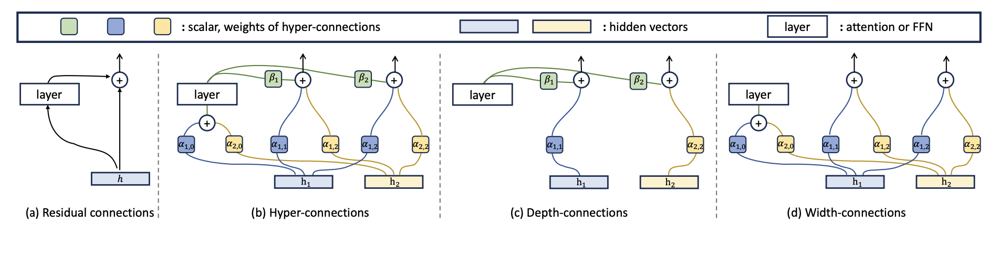
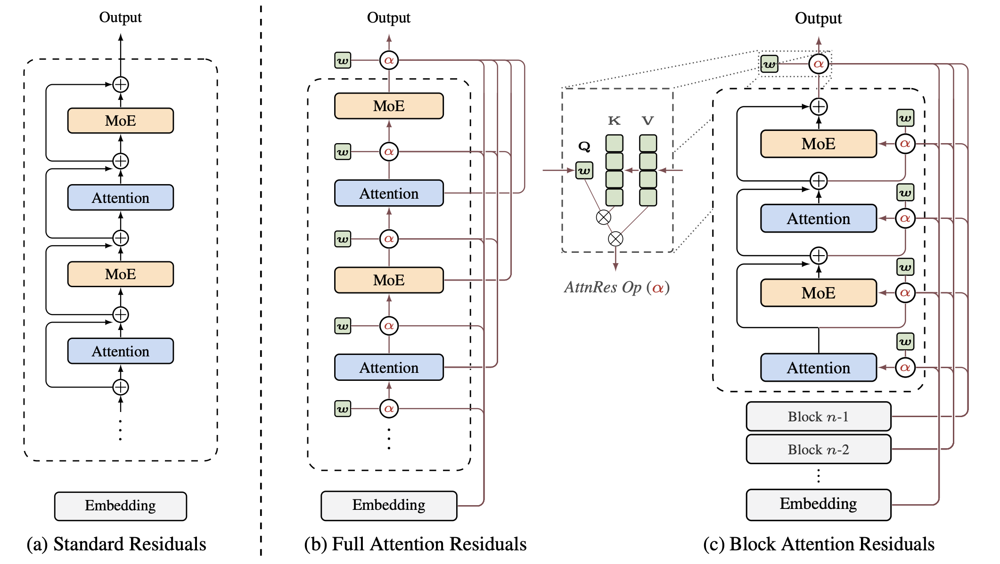
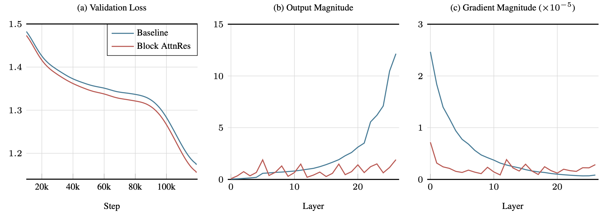

## 0. 这一篇讲什么

第 1 篇讲过残差连接的基础版本：$y = x + F(x)$。它出现在每个注意力和 FFN 子层上，是深层 Transformer 能训练起来的前提。第 4 篇讨论了归一化应该放在残差的哪里。这一篇讨论残差连接本身：

```
问题                                  做法                                       本篇
───────────────────────────────────────────────────────────────────────────────────────
残差连接为什么有效                      恒等路径、残差流、集成视角                    第 1 节
每层更新的比例能不能调                  ReZero、LayerScale、Highway、DeepNorm         第 2 节
所有层输出等权累加的问题                Pre-Norm 稀释                               第 3 节
统一的视角                             深度方向的混合矩阵                           第 4 节
一条残差流不够                          多条流：Hyper-Connections、mHC               第 5 节
固定累加换成按内容选择                  沿深度做注意力：Attention Residuals           第 6 节
```

## 1. 残差连接为什么有效

### 1.1 学习变化量

残差连接来自 ResNet（He et al., 2016）。普通网络让每一层直接学习目标映射 $H(x)$；残差连接让它只学习输入与目标之间的**变化量** $F(x) = H(x) - x$：

$$
y = x + F(x)
$$

动机来自一个观察：更深的普通网络在**训练集**上的误差反而比浅的网络高。这不是过拟合，而是优化困难。理论上，深网络至少可以让多出来的层学成恒等映射，从而不比浅网络差；但让一叠非线性层精确地学出恒等映射并不容易。有了残差连接，恒等映射只需要 $F(x) = 0$，把权重推向 0 就可以了。

### 1.2 梯度的恒等通路

笔记中给出了梯度：

$$
\frac{\partial y}{\partial x} = I + \frac{\partial F(x)}{\partial x}
$$

即使 $F$ 这条路径上的梯度很小，梯度仍可以通过恒等项 $I$ 直接回传。把 $L$ 层串起来，

$$
\frac{\partial\mathcal L}{\partial x_l} = \frac{\partial\mathcal L}{\partial x_L}\prod_{j=l}^{L-1}\Big(I + \frac{\partial F_j}{\partial x_j}\Big)
$$

展开这个连乘积，第一项永远是 $I$：**无论网络多深，损失到任何一层都有一条不经过任何变换的梯度通路。** 第 4 篇讲过，Post-LN 把归一化放在了这条通路上，Pre-LN 把它恢复了出来。

### 1.3 残差流：一条共享的通信通道

Pre-Norm Transformer 中，把递推展开：

$$
x_L = x_0 + \sum_{l=0}^{L-1}F_l\big(\mathrm{Norm}(x_l)\big)
$$

最终的表示是词嵌入加上**所有层的输出之和**。Elhage et al.（2021）把这条贯穿所有层的向量称为**残差流**（residual stream），并给出了一个有用的看法：残差流是一条共享的通信通道，每一层从中"读取"（通过子层开头的投影），计算之后再"写入"（通过子层末尾的投影，加回去）。不同的层可以使用残差流中不同的子空间来传递不同的信息，一层写入的信息可以被之后任意一层读取。

### 1.4 集成的视角

Veit et al.（2016）给出了另一个视角。把 $L$ 个残差块的输出展开，每一块都可以选择"经过 $F$"或"走恒等路径"，一共有 $2^L$ 条路径。残差网络的行为很像这些长短不一的路径组成的**集成**，并且实际起作用的主要是相对较短的路径。他们的实验发现，删除训练好的 ResNet 中的单个残差块，性能只是平缓下降，而普通网络删掉一层就会完全失效。这也预示了第 3 节将讨论的现象：深层的 Transformer 中，许多层的贡献并不大。

## 2. 单条残差流上的缩放与门控

最简单的改进是给残差的两项加上系数：

$$
h_l = \alpha_l\cdot h_{l-1} + \beta_l\cdot f_{l-1}(h_{l-1})
$$

| 方法 | 形式 | 系数 |
|---|---|---|
| 标准残差 | $h_{l-1} + f(h_{l-1})$ | 固定为 1 |
| ReZero（Bachlechner et al., 2020） | $h_{l-1} + \alpha_l f(h_{l-1})$ | 每层一个标量，初始化为 0 |
| LayerScale（Touvron et al., 2021） | $h_{l-1} + \mathrm{diag}(\lambda_l)f(h_{l-1})$ | 每层一个向量，初始化为很小的值 |
| Highway（Srivastava et al., 2015） | $(1 - g_l)\odot h_{l-1} + g_l\odot f(h_{l-1})$ | 由输入算出的门，$g\in[0,1]^d$ |
| DeepNorm（Wang et al., 2022） | $\mathrm{Norm}(\alpha h_{l-1} + f(h_{l-1}))$ | 固定的 $\alpha>1$ |

ReZero 和 LayerScale 让每一层一开始几乎是恒等映射，训练中逐渐"加入"，改善深层网络初期的训练稳定性。Highway 网络比 ResNet 还早，用输入相关的门在变换和恒等之间插值，可以看作 LSTM 的门控思想沿深度方向的版本。DeepNorm 在第 4 篇讲过。

Attention Residuals 的论文（Kimi Team, 2026）指出了这些方法共同的限制：**第 $l$ 层只能看到上一层的状态 $h_{l-1}$。** 它是之前所有层输出压缩成的一个向量。由此带来几个问题：

1. **不能选择性地读取**：注意力层和 FFN 层收到同一个聚合后的状态，即使它们可能需要不同的早期信息；
2. **信息不可恢复**：在累加中被淹没的早期信息，后面的层无法单独取回；
3. **输出越来越大**：后面的层为了在累积的残差流中产生影响，不得不学出越来越大的输出，这可能破坏训练稳定性。

第三点就是下一节的 Pre-Norm 稀释。

## 3. Pre-Norm 稀释

第 4 篇 3.4 节用一个模拟展示过：Pre-Norm 中每个子层的输入都被归一化，输出尺度大致固定，而这些输出不断累加，残差流的 RMS 约按 $\sqrt l$ 增长（若各层输出方向相关，增长更快，最坏按 $l$ 线性增长），第 $l$ 层的更新在残差流中的占比相应下降。

笔记中把这个现象称为 **Pre-Norm 稀释**（PreNorm dilution）：大量层输出不断累加，残差流的尺度持续增长，而单个新层的输出在整体表示中的相对占比越来越小。模型也无法决定当前层应该从哪些早期层读取信息、哪些历史表示应该保留或减弱、当前层的输出应该写入多少。

实际模型中可以看到它的后果：

- **深层可以被删掉**：Gromov et al.（2024）发现，在多个开源大模型中删掉相当比例的深层，下游性能下降很小，说明这些层没有被充分利用；
- **深层输出的尺度失控**：图 2（第 6 节）中基线模型每个 block 的输出量级随深度单调增长，最后几层的输出比前面大一个数量级，正是"后层为了产生影响只能输出更大的值"；
- **梯度分布不均**：同一张图中，基线模型浅层的梯度远大于深层。

一些修补方法沿用单条残差流，例如按层数缩放归一化的输出（Sun et al., 2025 的 LayerNorm Scaling，对第 $l$ 层的归一化输出乘以 $1/\sqrt l$），或第 4 篇讲的 Sandwich、输出归一化。下面两节的方法则改变了残差连接本身的结构。

## 4. 统一的视角：深度方向的混合矩阵

把第 $l$ 层的输入写成之前所有"来源"的线性组合：

$$
h_l = \sum_{i=0}^{l-1}M_{i\to l}\,v_i,\qquad v_0 = h_1\ \text{（词嵌入）},\quad v_i = f_i(h_i)\ \text{（第 } i \text{ 层的输出）}
$$

矩阵 $M$ 描述了**信息如何沿深度聚合**。标准残差中 $M_{i\to l} = 1$，$M$ 是一个全 1 的下三角矩阵：

$$
\begin{pmatrix}h_1\\h_2\\\vdots\\h_L\end{pmatrix}
=
\begin{pmatrix}1&&&\\1&1&&\\\vdots&\vdots&\ddots&\\1&1&\cdots&1\end{pmatrix}
\begin{pmatrix}v_0\\v_1\\\vdots\\v_{L-1}\end{pmatrix}
$$

这个形式让人联想到第 3 篇的注意力：如果把"层"换成"序列位置"，全 1 的下三角矩阵正是**没有 softmax、没有衰减的因果线性注意力**（第 3 篇 7.3 节的 $S_t = S_{t-1} + k_tv_t^\top$）。Attention Residuals 的论文把这一点说得很清楚：残差连接沿深度做的事情，就像 RNN 沿时间做的事情，把所有历史压缩进一个状态。

各种残差变体可以按 $M$ 的形式来比较：

| 方法 | $M_{i\to l}$ | 是否依赖输入 | 类比 |
|---|---|---|---|
| 标准残差 | 全为 1 | 否 | 沿深度的线性注意力 |
| Highway | 门控系数的累乘 | 是 | 带遗忘门的循环 |
| DenseFormer（Pagliardini et al., 2024） | 每对 $(i, l)$ 一个学到的标量 | 否 | 固定权重的跨层连接 |
| Hyper-Connections / mHC | 由 $m\times m$ 矩阵的累乘决定 | 是 | 多状态的循环 |
| Attention Residuals | $\mathrm{softmax}$ 注意力权重 | 是 | 沿深度的 softmax 注意力 |

序列建模从 RNN 走到了注意力。下面两节分别对应沿深度方向的两种推广：**扩大状态**（多条残差流），和**直接访问所有历史**（沿深度做注意力）。

## 5. Hyper-Connections 与 mHC：多条残差流

### 5.1 Hyper-Connections

**Hyper-Connections**（Zhu et al., 2025）把一条残差流扩展成 $n$ 条并行的流（$n$ 称为扩展率，常取 4）：

$$
X_l = [x_{l,1};\ x_{l,2};\ \dots;\ x_{l,n}]\in\mathbb R^{n\times d}
$$

笔记中的写法清楚地给出了三个可学习的连接：

$$
X_{l+1} = B_lX_l + C_l\,F_l(A_lX_l)
$$

- $A_l\in\mathbb R^{1\times n}$：当前层从哪些流中**读取**，把 $n$ 条流组合成子层的一个输入；
- $B_l\in\mathbb R^{n\times n}$：旧的流之间如何**互相混合**；
- $C_l\in\mathbb R^{n\times 1}$：当前层的输出**写入**哪些流、各写多少。

$n = 1$、$A = B = C = 1$ 时退化为标准残差。这些系数可以是静态学到的标量，也可以由当前的输入动态预测（动态版本效果更好）。



*图 1：（a）标准残差连接；（b）扩展率 $n = 2$ 的 Hyper-Connections，有两条隐藏向量 $h_1, h_2$，$\alpha$ 决定层的输入如何从各条流中组合以及各流之间如何混合，$\beta$ 决定层的输出写回各条流的权重；它可以分解为（c）深度连接（层输出与各条流的加权求和）和（d）宽度连接（各条流之间的信息交换）。图片来源：Zhu et al., "Hyper-Connections", ICLR 2025, Figure 2。*

多条流让模型有了更大的"沿深度的状态"：不同的流可以保留不同阶段的信息，层可以有选择地读取和写入。Hyper-Connections 的论文报告，在 MoE 语言模型上，它比标准残差收敛更快、效果更好。

### 5.2 问题：无约束的混合会放大信号

把 $B_l$ 沿深度累乘，信号经过多层后的变换是 $B_{L-1}\cdots B_{l+1}B_l$。标准残差中这个乘积就是 1，恒等映射完好；Hyper-Connections 中 $B_l$ 是任意的学习矩阵，**即使每个 $B_l$ 都接近单位矩阵，几十层的乘积也可能指数级地放大或衰减信号**，残差连接原本保证的恒等性质就丢失了。笔记中说的"普通 Hyper-Connections 的混合矩阵可能在深层网络中不断放大信号，导致训练不稳定"就是这个意思。

### 5.3 mHC：约束到双随机矩阵

**mHC**（Manifold-Constrained Hyper-Connections，Xie et al., 2026，DeepSeek）把流之间的混合矩阵 $B_l$ 约束为**双随机矩阵**：

$$
B_l\mathbf 1 = \mathbf 1,\qquad \mathbf 1^\top B_l = \mathbf 1^\top,\qquad B_l\ge 0
$$

即所有元素非负，每行之和、每列之和都为 1。所有双随机矩阵构成的集合称为 Birkhoff 多面体，这就是名字中"流形约束"的含义。读和写的系数 $A_l, C_l$ 也约束为非负。

**为什么是双随机矩阵.**

- **不放大信号**：双随机矩阵的每一行是一个凸组合，混合后的每条流都是旧流的加权平均，不会超出原来的范围；它的谱范数不超过 1；
- **对乘法封闭**：两个双随机矩阵的乘积仍是双随机矩阵。所以无论叠多少层，累积的混合矩阵始终是双随机的，范数始终有界。这恢复了残差连接"恒等映射不被破坏"的性质：$B_l = I$ 是双随机矩阵，而偏离 $I$ 的混合也只是在流之间重新分配，不改变总量；
- **保持均值**：列和为 1 意味着各条流的平均值在混合前后不变。

**怎么得到双随机矩阵.** 用 **Sinkhorn-Knopp 算法**：先对网络预测的原始矩阵逐元素取指数（保证为正），然后交替地做行归一化和列归一化，迭代若干次就收敛到一个双随机矩阵。整个过程可导，可以端到端训练。mHC 默认迭代 20 次，后续工作（mHC-lite）研究了如何减少迭代次数。

下面模拟 64 层的累积混合矩阵：

```python
import numpy as np
rng = np.random.default_rng(0)
n, L = 4, 64                                 # 4 条残差流，64 层

def sinkhorn(logits, iters=20):
    """把任意矩阵投影成（近似）双随机矩阵：元素非负，每行、每列之和为 1"""
    M = np.exp(logits)
    for _ in range(iters):
        M = M / M.sum(axis=1, keepdims=True)  # 行归一化
        M = M / M.sum(axis=0, keepdims=True)  # 列归一化
    return M

P_hc, P_mhc = np.eye(n), np.eye(n)
for l in range(1, L + 1):
    noise = 0.3 * rng.standard_normal((n, n))
    P_hc = (np.eye(n) + noise) @ P_hc                # HC：无约束的混合矩阵（在单位阵附近）
    P_mhc = sinkhorn(3 * np.eye(n) + noise) @ P_mhc  # mHC：投影到双随机矩阵
    if l in (1, 8, 32, 64):
        print(f"第 {l:2d} 层  HC 累积映射的谱范数 = {np.linalg.norm(P_hc, 2):10.2f}   "
              f"mHC = {np.linalg.norm(P_mhc, 2):.3f}")
```

输出：

```
第  1 层  HC 累积映射的谱范数 =       1.42   mHC = 1.000
第  8 层  HC 累积映射的谱范数 =       6.41   mHC = 1.000
第 32 层  HC 累积映射的谱范数 =      29.50   mHC = 1.000
第 64 层  HC 累积映射的谱范数 =    2420.86   mHC = 1.000
```

每一层的无约束混合矩阵都只是单位阵加上一点扰动，64 层之后累积映射的谱范数却超过了 2000；双随机约束下，它始终为 1。

**代价.** 多条流意味着残差流的显存和读写量变成原来的 $n$ 倍。Attention Residuals 的论文统计过，按每个 token、每层的残差相关访存量计，标准残差约为 $3d$，$n = 4$ 的 mHC 约为 $34d$。mHC 的论文为此做了算子融合、重计算等系统优化。

笔记中记录 DeepSeek V4 采用了 mHC。mHC 的论文本身我核实过，但 V4 的具体配置比我能核实的资料更新，以其技术报告为准。

## 6. Attention Residuals：沿深度做注意力

### 6.1 Full AttnRes

**Attention Residuals**（Kimi Team, 2026）走了另一条路：不维护压缩后的状态，而是保留所有之前层的输出，让每一层通过**注意力**选择要读取哪些层：

$$
h_l = \sum_{i=0}^{l-1}\alpha_{i\to l}\,v_i,\qquad \alpha_{i\to l} = \frac{\exp\big(w_l^\top\,\mathrm{RMSNorm}(v_i)\big)}{\sum_{j=0}^{l-1}\exp\big(w_l^\top\,\mathrm{RMSNorm}(v_j)\big)}
$$

- **值** $v_i$：词嵌入 $v_0 = h_1$，以及每一层的输出 $v_i = f_i(h_i)$。注意是**每一层自己的输出**，而不是累加之后的隐藏状态；
- **键** $k_i = \mathrm{RMSNorm}(v_i)$：归一化防止输出量级大的层主导注意力权重；
- **查询** $w_l\in\mathbb R^d$：**每层一个可学习的向量**，与当前输入无关。注意力权重仍然依赖输入，因为键是由当前 token 的各层输出算出的；
- 权重沿深度做 softmax，和为 1。

第 $l$ 层的输入就是这个加权和，层的输出 $f_l(h_l)$ 成为下一层可以选择的新来源。这里没有额外的"$+\,h$"：固定的累加完全被注意力取代了。在 Transformer 中，每个注意力子层和 FFN 子层都被当作一"层"，各有自己的 $w_l$。

笔记中把 AttnRes 写成"保留前面不同深度的表示 $x_i$，用 $\alpha_{l,i} = \mathrm{softmax}_i(q_l^\top k_i)$ 选择，再计算 $x_{l+1} = \tilde x_l + F_l(\tilde x_l)$"。按论文，有三处需要修正：被选择的是**各层的输出** $f_i(h_i)$ 和词嵌入，而不是累加后的隐藏状态；查询 $q_l$ 是每层一个学到的向量 $w_l$，不随 token 变化；加权和直接作为层的输入，后面没有再加一次残差。



*图 2：（a）标准残差，所有层的输出以相同的权重累加；（b）Full AttnRes，每一层用一个可学习的查询 $w$ 对之前所有层的输出做注意力（中间放大的 AttnRes Op），按权重 $\alpha$ 聚合后作为该层的输入；（c）Block AttnRes，层被分成若干块，块内按标准残差累加，跨块只对块级的表示做注意力。图片来源：Kimi Team, "Attention Residuals", 2026, Figure 1。*

从第 4 节的角度看，标准残差是沿深度的线性注意力，AttnRes 是沿深度的 **softmax 注意力**。这正是序列建模从 RNN 到 Transformer 的那一步，只是换到了深度方向上。深度通常不超过一千，$O(L^2)$ 的注意力在深度方向上完全可以承受。

下面比较标准残差和 AttnRes 中最后一层输入的尺度（各层用随机线性层代替，AttnRes 的查询也是随机的，只为说明尺度上的差别）：

```python
import numpy as np
rng = np.random.default_rng(0)
d, L = 256, 64

def rms_norm(x):
    return x / np.sqrt((x ** 2).mean(-1, keepdims=True) + 1e-6)

Ws = [rng.standard_normal((d, d)) / np.sqrt(d) for _ in range(L)]
f = lambda l, h: Ws[l] @ rms_norm(h)          # 第 l 层：Pre-Norm 的子层
emb = rng.standard_normal(d)
rms = lambda v: np.sqrt((v ** 2).mean())

# 标准残差：h_l = h_{l-1} + f(h_{l-1})，等价于对所有 v_i 以权重 1 求和
h = emb.copy()
for l in range(L):
    h = h + f(l, h)
print(f"标准残差：最后一层输入的 RMS = {rms(h):.2f}")        # 8.60

# Full AttnRes：h_l = sum_i softmax_i(w_l · RMSNorm(v_i)) v_i
w = [rng.standard_normal(d) * 0.1 for _ in range(L + 1)]   # 每层一个伪查询（这里随机）
vs = [emb]                                                  # v_0 是词嵌入
for l in range(L):
    K = rms_norm(np.stack(vs))                             # 键：对每个来源做 RMSNorm
    logits = K @ w[l]
    a = np.exp(logits - logits.max()); a /= a.sum()        # 沿深度做 softmax
    h = a @ np.stack(vs)                                   # 本层输入：历史输出的加权平均
    vs.append(f(l, h))                                     # 本层输出成为新的来源
K = rms_norm(np.stack(vs)); logits = K @ w[L]
a = np.exp(logits - logits.max()); a /= a.sum()
print(f"AttnRes：最后一层输入的 RMS = {rms(a @ np.stack(vs)):.2f}")   # 0.36
```

标准残差中残差流随深度增长到 8.6；AttnRes 的输入是各来源的**凸组合**，尺度不会随深度累积（这里由于各层输出近似正交，加权平均之后 RMS 甚至小于 1）。

### 6.2 Block AttnRes

Full AttnRes 的计算量很小，但每个 token 需要保留所有 $L$ 层的输出。普通训练中这些激活本来就要为反向传播保存，没有额外的显存开销；但在大规模训练中，激活重计算和流水线并行是常规手段，这些输出就必须额外保留，并在流水线的各个阶段之间传输，显存和通信都按 $O(Ld)$ 增长。

**Block AttnRes** 把 $L$ 层分成 $N$ 个块：

- **块内**：按标准残差把块内各层的输出相加，得到一个块级表示 $b_n = \sum_{j\in\mathcal B_n}f_j(h_j)$；
- **跨块**：每一层只对之前的 $N$ 个块级表示、词嵌入，以及当前块内到目前为止的部分和做注意力。

显存和通信从 $O(Ld)$ 降到 $O(Nd)$。$N = L$ 时就是 Full AttnRes，$N = 1$ 时退化为标准残差（加上单独保留的词嵌入）。论文发现 $N\approx 8$ 就能恢复大部分收益。推理时，跨块的注意力可以对块内各层并行计算，再用在线 softmax（第 3 篇 11.2 节）与块内的部分和合并，结果完全等价，论文报告推理延迟增加不到 2%。

### 6.3 效果

论文中的结果（Kimi Team, 2026）：

- **扩展规律**：在各个规模上，Full 和 Block AttnRes 都稳定优于基线。在最大的规模上，Block AttnRes 的损失相当于基线用 **1.25 倍**的计算量才能达到的水平；
- **消融**（16 头的模型，验证损失）：基线 1.766；DenseFormer（固定的跨层权重）1.767，没有提升，说明权重**依赖输入**很重要；mHC 1.747；Full AttnRes 1.737；Block AttnRes（块大小 4）1.746。只保留最近 8 层的滑动窗口版本是 1.764，说明能访问**远处的层**比访问很多近处的层更重要；
- **大模型**：在 Kimi Linear 的 48B 总参数、3B 激活参数配置上训练 1.4T token，Block AttnRes 在所有评测任务上不差于基线，在多步推理和代码任务上提升最明显（例如 GPQA-Diamond +7.5，Minerva Math +3.6，HumanEval +3.1）。



*图 3：基线（蓝）与 Block AttnRes（红）的训练动态。（a）验证损失；（b）训练结束时每个 Transformer block 的输出量级，基线随深度单调增长，即 Pre-Norm 稀释，Block AttnRes 在块边界处重新聚合，量级保持有界；（c）每个 block 的梯度量级，Block AttnRes 在各层之间分布得更均匀。图片来源：Kimi Team, "Attention Residuals", 2026, Figure 5。*

论文还观察到沿深度的**注意力沉没**：某些层不管输入是什么，总是得到很大的权重，与第 3 篇 1.4 节序列方向上的现象如出一辙。

笔记中记录 Kimi K3 采用了 Block AttnRes。AttnRes 的论文本身我核实过，但 K3 的具体配置比我能核实的资料更新，以其技术报告为准。

## 7. 总结

| 方法 | 每层能看到什么 | 聚合权重 | 额外代价 | 解决的问题 |
|---|---|---|---|---|
| 标准残差 | 上一层的累加状态 | 固定为 1 | 无 | 梯度通路 |
| ReZero / LayerScale | 同上 | 每层学到的系数 | 极小 | 初期训练稳定 |
| Highway | 同上 | 输入相关的门 | 小 | 选择保留多少 |
| Hyper-Connections | $n$ 条流 | 输入相关的读、写、混合矩阵 | 残差读写约 $n$ 倍 | 单一状态容量不足 |
| mHC | $n$ 条流 | 同上，混合矩阵为双随机 | 同上，加 Sinkhorn | 多层累乘时信号放大 |
| Full AttnRes | 所有之前层的输出 | 沿深度的 softmax 注意力 | 大规模训练时 $O(Ld)$ | Pre-Norm 稀释，选择性读取 |
| Block AttnRes | 块级表示 + 块内部分和 | 同上 | $O(Nd)$ | 同上，可扩展 |

- 残差连接的第一个作用是提供**梯度的恒等通路**，第二个作用常被忽略：它决定了**信息沿深度如何聚合**。标准残差对所有层的输出等权累加，相当于沿深度的线性注意力；
- 等权累加导致 **Pre-Norm 稀释**：残差流随深度增长，后层的相对贡献变小，深层可以被删掉，输出和梯度的量级沿深度分布不均；
- **Hyper-Connections** 扩大沿深度的状态，用多条残差流和可学习的读、写、混合连接；**mHC** 把流之间的混合约束为双随机矩阵，使多层累乘后信号仍然有界，恢复了恒等映射的性质；
- **Attention Residuals** 直接让每一层用 softmax 注意力从所有之前层的输出中选择，**Block AttnRes** 把它做成了可以大规模训练的形式。这是序列方向上"从 RNN 到注意力"的转变在深度方向上的重演。

## 参考文献

- Srivastava, Greff & Schmidhuber. *Highway Networks.* 2015.
- He et al. *Deep Residual Learning for Image Recognition.* CVPR 2016.
- Veit, Wilber & Belongie. *Residual Networks Behave Like Ensembles of Relatively Shallow Networks.* NeurIPS 2016.
- Vaswani et al. *Attention Is All You Need.* NeurIPS 2017.
- Bachlechner et al. *ReZero is All You Need: Fast Convergence at Large Depth.* 2020.
- Touvron et al. *Going Deeper with Image Transformers.* ICCV 2021.
- Elhage et al. *A Mathematical Framework for Transformer Circuits.* Transformer Circuits Thread, 2021.
- Wang et al. *DeepNet: Scaling Transformers to 1,000 Layers.* 2022.
- Gromov et al. *The Unreasonable Ineffectiveness of the Deeper Layers.* 2024.
- Pagliardini et al. *DenseFormer: Enhancing Information Flow in Transformers via Depth Weighted Averaging.* NeurIPS 2024.
- Zhu et al. *Hyper-Connections.* ICLR 2025.
- Sun et al. *The Curse of Depth in Large Language Models.* 2025.
- Xie et al. *mHC: Manifold-Constrained Hyper-Connections.* 2026.
- Yang & Gao. *mHC-lite: You Don't Need 20 Sinkhorn-Knopp Iterations.* 2026.
- Kimi Team. *Attention Residuals.* 2026.
