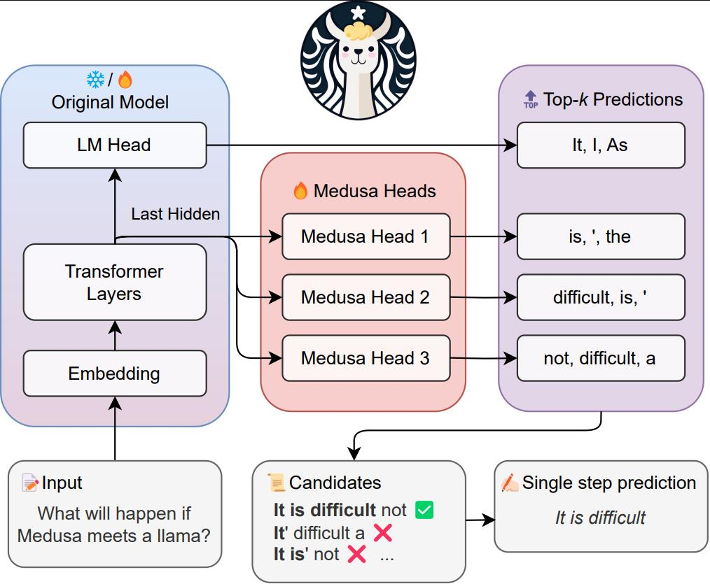

## 0. 这一篇讲什么

模型的最后一步（第 1 篇 2.2 节）输出的是下一个 token 的**概率分布**：

$$
p(x_{t+1}\mid x_{\le t}) = \mathrm{softmax}(z_t),\qquad z_t\in\mathbb R^V
$$

模型本身并不决定输出哪个 token。**解码**就是根据这个分布，一步一步选出 token、拼成序列的过程。同一个模型，用不同的解码方法，生成的文本可能截然不同。

```
问题                                做法                                     本篇
────────────────────────────────────────────────────────────────────────────────────
找概率最大的序列                      贪心、束搜索                              第 1 节
按分布随机生成，但避开长尾             温度、Top-k、Top-p、Min-p                 第 2、3 节
避免重复                             重复惩罚、频率与存在惩罚                    第 4 节
多生成几个，挑最好的                   Best-of-N、自洽性、pass@k                  第 5 节
强化学习中的采样                      为什么 rollout 通常不截断                   第 6 节
输出必须满足格式                      约束解码                                   第 7 节
解码太慢                             投机解码、Medusa、EAGLE、MTP               第 8 节
```

## 1. 确定性搜索：贪心与束搜索

### 1.1 贪心搜索

每一步都选概率最大的 token：

$$
x_{t+1} = \arg\max_i\,p(i\mid x_{\le t})
$$

最快，结果确定。缺点是**只看眼前**：每一步的最优选择拼起来，不一定是整体概率最大的序列。笔记中还指出，生成长文本时贪心很容易陷入重复循环（1.3 节解释原因）。它适合答案短、格式固定的任务，如抽取、分类，以及需要可复现结果的场景。

### 1.2 束搜索

**束搜索**（beam search）每一步保留概率最高的 $B$ 条部分序列（$B$ 称为束宽）。每条序列扩展所有可能的下一个 token，得到 $B\times V$ 个候选，再从中保留累计对数概率最高的 $B$ 个。遇到结束符的序列放入完成列表，最后从中选出最好的。

下面用一个手写的小"语言模型"对比两者：

```python
import numpy as np

VOCAB = ["<eos>", "A", "B", "C"]
TABLE = {                                         # 前缀 -> 下一个 token 的概率
    ():     [0.0, 0.5, 0.4, 0.1],
    ("A",): [0.0, 0.0, 0.3, 0.7],
    ("B",): [0.0, 0.9, 0.1, 0.0],
}
def next_probs(prefix):
    if prefix in TABLE:
        return np.array(TABLE[prefix])
    return np.array([0.6, 0.2, 0.1, 0.1]) if len(prefix) < 3 else np.array([1.0, 0, 0, 0])

def greedy(max_len=4):
    seq, logp = (), 0.0
    while len(seq) < max_len:
        p = next_probs(seq); t = int(np.argmax(p))
        logp += np.log(p[t]); seq += (VOCAB[t],)
        if t == 0: break
    return seq, logp

def beam_search(beam=2, max_len=4, alpha=0.0):
    beams, done = [((), 0.0)], []
    for _ in range(max_len):
        cand = []
        for seq, lp in beams:
            p = next_probs(seq)
            for t in np.nonzero(p)[0]:
                cand.append((seq + (VOCAB[t],), lp + np.log(p[t])))
        cand.sort(key=lambda c: -c[1])
        beams = []
        for seq, lp in cand:
            (done if seq[-1] == "<eos>" else beams).append((seq, lp))
            if len(beams) == beam: break
        if not beams: break
    lp_norm = lambda s, lp: lp / (((5 + len(s)) / 6) ** alpha)   # 长度惩罚，见 1.3 节
    return max(done + beams, key=lambda c: lp_norm(*c))

s, lp = greedy();             print("贪心  :", s, round(float(np.exp(lp)), 3))   # ('A', 'C', '<eos>') 0.21
s, lp = beam_search(beam=2);  print("束搜索:", s, round(float(np.exp(lp)), 3))   # ('B', 'A', '<eos>') 0.216
```

第一步 A 的概率（0.5）高于 B（0.4），贪心选了 A；但 B 之后接 A 的概率高达 0.9，整体上 "B A" 更好。束宽为 2 时，B 被保留了下来，束搜索找到了概率更高的序列。

### 1.3 束搜索的问题

**偏好短序列.** 每多一个 token，累计对数概率就多加一个负数，所以越短的序列分数越高，束搜索倾向于过早结束。常用的修正是**长度惩罚**，GNMT（Wu et al., 2016）的形式是

$$
\mathrm{score}(Y) = \frac{\log p(Y)}{\mathrm{lp}(Y)},\qquad \mathrm{lp}(Y) = \left(\frac{5 + |Y|}{6}\right)^\alpha
$$

原始 Transformer 的翻译实验用了束宽 4、$\alpha = 0.6$（第 1 篇第 4 节）。

**束越宽不一定越好.** 在机器翻译中，把束宽加大到几十、上百，翻译质量反而下降（Koehn & Knowles, 2017），因为搜索找到的高概率序列常常是很短或空洞的句子。这说明**模型给出的最高概率序列并不等于最好的序列**。

**开放式生成中的退化.** Holtzman et al.（2020）系统分析了这一点。对于故事续写、对话这类开放式生成，贪心和束搜索产生的文本平淡、重复，常常陷入循环。他们发现两个原因：

- **重复会自我强化**：一个短语每重复一次，模型对它再次出现的概率估计就更高，形成正反馈，一旦开始重复就停不下来；
- **人写的文本并不是概率最大的文本**：人类文本中每个 token 的概率起伏很大，经常出现模型认为不太可能、但信息量大的词。追求最大概率的搜索会系统性地避开这些词，生成的文本"太安全"。笔记中的说法是，束搜索生成的句子通常太"安全平庸"，缺乏人情味。

所以今天的大语言模型在开放式生成中几乎都使用**采样**。束搜索仍用于机器翻译、语音识别等答案相对确定的任务。

## 2. 温度

采样的出发点是：直接从模型的分布 $p$ 中随机抽取下一个 token。这样生成的文本在统计上更接近训练数据，但完全按原分布采样会时不时抽中长尾中的低质量 token，一旦抽错，后面的生成会越走越偏。所以实践中要对分布做一些调整：温度改变分布的形状，第 3 节的截断方法去掉长尾。

在 softmax 之前把 logits 除以温度 $T$：

$$
p_T(i) = \frac{\exp(z_i/T)}{\sum_j\exp(z_j/T)}
$$

- $T = 1$：原始分布；
- $T<1$：分布更尖锐，高概率的 token 更占优，生成更确定、保守；
- $T>1$：分布更平坦，低概率的 token 更容易被选中，生成更多样，也更容易出错；
- $T\to 0$：退化为贪心（全部概率集中到最大的 logit）；$T\to\infty$：趋于均匀分布。

可以证明分布的熵随 $T$ 单调递增。一个例子：

```
logits = [3.0, 2.5, 1.0, 0.5, -1.0, -2.0]
T=0.5: p=[0.718 0.264 0.013 0.005 0.    0.   ]  熵=0.67
T=1.0: p=[0.541 0.328 0.073 0.044 0.01  0.004]  熵=1.09
T=2.0: p=[0.377 0.294 0.139 0.108 0.051 0.031]  熵=1.50
```

温度只改变各 token 概率的**相对大小**，不改变它们的**排序**。

## 3. 截断：去掉分布的长尾

温度调低可以减少抽中长尾的概率，但也会让整个分布变得过于确定。截断方法直接把长尾的概率置为 0，然后在剩下的 token 中重新归一化、采样。

### 3.1 Top-k

只保留概率最高的 $k$ 个 token（Fan et al., 2018）：

$$
\mathcal V_k = \{k \text{ 个概率最高的 token}\},\qquad \tilde p(i) = \frac{p(i)\,\mathbb 1[i\in\mathcal V_k]}{\sum_{j\in\mathcal V_k}p(j)}
$$

问题是 $k$ 固定，不管模型对下一个词是很确定还是很犹豫。笔记中的说法很准确：

- 分布很尖锐时（例如 "The capital of France is" 之后），合理的候选只有一两个，$k = 50$ 会把很多不合理的 token 留下；
- 分布很平坦时（例如一个故事的开头），合理的候选可能有几百个，$k = 50$ 又会过早地切掉很多合理的选择。

### 3.2 Top-p（核采样）

**Top-p**（nucleus sampling，Holtzman et al., 2020）按概率从高到低排序，保留**累计概率刚好达到 $p$** 的最小集合：

$$
\mathcal V_p = \text{满足}\ \sum_{i\in\mathcal V}p(i)\ge p\ \text{的最小的高概率 token 集合}
$$

候选集的大小随分布自动变化：模型确定时候选少，犹豫时候选多。这是今天最常用的截断方法，典型取值 $p = 0.9$ 或 $0.95$。

### 3.3 Min-p

Top-p 也有它的问题。温度较高时分布变平，累计到 $p$ 需要很多 token，长尾中的低质量 token 也被纳入。**Min-p**（Nguyen et al., 2024）用一个相对于最大概率的阈值：

$$
\mathcal V_{\min} = \{\,i : p(i)\ge p_{\min}\cdot\max_jp(j)\,\}
$$

例如 $p_{\min} = 0.1$：保留概率至少是最大概率十分之一的 token。最大概率很高（模型很确定）时，阈值高，只留下少数候选；最大概率很低（模型犹豫）时，阈值也低，候选变多。论文报告它在较高温度下比 Top-p 更好地兼顾了质量和多样性。

还有一些基于信息论的截断方法，例如 **typical sampling**（Meister et al., 2023）保留信息量（$-\log p(i)$）接近分布熵的 token，而不是概率最高的 token。

### 3.4 先后顺序

这些操作的顺序会影响结果。常见的做法（也是笔记中提到的）是**先温度、后截断**：先用温度调整分布形状，再在调整后的分布上做 Top-k、Top-p 或 Min-p。这样温度会影响截断后保留下来的 token 集合。不同推理框架的默认顺序不完全一样，对比实验结果时需要注意。

```python
import numpy as np

def softmax(z):
    e = np.exp(z - z.max()); return e / e.sum()

def sample_next(logits, rng, temperature=1.0, top_k=0, top_p=1.0, min_p=0.0,
                generated=(), repetition_penalty=1.0, frequency_penalty=0.0, presence_penalty=0.0):
    z = logits.astype(float).copy()
    # 1) 重复惩罚（作用在 logits 上，见第 4 节）
    if generated:
        ids, counts = np.unique(np.array(generated), return_counts=True)
        if repetition_penalty != 1.0:                    # CTRL 式：正 logit 除以 θ，负 logit 乘以 θ
            z[ids] = np.where(z[ids] > 0, z[ids] / repetition_penalty, z[ids] * repetition_penalty)
        z[ids] -= frequency_penalty * counts + presence_penalty   # 按出现次数和是否出现扣分
    # 2) 温度
    if temperature == 0:
        return int(np.argmax(z))                         # 温度为 0 即贪心
    p = softmax(z / temperature)
    # 3) 截断：top-k、top-p、min-p，都是把部分 token 的概率置 0
    keep = np.ones_like(p, dtype=bool)
    order = np.argsort(-p)
    if top_k > 0:
        keep[order[top_k:]] = False
    if top_p < 1.0:
        cum = np.cumsum(p[order])
        cutoff = np.searchsorted(cum, top_p) + 1         # 最小的前缀，使累计概率 >= top_p
        keep[order[cutoff:]] = False
    if min_p > 0.0:
        keep &= p >= min_p * p.max()
    p = np.where(keep, p, 0.0)
    p /= p.sum()                                         # 4) 重新归一化后采样
    return int(rng.choice(len(p), p=p))

rng = np.random.default_rng(0)
logits = np.array([3.0, 2.5, 1.0, 0.5, -1.0, -2.0])     # 原始概率 [0.541 0.328 0.073 0.044 0.01 0.004]
def empirical(**kw):
    c = np.bincount([sample_next(logits, rng, **kw) for _ in range(20000)], minlength=6)
    return (c / c.sum()).round(3)
print("top_k=2  ", empirical(top_k=2))     # [0.619 0.381 0.    0.    0.    0.   ]
print("top_p=0.9", empirical(top_p=0.9))   # [0.574 0.35  0.076 0.    0.    0.   ]
print("min_p=0.1", empirical(min_p=0.1))   # [0.574 0.347 0.079 0.    0.    0.   ]
print("重复惩罚  ", empirical(generated=[0, 0, 1], frequency_penalty=0.5, presence_penalty=0.5))
# [0.325 0.328 0.196 0.116 0.026 0.009]
```

Top-p 取 0.9 时，前两个 token 的累计概率是 0.869，还不到 0.9，所以保留了前三个；这个例子中 Min-p 恰好保留了同样的三个 token。

## 4. 重复的控制

1.3 节说过，重复会自我强化。采样能缓解但不能完全消除重复，常用的补救是在 logits 上直接惩罚已经出现过的 token：

- **重复惩罚**（repetition penalty，Keskar et al., 2019 的 CTRL）：对已出现过的 token，正的 logit 除以 $\theta$，负的 logit 乘以 $\theta$（$\theta>1$，常取 1.1 到 1.3），即无论正负都往"更不可能"的方向推；
- **频率惩罚与存在惩罚**（OpenAI API 中的 frequency / presence penalty）：

$$
z_i\leftarrow z_i - \alpha_{\text{freq}}\cdot c_i - \alpha_{\text{pres}}\cdot\mathbb 1[c_i>0]
$$

  $c_i$ 是 token $i$ 已经出现的次数。频率惩罚随次数线性增长，抑制反复使用同一个词；存在惩罚只要出现过就扣一次，鼓励引入新的话题；
- **禁止重复 n-gram**：生成时直接禁止已经出现过的 $n$ 元组再次出现，常用于摘要等任务。

这些惩罚都是启发式的，过强会伤害正常的重复（代码中的变量名、专有名词、需要原样复述的内容）。上面代码中的例子，0 号 token 出现两次、1 号出现一次，惩罚之后两者的概率被压到大致相同，其余 token 的概率相应提高。

## 5. 多次采样：Best-of-N、自洽性与 pass@k

前面的方法都是一次生成一个回答。另一类做法是对同一个问题**采样多个回答**，再从中选择或汇总。

**Best-of-N.** 笔记中的描述：对同一个提示词随机生成 $N$ 个完整的回答，用一个打分模型（通常是奖励模型）选出得分最高的一个。它从完整回答的层面择优，效果上限很高，但推理成本是 $N$ 倍。它常被用作强化学习对齐的基线，或者用来构造偏好数据和拒绝采样微调的数据。

**自洽性**（self-consistency，Wang et al., 2023）：对推理题采样多条思维链，取最终答案的**多数票**。不需要奖励模型，利用的是"正确答案往往可以由多条不同的推理路径得到，而错误答案各不相同"。

**pass@k.** 代码和数学任务中常用的评测指标：对每道题采样 $k$ 个回答，只要有一个正确就算通过。直接采样 $k$ 次估计方差很大，Chen et al.（2021）给出了一个无偏估计：每道题采样 $n\ge k$ 次，其中 $c$ 个正确，则

$$
\text{pass@}k = \mathbb E\left[1 - \frac{\binom{n-c}{k}}{\binom{n}{k}}\right]
$$

$\binom{n-c}{k}/\binom nk$ 是从 $n$ 个回答中随机挑 $k$ 个、全部错误的概率。pass@$k$ 与 pass@1 的差距常被用来衡量模型的"潜力"：如果 pass@$k$ 远高于 pass@1，说明模型有能力解出很多题，只是不稳定，这正是强化学习可以进一步提升的空间。

这些方法的效果都依赖采样的**多样性**，温度太低时 $N$ 个回答几乎一样，多采样就失去了意义。

## 6. 强化学习中的采样

在大模型的强化学习（如 PPO、GRPO）中，模型生成回答（rollout），根据奖励更新策略。这里的采样方式有一个容易被忽略的要求：策略梯度

$$
\nabla_\theta J = \mathbb E_{y\sim\pi_\theta}\big[A(y)\,\nabla_\theta\log\pi_\theta(y)\big]
$$

要求回答 $y$ 是**从 $\pi_\theta$ 本身**采样的。如果 rollout 时用了温度或截断，实际的采样分布就变成了一个被修改过的分布 $\tilde\pi$，而计算 $\log\pi_\theta(y)$ 时用的是原始分布，两者不一致，梯度估计就有偏差。截断的影响尤其明显：被截掉的 token 在 $\tilde\pi$ 下概率为 0，模型永远不会探索到它们，但 $\pi_\theta$ 认为它们仍有概率。

所以强化学习的 rollout 通常使用 **$T = 1$、不做 Top-k / Top-p 截断**，让采样分布与训练时的策略一致；如果为了稳定使用了其他温度，计算对数概率时也要用同样的温度。这种"训练与推理不一致"（training-inference mismatch）的问题，在 rollout 由一个推理引擎生成、而对数概率由训练框架重新计算时也会出现（两者的数值实现不同），近来的工作会用重要性采样对此做修正。

温度也直接影响强化学习的**探索**：温度越高，采样越多样，越容易发现新的解法，但也更容易产生无意义的输出。训练过程中策略的熵通常会逐渐下降（熵塌缩），模型越来越确定、越来越少探索，这是 Agentic RL 中需要监控的指标之一。

## 7. 约束解码

很多应用要求输出满足严格的格式：合法的 JSON、符合某个 schema 的函数调用参数、某种语法的代码。**约束解码**在每一步把不可能产生合法输出的 token 的 logit 设为 $-\infty$：

$$
z_i\leftarrow -\infty\quad\text{若 token } i \text{ 会使当前前缀无法再被补全为合法输出}
$$

实现上，把格式描述（JSON schema、正则表达式、上下文无关文法）编译成一个自动机，生成时跟踪自动机的状态，每一步只允许能让自动机继续前进的 token。难点在于 token 和字符不一一对应：一个 token 可能包含多个字符，跨越多个语法单元，所以要预先计算每个自动机状态下哪些 token 合法。

约束解码保证了格式，但它强行改变了分布，可能让模型被迫走上一条它本来不会选择的路径，导致内容质量下降。一般的做法是让模型先在不受约束的情况下推理，最后再用约束生成结构化的结果。

## 8. 投机解码

### 8.1 解码为什么慢

第 3 篇 2.3 节讲过，解码阶段每生成一个 token 都要把整个模型的权重从显存读一遍，算术强度很低，GPU 大部分时间在等数据。**生成 1 个 token 和"并行地检查"几个 token 花的时间几乎一样**，因为瓶颈在读权重，而不在计算。投机解码利用的正是这一点。

### 8.2 算法

**投机解码**（speculative decoding，Leviathan et al., 2023；Chen et al., 2023 称为 speculative sampling）用一个小而快的**草稿模型** $q$ 和要加速的**目标模型** $p$：

1. 草稿模型自回归地生成 $\gamma$ 个 token $x_1,\dots,x_\gamma$（很快）；
2. 目标模型对"前缀 + 这 $\gamma$ 个 token"做**一次**前向传播，得到每个位置上的分布 $p(\cdot\mid\dots)$（与生成 1 个 token 的时间差不多）；
3. 从第一个草稿 token 开始逐个验证：以概率 $\min\big(1, p(x_i)/q(x_i)\big)$ **接受** $x_i$；
4. 一旦某个 $x_i$ 被拒绝，就从**残差分布**中重新采样一个 token 替代它，后面的草稿全部丢弃：

$$
x_i'\sim\frac{\max\big(0,\ p(\cdot) - q(\cdot)\big)}{\sum_x\max\big(0,\ p(x) - q(x)\big)}
$$

5. 如果 $\gamma$ 个全部被接受，目标模型在最后一个位置的分布上再额外采样一个 token。

每一轮至少产生 1 个 token（最坏情况下和普通解码一样），最多产生 $\gamma + 1$ 个。

### 8.3 为什么输出分布完全不变

投机解码最重要的性质：**输出的 token 严格服从目标模型的分布 $p$**，不是近似。对单个位置证明：最终输出 $x$ 有两种途径，

- 草稿提议 $x$ 并被接受：概率 $q(x)\cdot\min\big(1, p(x)/q(x)\big) = \min\big(q(x), p(x)\big)$；
- 草稿被拒绝后从残差分布中采样到 $x$：拒绝的总概率是 $1 - \sum_x\min(q(x), p(x)) = \sum_x\max(0, p(x) - q(x))$，再乘以残差分布中 $x$ 的概率，正好是 $\max\big(0, p(x) - q(x)\big)$。

两者相加：$\min(q, p) + \max(0, p - q) = p(x)$。所以投机解码是**无损**的加速。下面用模拟验证：

```python
import numpy as np
rng = np.random.default_rng(0)
V = 5
p = np.array([0.40, 0.25, 0.20, 0.10, 0.05])   # 目标模型的分布
q = np.array([0.10, 0.50, 0.20, 0.15, 0.05])   # 草稿模型的分布

def speculative_step():
    x = rng.choice(V, p=q)                       # 草稿模型提议
    if rng.random() < min(1.0, p[x] / q[x]):     # 以 min(1, p/q) 的概率接受
        return x, True
    r = np.maximum(p - q, 0); r /= r.sum()       # 拒绝时从残差分布重新采样
    return rng.choice(V, p=r), False

out = [speculative_step() for _ in range(200000)]
freq = np.bincount([x for x, _ in out], minlength=V) / len(out)
print("输出分布:", freq.round(3), " 目标分布:", p)
# 输出分布: [0.4   0.251 0.2   0.099 0.05 ]  目标分布: [0.4  0.25 0.2  0.1  0.05]
print("接受率:", np.mean([a for _, a in out]).round(3), " 理论值:", np.minimum(p, q).sum())
# 接受率: 0.7  理论值: 0.7
```

### 8.4 能快多少

单个草稿 token 的接受率是 $\alpha = \sum_x\min\big(p(x), q(x)\big)$，即两个分布的重叠程度。若各位置独立、接受率都是 $\alpha$，每轮期望产生的 token 数为

$$
\mathbb E[\text{tokens}] = \frac{1 - \alpha^{\gamma+1}}{1 - \alpha}
$$

$\alpha = 0.8$、$\gamma = 4$ 时约为 3.4 个。实际加速比还要扣掉草稿模型的开销。草稿模型越接近目标模型、越便宜，加速越明显。对于代码、格式化文本这类可预测性高的内容，接受率很高，加速也最明显。

### 8.5 草稿从哪里来

独立的小模型需要与目标模型共享分词器，还要单独部署。后来的方法让目标模型自己产生草稿：

- **Medusa**（Cai et al., 2024）：在目标模型最后一层的隐藏状态上加几个额外的解码头，第 $k$ 个头直接预测第 $t+k+1$ 个 token。各头的 top 候选组合成一棵候选树，用**树注意力**（特殊的注意力掩码）在一次前向中同时验证多条候选路径；



*图 1：Medusa 的结构。原模型的 LM Head 预测下一个 token，几个 Medusa 头基于同一个最后隐藏状态分别预测之后第 2、3、4 个位置的 token；各头的 top-$k$ 预测组合成候选序列，经原模型一次验证后接受最长的合法前缀。图片来源：Cai et al., "Medusa: Simple LLM Inference Acceleration Framework with Multiple Decoding Heads", ICML 2024, Figure 1。*

- **EAGLE**（Li et al., 2024）：草稿不是直接从隐藏状态预测 token，而是用一个很小的网络在**特征层面**做自回归（预测下一个位置的隐藏状态，再经过原模型的 LM Head 得到 token），并把已采样的 token 作为输入，降低了不确定性，接受率比 Medusa 更高；
- **MTP**（multi-token prediction）：DeepSeek-V3 在训练时加入了一个多 token 预测模块，用额外的训练信号预测更远的 token。训练完成后这个模块可以直接作为投机解码的草稿，DeepSeek-V3 报告第二个 token 的接受率在 85% 到 90% 之间，解码速度约提高到 1.8 倍。

这些方法都可以与第 2、3 节的采样配合使用（验证时按 8.2 节的规则对采样后的分布做接受和拒绝），也可以用于贪心解码（只要草稿与目标模型的 argmax 一致就接受）。

## 9. 总结

| 方法 | 做什么 | 优点 | 缺点 | 适用 |
|---|---|---|---|---|
| 贪心 | 每步取最大 | 快、确定 | 短视、易重复 | 抽取、分类、可复现 |
| 束搜索 | 保留 $B$ 条最优路径 | 更接近全局最优 | 平庸、重复、成本 $B$ 倍 | 翻译、语音识别 |
| 温度 | 调整分布形状 | 控制确定性与多样性 | 单独使用不去除长尾 | 几乎所有采样 |
| Top-k | 保留前 $k$ 个 | 简单 | $k$ 不随分布变化 | 较少单独使用 |
| Top-p | 保留累计概率 $p$ 的集合 | 候选集自适应 | 高温时纳入长尾 | 最常用 |
| Min-p | 保留 $\ge p_{\min}\cdot p_{\max}$ 的 token | 阈值随置信度变化 | 较新 | 高温度、创意生成 |
| 重复惩罚 | 压低已出现 token 的 logit | 减少循环 | 启发式，过强会伤害内容 | 长文本生成 |
| Best-of-N / 自洽性 | 采样多个再选择或投票 | 质量上限高 | 成本 $N$ 倍 | 推理、数据构造、RL |
| 约束解码 | 屏蔽不合法的 token | 保证格式 | 可能降低内容质量 | JSON、函数调用 |
| 投机解码 | 草稿 + 并行验证 | 无损加速 | 需要草稿模型或头 | 推理服务 |

- 模型只给出分布，解码决定输出。**最大概率的序列不等于最好的序列**，开放式生成用采样而不是搜索；
- 采样的工具分两类：**温度**改变分布的形状，**截断**（Top-k、Top-p、Min-p）去掉长尾。通常先温度、后截断；
- **重复惩罚**是对"重复自我强化"的启发式补救；
- **多次采样**（Best-of-N、自洽性）用计算换质量，pass@$k$ 衡量模型的潜力；强化学习的 rollout 一般用 $T = 1$、不截断，以保证采样分布与策略一致；
- **投机解码**利用解码阶段访存瓶颈下"验证几个 token 和生成一个 token 一样快"的特点，在**不改变输出分布**的前提下加速生成；Medusa、EAGLE、MTP 让目标模型自己产生草稿。

## 参考文献

- Wu et al. *Google's Neural Machine Translation System: Bridging the Gap between Human and Machine Translation.* 2016.
- Koehn & Knowles. *Six Challenges for Neural Machine Translation.* 2017.
- Vaswani et al. *Attention Is All You Need.* NeurIPS 2017.
- Fan, Lewis & Dauphin. *Hierarchical Neural Story Generation.* ACL 2018.
- Keskar et al. *CTRL: A Conditional Transformer Language Model for Controllable Generation.* 2019.
- Holtzman et al. *The Curious Case of Neural Text Degeneration.* ICLR 2020.
- Chen et al. *Evaluating Large Language Models Trained on Code.* 2021.
- Wang et al. *Self-Consistency Improves Chain of Thought Reasoning in Language Models.* ICLR 2023.
- Meister et al. *Locally Typical Sampling.* TACL 2023.
- Leviathan, Kalman & Matias. *Fast Inference from Transformers via Speculative Decoding.* ICML 2023.
- Chen et al. *Accelerating Large Language Model Decoding with Speculative Sampling.* 2023.
- Cai et al. *Medusa: Simple LLM Inference Acceleration Framework with Multiple Decoding Heads.* ICML 2024.
- Li et al. *EAGLE: Speculative Sampling Requires Rethinking Feature Uncertainty.* ICML 2024.
- Nguyen et al. *Turning Up the Heat: Min-p Sampling for Creative and Coherent LLM Outputs.* 2024.
- DeepSeek-AI. *DeepSeek-V3 Technical Report.* 2024.
